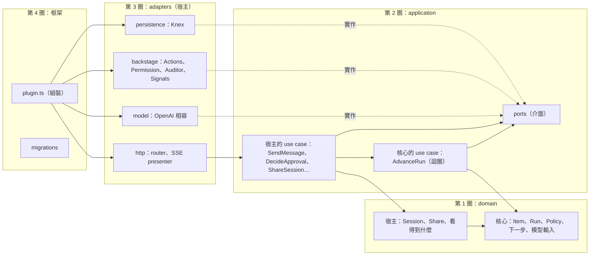
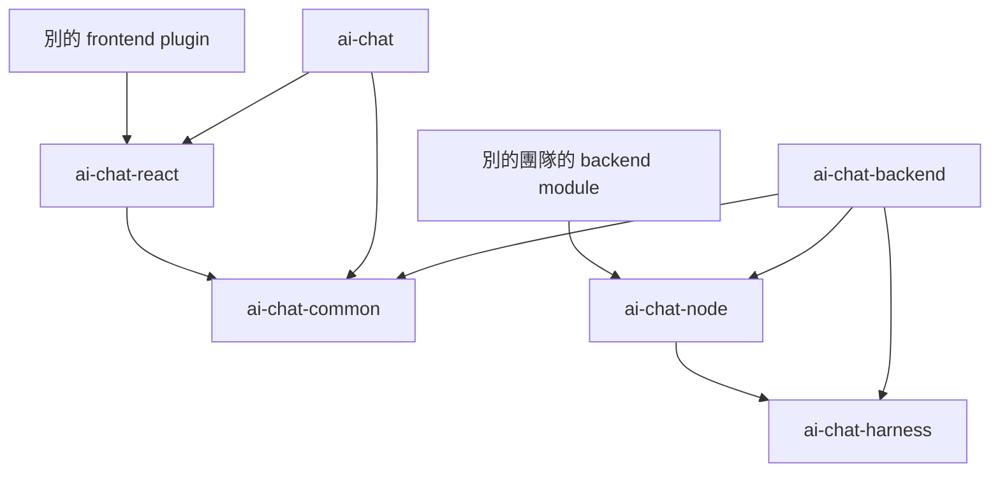

# AI Chat Harness 程式架構

| 欄位     | 內容                                                                                                   |
| -------- | ------------------------------------------------------------------------------------------------------ |
| 狀態     | 已定案，進入實作                                                                                       |
| 版本     | 1.0（2026-11-24）                                                                                      |
| 對應規格 | [harness-spec.zh-TW.md](harness-spec.zh-TW.md) 1.0，主要是 D-15 到 D-19、D-23、D-25，以及需求 4.9（A） |
| 下一份   | [implementation-plan.zh-TW.md](implementation-plan.zh-TW.md)                                           |

這份文件說明程式怎麼分層、每一層放什麼、介面長什麼樣。它不重複規格裡的「為什麼」。

## 1. 結論

- **照 Clean Architecture 分四圈：domain、application、adapters、框架。依賴只能往內。**
- **核心（`ai-chat-harness`）只有裡面兩圈。** 它是純 TypeScript 的函式庫，沒有任何 `@backstage/*` 的依賴。
- **宿主（`ai-chat-backend`）四圈都有。** 它裡面兩圈管 Session 和分享，外面兩圈把 Backstage 接上來。
- **所有對外的東西都在 port 後面。** 資料庫、模型、Actions Registry、Permission、Auditor、Signals、時間、亂數都是 port。換掉任何一個，只動 adapters 那一圈。
- **整個系統只有一個地方 `new` 出 adapter**：宿主的 `plugin.ts`。



## 2. 四圈的規則

| 圈            | 放什麼                                       | 可以 import                                     | 不可以 import                                        |
| ------------- | -------------------------------------------- | ----------------------------------------------- | ---------------------------------------------------- |
| 1 domain      | 型別和純函式。沒有 `async`，沒有 I/O         | 同一圈；宿主的 domain 可以 import 核心的 domain | 其他所有東西                                         |
| 2 application | use case 和 port 的介面。流程在這裡          | domain、同一圈                                  | adapters、`@backstage/*`、`express`、`knex`、`fetch` |
| 3 adapters    | port 的實作、HTTP 的 controller 和 presenter | application、domain、Backstage 和第三方套件     | 其他 adapter 的內部檔案                              |
| 4 框架        | 組裝、migration、設定的 schema               | 全部                                            | —                                                    |

另外四條：

1. **use case 的輸入和輸出是純資料。** 它不收 `Request`，不回 `Response`，不丟 HTTP 的錯誤。
2. **身分是不透明的值。** application 那一圈拿到的是 `Principal`，裡面的 `credentials` 型別是 `unknown`。只有 Backstage 的 adapter 知道它是 `BackstageCredentials`。
3. **錯誤是 domain 的錯誤。** 例如 `RunAlreadyActive`、`NotSessionOwner`。HTTP 的狀態碼由 http adapter 對應。
4. **時間和 id 都是 port。** 測試可以固定時間和 id。

## 3. 套件

| 套件                               | 路徑                       | Backstage role    | 內容                                                                         | 分期                         |
| ---------------------------------- | -------------------------- | ----------------- | ---------------------------------------------------------------------------- | ---------------------------- |
| `ai-chat-harness`                  | `packages/ai-chat-harness` | `node-library`    | 核心：domain 和 application。另有 `/testing` 入口，放假模型和記憶體版的 port | P1                           |
| `backstage-plugin-ai-chat-common`  | `plugins/ai-chat-common`   | `common-library`  | 前後端共用：HTTP 的資料型別、permission 的定義                               | P1（型別）、P2（permission） |
| `backstage-plugin-ai-chat-backend` | `plugins/ai-chat-backend`  | `backend-plugin`  | 宿主：四圈                                                                   | P1                           |
| `backstage-plugin-ai-chat`         | `plugins/ai-chat`          | `frontend-plugin` | 前端                                                                         | P1                           |
| `backstage-plugin-ai-chat-node`    | `plugins/ai-chat-node`     | `node-library`    | backend 的擴充點 `aiChatHarnessExtensionPoint`                               | P3                           |
| `backstage-plugin-ai-chat-react`   | `plugins/ai-chat-react`    | `web-library`     | 前端的擴充點：開啟對話的元件、結果顯示元件、client tool                      | P2 開始                      |

套件之間的依賴：



別的團隊只會碰到 `ai-chat-node` 和 `ai-chat-react`。它們不需要 import 宿主或核心的內部檔案。

## 4. 核心：`ai-chat-harness`

### 4.1 目錄

```
packages/ai-chat-harness/src/
  domain/                      第 1 圈
    item.ts                    Item 的型別（九種 kind）
    run.ts                     RunStatus、合法的狀態轉移
    tool.ts                    ToolDescriptor、ToolCall、ToolResult
    policy.ts                  decidePolicy()、needsApproval()
    agent.ts                   AgentDefinition、Limits
    plan.ts                    Plan、currentPlan()
    nextAction.ts              decideNextAction()：從紀錄算出下一步
    modelInput.ts              buildModelInput()：從紀錄算出送給模型的內容
    errors.ts
  application/                 第 2 圈
    ports/
      ItemLog.ts               讀和寫 Item、ItemDraft、RunFence
      ModelClient.ts           呼叫模型，回傳串流；ModelChunk
      ToolGateway.ts           列出工具、驗證、執行；CallContext、ToolOutput、ValidationResult
      RunControl.ts            續租、讀取停止要求、更新用量
      Clock.ts
      IdGenerator.ts
      extensions.ts            P3 才有內容。現在 Extensions 是空型別
    AdvanceRun.ts              迴圈
    types.ts                   AdvanceRunDeps、AdvanceRunRequest
    steps/
      callModel.ts
      executeTools.ts
    events.ts                  HarnessEvent、RunOutcome
    （還沒有：steps/summarize.ts（P1-07）、builtins/（updatePlan、loadSkill 是 P3，delegate 是 P4）、extensions 的內容（P3））
  testing/                     另一個入口：ai-chat-harness/testing
    ScriptedModel.ts           照劇本回答的假模型
    InMemoryItemLog.ts
    FakeToolGateway.ts
    fakes.ts                   FakeClock、SequentialIdGenerator、FakeRunControl
    itemLogContract.ts         ItemLog 的共用測試（A-10）
    fixture.ts                 核心迴圈測試用的組合（不對外匯出）
  index.ts
```

### 4.2 Domain

**Item** 是整個設計的中心。它是一個聯集型別，每種 `kind` 有自己的 `payload`。

```ts
export type ItemBody =
  | { kind: 'user_message'; text: string }
  | { kind: 'agent_message'; text: string }
  | {
      kind: 'tool_call';
      callId: string;
      toolId: string;
      input: JsonObject;
      schemaHash: string;
      policy: 'allow' | 'ask';
      readOnly: boolean;
      step: number;
      position: number;
    }
  | {
      kind: 'approval';
      callId: string;
      decision: 'allow' | 'deny';
      decidedBy: string;
    }
  | { kind: 'tool_started'; callId: string }
  | {
      kind: 'tool_result';
      callId: string;
      status: 'ok' | 'error' | 'timeout' | 'denied' | 'invalid' | 'unknown';
      output?: JsonValue;
      truncated?: boolean;
      message?: string;
    }
  | { kind: 'plan_update'; plan: Plan }
  | { kind: 'summary'; coversUpToSeq: number; text: string }
  | { kind: 'note'; text: string };

export type Item = ItemBody & {
  sessionId: string;
  seq: number; // 每段 Session 從 1 遞增
  runId?: string;
  createdAt: string; // ISO 8601
};
```

**三個純函式**裝了大部分的規則。它們沒有 I/O，用表格式的測試就能測完。

```ts
// 規格 D-06、T-03、T-04
export function decidePolicy(
  tool: ToolDescriptor,
  settings: PolicySettings,
): 'allow' | 'ask' | 'deny';

// 規格 D-18、D-25、H-05
export function decideNextAction(
  items: readonly Item[],
  run: RunUsage,
  limits: Limits,
): NextAction;

export type NextAction =
  | { type: 'call_model' }
  | {
      type: 'execute_tools';
      calls: ToolCallItem[];
      interrupted: ToolCallItem[];
    }
  | { type: 'wait_approval'; pending: ToolCallItem[] }
  | { type: 'complete' }
  | { type: 'stop'; reason: 'max_steps' | 'max_tool_calls' | 'timeout' };

// 規格 A-05、H-09
export function buildModelInput(
  items: readonly Item[],
  agent: AgentDefinition,
  extra: { context: string[]; tools: ToolDescriptor[] },
  budget: ContextBudget,
): ModelInput;
```

`decideNextAction` 的規則，由上往下，先符合的先用：

| 紀錄的狀態                                                              | 下一步                                                                                        |
| ----------------------------------------------------------------------- | --------------------------------------------------------------------------------------------- |
| 最後一筆對話 Item 是 `agent_message`，而且最後一步沒有未完成的呼叫      | `complete`                                                                                    |
| 總時間用完                                                              | `stop`（`timeout`）                                                                           |
| 最後一步有要核准的呼叫（`needsApproval`），還沒有 `approval` 也沒有結果 | `wait_approval`                                                                               |
| 最後一步有工具呼叫還沒有 `tool_result`                                  | `execute_tools`。有 `tool_started` 但沒有結果的放進 `interrupted`，不執行，結果寫成 `unknown` |
| Step 數用完                                                             | `stop`（`max_steps`）                                                                         |
| 工具呼叫數用完                                                          | `stop`（`max_tool_calls`）                                                                    |
| 其他（最後是使用者訊息，或工具結果都齊了）                              | `call_model`                                                                                  |

Step 數和工具呼叫數的上限只擋新的模型呼叫，不會讓最後一步的呼叫沒有結果。一步裡的呼叫超過 `maxToolCallsPerRun` 的部分，由 `callModel` 寫入時處理（見 4.3）。「要核准」的判斷是 domain 的 `needsApproval(call)`：`policy === 'ask'`，或 `readOnly !== true`。宿主也用它。

### 4.3 Application

**Ports**（核心要求外面提供的東西）：

```ts
export interface ItemLog {
  read(sessionId: string, opts?: { afterSeq?: number }): Promise<Item[]>;
  /**
   * 一次寫入多筆，序號連續（Session 的第一筆是 1）。
   * - `dedupeKeyOf` 和紀錄裡的 Item 相同，或同一批裡有兩筆相同，都丟 DuplicateItem，整批不寫入。
   * - fence 不是這個 Run 的租約持有者，或這個 Run 不屬於這段 Session，丟 LeaseLost，整批不寫入。
   */
  append(
    sessionId: string,
    drafts: ItemDraft[],
    fence: RunFence,
  ): Promise<Item[]>;
}

/** 核心要寫的內容。紀錄補上 Session、序號、Run（來自 fence）和時間。 */
export type ItemDraft = ItemBody;

export type ModelChunk =
  | { type: 'text'; text: string }
  | {
      type: 'tool_call';
      modelCallId: string; // 模型給的 id，只用來區分同一個回答裡的呼叫
      toolId: string;
      input: JsonValue; // 已解析。不是物件的輸入會得到 invalid 結果
    };

export interface ModelClient {
  /** 呼叫失敗時丟例外，迴圈把 Run 結束成 failed。signal 中止時停止。 */
  stream(
    input: ModelInput,
    opts: { signal: AbortSignal },
  ): AsyncIterable<ModelChunk>;
  readonly capabilities: { parallelToolCalls: boolean };
}

export type ValidationResult =
  | { valid: true }
  | { valid: false; message: string };

export type ToolOutput = {
  status: 'ok' | 'error' | 'timeout';
  output?: JsonValue;
  truncated?: boolean;
  message?: string;
};

export interface ToolGateway {
  list(ctx: CallContext): Promise<ToolDescriptor[]>;
  validate(
    toolId: string,
    input: JsonObject,
    ctx: CallContext,
  ): Promise<ValidationResult>;
  execute(
    call: ToolCallItem,
    ctx: CallContext,
    opts: { signal: AbortSignal },
  ): Promise<ToolOutput>;
}

export interface RunControl {
  /** 續租。租約已經不是自己的就丟 LeaseLost。 */
  heartbeat(fence: RunFence): Promise<{ cancelRequested: boolean }>;
  /**
   * 宿主把用量跟 Run 一起存下來，包含 `elapsedSeconds`（不含等核准的時間）。
   * 核准後再呼叫迴圈時，宿主把存下的用量帶進 request。
   */
  recordUsage(fence: RunFence, usage: RunUsage): Promise<void>;
}

/** 核心不解讀 principal，只把它交給 ToolGateway 和擴充點。 */
export interface CallContext {
  sessionId: string;
  runId: string;
  principal: unknown;
  page?: { path: string; entityRef?: string }; // 規格 B-01，不存進紀錄
}

/** 寫入時帶著，資料庫用它確認「這個 Run 的租約還是我的」。 */
export interface RunFence {
  runId: string;
  leaseOwner: string;
}

export interface Clock {
  now(): Date;
}
export interface IdGenerator {
  next(): string; // 核心的 port，宿主提供實作（P1 用 UUID）
}
```

**Use case：`AdvanceRun`**。這就是迴圈。它沒有成員變數形式的狀態，每一輪都重新讀紀錄。

```ts
export type AdvanceRunDeps = {
  items: ItemLog;
  model: ModelClient;
  tools: ToolGateway;
  run: RunControl;
  clock: Clock;
  ids: IdGenerator;
  extensions: Extensions; // P3 才有內容，現在是空型別
};

export type AdvanceRunRequest = {
  agent: AgentDefinition;
  limits: Limits;
  budget: ContextBudget; // P1-07 才套用
  policy: PolicySettings; // 每個呼叫的政策都用它算
  fence: RunFence;
  ctx: CallContext;
  signal: AbortSignal;
  usage: RunUsage; // 這個 Run 之前用掉的量。新的 Run 是 0，核准後接續是宿主存下的值
};

export class AdvanceRun {
  constructor(private readonly deps: AdvanceRunDeps) {}

  async *execute(
    req: AdvanceRunRequest,
  ): AsyncGenerator<HarnessEvent, RunOutcome> {
    yield { type: 'run.started', runId: req.fence.runId };
    // 每一輪：
    //   1. heartbeat；cancelRequested 或 signal 中止 → cancelled
    //   2. 讀紀錄，decideNextAction(items, usage, limits)
    //   3. call_model     → callModel(deps, req, items, usage)
    //      execute_tools  → executeTools(deps, req, items, action)
    //      wait_approval  → waiting_approval（pending 是還沒決定的呼叫）
    //      complete       → completed
    //      stop           → completed，endReason 是上限的名稱
    //   4. recordUsage
    yield { type: 'run.ended', outcome };
    return outcome;
  }
}

export type RunOutcome =
  | { status: 'completed'; endReason?: StopReason }
  | { status: 'waiting_approval'; pending: ToolCallItem[] }
  | { status: 'cancelled' }
  | { status: 'failed'; message: string; cause?: unknown };

// 內部步驟
function callModel(
  deps,
  req,
  items,
  usage,
): AsyncGenerator<HarnessEvent, CallModelResult>;
function executeTools(
  deps,
  req,
  items,
  action: { calls; interrupted },
): AsyncGenerator<HarnessEvent, 'cancelled' | undefined>;
```

要注意的地方：

- **核准之後的繼續，跟第一次執行是同一個函式。** 宿主寫入 `approval` 之後再呼叫一次 `execute()`，並帶入存下的 `usage`。迴圈讀紀錄，發現有核准過但沒結果的呼叫，就去執行。
- **已用時間不從紀錄算。** 已用時間（扣掉等核准的時間）紀錄裡沒有，由 request 帶入，迴圈每一輪之後呼叫 `recordUsage`。步數取帶入值和紀錄裡這個 Run 最大 `step` 的較大者（模型的回答是空的時候不寫任何 Item，所以帶入值不能省）。時間 = 帶入的 `elapsedSeconds` 加這次呼叫內經過的時間（用 `Clock`）。
- **步驟編號** = max(`usage.stepsUsed`，紀錄裡這個 Run 的 `tool_call` 最大的 `step`) + 1。這樣在 `recordUsage` 之前當掉，接手的 backend 也不會重複編號，或超過 `maxSteps`。
- **`callModel`**：
  - 呼叫 `buildModelInput`，Context provider 的輸出 P3 才有。
  - 被政策 `deny` 的工具不給模型看。
  - 把模型的串流轉成事件，完成後把 `agent_message` 和所有 `tool_call` 用同一次 `append` 寫入，文字在前；空白文字不寫。
  - 每個呼叫的 `callId` 在收到呼叫時由 `IdGenerator` 產生，不用模型的 id。
  - `policy` 一律由 `decidePolicy` 算。
  - 不能執行的呼叫，結果寫在同一次 `append`，排在所有 `tool_call` 之後：
    - 未知的工具、輸入不是物件、`validate` 不合格（或丟例外，訊息固定為 `The input could not be checked.`）→ `invalid`（T-05，不產生核准）。
    - 政策 `deny` → `denied`。
    - 超過 `maxToolCallsPerRun` 剩餘額度 → `denied`，訊息 `tool call limit`。
  - `tool_call` 的 `policy` 型別沒有 `deny`。立即被拒絕的呼叫存成 `ask`，靠同一批的結果把它關閉，所以不會等核准。
  - 模型沒有文字也沒有呼叫：什麼都不寫，Run 結束成 `failed`。再問一次輸入相同。
  - 模型呼叫失敗：Run 結束成 `failed`，`message` 是固定文字 `The model call failed.`，供應商的原文放 `cause`。`cause` 只給宿主記 log，不給使用者看。
  - 寫入之前再檢查一次 `signal`（驗證會 `await`）。中止的話什麼都不寫。
- **`executeTools`**：
  - 先把 `interrupted` 的呼叫寫成 `unknown`，不執行。
  - 呼叫分成批次：連續的唯讀呼叫一批，每個不是唯讀的呼叫自己一批。P1 每個呼叫依序執行；P3 的平行唯讀（D-09）只要改批次內的執行方式，結果照 `position` 寫入（P-03）。
  - 只在決定是 `allow` 時執行：需要核准的看 `approval`（`needsApproval`），其他的看政策。`deny` 寫 `denied`，不執行。沒有決定的不動。決定不是 `allow` 也不是 `deny` 時丟錯。
  - 不是唯讀的工具：先 `heartbeat`，看到 `cancelRequested` 就停止（回傳 `'cancelled'`，這個呼叫和後面的都不開始）；再寫 `tool_started`；再檢查 `signal`；才執行（D-25）。
  - 工具丟例外，或沒有回傳結果，寫成 `error`。`signal` 中止時什麼都不寫。
  - 每個 Item 準備好就寫，當掉時已完成的不會丟。
- **停止**：使用者按停止時，`heartbeat` 回 `cancelRequested`。迴圈在每一輪開頭和每個不是唯讀的呼叫之前呼叫 `heartbeat`，所以一步裡的第二個寫入工具在停止之後不會開始。
- **一步之內的時間上限**：迴圈從 `limits.runTimeoutSeconds` 減去 `usage.elapsedSeconds` 算出剩餘時間，設一個計時器，到時候中止傳給模型和工具的 `signal`。因此執行中的模型呼叫或工具在截止時間結束。這時 Run 結束成 `completed`，`endReason: 'timeout'`，不是 `cancelled`。使用者的 `signal` 先中止則是 `cancelled`。每一輪開頭仍用 `Clock` 檢查總時間。計時器已 `unref`，不會讓程序保持運作；宿主要自己讓程序活著，直到 generator 結束。沒有 HTTP server 的宿主（CLI、worker、demo 腳本）要注意：沒有別的 I/O 時，程序會直接結束，Run 沒有收尾。
- **例外**：port 丟的例外（例如 `LeaseLost`）直接丟出來，沒有 `run.ended`。宿主要自己更新 Run 的狀態。

**事件**（A-03）：

```ts
export type HarnessEvent =
  | { type: 'run.started'; runId: string }
  | { type: 'step.started'; step: number }
  | {
      type: 'item.started';
      draftId: string;
      kind: 'agent_message' | 'tool_call';
      modelCallId?: string; // tool_call：模型給的 id
    }
  | { type: 'item.delta'; draftId: string; text: string } // 不存
  | { type: 'item.completed'; draftId?: string; item: Item } // 已經寫進紀錄
  | { type: 'step.ended'; step: number }
  | { type: 'run.ended'; outcome: RunOutcome };
```

- 寫進紀錄的每一筆 Item 都回報一次 `item.completed`，依序號，包含 `tool_started` 和迴圈自己寫的結果。`approval` 由宿主寫，由宿主回報。
- `draftId`：`agent_message` 是迴圈產生的 id；`tool_call` 就是它在紀錄裡的 `callId`（同一步裡模型的 id 可能重複，所以不用模型的 id）。結果沒有 `draftId`。
- 一個 step 是一次模型呼叫：`step.started` 在呼叫之前，`step.ended` 在這次的 Item 寫完之後。工具的結果在 `step.ended` 之後。
- 模型呼叫失敗或中止時，已送出的 `item.started` 沒有對應的 `item.completed`。畫面要能忽略它們。

## 5. 宿主：`ai-chat-backend`

### 5.1 目錄

```
plugins/ai-chat-backend/
  migrations/                          第 4 圈
  config.d.ts                          第 4 圈
  src/
    domain/                            第 1 圈
      session.ts                       Session、NewSession、SessionPatch（可以改哪些欄位）
      run.ts                           Run、LeasedRun（Run 加上 fence）
      principal.ts                     Principal { userRef, ownershipRefs, credentials: unknown }
      share.ts                         Share、ShareMode、到期的處理
      visibility.ts                    visibleItems()：某個檢視者看得到哪些 Item
      fork.ts                          forkItems()：複製時帶走哪些 Item
      toolset.ts                       Toolset、enabledTools()
      retention.ts
      errors.ts                        SessionNotFound、RunNotFound、RunAlreadyActive（P1-05）；NotSessionOwner…（P1-08）
    application/                       第 2 圈
      ports/
        SessionRepository.ts           create、get、listByOwner、update、delete
        RunRepository.ts               start、acquireLease、transition、requestCancel、expireStale。也實作核心的 RunControl（heartbeat、recordUsage）
        ShareRepository.ts             P2
        AccessControl.ts               能不能讀這段 Session、能不能用這個 Toolset
        AuditLog.ts
        Notifier.ts                    P2：通知畫面「狀態變了」
        AgentCatalog.ts                有哪些 Agent、Toolset
        Scheduler.ts                   定期工作
      usecases/
        CreateSession.ts
        GetSession.ts                  回傳 Session 和檢視者看得到的 Item
        ListSessions.ts
        UpdateSession.ts               改名、釘選、封存、開關 Toolset
        DeleteSession.ts
        SendMessage.ts
        DecideApproval.ts
        CancelRun.ts
        FollowSession.ts               P2：接回（從目前 Run 的第一個 Item 重送）
        ShareSession.ts                P2
        UpdateShare.ts                 P2：更新快照、開關工具輸出、停止
        ForkSession.ts                 P2
        ExpireStaleRuns.ts
        PurgeExpiredSessions.ts        P2
      RunSupervisor.ts                 這一台正在跑的 Run：啟動、續租、訂閱、關機
    adapters/                          第 3 圈
      http/
        router.ts
        controllers/                   每個 use case 一個，只做轉換
        presenters/uiMessageStream.ts  HarnessEvent 轉成 UI message stream
        errorMapping.ts                domain 的錯誤轉成 HTTP 狀態碼
      persistence/
        KnexItemLog.ts
        KnexSessionRepository.ts
        KnexRunRepository.ts
        KnexShareRepository.ts         P2
        uniqueViolation.ts             判斷資料庫的唯一性錯誤（SQLite、PostgreSQL 各一種格式）
      backstage/
        ActionsToolGateway.ts          Actions Registry 轉成 ToolGateway
        PermissionAccessControl.ts
        AuditorAuditLog.ts
        SignalsNotifier.ts
        ConfigAgentCatalog.ts
        principalFromRequest.ts        httpAuth、userInfo 轉成 Principal
        BackstageScheduler.ts
      model/
        OpenAiCompatibleModelClient.ts
      system/
        SystemClock.ts
        UuidGenerator.ts
    plugin.ts                          第 4 圈：組裝
    index.ts
```

### 5.2 Domain

宿主的 domain 管「誰」和「看得到什麼」。這些是核心不知道的事。

```ts
// 規格 SH-02、SH-08、SH-09、SH-11
export function visibleItems(
  items: readonly Item[],
  viewer: { isOwner: true } | { isOwner: false; share: Share },
  now: string,
): VisibleItem[];

// 規格 SH-04
export function forkItems(visible: readonly VisibleItem[]): ItemDraft[];

// 規格 T-02、T-11、D-24
export function enabledTools(
  all: readonly ToolDescriptor[],
  toolsets: readonly Toolset[],
  sessionChoice: readonly string[],
): ToolDescriptor[];
```

`visibleItems` 的規則：

| 檢視者       | 看得到的 Item                    | 工具輸出                                                                |
| ------------ | -------------------------------- | ----------------------------------------------------------------------- |
| 擁有者       | 全部                             | 全部                                                                    |
| 快照分享     | 序號不超過 `up_to_seq` 的        | 序號不超過 `outputs_up_to_seq` 的。超過的只留狀態，輸出換成「沒有分享」 |
| 持續更新     | 全部                             | 同上。預設 `outputs_up_to_seq` 是分享當下的序號                         |
| 過了到期時間 | 當成快照，停在到期當下的最後一筆 | 同上                                                                    |

### 5.3 Use case

每個 use case 一個類別，只有一個 `execute` 方法。

| Use case                      | 做什麼                                            | 用到的 port                                                | 規格                   |
| ----------------------------- | ------------------------------------------------- | ---------------------------------------------------------- | ---------------------- |
| `CreateSession`               | 建立 Session，套用 Toolset 的預設值               | SessionRepository、AgentCatalog                            | SE-01、T-01            |
| `GetSession`                  | 檢查權限，回傳 Session、Run 的狀態、看得到的 Item | SessionRepository、ItemLog、AccessControl、ShareRepository | SH-02、SH-05           |
| `UpdateSession`               | 改名、釘選、封存、開關 Toolset                    | SessionRepository、AgentCatalog                            | SE-03、T-11            |
| `SendMessage`                 | 建立 Run、寫入使用者訊息、啟動迴圈、回傳事件串流  | RunRepository、ItemLog、RunSupervisor、AccessControl       | H-01、H-03、B-01       |
| `DecideApproval`              | 寫入 `approval`。全部決定後重新啟動迴圈           | ItemLog、RunRepository、RunSupervisor、AuditLog            | D-05、T-06、T-07、P-04 |
| `CancelRun`                   | 設定停止要求。Run 在這一台就直接中止              | RunRepository、RunSupervisor                               | H-06                   |
| `FollowSession`               | 從目前 Run 的第一個 Item 重送，再接上即時事件     | ItemLog、RunSupervisor、AccessControl                      | A-07                   |
| `ShareSession`、`UpdateShare` | 建立和修改分享                                    | ShareRepository、ItemLog、AuditLog、Notifier               | SH-01、SH-06 到 SH-11  |
| `ForkSession`                 | 複製成自己的 Session                              | SessionRepository、ItemLog、AccessControl、AuditLog        | SH-04                  |
| `ExpireStaleRuns`             | 租約過期的 Run 標成 `expired`                     | RunRepository                                              | H-04                   |
| `PurgeExpiredSessions`        | 刪除超過保存期限的 Session                        | SessionRepository                                          | SE-05                  |

`SendMessage` 的樣子：

```ts
export class SendMessage {
  constructor(
    private readonly deps: {
      sessions: SessionRepository;
      runs: RunRepository;
      items: ItemLog;
      access: AccessControl;
      supervisor: RunSupervisor;
      agents: AgentCatalog;
    },
  ) {}

  async execute(input: {
    principal: Principal;
    sessionId: string;
    text: string;
    page?: { path: string; entityRef?: string };
  }): Promise<RunSubscription> {
    const session = await this.deps.sessions.get(input.sessionId);
    assertOwner(session, input.principal); // 丟 NotSessionOwner

    const run = await this.deps.runs.start(session.id); // 丟 RunAlreadyActive
    await this.deps.items.append(
      session.id,
      [{ kind: 'user_message', text: input.text }],
      run.fence,
    );
    return this.deps.supervisor.launch(run, {
      agent: await this.deps.agents.get(session.agentId),
      ctx: {
        sessionId: session.id,
        runId: run.id,
        principal: input.principal,
        page: input.page,
      },
    });
  }
}
```

### 5.4 `RunSupervisor`

它管理「這一台 backend 正在跑的 Run」。它在 application 那一圈，只用 port。

- **啟動**：呼叫核心的 `AdvanceRun.execute()`，在背景消費事件。HTTP 的回應只是其中一個訂閱者。
- **訂閱**：每個 Run 可以有多個訂閱者。訂閱者斷線不影響 Run（H-07、A-06）。
- **續租**：核心每一輪呼叫一次 `heartbeat`；執行不是唯讀的工具之前也會呼叫，讓停止要求在兩個寫入工具之間生效。模型呼叫很久時，另外有計時器每 10 秒續租一次。租約長度 30 秒。
- **結束**：依照 `RunOutcome` 更新 Run 的狀態，清掉 `active_session_id`，通知 Notifier。
- **關機**：停止接新的 Run。等進行中的 Run 最多 20 秒。沒跑完的中止並標成 `expired`（H-11）。

租約在 `KnexRunRepository` 裡的規則。同時進來的呼叫由資料庫決定：`start` 靠唯一索引，`heartbeat`、`recordUsage`、`acquireLease`、`requestCancel`、`expireStale` 各是一個帶條件的 UPDATE，`transition` 在 transaction 裡先 `SELECT … FOR UPDATE` 再 UPDATE：

- `start`：INSERT 一個 `running` 的 Run，期限是現在加租約長度。`lease_owner` 是用 `IdGenerator` 產生的新值（UUID），每次 `start` 和每次 `acquireLease` 都產生一個，fence 就是 `{runId, leaseOwner}`；同一台 backend 再接手同一個 Run 也拿到不同的 fence，舊的迴圈寫入、續租都會被拒絕。`active_session_id` 的唯一索引擋下第二個進行中的 Run，adapter 把它轉成 `RunAlreadyActive`（H-03）。
- `heartbeat`：`lease_owner` 是自己、狀態是 `running` 才更新期限，同時回傳 `cancel_requested`。否則丟 `LeaseLost`。`recordUsage` 的條件相同。
- `acquireLease`：接手一個 Run。條件是狀態為 `waiting_approval`，或狀態為 `running` 而租約沒有主人或已過期。有效的租約不能再接手，持有者自己也一樣。同時有多個呼叫（不論同一台或不同台）時只有一個拿到；等核准的 Run 這時改成 `running`。
- `transition`：`waiting_approval` 和結束的狀態都會清掉租約；結束的狀態同時清掉 `active_session_id`，讓這段 Session 可以開新的 Run。帶 `leaseOwner` 時不是這個持有者就丟 `LeaseLost`；不帶時是宿主替使用者操作（例如取消一個等核准的 Run）。
- `expireStale`：狀態 `running` 而 `lease_expires_at` 已過的 Run 標成 `expired`，`end_reason` 是 `lease_expired`。等核准的 Run 沒有租約，不在其中。
- 租約長度預設 30 秒（建構時可指定）。
- 各台 backend 的時鐘要同步：租約期限和過期判斷用的是各台自己的時鐘，誤差要小於租約長度減續租間隔（目前 30 − 10 = 20 秒）。

### 5.5 Adapters

| Port                                                               | Adapter                        | 用到的 Backstage 服務                                                             |
| ------------------------------------------------------------------ | ------------------------------ | --------------------------------------------------------------------------------- |
| `ItemLog`、`SessionRepository`、`RunRepository`、`ShareRepository` | `Knex*`                        | `coreServices.database`                                                           |
| `ToolGateway`                                                      | `ActionsToolGateway`           | `actionsServiceRef`（`@backstage/backend-plugin-api/alpha`）的 `list` 和 `invoke` |
| `ModelClient`                                                      | `OpenAiCompatibleModelClient`  | 沒有。用 `fetch`                                                                  |
| `AccessControl`                                                    | `PermissionAccessControl`      | `coreServices.permissions`（P2 之前只檢查擁有者）                                 |
| `AuditLog`                                                         | `AuditorAuditLog`              | `coreServices.auditor`                                                            |
| `Notifier`                                                         | `SignalsNotifier`              | `signalsServiceRef`。沒有安裝時用不做事的版本                                     |
| `AgentCatalog`                                                     | `ConfigAgentCatalog`           | `coreServices.rootConfig`，加上擴充點註冊的內容                                   |
| `Scheduler`                                                        | `BackstageScheduler`           | `coreServices.scheduler`                                                          |
| `Clock`、`IdGenerator`                                             | `SystemClock`、`UuidGenerator` | 沒有                                                                              |
| （HTTP 的身分）                                                    | `principalFromRequest`         | `coreServices.httpAuth`、`coreServices.userInfo`                                  |

`ActionsToolGateway` 負責的轉換。它是 adapter 裡唯一用到 `actionsServiceRef` 的檔案（V-02）。`plugin.ts` 的組裝，以及舊的 `ChatService`、`ToolCatalog` 是例外，P1-08、P1-09 會刪掉它們：

- 建構時收到 `actions`（`ActionsService`）、`catalog`（`AgentCatalog`）、`logger`、`maxOutputChars`，以及 `enabledToolsets(ctx)`：回傳這個 Session 開啟的 Toolset id，`undefined` 表示沒選過，用預設值（`default: true` 的組）。
- `list`：用呼叫者的憑證呼叫 `actions.list`。要 `secrets` 的 action 不給（聊天沒辦法提供）。每個 action 轉成 `ToolDescriptor`：`id` 是 action id，`readOnly` 只有 `attributes.readOnly === true` 才是 `true`，沒有標的當成不是唯讀（D-06）；`egress` 由 Toolset 算出（所屬的任一組標了 `egress` 就是）；`inputSchema` 是 action 的 input schema 去掉 `$schema`，不是 object 型別時換成空的 object schema；`schemaHash` 是這份 schema 排序鍵之後的 SHA-256（T-06）。最後用 domain 的 `enabledTools` 只留下 Session 開啟的 Toolset 裡的工具（T-02、T-11）；不在任何 Toolset 的 action 不會出現。
- `validate`：用 `ajv`（draft-07，不檢查 `format`）驗證參數。找不到工具、schema 編不出來，都回傳不合格；訊息是 ajv 的錯誤文字，最多 2000 字（T-05）。
- `execute`：先用現在的 action 和政策檢查這筆存下來的呼叫（T-06）。政策在提出呼叫時和執行前各檢查一次。工具已經不在清單裡、呼叫存成唯讀但 action 現在不是唯讀、`schemaHash` 變了而存下的輸入不符合新 schema、現在的政策是 `deny`、或存下時不需核准而現在政策要 `ask`（例如事後改成 `egress`），都不執行，回傳 `error` 結果。存下時要核准的呼叫，核准之後現在的政策仍是 `ask` 就照常執行。通過就把 `CallContext.principal` 的 `credentials` 交給 `actions.invoke`。`invoke` 沒有 signal 參數，所以 signal 中止時不再等它並丟出例外（核心看到 signal 已中止就不寫結果）；action 本身可能仍會跑完。action 丟出的例外轉成 `error` 結果。回傳值一律整理成 `ToolOutput` 物件：沒有值是 `{ status: 'ok' }`，字串、數字、`null`、陣列放進 `output`；序列化後超過 `maxOutputChars` 的，`output` 換成 `{ text, originalLength }`（序列化後不超過 `maxOutputChars`），`truncated: true`。
- 政策的警告：政策把不是唯讀或屬於 `egress` Toolset 的 action 設成 `allow` 時，第一次在 `list` 看到它就記一筆警告，同一個工具只記一次。執行時 `decidePolicy` 仍然算出 `ask`。Actions Registry 要用憑證才能列出 action，所以啟動時沒有清單可查。

`ConfigAgentCatalog` 在建構時讀取並檢查 `aiChat.toolsets` 和 `aiChat.policy`，值不對就丟 `InputError`，後端啟動失敗。它只實作 `AgentCatalog { toolsets(); policy() }`，Agent 留到 P3。

- Toolset 的欄位：`actions`（樣式，不可為空）、`exclude`（不屬於這組的樣式）、`title`、`default`（預設 `false`）、`egress`（預設 `false`）。id 以字母開頭，只能是字母、數字，以及夾在中間的 `-`、`_`。`policy` 的鍵只接受完整的 action id，含 `*` 會丟 `InputError`。
- `policy` 在設定檔是平的 `{ toolId: allow|ask|deny }`，轉成 domain 的 `PolicySettings { byTool }`。
- 沒有 `toolsets` 時，用淘汰的 `actions.include`、`actions.exclude` 組成一個 `default` Toolset，所有 Session 預設開啟；兩個都空就是所有 action。只要其中一個有設，啟動時記一筆警告；有 `toolsets` 時 catalog 不用它們。目前的 `ChatService` 不管有沒有 `toolsets` 都用這兩個清單過濾，新的設定要等 P1-08 接上迴圈才生效，警告也這樣說。

### 5.6 組裝

`plugin.ts` 是唯一知道所有具體類別的地方。

```ts
export const aiChatPlugin = createBackendPlugin({
  pluginId: 'ai-chat',
  register(env) {
    const extensions = new ExtensionRegistry();
    env.registerExtensionPoint(aiChatHarnessExtensionPoint, extensions);   // P3

    env.registerInit({
      deps: { /* logger、rootConfig、database、httpAuth、userInfo、httpRouter、
                 auditor、permissions、scheduler、lifecycle、actions */ },
      async init(d) {
        const knex = await d.database.getClient();
        const clock = new SystemClock();
        const ids = new UuidGenerator();

        // 第 3 圈
        const items = new KnexItemLog(knex, clock);
        const sessions = new KnexSessionRepository(knex, clock, ids);
        const runs = new KnexRunRepository(knex, clock, ids);
        const agents = new ConfigAgentCatalog(d.rootConfig, d.logger); // P3 再加 extensions
        const tools = new ActionsToolGateway({
          actions: d.actions,
          catalog: agents,
          logger: d.logger,
          enabledToolsets: ctx => sessions.enabledToolsets(ctx.sessionId),
          maxOutputChars: readToolOutputLimit(d.rootConfig),
        });
        const model = new OpenAiCompatibleModelClient(readModelConfig(d.rootConfig));
        const access = new PermissionAccessControl(d.permissions);
        const audit = new AuditorAuditLog(d.auditor);

        // 第 2 圈
        const advanceRun = new AdvanceRun({ items, model, tools, run: runs, clock, ids, extensions });
        const supervisor = new RunSupervisor({ advanceRun, runs, clock });
        const useCases = {
          sendMessage: new SendMessage({ sessions, runs, items, access, supervisor, agents }),
          decideApproval: new DecideApproval({ sessions, runs, items, supervisor, audit, tools }),
          /* 其餘 use case */
        };

        // 第 3 圈：HTTP
        d.httpRouter.use(createRouter({ useCases, principalFromRequest: /* … */ }));
        d.lifecycle.addShutdownHook(() => supervisor.shutdown());
      },
    });
  },
});
```

## 6. 擴充點

### 6.1 Backend：`ai-chat-node`

擴充點的介面在規格第 7 節。型別定義在核心的 `application/ports/extensions.ts`，`ai-chat-node` 重新匯出它們，並定義 `aiChatHarnessExtensionPoint`。

別的團隊的 module 長這樣：

```ts
export default createBackendModule({
  pluginId: 'ai-chat',
  moduleId: 'sre',
  register(env) {
    env.registerInit({
      deps: {
        harness: aiChatHarnessExtensionPoint,
        catalog: catalogServiceRef,
      },
      async init({ harness, catalog }) {
        harness.addContextProvider({
          id: 'oncall',
          async provide(ctx) {
            /* 回傳「目前值班的人是誰」 */
          },
        });
        harness.addHook('beforeToolCall', async call =>
          call.toolId.startsWith('temporal:') && isFreezeWindow()
            ? { action: 'deny', reason: '目前是凍結期' }
            : { action: 'continue' },
        );
      },
    });
  },
});
```

擴充點在這個架構裡的位置：它們是核心 application 那一圈的 port。別的團隊寫的是 adapter。所以擴充的程式碼天生不能繞過政策，它只拿得到 port 給它的東西。

### 6.2 Frontend：`ai-chat-react`

| 擴充點       | 形式                                                                   | 分期 |
| ------------ | ---------------------------------------------------------------------- | ---- |
| 頁面上下文   | 內建。前端從 router 和 entity context 讀取，每則訊息帶上               | P1   |
| 入口         | `<AiChatLauncher prompt="…" entityRef="…" />`，以及 `useAiChatPanel()` | P2   |
| 結果顯示元件 | `AiChatToolResultBlueprint`：為某個 action id 註冊一個元件             | P3   |
| Client tool  | `AiChatClientToolBlueprint`：在瀏覽器執行的工具                        | P4   |

## 7. 資料庫

id 是字串（64），時間是 ISO 8601 字串（32）。這跟 PR #1 的慣例一樣，SQLite 和 PostgreSQL 的行為相同。

```
sessions
  id                    string(64)   PK
  owner_ref             string(255)  not null, index
  agent_id              string(64)   not null
  title                 string(255)  null
  entity_ref            string(255)  null, index
  enabled_toolsets      text         not null   JSON 陣列
  next_seq              integer      not null default 1
  forked_from_session   string(64)   null
  forked_from_seq       integer      null
  pinned                boolean      not null default false
  archived_at           string(32)   null
  created_at, updated_at string(32)  not null
  index (owner_ref, updated_at)

runs
  id                    string(64)   PK
  session_id            string(64)   not null, FK sessions on delete cascade
  parent_run_id         string(64)   null
  status                string(24)   not null
  active_session_id     string(64)   null, UNIQUE       進行中才有值（H-03）
  lease_owner           string(64)   null
  lease_expires_at      string(32)   null, index
  steps_used            integer      not null default 0
  tool_calls_used       integer      not null default 0
  elapsed_seconds       double       not null default 0   不含等核准的已用時間（RunUsage.elapsedSeconds）
  cancel_requested      boolean      not null default false
  end_reason            string(32)   null
  started_at            string(32)   not null
  ended_at              string(32)   null

items
  session_id            string(64)   not null, FK sessions on delete cascade
  seq                   integer      not null
  run_id                string(64)   null
  kind                  string(24)   not null
  payload               text         not null   JSON
  dedupe_key            string(96)   null
  created_at            string(32)   not null
  PK (session_id, seq)
  UNIQUE (session_id, dedupe_key)               空值不算重複（T-07、D-25）

shares                                           P2
  id                    string(64)   PK
  session_id            string(64)   not null, FK sessions on delete cascade
  subject_ref           string(255)  not null, index    user:… 或 group:…
  up_to_seq             integer      null       空值是持續更新
  outputs_up_to_seq     integer      null       空值是範圍內都給看
  expires_at            string(32)   null
  created_by            string(255)  not null
  created_at            string(32)   not null
  revoked_at            string(32)   null
```

SQLite 和 PostgreSQL 對唯一索引裡的空值的行為相同：空值之間不算重複，只有相同的非空值才算（V-03，測試在 `sessionLogMigration.test.ts`，兩種資料庫都跑）。所以 `active_session_id` 在 Run 結束後設成空值，同一段 Session 可以有任意多個結束的 Run；`dedupe_key` 是空值的 Item 可以有任意多筆。兩個唯一索引都不依賴別的行為。

寫入 Item 的 transaction（`KnexItemLog.append`）：

1. 用共享鎖讀取 `runs` 裡 fence 的那個 Run，確認它屬於這段 Session。接著分兩種：
   - 批次裡只有 `user_message` 和 `approval`（宿主替使用者寫的）：Run 的狀態是 `running` 或 `waiting_approval` 即可，不看 `lease_owner`。核准可以由任何一台 backend 寫入，而等核准的 Run 沒有租約。
   - 其餘（迴圈寫的，批次裡有任何一筆就算）：Run 的狀態是 `running`，而且 `lease_owner` 是 fence 的 `leaseOwner`。
     不符合時丟 `LeaseLost`，整批不寫。
2. 用一個 UPDATE 把 `sessions.next_seq` 加上這一批的筆數，取回新的值，新值減筆數就是這一批的第一個序號。UPDATE 鎖住那一列，同一段 Session 的寫入一個接一個，序號不重複、不跳號；寫入失敗時 transaction 一起回復，序號不會用掉。
3. 檢查批次裡的 `dedupe_key` 有沒有在紀錄裡，或在批次裡重複，有就丟 `DuplicateItem`。
4. 插入 Item，更新 `sessions.updated_at`。

`dedupe_key` 的唯一索引才是保證：第 3 步擋不到的情況下（例如有人繞過紀錄直接寫表），資料庫仍會拒絕，adapter 把這個錯誤也轉成 `DuplicateItem`。`DecideApproval` 收到這個錯誤時，回傳已經存在的那個決定。

## 8. HTTP 介面

路徑都在 `/api/ai-chat` 底下。

| 方法和路徑                                                                    | Use case                  | 回應                                                          | 分期                      |
| ----------------------------------------------------------------------------- | ------------------------- | ------------------------------------------------------------- | ------------------------- |
| `GET /sessions`                                                               | ListSessions              | JSON                                                          | P1                        |
| `POST /sessions`                                                              | CreateSession             | JSON                                                          | P1                        |
| `GET /sessions/:id`                                                           | GetSession                | JSON：Session、Run 狀態、Item                                 | P1                        |
| `PATCH /sessions/:id`                                                         | UpdateSession             | JSON                                                          | P1（Toolset）、P2（其他） |
| `DELETE /sessions/:id`                                                        | DeleteSession             | 204                                                           | P1                        |
| `POST /sessions/:id/runs`                                                     | SendMessage               | SSE                                                           | P1                        |
| `POST /sessions/:id/runs/:runId/cancel`                                       | CancelRun                 | 202                                                           | P1                        |
| `POST /sessions/:id/tool-calls/:callId/decision`                              | DecideApproval            | 還有別的要決定：JSON。全部決定了：SSE                         | P1                        |
| `GET /sessions/:id/stream?afterSeq=`（`afterSeq` 選用）                       | FollowSession             | SSE；Run 是 running 時才串流，waiting_approval 或已結束時 204 | P2                        |
| `GET/POST /sessions/:id/shares`、`PATCH/DELETE /sessions/:id/shares/:shareId` | ShareSession、UpdateShare | JSON                                                          | P2                        |
| `POST /sessions/:id/fork`                                                     | ForkSession               | JSON                                                          | P2                        |
| `GET /toolsets`、`GET /agents`                                                | AgentCatalog              | JSON                                                          | P1、P3                    |

Controller 只做三件事：把請求轉成 use case 的輸入、呼叫 use case、把結果交給 presenter。

**SSE 的格式**是 AI SDK 的 UI message stream（鎖定 `ai@7.0.166`）。`uiMessageStream.ts` 把 `HarnessEvent` 轉過去。回應的 header：`content-type: text/event-stream`、`cache-control: no-cache`、`x-vercel-ai-ui-message-stream: v1`、`x-accel-buffering: no`。每個事件一行 `data: <JSON>`，結尾 `data: [DONE]`。

| HarnessEvent                                                    | UI message stream                                                                        |
| --------------------------------------------------------------- | ---------------------------------------------------------------------------------------- |
| `run.started`                                                   | `start`（`messageId` 每個 Run 一個），加 `data-run`（`transient`，Run 的 id 和狀態）     |
| `step.started`、`step.ended`                                    | `start-step`、`finish-step`                                                              |
| `item.started`（agent_message）、`item.delta`、`item.completed` | `text-start`、`text-delta`、`text-end`                                                   |
| `item.completed`（tool_call）                                   | `tool-input-available`                                                                   |
| `run.ended`（等核准）的 `pending`，每個呼叫                     | 各送一次 `tool-approval-request`（`approvalId` 等於 `toolCallId`），放在 `data-run` 之前 |
| `approval` Item                                                 | `tool-approval-response`（`approved`），放在核准後接續串流的開頭                         |
| `item.completed`（tool_result，成功）                           | `tool-output-available`                                                                  |
| `item.completed`（tool_result，失敗）                           | `tool-output-error`                                                                      |
| `item.completed`（tool_result，被拒絕）                         | `tool-output-denied`                                                                     |
| `item.completed`（plan_update）                                 | `data-plan`（固定 `id`，同一則訊息內後送的取代先送的）                                   |
| 每一筆完成的 Item                                               | `data-item`（`transient`，序號和 kind），給 A-07 接回用                                  |
| `run.ended`（等核准）                                           | `data-run`（`transient`），然後 `finish`（`finishReason: 'tool-calls'`）                 |
| `item.started`（tool_call）                                     | 忽略。`tool-input-available` 在 `item.completed` 才送                                    |
| `run.ended`（完成）                                             | `data-run`（`transient`），然後 `finish`（`finishReason: 'stop'`）                       |
| `run.ended`（失敗）                                             | `data-run`（`transient`），然後 `error`。不送 `finish`，`useChat` 遇到 `error` 就丟例外  |
| `run.ended`（取消）                                             | `data-run`（`transient`），然後 `abort`                                                  |

- 串流中，要核准的呼叫由 `run.ended`（等核准）的 `pending` 決定，每個各送一次 `tool-approval-request`。
- 從紀錄還原畫面（重新整理、接回、GetSession）時，「要核准」是 `needsApproval(call)`、沒有 `approval`、沒有 `tool_result`，而且 Run 是 `waiting_approval`、這個呼叫在它的最後一步。不看 `policy` 欄位：立即被拒絕的呼叫存成 `ask`，但它有結果，所以不算要核准。已決定但還沒有結果的呼叫（P-04 部分決定）顯示成 `approval-responded`（見 5.5），只在 Run 是 `waiting_approval` 或 `running` 時。Run 已經結束（`completed`、`cancelled`、`expired`）時，沒有結果的呼叫一律看有沒有 `tool_started`：有就顯示成「結果不明」，沒有就顯示成沒有執行。
- `run.ended`（失敗）的 `error` 只顯示固定文字。`outcome.cause` 是供應商的原文，宿主記 log，不送給畫面。

`data-*` 事件標 `transient: true` 時不進訊息，只送給用戶端的 `onData`。

「停在核准上」用協定原生的 `tool-approval-request`。核准是另一個請求（`decision`），它的回應用同一個 `messageId`，從 `tool-approval-response` 開始，接在同一則訊息上。不用 `signature`：歷史在伺服器的紀錄裡，用戶端不送歷史。

重新整理後接回（A-07）：伺服器先送 `start`（同一個 `messageId`），從目前 Run 的第一個 Item 重送，再接著送新的。還沒完成的 Item 補送 `text-start` 加已累積的文字（Run 在別台 backend、拿不到逐字片段時，等它完成再整段送），不送缺開頭的 `text-delta`（`useChat` 會報錯）。只送缺的 Item 時，`useChat` 會蓋掉已載入的部分訊息。`afterSeq` 給不用 `useChat` 的用戶端當下限。Run 是 `running` 時才串流；`waiting_approval` 或已結束時回 204（停在核准上的 Session 開著串流，`useChat` 會停在 `streaming`，按核准不會自動送出）。

`data-plan` 的「後送的取代先送的」只在同一則訊息裡成立。前一個 Run 的計畫留在舊訊息，畫面取最新的。

每一列都用 `ai@7.0.166` 的解析器和 `useChat` 實測過（失敗那一列的順序也測過，見 protocol-check 3.4）。細節在 [protocol-check.zh-TW.md](protocol-check.zh-TW.md)。協定只出現在這一個檔案；要換協定，改這個檔案和前端對應的 adapter。

## 9. 前端：`ai-chat`

前端的分層比較輕，但是方向一樣：畫面元件不直接呼叫 `fetch`，狀態的規則是純函式。

```
plugins/ai-chat/src/
  domain/
    itemsToMessages.ts      把 GET /sessions/:id 的 Item 轉成 UIMessage（純函式）
    approval.ts             哪些卡片還在等、能不能送新訊息（讀 UIMessage 的 part，純函式）
  application/              React hooks，每個對應一個使用情境。包 useChat
    useSession.ts           useChat 加 resume、onData（記住最後的序號）
    useSendMessage.ts
    useApproval.ts          addToolApprovalResponse
    useSessionList.ts
    usePageContext.ts       B-01
  adapters/
    AiChatClient.ts         實作 aiChatApiRef
    AiChatTransport.ts      實作 ai 的 ChatTransport：送訊息、決定、接回串流
  ui/
    ChatPage.tsx  SessionList.tsx  MessageList.tsx
    ToolCallCard.tsx  ApprovalCard.tsx
    ShareDialog.tsx（P2）  SharedBanner.tsx（P2）  PlanPanel.tsx（P3）
  alpha.tsx                 新 frontend system 的 extension
  plugin.ts                 舊 frontend system
```

前端用 `@ai-sdk/react` 的 `useChat`，加我們的 `ChatTransport`。`AiChatTransport` 只送最後一則使用者文字，不送整段歷史。核准由畫面明確指定：處理函式設 `pendingDecision = { callId, approved }`，呼叫 `addToolApprovalResponse({ id, approved, options: { body: pendingDecision } })`；`sendAutomaticallyWhen` 要求 `pendingDecision != null`；`sendMessages` 只讀 `body.callId`，打 `decision` 端點，用完清空。不是最後一個要決定的呼叫，處理函式先直接打 `decision` 端點存下。`reconnectToStream` 打 `GET /sessions/:id/stream`，`resumeStreamIsReplay` 設成 `true`；P1 沒有這個端點（P2 才有），P1 的 transport 讓 `reconnectToStream` 直接回 `null`，否則打到 404 會讓 `useChat` 每次載入都進 `error`。做法和實測在 [protocol-check.zh-TW.md](protocol-check.zh-TW.md) 第 5 節。在 Backstage CLI 的 jest 裡可以 import `ai` 和 `@ai-sdk/react`，也能處理串流，已用探針確認（那份文件的 5.3 節）。

PR #1 的 `chatState.ts` 的 Item 轉換搬到 `domain/itemsToMessages.ts`，`useChat.ts` 拆進 `application/`，`api/` 搬到 `adapters/`。

## 10. 測試

| 圈                    | 測什麼                                                                             | 怎麼測                                                   | 需要什麼                        |
| --------------------- | ---------------------------------------------------------------------------------- | -------------------------------------------------------- | ------------------------------- |
| domain                | `decidePolicy`、`decideNextAction`、`buildModelInput`、`visibleItems`、`forkItems` | 表格式的單元測試。每條規則至少一列                       | 什麼都不用                      |
| application（核心）   | 迴圈：一般回答、工具、核准後繼續、拒絕、上限、停止、當掉後接手                     | 用 `ScriptedModel`、`InMemoryItemLog`、`FakeToolGateway` | 什麼都不用                      |
| application（宿主）   | 每個 use case 的權限和流程                                                         | 記憶體版的 port                                          | 什麼都不用                      |
| adapters：persistence | 每個 `Knex*`                                                                       | 跑 A-10 的共用測試。SQLite 和 PostgreSQL 都跑            | `TestDatabases`                 |
| adapters：backstage   | `ActionsToolGateway` 的屬性對應和 schema 驗證                                      | 假的 ActionsService                                      | `@backstage/backend-test-utils` |
| adapters：http        | 路由、狀態碼、SSE 的內容                                                           | `startTestBackend` 加 supertest                          | 同上                            |
| 整體                  | 兩台 backend 共用一個資料庫：一台送訊息，另一台核准                                | 整合測試                                                 | PostgreSQL                      |
| 端對端                | 送訊息、核准、停止、重新整理                                                       | Playwright（PR #1 已有）                                 | 假的模型伺服器                  |

目標：裡面兩圈的測試不啟動 Backstage，全部在幾秒內跑完。

## 11. 用 lint 守住方向

三層檢查，CI 都會擋（A-09）：

1. **核心的 `package.json` 沒有任何 `@backstage/*`。** Backstage 內建的 `@backstage/no-undeclared-imports` 規則會擋掉沒宣告的 import。
2. **`import/no-restricted-paths`** 設定各圈的方向：

   ```js
   // plugins/ai-chat-backend/.eslintrc.js（核心的設定相同，少了 adapters）
   'import/no-restricted-paths': ['error', { zones: [
     { target: './src/domain',      from: './src/application' },
     { target: './src/domain',      from: './src/adapters' },
     { target: './src/application', from: './src/adapters' },
     { target: './src/adapters/http',        from: './src/adapters/persistence' },
     { target: './src/adapters/persistence', from: './src/adapters/http' },
   ]}],
   ```

3. **`no-restricted-imports`** 在 `src/domain` 和 `src/application` 禁止 `@backstage/*`、`express`、`knex`。

## 12. 要改東西時動哪裡

| 要做的事                       | 動哪裡                                                                                       | 不用動                               |
| ------------------------------ | -------------------------------------------------------------------------------------------- | ------------------------------------ |
| 換資料庫，或加快取             | `adapters/persistence`                                                                       | 其他全部                             |
| 換串流協定                     | `presenters/uiMessageStream.ts`、前端的 `adapters/AiChatTransport.ts`                        | 核心、use case                       |
| 換模型供應商                   | `adapters/model`，或用擴充點註冊                                                             | 核心                                 |
| 加一種 Item                    | 核心的 `domain/item.ts`、`nextAction.ts`、`modelInput.ts`；宿主的 `visibility.ts`；presenter | 資料庫的 schema（`payload` 是 JSON） |
| 加一條政策規則                 | 核心的 `domain/policy.ts` 和它的測試                                                         | adapters                             |
| 把迴圈搬到獨立的 worker        | 寫新的宿主，重用核心和 `Knex*`                                                               | 核心                                 |
| 接到別的畫面（例如別人的前端） | 多寫一個 presenter 和 router                                                                 | 核心、use case、資料庫               |
