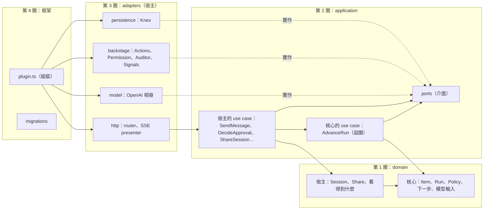
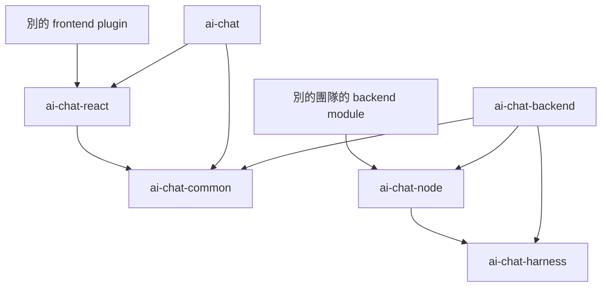

# AI Chat Harness 程式架構

| 欄位     | 內容                                                                                                                                         |
| -------- | -------------------------------------------------------------------------------------------------------------------------------------------- |
| 狀態     | 已定案，P1 完成（P1-01 到 P1-11）。PI 進行中：核心（PI-02）已實作，其餘見第 13 節                                                            |
| 版本     | 1.1（2026-11-24）                                                                                                                            |
| 對應規格 | [harness-spec.zh-TW.md](harness-spec.zh-TW.md) 1.1，主要是 D-15 到 D-19、D-23、D-25，以及需求 4.9（A）。PI 是 D-27 到 D-30 和需求 4.11（IN） |
| 下一份   | [implementation-plan.zh-TW.md](implementation-plan.zh-TW.md)                                                                                 |

這份文件說明程式怎麼分層、每一層放什麼、介面長什麼樣。它不重複規格裡的「為什麼」。

## 1. 結論

- **照 Clean Architecture 分四圈：domain、application、adapters、框架。依賴只能往內。**
- **核心（`ai-chat-harness`）只有裡面兩圈。** 它是純 TypeScript 的函式庫，沒有任何 `@backstage/*` 的依賴。
- **宿主（`ai-chat-backend`）四圈都有。** 它裡面兩圈管 Session 和分享，外面兩圈把 Backstage 接上來。
- **所有對外的東西都在 port 後面。** 資料庫、模型、Actions Registry、Permission、Auditor、Signals、時間、亂數都是 port。換掉任何一個，只動 adapters 那一圈。
- **整個系統只有一個地方 `new` 出 adapter**：宿主的 `plugin.ts`。



## 2. 四圈的規則

| 圈            | 放什麼                                       | 可以 import                                     | 不可以 import                                        |
| ------------- | -------------------------------------------- | ----------------------------------------------- | ---------------------------------------------------- |
| 1 domain      | 型別和純函式。沒有 `async`，沒有 I/O         | 同一圈；宿主的 domain 可以 import 核心的 domain | 其他所有東西                                         |
| 2 application | use case 和 port 的介面。流程在這裡          | domain、同一圈                                  | adapters、`@backstage/*`、`express`、`knex`、`fetch` |
| 3 adapters    | port 的實作、HTTP 的 controller 和 presenter | application、domain、Backstage 和第三方套件     | 其他 adapter 的內部檔案                              |
| 4 框架        | 組裝、migration、設定的 schema               | 全部                                            | —                                                    |

另外四條：

1. **use case 的輸入和輸出是純資料。** 它不收 `Request`，不回 `Response`，不丟 HTTP 的錯誤。
2. **身分是不透明的值。** application 那一圈拿到的是 `Principal`，裡面的 `credentials` 型別是 `unknown`。只有 Backstage 的 adapter 知道它是 `BackstageCredentials`。
3. **錯誤是 domain 的錯誤。** 例如 `RunAlreadyActive`、`NotSessionOwner`。HTTP 的狀態碼由 http adapter 對應。
4. **時間和 id 都是 port。** 測試可以固定時間和 id。

## 3. 套件

| 套件                               | 路徑                       | Backstage role    | 內容                                                                         | 分期                         |
| ---------------------------------- | -------------------------- | ----------------- | ---------------------------------------------------------------------------- | ---------------------------- |
| `ai-chat-harness`                  | `packages/ai-chat-harness` | `node-library`    | 核心：domain 和 application。另有 `/testing` 入口，放假模型和記憶體版的 port | P1                           |
| `backstage-plugin-ai-chat-common`  | `plugins/ai-chat-common`   | `common-library`  | 前後端共用：HTTP 的資料型別、permission 的定義                               | P1（型別）、P2（permission） |
| `backstage-plugin-ai-chat-backend` | `plugins/ai-chat-backend`  | `backend-plugin`  | 宿主：四圈                                                                   | P1                           |
| `backstage-plugin-ai-chat`         | `plugins/ai-chat`          | `frontend-plugin` | 前端                                                                         | P1                           |
| `backstage-plugin-ai-chat-node`    | `plugins/ai-chat-node`     | `node-library`    | backend 的擴充點 `aiChatHarnessExtensionPoint`                               | P3                           |
| `backstage-plugin-ai-chat-react`   | `plugins/ai-chat-react`    | `web-library`     | 前端的擴充點：開啟對話的元件、結果顯示元件、client tool                      | P2 開始                      |

套件之間的依賴：



別的團隊只會碰到 `ai-chat-node` 和 `ai-chat-react`。它們不需要 import 宿主或核心的內部檔案。

## 4. 核心：`ai-chat-harness`

### 4.1 目錄

```
packages/ai-chat-harness/src/
  domain/                      第 1 圈
    item.ts                    Item 的型別（九種 kind）
    run.ts                     RunStatus、合法的狀態轉移
    tool.ts                    ToolDescriptor、ToolCall、ToolResult
    policy.ts                  decidePolicy()、needsApproval()
    agent.ts                   AgentDefinition、Limits
    plan.ts                    Plan、currentPlan()
    nextAction.ts              decideNextAction()：從紀錄算出下一步
    modelInput.ts              buildModelInput()、planSummary()、buildSummaryInput()、estimateTokens()：從紀錄算出送給模型的內容，套用 token 預算
    errors.ts
  application/                 第 2 圈
    ports/
      ItemLog.ts               讀和寫 Item、ItemDraft、RunFence
      ModelClient.ts           呼叫模型，回傳串流；ModelChunk
      ToolGateway.ts           列出工具、驗證、執行；CallContext、ToolOutput、ValidationResult
      RunControl.ts            續租、讀取停止要求、更新用量
      Clock.ts
      IdGenerator.ts
      extensions.ts            P3 才有內容。現在 Extensions 是空型別
    AdvanceRun.ts              迴圈
    types.ts                   AdvanceRunDeps、AdvanceRunRequest
    steps/
      callModel.ts
      executeTools.ts
      summarize.ts             用模型產生摘要，寫成 summary Item
    events.ts                  HarnessEvent、RunOutcome
    （還沒有：builtins/（updatePlan、loadSkill 是 P3，delegate 是 P4）、extensions 的內容（P3））
  testing/                     另一個入口：ai-chat-harness/testing
    ScriptedModel.ts           照劇本回答的假模型
    InMemoryItemLog.ts
    FakeToolGateway.ts
    fakes.ts                   FakeClock、SequentialIdGenerator、FakeRunControl
    itemLogContract.ts         ItemLog 的共用測試（A-10）
    fixture.ts                 核心迴圈測試用的組合（不對外匯出）
  index.ts
```

### 4.2 Domain

**Item** 是整個設計的中心。它是一個聯集型別，每種 `kind` 有自己的 `payload`。

```ts
export type ItemBody =
  | {
      kind: 'user_message';
      text: string;
      page?: { path: string; entityRef?: string };
    } // 規格 B-01
  | { kind: 'agent_message'; text: string }
  | {
      kind: 'tool_call';
      callId: string;
      toolId: string;
      input: JsonObject;
      schemaHash: string;
      policy: 'allow' | 'ask';
      readOnly: boolean;
      step: number;
      position: number;
    }
  | {
      kind: 'approval';
      callId: string;
      decision: 'allow' | 'deny';
      decidedBy: string;
    }
  | { kind: 'tool_started'; callId: string }
  | {
      kind: 'tool_result';
      callId: string;
      status: 'ok' | 'error' | 'timeout' | 'denied' | 'invalid' | 'unknown';
      output?: JsonValue;
      truncated?: boolean;
      message?: string;
    }
  | { kind: 'plan_update'; plan: Plan }
  | { kind: 'summary'; coversUpToSeq: number; text: string }
  | { kind: 'note'; text: string };

export type Item = ItemBody & {
  sessionId: string;
  seq: number; // 每段 Session 從 1 遞增
  runId?: string;
  createdAt: string; // ISO 8601
};
```

PI 在 `user_message` 加 `attachments` 和 `delivery`，在 `agent_message` 和 `tool_call` 加 `readUpToSeq`（第 13.4 節）。

**三個純函式**裝了大部分的規則。它們沒有 I/O，用表格式的測試就能測完。

```ts
// 規格 D-06、T-03、T-04
export function decidePolicy(
  tool: ToolDescriptor,
  settings: PolicySettings,
): 'allow' | 'ask' | 'deny';

// 規格 D-18、D-25、H-05
export function decideNextAction(
  items: readonly Item[],
  run: RunUsage,
  limits: Limits,
): NextAction;

export type NextAction =
  | { type: 'call_model' }
  | {
      type: 'execute_tools';
      calls: ToolCallItem[];
      interrupted: ToolCallItem[];
    }
  | { type: 'wait_approval'; pending: ToolCallItem[] }
  | { type: 'complete' }
  | { type: 'stop'; reason: 'max_steps' | 'max_tool_calls' | 'timeout' };

// 規格 A-05、H-09、B-01：user_message 有 page 時，那則 user 訊息的內容前面加一行
// 「The user is on the page of "<entityRef>" ("<path>").」（沒有 entity 時「The user is on the page "<path>".」），
// 值用 JSON.stringify 寫（page 是用戶端給的，換行和引號不能讓這一行結束），
// 空一行後是原文；這一行在訊息裡，不在 system prompt。
export function buildModelInput(
  items: readonly Item[],
  agent: AgentDefinition,
  extra: { context: string[]; tools: ToolDescriptor[] },
  budget: ContextBudget, // { tokenBudget, keepRecentSteps }
): ModelInput;

// 規格 H-09：舊的 Step 該不該換成摘要，換哪一段。不需要時回傳 undefined
export function planSummary(/* 同 buildModelInput 的參數 */):
  | SummaryPlan
  | undefined;
export type SummaryPlan = {
  coversUpToSeq: number;
  previousSummary?: string;
  items: Item[]; // 上一份摘要之後，到 coversUpToSeq 為止
};

// 產生摘要的那次模型呼叫的輸入：舊的 Step 轉成一段文字，沒有工具
export function buildSummaryInput(
  plan: SummaryPlan,
  budget: ContextBudget,
): ModelInput;

// 規格 V-04：用字數估計 token
export function estimateTokens(text: string): number;
```

**上下文預算**（H-09）。四個函式都是純函式，沒有 async；產生摘要的模型呼叫在 application（`steps/summarize.ts`）。

- **大小**用 `estimateTokens`：ASCII 字元算 1/4 個 token，其他字元（中日韓）算 1 個，無條件進位。`ModelClient` 的串流不回傳用量，所以一律用估計。系統提示、工具清單、摘要訊息、每則訊息都算進去。
- **分段**：紀錄分成「一則使用者訊息」和「一個 Step」（agent 的文字、同一步的工具呼叫、每個呼叫的回答）。預算只整段增減，所以工具呼叫和它的結果不會被拆開。
- **保留最近的 Step**：最近 `keepRecentSteps` 個 Step（至少 1 個）和它們前面連著的使用者訊息不會被縮短、省略或摘要。只有這些就超過預算時，送出的內容會超過預算。
- **最新的使用者訊息永遠原文送出**：它不被摘要涵蓋（`coversUpToSeq` 最多到它的 `seq` 減 1，所以 `fromLatestSummary` 讀得到它），也不被省略。同一個 Run 裡超過 `keepRecentSteps` 的 Step（在這則訊息之後、最近的 Step 之前）照規則先縮短、再省略，但不摘要：摘要只涵蓋這則訊息之前的部分。
- **超過預算時依序處理**：
  1. 舊的 Step 的工具輸出換成一行（保留 `status`，`message` 是 `The output was left out to keep the context short.`），從最舊的開始，夠了就停。
  2. 還是超過，`planSummary` 回傳要摘要的範圍：從上一份摘要之後，到最新的使用者訊息之前（它在最近的 Step 之前時；否則到最近的 Step 之前）。`AdvanceRun` 產生摘要，寫成 `summary` Item。
  3. 沒有摘要可用（摘要失敗，或沒有舊的 Step 可以摘要），`buildModelInput` 從最舊的 Step 起整段省略，直到符合預算。省略要讓模型知道，訊息都算進預算：
     - 跨 Run 的舊內容（最新的使用者訊息之前）被省略，而且沒有摘要時，最前面放一則固定的 `user` 訊息 `The earlier part of the conversation was left out.`，所以送出的第一則訊息一定是 `user`。
     - 同一個 Run 的中間 Step（最新的使用者訊息之後、最近的 Step 之前）被省略時，不管有沒有摘要，都在那則使用者訊息後面放 `Some earlier steps of this answer were left out.`。
     - 事件 `context.trimmed`（`parts` 是 `earlier` 和 `steps` 的子集合）讓畫面知道有東西被省略。摘要失敗、摘要沒有用而直接省略時也會發。
- **摘要沒有用時不做**：不會被省略的部分（系統提示、工具清單、最新的使用者訊息、最近的 Step）加上摘要預留（`min(600, tokenBudget 的十分之一)` token）已經超過預算時，`planSummary` 回傳 `undefined`，不然每一步都會重做一次摘要而大小不變。
- **有摘要之後**：最新的 `summary`（`seq` 最大的）取代 `seq <= coversUpToSeq` 的 Item。它的文字加上說明（`This is a summary of the earlier part ...`，並註明內容含工具輸出，是不可信的資料）是第一則訊息，角色是 `user`。新的摘要包含上一份摘要的文字，所以每一份都涵蓋從頭到 `coversUpToSeq`。
- **已知限制**：
  - 同一個 Run 的中間 Step 只縮短和省略，不摘要。原因：摘要的涵蓋範圍是 `seq` 的前綴（`coversUpToSeq`），摘要中間的 Step 會連最新的使用者訊息一起蓋掉，違反「問題永遠原文」。Run 很長（`maxSteps` 調高）時，中間的 Step 會被省略。排到 P3 評估，或調高 `maxSteps` 預設值時評估。
  - 摘要（或「已省略」的說明）後面接著問題，會有連續兩則 `user`。少數要求 `user` 和 `assistant` 嚴格交替的 chat template 可能拒絕（未查證）。
- **預算是估計**：`estimateTokens` 對 JSON 和程式碼可能低估（每字元的 token 比文字多），`tokenBudget` 要設得比模型的上下文視窗小很多。
- **摘要的輸入**：`buildSummaryInput` 把要摘要的 Item 轉成一則 `user` 訊息（`User:`、`Agent:`、`Agent called`、`Result of`），每個工具輸出最多 1500 字元，整段不超過 `tokenBudget`（超過時留下最新的部分）。上一份摘要放在最前面。

`decideNextAction` 的規則，由上往下，先符合的先用：

| 紀錄的狀態                                                              | 下一步                                                                                        |
| ----------------------------------------------------------------------- | --------------------------------------------------------------------------------------------- |
| 最後一筆對話 Item 是 `agent_message`，而且最後一步沒有未完成的呼叫      | `complete`                                                                                    |
| 總時間用完                                                              | `stop`（`timeout`）                                                                           |
| 最後一步有要核准的呼叫（`needsApproval`），還沒有 `approval` 也沒有結果 | `wait_approval`                                                                               |
| 最後一步有工具呼叫還沒有 `tool_result`                                  | `execute_tools`。有 `tool_started` 但沒有結果的放進 `interrupted`，不執行，結果寫成 `unknown` |
| Step 數用完                                                             | `stop`（`max_steps`）                                                                         |
| 工具呼叫數用完                                                          | `stop`（`max_tool_calls`）                                                                    |
| 其他（最後是使用者訊息，或工具結果都齊了）                              | `call_model`                                                                                  |

PI 改兩處（第 13.4 節）：`complete` 還要沒有未讀的插入訊息；找「最後一步的呼叫」從最後一則不是插入的 `user_message` 之後開始。

Step 數和工具呼叫數的上限只擋新的模型呼叫，不會讓最後一步的呼叫沒有結果。一步裡的呼叫超過 `maxToolCallsPerRun` 的部分，由 `callModel` 寫入時處理（見 4.3）。「要核准」的判斷是 domain 的 `needsApproval(call)`：`policy === 'ask'`，或 `readOnly !== true`。宿主也用它。

### 4.3 Application

**Ports**（核心要求外面提供的東西）：

```ts
export interface ItemLog {
  /**
   * `afterSeq`：只回傳 `seq` 比它大的 Item。
   * `fromLatestSummary`：只回傳最新的 `summary` 涵蓋範圍之後的 Item
   * （`seq` 大於它的 `coversUpToSeq`，包含摘要本身）；沒有摘要就回傳全部。
   * 兩個都有時取較大的界線。
   */
  read(
    sessionId: string,
    opts?: { afterSeq?: number; fromLatestSummary?: boolean },
  ): Promise<Item[]>;
  /**
   * 一次寫入多筆，序號連續（Session 的第一筆是 1）。
   * - `dedupeKeyOf` 和紀錄裡的 Item 相同，或同一批裡有兩筆相同，都丟 DuplicateItem，整批不寫入。
   * - fence 不是這個 Run 的租約持有者，或這個 Run 不屬於這段 Session，丟 LeaseLost，整批不寫入。
   */
  append(
    sessionId: string,
    drafts: ItemDraft[],
    fence: RunFence,
  ): Promise<Item[]>;
}

/** 核心要寫的內容。紀錄補上 Session、序號、Run（來自 fence）和時間。 */
export type ItemDraft = ItemBody;

export type ModelChunk =
  | { type: 'text'; text: string }
  | {
      type: 'tool_call';
      modelCallId: string; // 模型給的 id，只用來區分同一個回答裡的呼叫
      toolId: string;
      input: JsonValue; // 已解析。不是物件的輸入會得到 invalid 結果
    };

export interface ModelClient {
  /** 呼叫失敗時丟例外，迴圈把 Run 結束成 failed。signal 中止時停止。 */
  stream(
    input: ModelInput,
    opts: { signal: AbortSignal },
  ): AsyncIterable<ModelChunk>;
  readonly capabilities: { parallelToolCalls: boolean };
}

export type ValidationResult =
  | { valid: true }
  | { valid: false; message: string };

export type ToolOutput = {
  status: 'ok' | 'error' | 'timeout';
  output?: JsonValue;
  truncated?: boolean;
  message?: string;
};

export interface ToolGateway {
  list(ctx: CallContext): Promise<ToolDescriptor[]>;
  validate(
    toolId: string,
    input: JsonObject,
    ctx: CallContext,
  ): Promise<ValidationResult>;
  execute(
    call: ToolCallItem,
    ctx: CallContext,
    opts: { signal: AbortSignal },
  ): Promise<ToolOutput>;
}

export interface RunControl {
  /** 續租。租約已經不是自己的就丟 LeaseLost。 */
  heartbeat(fence: RunFence): Promise<{ cancelRequested: boolean }>;
  /**
   * 宿主把用量跟 Run 一起存下來，包含 `elapsedSeconds`（不含等核准的時間）。
   * 核准後再呼叫迴圈時，宿主把存下的用量帶進 request。
   */
  recordUsage(fence: RunFence, usage: RunUsage): Promise<void>;
}

/** 核心不解讀 principal，只把它交給 ToolGateway 和擴充點。 */
export interface CallContext {
  sessionId: string;
  runId: string;
  principal: unknown;
  page?: { path: string; entityRef?: string }; // 規格 B-01：這個請求的頁面。送訊息的請求另外存在 user_message
}

/** 寫入時帶著，資料庫用它確認「這個 Run 的租約還是我的」。 */
export interface RunFence {
  runId: string;
  leaseOwner: string;
}

export interface Clock {
  now(): Date;
}
export interface IdGenerator {
  next(): string; // 核心的 port，宿主提供實作（P1 用 UUID）
}
```

**Use case：`AdvanceRun`**。這就是迴圈。它沒有成員變數形式的狀態，每一輪都重新讀紀錄。

```ts
export type AdvanceRunDeps = {
  items: ItemLog;
  model: ModelClient;
  tools: ToolGateway;
  run: RunControl;
  clock: Clock;
  ids: IdGenerator;
  extensions: Extensions; // P3 才有內容，現在是空型別
};

export type AdvanceRunRequest = {
  agent: AgentDefinition;
  limits: Limits;
  budget: ContextBudget;
  policy: PolicySettings; // 每個呼叫的政策都用它算
  fence: RunFence;
  ctx: CallContext;
  signal: AbortSignal;
  usage: RunUsage; // 這個 Run 之前用掉的量。新的 Run 是 0，核准後接續是宿主存下的值
};

export class AdvanceRun {
  constructor(private readonly deps: AdvanceRunDeps) {}

  async *execute(
    req: AdvanceRunRequest,
  ): AsyncGenerator<HarnessEvent, RunOutcome> {
    yield { type: 'run.started', runId: req.fence.runId };
    // 每一輪：
    //   1. heartbeat；cancelRequested 或 signal 中止 → cancelled
    //   2. 讀紀錄（只讀最新的摘要涵蓋範圍之後），decideNextAction(items, usage, limits)
    //   3. call_model     → callModel(deps, req, items, usage)（需要時先 summarize）
    //      execute_tools  → executeTools(deps, req, items, action)
    //      wait_approval  → waiting_approval（pending 是還沒決定的呼叫）
    //      complete       → completed
    //      stop           → completed，endReason 是上限的名稱
    //   4. recordUsage
    yield { type: 'run.ended', outcome };
    return outcome;
  }
}

export type RunOutcome =
  | { status: 'completed'; endReason?: StopReason }
  | { status: 'waiting_approval'; pending: ToolCallItem[] }
  | { status: 'cancelled' }
  | { status: 'failed'; message: string; cause?: unknown };

// 內部步驟
function callModel(
  deps,
  req,
  items,
  usage,
): AsyncGenerator<HarnessEvent, CallModelResult>;
function executeTools(
  deps,
  req,
  items,
  action: { calls; interrupted },
): AsyncGenerator<HarnessEvent, 'cancelled' | undefined>;
```

要注意的地方：

- **核准之後的繼續，跟第一次執行是同一個函式。** 宿主寫入 `approval` 之後再呼叫一次 `execute()`，並帶入存下的 `usage`。迴圈讀紀錄，發現有核准過但沒結果的呼叫，就去執行。
- **已用時間不從紀錄算。** 已用時間（扣掉等核准的時間）紀錄裡沒有，由 request 帶入，迴圈每一輪之後呼叫 `recordUsage`。步數取帶入值和紀錄裡這個 Run 最大 `step` 的較大者（模型的回答是空的時候不寫任何 Item，所以帶入值不能省）。時間 = 帶入的 `elapsedSeconds` 加這次呼叫內經過的時間（用 `Clock`）。
- **步驟編號** = max(`usage.stepsUsed`，紀錄裡這個 Run 的 `tool_call` 最大的 `step`) + 1。這樣在 `recordUsage` 之前當掉，接手的 backend 也不會重複編號，或超過 `maxSteps`。
- **`callModel`**：
  - 先用 `planSummary` 判斷輸入會不會超過預算。會的話先 `summarize`（見下），再呼叫 `buildModelInput`；Context provider 的輸出 P3 才有。
  - 被政策 `deny` 的工具不給模型看。
  - 把模型的串流轉成事件，完成後把 `agent_message` 和所有 `tool_call` 用同一次 `append` 寫入，文字在前；空白文字不寫。
  - 每個呼叫的 `callId` 在收到呼叫時由 `IdGenerator` 產生，不用模型的 id。
  - `policy` 一律由 `decidePolicy` 算。
  - 不能執行的呼叫，結果寫在同一次 `append`，排在所有 `tool_call` 之後：
    - 未知的工具、輸入不是物件、`validate` 不合格（或丟例外，訊息固定為 `The input could not be checked.`）→ `invalid`（T-05，不產生核准）。
    - 政策 `deny` → `denied`。
    - 超過 `maxToolCallsPerRun` 剩餘額度 → `denied`，訊息 `tool call limit`。
  - `tool_call` 的 `policy` 型別沒有 `deny`。立即被拒絕的呼叫存成 `ask`，靠同一批的結果把它關閉，所以不會等核准。
  - 模型沒有文字也沒有呼叫：什麼都不寫，Run 結束成 `failed`。再問一次輸入相同。
  - 模型呼叫失敗：Run 結束成 `failed`，`message` 是固定文字 `The model call failed.`，供應商的原文放 `cause`。`cause` 只給宿主記 log，不給使用者看。
  - 寫入之前再檢查一次 `signal`（驗證會 `await`）。中止的話什麼都不寫。
- **`summarize`**（H-09、A-05）：
  - 在需要它的那一步的模型呼叫之前跑，不是獨立的一輪，也不算 Step：不增加 `stepsUsed`，不發 `step.started`。一次 `callModel` 最多做一份摘要；只有跨 Run 的舊內容移出最近範圍時，後面的 `callModel` 才會再做摘要；同一個 Run 的中間 Step 只縮短和省略，不摘要。
  - 用 Run 的 `ModelClient`、不給工具、用 Run 的 `signal`（所以截止時間也會中止它）。回答的文字去掉前後空白，寫成 `summary` Item（`coversUpToSeq` 來自 `planSummary`）。寫入是在紀錄最後新增一筆，舊的 Item 一個字都不改（A-05）。
  - 模型呼叫失敗，或回答沒有文字：不寫任何 Item，回報 `summary.failed`（`cause` 放原始錯誤，只給宿主記 log），Run **不會**失敗，照常呼叫模型，只是舊的 Step 被省略。同一次 `execute()` 不再試。下一次 `execute()`（下一則訊息或核准後）會再試。
  - 摘要文字最多 4000 字元，超過的截掉，避免模型不守長度時每一步都觸發。
  - 摘要寫入後呼叫一次 `heartbeat`，`cancelRequested` 就結束成 `cancelled`（摘要留著，不算 Step）。
  - `signal` 中止：不寫任何 Item，也不發 `summary.failed`。使用者中止是 `cancelled`，截止時間是 `completed`（`endReason: 'timeout'`），跟模型呼叫一樣。
  - 紀錄的例外（`LeaseLost`）照常丟出來。
- **`executeTools`**：
  - 先把 `interrupted` 的呼叫寫成 `unknown`，不執行。
  - 呼叫分成批次：連續的唯讀呼叫一批，每個不是唯讀的呼叫自己一批。P1 每個呼叫依序執行；P3 的平行唯讀（D-09）只要改批次內的執行方式，結果照 `position` 寫入（P-03）。
  - 只在決定是 `allow` 時執行：需要核准的看 `approval`（`needsApproval`），其他的看政策。`deny` 寫 `denied`，不執行。沒有決定的不動。決定不是 `allow` 也不是 `deny` 時丟錯。
  - 不是唯讀的工具：先 `heartbeat`，看到 `cancelRequested` 就停止（回傳 `'cancelled'`，這個呼叫和後面的都不開始）；再寫 `tool_started`；再檢查 `signal`；才執行（D-25）。
  - 工具丟例外，或沒有回傳結果，寫成 `error`。`signal` 中止時什麼都不寫。
  - 每個 Item 準備好就寫，當掉時已完成的不會丟。
- **停止**：使用者按停止時，`heartbeat` 回 `cancelRequested`。迴圈在每一輪開頭、每個不是唯讀的呼叫之前、摘要寫入之後呼叫 `heartbeat`，所以一步裡的第二個寫入工具在停止之後不會開始。
- **一步之內的時間上限**：迴圈從 `limits.runTimeoutSeconds` 減去 `usage.elapsedSeconds` 算出剩餘時間，設一個計時器，到時候中止傳給模型和工具的 `signal`。因此執行中的模型呼叫或工具在截止時間結束。這時 Run 結束成 `completed`，`endReason: 'timeout'`，不是 `cancelled`。使用者的 `signal` 先中止則是 `cancelled`。每一輪開頭仍用 `Clock` 檢查總時間。計時器已 `unref`，不會讓程序保持運作；宿主要自己讓程序活著，直到 generator 結束。沒有 HTTP server 的宿主（CLI、worker、demo 腳本）要注意：沒有別的 I/O 時，程序會直接結束，Run 沒有收尾。
- **例外**：port 丟的例外（例如 `LeaseLost`）直接丟出來，沒有 `run.ended`。宿主要自己更新 Run 的狀態。

**事件**（A-03）：

```ts
export type HarnessEvent =
  | { type: 'run.started'; runId: string }
  | { type: 'step.started'; step: number }
  | {
      type: 'item.started';
      draftId: string;
      kind: 'agent_message' | 'tool_call';
      modelCallId?: string; // tool_call：模型給的 id
    }
  | { type: 'item.delta'; draftId: string; text: string } // 不存
  | { type: 'item.completed'; draftId?: string; item: Item } // 已經寫進紀錄
  | { type: 'step.ended'; step: number }
  | { type: 'summary.started'; coversUpToSeq: number }
  | { type: 'summary.failed'; cause?: unknown }
  | { type: 'context.trimmed'; parts: ('earlier' | 'steps')[] }
  | { type: 'message.read'; item: Item } // 插入的 user_message 第一次被模型輸入包含
  | { type: 'run.ended'; outcome: RunOutcome };
```

- 寫進紀錄的每一筆 Item 都回報一次 `item.completed`，依序號，包含 `tool_started` 和迴圈自己寫的結果。`approval` 由宿主寫，由宿主回報。
- `draftId`：`agent_message` 是迴圈產生的 id；`tool_call` 就是它在紀錄裡的 `callId`（同一步裡模型的 id 可能重複，所以不用模型的 id）。結果沒有 `draftId`。
- 一個 step 是一次模型呼叫：`step.started` 在呼叫之前，`step.ended` 在這次的 Item 寫完之後。工具的結果在 `step.ended` 之後。
- 摘要在需要它的 Step 之前：`summary.started`，然後 `summary` Item 的 `item.completed`；失敗時是 `summary.failed`。摘要不是 Step，沒有 `step.started`。
- `context.trimmed` 在 `step.started` 之前：預算讓迴圈把舊內容拿出送給模型的輸入時發。同一次 `execute()` 內只有 `parts` 跟上一步發的不同才發（不會每一步重發）；核准後接續的 `execute()` 會再發一次。`earlier` 是最新的使用者訊息之前的部分，`steps` 是同一個 Run 裡它之後的 Step。
- `message.read` 在 `step.started` 之前（在 `context.trimmed` 之後）：這一輪才第一次給模型的插入訊息，每則送一次，`item` 是那筆 `user_message`。模型呼叫在這之後失敗或中止，訊息仍標成沒讀到（紀錄沒有 `readUpToSeq` 蓋過它），下一次 `execute()` 會再送。
- 模型呼叫失敗或中止時，已送出的 `item.started` 沒有對應的 `item.completed`。畫面要能忽略它們。

## 5. 宿主：`ai-chat-backend`

### 5.1 目錄

```
plugins/ai-chat-backend/
  migrations/                          第 4 圈
  config.d.ts                          第 4 圈
  src/
    domain/                            第 1 圈
      session.ts                       Session、NewSession、SessionPatch（可以改哪些欄位）
      run.ts                           Run、LeasedRun（Run 加上 fence）
      principal.ts                     Principal { userRef, ownershipRefs, credentials: unknown, credentialsExpireAt? }
      approval.ts                      callsAwaitingDecision()：哪些呼叫在等決定（用核心的 needsApproval）
      runLimits.ts                     runLimits()：Run 的工作時間不超過憑證的有效期（V-06）
      systemPrompt.ts                  buildSystemPrompt()
      share.ts                         Share、ShareMode、到期的處理
      visibility.ts                    visibleItems()：某個檢視者看得到哪些 Item
      fork.ts                          forkItems()：複製時帶走哪些 Item
      toolset.ts                       Toolset、enabledTools()
      retention.ts                     保存期限：updated_at 早於現在減 days 天（SE-05）
      errors.ts                        SessionNotFound、RunNotFound、RunAlreadyActive（P1-05）；NotSessionOwner、ToolCallNotFound、ToolCallNotWaiting、RunNotWaiting、AgentNotFound、UnknownToolset、ShuttingDown（P1-08）
    application/                       第 2 圈
      ports/
        SessionRepository.ts           create、get、listByOwner（搜尋、釘選在前）、update、setTitleIfAbsent、delete
        RunRepository.ts               start、acquireLease、transition、requestCancel、expireStale、hasOtherNormalEnd。也實作核心的 RunControl（heartbeat、recordUsage）
        ShareRepository.ts             P2
        AccessControl.ts               P2：能不能讀這段 Session、能不能用這個 Toolset。P1 只檢查擁有者（domain 的 assertOwner）
        AuditLog.ts                    begin() 回傳 AuditSpan（success、fail）
        Logger.ts
        Notifier.ts                    通知擁有者處理中、等核准、有新回覆。沒有 Signals 時不做事
        AgentCatalog.ts                agent()、defaultAgentId()、toolsets()、policy()
        Scheduler.ts                   P2：定期工作。P1 的 `plugin.ts` 直接用 `coreServices.scheduler` 排 ExpireStaleRuns
      usecases/
        CreateSession.ts
        GetSession.ts                  回傳 Session 和檢視者看得到的 Item
        ListSessions.ts                自己的 Session：釘選在前，`q` 比對標題
        UpdateSession.ts               改名、釘選、封存、開關 Toolset
        NameSession.ts                 第一輪正常結束後寫標題（SE-04）；title 已有就不寫
        DeleteSession.ts
        SendMessage.ts
        DecideApproval.ts
        ResumeRun.ts                   全部已決定但迴圈沒有啟動時接續（不帶新的決定）
        CancelRun.ts
        FollowSession.ts               接回（從目前 Run 的第一個 Item 重送）。這一台即時；別台每秒讀已完成的 Item
        ListToolsets.ts                管理者定義的 Toolset 清單
        ShareSession.ts                P2
        UpdateShare.ts                 P2：更新快照、開關工具輸出、停止
        ForkSession.ts                 P2
        ExpireStaleRuns.ts
        PurgeExpiredSessions.ts        P2
      RunSupervisor.ts                 這一台正在跑的 Run：啟動、續租、訂閱、關機
      resumeIfDecided.ts               DecideApproval 和 ResumeRun 共用：全部已決定就 acquireLease 並啟動迴圈
      EventChannel.ts                  給一個訂閱者的事件佇列
      AuditedToolGateway.ts            包住 ToolGateway：不是唯讀的工具執行時寫稽核（O-02）
      buildRunRequest.ts               組出 AdvanceRun 的 request（agent、政策、限制、用量）
    adapters/                          第 3 圈
      http/
        router.ts                      路由；取出身分、呼叫 controller、把 use case 的錯誤交給 errorMapping
        controllers/
          sessions.ts                  JSON 路由：Session 的建立、讀取、修改、刪除、Toolset 清單
          runs.ts                      串流路由：送訊息、決定、接續、取消、接回
        presenters/
          uiMessageStream.ts           HarnessEvent 轉成 UI message stream（協定只出現在這個檔案、uiMessageChunk.ts 和 sse.ts）
          uiMessageChunk.ts            送出的事件的型別
          session.ts                   Session、Run、Item 轉成 ai-chat-common 的 API 型別（只給明列的欄位）
        requestSchemas.ts              請求內容的檢查（zod）
        sse.ts                         寫出 SSE 回應；客戶端離開時停止讀取，Run 照跑
        errorMapping.ts                domain 的錯誤轉成 Backstage 的錯誤（404、409、400、503）
      persistence/
        KnexItemLog.ts
        KnexSessionRepository.ts
        KnexRunRepository.ts
        KnexShareRepository.ts         P2
        uniqueViolation.ts             判斷資料庫的唯一性錯誤（SQLite、PostgreSQL 各一種格式）
      backstage/
        ActionsToolGateway.ts          Actions Registry 轉成 ToolGateway
        PermissionAccessControl.ts
        AuditorAuditLog.ts
        SignalsNotifier.ts             頻道 `ai-chat`。由 `ai-chat` 的 signals module 裝上，plugin 本身不依賴 Signals
        ConfigAgentCatalog.ts
        principalFromRequest.ts        httpAuth、userInfo、auth（getLimitedUserToken 取 token 的到期時間）轉成 Principal
        BackstageScheduler.ts
      model/
        OpenAiCompatibleClient.ts      用 `fetch` 呼叫 OpenAI 相容的伺服器
        OpenAiCompatibleModelClient.ts 把上面的 client 包成核心的 ModelClient
      system/
        SystemClock.ts
        UuidGenerator.ts
    host.ts                            第 4 圈：createHost() 把核心迴圈、RunSupervisor 和 use case 接在 port 上（plugin.ts 和測試共用）
    plugin.ts                          第 4 圈：組裝
    index.ts
```

### 5.2 Domain

宿主的 domain 管「誰」和「看得到什麼」。這些是核心不知道的事。

```ts
// 規格 SH-02、SH-08、SH-09、SH-11
export function visibleItems(
  items: readonly Item[],
  viewer: { isOwner: true } | { isOwner: false; share: Share },
  now: string,
): VisibleItem[];

// 規格 SH-04
export function forkItems(
  visible: readonly VisibleItem[],
  idMap: ReadonlyMap<string, string>, // 舊附件 id 到新附件 id（13.5）
): ItemDraft[];

// 規格 T-02、T-11、D-24
export function enabledTools(
  all: readonly ToolDescriptor[],
  toolsets: readonly Toolset[],
  sessionChoice: readonly string[],
): ToolDescriptor[];
```

`visibleItems` 的規則：

| 檢視者       | 看得到的 Item                    | 工具輸出                                                                |
| ------------ | -------------------------------- | ----------------------------------------------------------------------- |
| 擁有者       | 全部                             | 全部                                                                    |
| 快照分享     | 序號不超過 `up_to_seq` 的        | 序號不超過 `outputs_up_to_seq` 的。超過的只留狀態，輸出換成「沒有分享」 |
| 持續更新     | 全部                             | 同上。預設 `outputs_up_to_seq` 是分享當下的序號                         |
| 過了到期時間 | 當成快照，停在到期當下的最後一筆 | 同上                                                                    |

### 5.3 Use case

每個 use case 一個類別，只有一個 `execute` 方法。

| Use case                             | 做什麼                                                                                                               | 用到的 port                                                                                           | 規格                   |
| ------------------------------------ | -------------------------------------------------------------------------------------------------------------------- | ----------------------------------------------------------------------------------------------------- | ---------------------- |
| `CreateSession`                      | 建立 Session，套用 Toolset 的預設值                                                                                  | SessionRepository、AgentCatalog                                                                       | SE-01、T-01            |
| `GetSession`                         | 檢查權限，回傳 Session、進行中的 Run、看得到的 Item                                                                  | SessionRepository、RunRepository、ItemLog、（P2：AccessControl、ShareRepository）                     | SH-02、SH-05           |
| `UpdateSession`                      | 改名、釘選、封存、開關 Toolset                                                                                       | SessionRepository、AgentCatalog                                                                       | SE-03、T-11            |
| `SendMessage`                        | 建立 Run、寫入使用者訊息、啟動迴圈、回傳事件串流；啟動失敗設為 `failed` 並通知 `idle`                                | SessionRepository、RunRepository、ItemLog、RunSupervisor、AgentCatalog、Notifier（P2：AccessControl） | H-01、H-03、B-01       |
| `DecideApproval`                     | 寫入 `approval`。全部決定後重新啟動迴圈；啟動失敗設為 `failed` 並通知 `idle`                                         | SessionRepository、ItemLog、RunRepository、RunSupervisor、AgentCatalog、AuditLog、Notifier            | D-05、T-06、T-07、P-04 |
| `ResumeRun`                          | 全部已決定但 Run 還在等核准時接續，不帶新的決定；啟動失敗設為 `failed` 並通知 `idle`                                 | SessionRepository、RunRepository、ItemLog、RunSupervisor、AgentCatalog、Notifier                      | P-04                   |
| `CancelRun`                          | 設定停止要求。Run 在這一台就直接中止；等核准時直接轉成 `cancelled` 並通知 `idle`                                     | RunRepository、RunSupervisor、Notifier                                                                | H-06                   |
| `FollowSession`                      | 從目前 Run 的第一個 Item 重送，再接上新的。這一台送未完成的文字；別台每秒送已完成的 Item。沒有 `running` 的 Run 不接 | SessionRepository、RunRepository、ItemLog、RunSupervisor、Logger（P2：AccessControl）                 | A-07                   |
| `ShareSession`、`UpdateShare`        | 建立和修改分享                                                                                                       | ShareRepository、ItemLog、AuditLog、Notifier                                                          | SH-01、SH-06 到 SH-11  |
| `ForkSession`                        | 複製成自己的 Session                                                                                                 | SessionRepository、ItemLog、AccessControl、AuditLog、AttachmentStore                                  | SH-04                  |
| `ExpireStaleRuns`                    | 租約過期的 Run 標成 `expired`，並通知 `idle`                                                                         | RunRepository、Notifier                                                                               | H-04                   |
| `PurgeExpiredSessions`               | 刪除超過保存期限的 Session                                                                                           | SessionRepository                                                                                     | SE-05                  |
| `UploadAttachment`、`ReadAttachment` | 上傳和讀取圖片附件（PI，13.3）                                                                                       | SessionRepository、AttachmentStore                                                                    | IN-01 到 IN-04、IN-08  |
| `InsertMessage`                      | Run 進行中插入訊息（PI，13.4）                                                                                       | SessionRepository、ItemLog、AttachmentStore、AgentCatalog                                             | IN-10、IN-11、IN-17    |
| `QueueMessage` 等                    | 排隊、修改、刪除、重排、列出（PI，13.6）                                                                             | SessionRepository、QueuedMessageRepository、AttachmentStore                                           | IN-13                  |
| `StartNextQueued`、`ResumeQueue`     | 用最前面的排隊訊息開新的 Run（PI，13.6）；啟動失敗設為 `failed` 並通知 `idle`                                        | QueuedMessageRepository、RunSupervisor、AgentCatalog、AuditLog、Notifier                              | IN-14 到 IN-17         |
| `PurgeUnusedAttachments`             | 刪除沒用到的附件（PI）                                                                                               | AttachmentStore                                                                                       | IN-04                  |

`SendMessage` 的樣子（P1 沒有 `AccessControl`，擁有者檢查是 domain 的 `assertOwner`）：

```ts
export class SendMessage {
  constructor(
    private readonly deps: {
      sessions: SessionRepository;
      runs: RunRepository;
      items: ItemLog;
      supervisor: RunSupervisor;
      agents: AgentCatalog;
      clock: Clock;
      settings: RunSettings; // limits、budget
    },
  ) {}

  async execute(input: {
    principal: Principal;
    sessionId: string;
    text: string;
    page?: { path: string; entityRef?: string };
  }): Promise<RunHandle> {
    const session = await this.deps.sessions.get(input.sessionId);
    assertOwner(session, input.principal); // 丟 NotSessionOwner
    if (!this.deps.supervisor.accepting) throw new ShuttingDown();

    const run = await this.deps.runs.start(session.id); // 丟 RunAlreadyActive
    try {
      const request = await buildRunRequest(/* agent、政策、限制、用量 */);
      await this.deps.items.append(
        session.id,
        [
          {
            kind: 'user_message',
            text: input.text,
            ...(input.page && { page: input.page }),
          },
        ],
        run.fence,
      );
      return this.deps.supervisor.launch(run, request);
    } catch (error) {
      await this.abandon(run); // transition(run, 'failed', { leaseOwner })，Session 不會卡住
      throw error;
    }
  }
}
```

各個 use case 的規則：

- **`SendMessage`**：先建立 Run（`start` 擋下第二個進行中的 Run），成功之後才寫 `user_message`，所以被拒絕的訊息不會留在紀錄裡。`buildRunRequest` 在寫入之前，找不到 Agent 這類錯誤不會留下訊息。啟動迴圈之前任何一步失敗，Run 以 `failed`（`end_reason` 是 `not_started`）結束，Session 可以再開新的 Run。
- **`DecideApproval`**：先讀紀錄。呼叫不存在丟 `ToolCallNotFound`；已經有決定就回傳那個決定（T-07，不再寫稽核）；沒有決定時，呼叫要 `needsApproval`（核心的規則）、沒有結果、而且 Run 是這個呼叫所屬、狀態是 `waiting_approval`，否則丟 `ToolCallNotWaiting` 或 `RunNotWaiting`。決定寫入的前後記稽核（`tool-call-approve` 或 `tool-call-deny`）；寫入時不需要租約（Run 在等核准，沒有人持有）；兩個請求同時決定同一個呼叫時，輸的那個得到先寫入的決定。寫完之後重讀紀錄：`callsAwaitingDecision` 還有呼叫就回傳（P-04，其他的仍在等）；沒有了就交給 `resumeIfDecided`：這一台不接新的 Run（關機中）就丟 `ShuttingDown`，決定已存下，Run 維持 `waiting_approval`，由別台接手；否則 `acquireLease`，只有拿到租約的那個請求啟動迴圈，其他請求（同一台或別台）得到沒有 `run` 的結果。啟動迴圈時丟 `ShuttingDown`（競爭）就用 `leaseOwner` 把 Run 放回 `waiting_approval`，其他錯誤才轉 `failed`。接手用這個請求的 `principal`（工具用這個請求的憑證）。
- **`ResumeRun`**：「全部已決定但迴圈沒有啟動」（決定的請求存下決定後當掉）的接續，不帶新的決定。做擁有者檢查，然後同樣交給 `resumeIfDecided`（含關機中的 `ShuttingDown`）：還有呼叫在等、沒有進行中的 Run、或別的請求先接手，都回傳 `undefined`。接手用這個請求的 `principal`。
- **`GetSession`**：除了 Item，還回傳 `awaitingDecision`（還在等決定的 `callId`，用 `callsAwaitingDecision`，不受 `afterSeq` 影響，另外讀整段紀錄）和 `resumable`（Run 是 `waiting_approval` 而且沒有呼叫要決定，表示要送接續請求）。路由 `POST /sessions/:id/resume` 對應 `ResumeRun`（SSE，沒有東西可接續時 204）；P1-10 的畫面開啟 Session 看到 `resumable` 時自動送接續請求，但自己剛送出決定之後不要自動接續（見實作規劃 P1-10）。
- **`CancelRun`**：`requestCancel` 存下停止要求；這一台有迴圈就 `abort`；然後一律再查一次狀態，是 `waiting_approval`（沒有迴圈）就直接 `transition` 成 `cancelled`（`end_reason` 是 `user`）；別台的迴圈在下一次續租看到停止要求。停止要求在迴圈最後一次 `heartbeat` 之後才存進來、迴圈照樣寫成 `waiting_approval` 的情形，由 `RunSupervisor` 收尾時處理（見 5.4）。
- **`DeleteSession`**：有進行中的 Run 就丟 `RunAlreadyActive`（鎖的順序見規劃的 P1-08）。檢查和刪除之間仍有一個很短的空隙：這時新開的 Run 會在刪除時被連帶刪掉，它的迴圈下一次寫入得到 `LeaseLost` 而結束。
- **`CreateSession`**：一定把 Toolset 存進 `enabled_toolsets`：沒給就用 `default: true` 的組，也可能是空陣列；不認得的 id 丟 `UnknownToolset`。`UpdateSession` 同樣檢查。
- **`ExpireStaleRuns`**：`plugin.ts` 每 30 秒排一次。
- **`ListSessions`**：自己的 Session。釘選的在前，然後 `updated_at` 新的在前，再以 `id`。`query` 比對存下的 `title`（不分 ASCII 大小寫的子字串，`%` 和 `_` 是字面字）；沒有標題的對不上。預設不含已封存。
- **`NameSession`**（SE-04）：第一輪正常結束（`isNormalEnd`）且 `title` 仍空時，用同一個 `ModelClient` 產生一行標題，只在 `title` 仍空時寫入。失敗只記 log。
- **`PurgeExpiredSessions`**（SE-05）：`plugin.ts` 每小時排一次（`ai-chat-purge-expired-sessions`，timeout 5 分鐘，跟清沒用到的附件一樣）。期限是 `aiChat.retention.days`：沒設定是 90，`0` 不刪任何 Session，負數或不是整數則 backend 啟動失敗。到期看 `sessions.updated_at` 是否**早於**「現在減 `days` 個整天（每個 24 小時）」；剛好在界線上的留下。`updated_at` 在建立、修改 Session（改名、釘選、封存、開關 Toolset）和寫入 Item 時更新；只排隊或只上傳附件不更新，所以不會因此延後刪除。進行中的 Run（`runs.active_session_id` 還在，也就是 `running` 或 `waiting_approval`）不刪，和 `DeleteSession` 拒絕刪除一樣；Run 結束後，下一次才刪。釘選和封存沒有例外。刪除沿用外鍵的連帶刪除（runs、items、queued messages、attachments）。稽核在 Backstage auditor，不在這些表裡，這項不讀也不寫它。PostgreSQL 上每個 Session 一個 transaction：先依 `id` 對它的 runs 取 `FOR UPDATE SKIP LOCKED`，確認沒有進行中的 Run，再對 session 列取 `FOR UPDATE SKIP LOCKED`（並且 `updated_at` 仍早於期限），然後刪除。別的 transaction 已經鎖住的 run 或 session 直接跳過，不等，所以兩台同時跑不會刪到同一段，也不會和寫入互等而死結。鎖的順序仍是先 runs 再 session（第 13.8 節）。SQLite 沒有列鎖，交易一個接一個。排程用 Backstage scheduler 的預設 global scope（同一時間只有一台執行這項工作）；列鎖是兩次執行重疊時的第二層。

### 5.4 `RunSupervisor`

它管理「這一台 backend 正在跑的 Run」。它在 application 那一圈，只用 port。

- **啟動**：`launch(run, request)` 用 `start` 或 `acquireLease` 拿到的 fence 呼叫核心的 `AdvanceRun.execute()`，在背景消費事件，回傳 `RunHandle { runId, events, done }`。`events` 是第一個訂閱者，從頭收到所有事件；要讀到最後，或對它的 iterator 呼叫 `return()`（`for await` 裡 `break` 就會），不然它的事件會留在記憶體直到 Run 結束。HTTP 的回應只是其中一個訂閱者。`done` 在迴圈結束、Run 的狀態更新之後完成。supervisor 一定把 generator 跑完或 `return()`：核心的截止計時器已 `unref`，宿主要自己讓程序活著，直到 generator 結束。
- **fence 表**：`Map<runId, fence>` 記這個程序正在跑的 Run 和它持有的 fence。核准後重新接手時 fence 會換，Map 跟著換。迴圈結束（包括丟出 `LeaseLost`）時只在 Map 裡還是自己的 fence 時移除，所以舊迴圈的收尾不會移掉新迴圈的項目。
- **訂閱**：每個 Run 可以有多個訂閱者（`subscribe(runId)` 從現在起收事件，`FollowSession` 在 P2 用它）。訂閱者斷線不影響 Run（H-07、A-06）。
- **續租**：核心每一輪呼叫一次 `heartbeat`；執行不是唯讀的工具之前也會呼叫，讓停止要求在兩個寫入工具之間生效。模型呼叫很久時，另外有計時器每 10 秒續租一次；續租得到 `LeaseLost` 或停止要求時中止迴圈。其他錯誤（資料庫暫時很慢）只記 warn，不中止：一次失敗不代表租約丟了，下一次續租或核心自己的 `heartbeat` 會再試。租約長度 30 秒。
- **結束**：依照 `RunOutcome` 用 `transition(runId, to, { leaseOwner })` 更新 Run 的狀態（`completed` 的 `end_reason` 是 `endReason`，`failed` 是 `error`，使用者取消是 `user`），清掉 `active_session_id`。先更新狀態，再把 `run.ended` 交給訂閱者：收到串流結束的用戶端馬上送決定時，Run 已經是 `waiting_approval`。`transition` 得到 `LeaseLost` 或 `InvalidRunTransition`（Run 已被別人結束或接手）就略過。`failed` 的 `cause` 和 `summary.failed` 的 `cause` 只記 log，交給訂閱者的事件是拿掉 `cause` 的副本。寫成 `waiting_approval` 之後如果回傳的 Run 帶著 `cancelRequested`（停止要求在迴圈最後一次 `heartbeat` 之後才存進來），再 `transition` 成 `cancelled`（`end_reason` 是 `user`），Run 不會卡在等核准。其餘事件（`summary.started`、`context.trimmed` 等）只交給訂閱者，不影響 Run 的狀態。
- **自動標題**（SE-04）：狀態寫入、佇列的 `afterRun` 處理完之後，先把 `run.ended` 交給訂閱者並結束訂閱，再若這段 Session 沒有標題、而且沒有更早的正常結束，用同一台的 `ModelClient` 產生一行標題。這一步仍在迴圈裡，關機仍會等到它結束。失敗只記 log，不改 Run 的狀態。使用者已經改名的不蓋掉。
- **port 丟例外**：核心的 port 丟例外（例如 `LeaseLost`）時迴圈沒有 `run.ended`。supervisor 自己處理：`LeaseLost` 表示租約已在別人手上，Run 的狀態不動；其他例外用 `leaseOwner` 把 Run 標成 `failed`（`end_reason` 是 `error`）並記 log。兩種情形都給訂閱者一個 `run.ended`（`failed`，固定文字 `The run stopped.`，沒有 `cause`）。
- **已用時間**：等核准的時間不算。核心每次呼叫只算這次呼叫內經過的時間，加上 request 帶入的 `usage.elapsedSeconds`；宿主接手時帶入存在 Run 裡的用量（`acquireLease` 回傳的 Run），不用現在時間減 `started_at`。
- **關機**（H-11）：`shutdown(graceMs = 20 秒)` 先停止接新的 Run（`launch` 丟 `ShuttingDown`，`SendMessage` 在 `start` 之前就檢查），等進行中的 Run 最多 `graceMs`。沒跑完的，只對 Map 裡的 Run 中止迴圈並呼叫 `transition(runId, 'expired', { leaseOwner: fence.leaseOwner })`；得到 `LeaseLost` 表示已被別台接手，略過。不用沒帶 `leaseOwner` 的 `transition` 結束 Run：那會結束別台接手的 Run。
- **當掉的 backend**：靠 `ExpireStaleRuns`（H-04）。

租約在 `KnexRunRepository` 裡的規則。同時進來的呼叫由資料庫決定：`start` 靠唯一索引，`heartbeat`、`recordUsage`、`acquireLease`、`requestCancel`、`expireStale` 各是一個帶條件的 UPDATE，`transition` 在 transaction 裡先 `SELECT … FOR UPDATE` 再 UPDATE：

- `start`：INSERT 一個 `running` 的 Run，期限是現在加租約長度。`lease_owner` 是用 `IdGenerator` 產生的新值（UUID），每次 `start` 和每次 `acquireLease` 都產生一個，fence 就是 `{runId, leaseOwner}`；同一台 backend 再接手同一個 Run 也拿到不同的 fence，舊的迴圈寫入、續租都會被拒絕。`active_session_id` 的唯一索引擋下第二個進行中的 Run，adapter 把它轉成 `RunAlreadyActive`（H-03）。
- `heartbeat`：`lease_owner` 是自己、狀態是 `running` 才更新期限，同時回傳 `cancel_requested`。否則丟 `LeaseLost`。`recordUsage` 的條件相同。
- `acquireLease`：接手一個 Run。條件是狀態為 `waiting_approval`，或狀態為 `running` 而租約沒有主人或已過期。有效的租約不能再接手，持有者自己也一樣。同時有多個呼叫（不論同一台或不同台）時只有一個拿到；等核准的 Run 這時改成 `running`。
- `transition`：`waiting_approval` 和結束的狀態都會清掉租約；結束的狀態同時清掉 `active_session_id`，讓這段 Session 可以開新的 Run。帶 `leaseOwner` 時不是這個持有者就丟 `LeaseLost`；不帶時是宿主替使用者操作（例如取消一個等核准的 Run）。
- `expireStale`：狀態 `running` 而 `lease_expires_at` 已過的 Run 標成 `expired`，`end_reason` 是 `lease_expired`。等核准的 Run 沒有租約，不在其中。
- 租約長度預設 30 秒（建構時可指定）。
- 各台 backend 的時鐘要同步：租約期限和過期判斷用的是各台自己的時鐘，誤差要小於租約長度減續租間隔（目前 30 − 10 = 20 秒）。

### 5.5 Adapters

| Port                                                               | Adapter                        | 用到的 Backstage 服務                                                             |
| ------------------------------------------------------------------ | ------------------------------ | --------------------------------------------------------------------------------- |
| `ItemLog`、`SessionRepository`、`RunRepository`、`ShareRepository` | `Knex*`                        | `coreServices.database`                                                           |
| `ToolGateway`                                                      | `ActionsToolGateway`           | `actionsServiceRef`（`@backstage/backend-plugin-api/alpha`）的 `list` 和 `invoke` |
| `ModelClient`                                                      | `OpenAiCompatibleModelClient`  | 沒有。包住 `llm/` 裡用 `fetch` 的 client                                          |
| `AccessControl`                                                    | `PermissionAccessControl`      | `coreServices.permissions`（P2。P1 只檢查擁有者，是 domain 的 `assertOwner`）     |
| `AuditLog`                                                         | `AuditorAuditLog`              | `coreServices.auditor`                                                            |
| `Notifier`                                                         | `SignalsNotifier`              | `signalsServiceRef`，由 signals module 裝上。沒有安裝時不做事，畫面改為輪詢       |
| `AgentCatalog`                                                     | `ConfigAgentCatalog`           | `coreServices.rootConfig`，加上擴充點註冊的內容                                   |
| `Scheduler`                                                        | `BackstageScheduler`           | `coreServices.scheduler`                                                          |
| `Clock`、`IdGenerator`                                             | `SystemClock`、`UuidGenerator` | 沒有                                                                              |
| （HTTP 的身分）                                                    | `principalFromRequest`         | `coreServices.httpAuth`、`userInfo`、`auth`                                       |

`ActionsToolGateway` 負責的轉換。它是 adapter 裡唯一用到 `actionsServiceRef` 的檔案（V-02）。`plugin.ts` 的組裝把它交進來：

- 建構時收到 `actions`（`ActionsService`）、`catalog`（`AgentCatalog`）、`logger`、`maxOutputChars`，以及 `enabledToolsets(ctx)`：回傳這個 Session 開啟的 Toolset id，`undefined` 表示沒選過，用預設值（`default: true` 的組）。
- `list`：用呼叫者的憑證呼叫 `actions.list`。要 `secrets` 的 action 不給（聊天沒辦法提供）。每個 action 轉成 `ToolDescriptor`：`id` 是 action id，`readOnly` 只有 `attributes.readOnly === true` 才是 `true`，沒有標的當成不是唯讀（D-06）；`egress` 由 Toolset 算出（所屬的任一組標了 `egress` 就是）；`inputSchema` 是 action 的 input schema 去掉 `$schema`，不是 object 型別時換成空的 object schema；`schemaHash` 是這份 schema 排序鍵之後的 SHA-256（T-06）。最後用 domain 的 `enabledTools` 只留下 Session 開啟的 Toolset 裡的工具（T-02、T-11）；不在任何 Toolset 的 action 不會出現。
- `validate`：用 `ajv`（draft-07，不檢查 `format`）驗證參數。找不到工具、schema 編不出來，都回傳不合格；訊息是 ajv 的錯誤文字，最多 2000 字（T-05）。
- `execute`：先用現在的 action 和政策檢查這筆存下來的呼叫（T-06）。政策在提出呼叫時和執行前各檢查一次。工具已經不在清單裡、呼叫存成唯讀但 action 現在不是唯讀、`schemaHash` 變了而存下的輸入不符合新 schema、現在的政策是 `deny`、或存下時不需核准而現在政策要 `ask`（例如事後改成 `egress`），都不執行，回傳 `error` 結果。存下時要核准的呼叫，核准之後現在的政策仍是 `ask` 就照常執行。通過就把 `CallContext.principal` 的 `credentials` 交給 `actions.invoke`。`invoke` 沒有 signal 參數，所以 signal 中止時不再等它並丟出例外（核心看到 signal 已中止就不寫結果）；action 本身可能仍會跑完。action 丟出的例外轉成 `error` 結果。回傳值一律整理成 `ToolOutput` 物件：沒有值是 `{ status: 'ok' }`，字串、數字、`null`、陣列放進 `output`；序列化後超過 `maxOutputChars` 的，`output` 換成 `{ text, originalLength }`（序列化後不超過 `maxOutputChars`），`truncated: true`。
- 政策的警告：政策把不是唯讀或屬於 `egress` Toolset 的 action 設成 `allow` 時，第一次在 `list` 看到它就記一筆警告，同一個工具只記一次。執行時 `decidePolicy` 仍然算出 `ask`。Actions Registry 要用憑證才能列出 action，所以啟動時沒有清單可查。

`ConfigAgentCatalog` 在建構時讀取並檢查 `aiChat.toolsets`、`aiChat.policy` 和 `aiChat.agents`，值不對就丟 `InputError`，後端啟動失敗。它實作 `AgentCatalog { agent(); defaultAgentId(); toolsets(); policy() }`。沒有人定義 `default` 時，只有內建的那一個（內建的系統提示加 `aiChat.systemPrompt`）。設定檔的 `agents.default` 取代它。其他 id 來自設定檔或擴充點。擴充點註冊的 Agent 也套 `buildSystemPrompt`，和設定檔同一條規則。`toolsets`、`skills`、`model`、`limits`、`planning` 記在定義上；迴圈還不使用它們。同一個 id 出現兩次就丟 `InputError`。

- Toolset 的欄位：`actions`（樣式，不可為空）、`exclude`（不屬於這組的樣式）、`title`、`default`（預設 `false`）、`egress`（預設 `false`）。id 以字母開頭，只能是字母、數字，以及夾在中間的 `-`、`_`。`policy` 的鍵只接受完整的 action id，含 `*` 會丟 `InputError`。
- `policy` 在設定檔是平的 `{ toolId: allow|ask|deny }`，轉成 domain 的 `PolicySettings { byTool }`。
- 沒有 `toolsets` 時，用淘汰的 `actions.include`、`actions.exclude` 組成一個 `default` Toolset，所有 Session 預設開啟；兩個都空就是所有 action。只要其中一個有設，啟動時記一筆警告；有 `toolsets` 時 catalog 不用它們。有 `toolsets` 時兩個清單被忽略，警告也這樣說。

### 5.6 組裝

`plugin.ts` 是唯一 `new` 出 adapter 的地方。它把 adapter 交給 `host.ts` 的 `createHost()`，後者組出核心的 `AdvanceRun`、`RunSupervisor` 和所有 use case（測試用同一個函式接真的資料庫和假的模型）。`createHost()` 把 `ToolGateway` 包上 `AuditedToolGateway`，所以每一個不是唯讀的工具執行都有稽核（O-02）。

```ts
export const aiChatPlugin = createBackendPlugin({
  pluginId: 'ai-chat',
  register(env) {
    // 模組的 init 比這裡的 init 早。擴充點要在 register() 裡就交出去。
    const harness = new AiChatHarnessRegistry();
    env.registerExtensionPoint(aiChatHarnessExtensionPoint, harness);
    env.registerInit({
      deps: {
        /* logger、rootConfig、database、httpAuth、userInfo、auth、httpRouter、
                 auditor、scheduler、lifecycle、actions */
      },
      async init(d) {
        const db = await d.database.getClient();
        const clock = new SystemClock();
        const ids = new UuidGenerator();

        // 第 3 圈
        // 擴充點在 register() 裡註冊（aiChatHarnessExtensionPoint）。模組的 init 先跑完。
        const catalog = new ConfigAgentCatalog(
          d.rootConfig,
          d.logger,
          harness.agents(),
        );
        const sessions = new KnexSessionRepository(db, clock, ids);
        const host = createHost({
          items: new KnexItemLog(db, clock),
          sessions,
          runs: new KnexRunRepository(db, clock, ids),
          agents: catalog,
          tools: new ActionsToolGateway({
            actions: d.actions,
            catalog,
            logger: d.logger,
            enabledToolsets: async ctx =>
              (await sessions.get(ctx.sessionId)).enabledToolsets,
            maxOutputChars: config.maxToolOutputChars,
          }),
          model: new OpenAiCompatibleModelClient(
            new OpenAiCompatibleClient(config.llm),
          ),
          audit: new AuditorAuditLog(d.auditor),
          clock,
          ids,
          logger: d.logger,
          settings: {
            limits: { maxSteps, maxToolCallsPerRun, runTimeoutSeconds },
            budget: config.context,
          },
        });

        d.lifecycle.addShutdownHook(() => host.supervisor.shutdown());
        await d.scheduler.scheduleTask({
          id: 'ai-chat-expire-stale-runs' /* 每 30 秒 */,
          fn: () => host.useCases.expireStaleRuns.execute(),
        });

        // 第 3 圈：HTTP
        d.httpRouter.use(
          createRouter({
            principal: req => principalFromRequest(req, d),
            useCases: host.useCases,
            logger: d.logger,
          }),
        );
      },
    });
  },
});
```

**憑證和 Run 的時間上限（V-06）**：

- 工具用「啟動或接續這個迴圈的那個請求」的憑證執行：`SendMessage` 的請求，或最後一個 `decision` 的請求。`principalFromRequest` 只收使用者（`allow: ['user']`），並用 `auth.getLimitedUserToken` 取得 token 的到期時間，放進 `Principal.credentialsExpireAt`。Actions Registry 每次 `invoke` 都用這份憑證發一個新的 plugin token，它的到期時間不會晚於使用者 token 的到期時間，所以 token 過期後工具呼叫會失敗。
- 因此 Run 不在 token 過期之後繼續工作：`runLimits` 把工作時間限制在「設定的剩餘時間」和「距離 token 到期減 30 秒」之中較短的一個。到期時間不明（取不到）就只用設定值。
- 設定的 `aiChat.runTimeoutSeconds` 預設 300，上限 600：Backstage 的 `auth.backstageTokenExpiration` 預設 1 小時，最短 10 分鐘，所以 600 秒內不會超過任何合法設定的 token 壽命。
- 等核准時 token 可以過期：核准的請求帶著新的憑證，迴圈用它接續，用量（已用時間）只含工作的時間。

## 6. 擴充點

### 6.1 Backend：`ai-chat-node`

擴充點的介面在規格第 7 節。型別定義在核心的 `application/ports/extensions.ts`，`ai-chat-node` 重新匯出它們，並定義 `aiChatHarnessExtensionPoint`。目前公開的只有 `addAgent`。Context provider、Skill、Hook、模型轉接的方法在 P3-02、P3-04、P3-05、P3-07 才加，連同迴圈的呼叫一起進來。

別的團隊的 module 長這樣：

```ts
export default createBackendModule({
  pluginId: 'ai-chat',
  moduleId: 'example',
  register(env) {
    env.registerInit({
      deps: {
        harness: aiChatHarnessExtensionPoint,
      },
      async init({ harness }) {
        harness.addAgent({
          id: 'guide',
          systemPrompt: 'You help people find documentation on example.com.',
        });
      },
    });
  },
});
```

擴充點在這個架構裡的位置：它們是核心 application 那一圈的 port。別的團隊寫的是 adapter。所以擴充的程式碼天生不能繞過政策，它只拿得到 port 給它的東西。

範例 module 在 `plugins/ai-chat-backend-module-example`。它是可以照抄的私有範例，不是要發佈的套件。它只 import `ai-chat-node` 和 Backstage 的公開 API，註冊一個 Agent（`guide`），說明用 `example.com`。示範 backend（`packages/backend`）掛上它。

### 6.2 Frontend：`ai-chat-react`

| 擴充點       | 形式                                                                   | 分期 |
| ------------ | ---------------------------------------------------------------------- | ---- |
| 頁面上下文   | 內建。前端從 router 和 entity context 讀取，每則訊息帶上               | P1   |
| 入口         | `<AiChatLauncher prompt="…" entityRef="…" />`，以及 `useAiChatPanel()` | P2   |
| 結果顯示元件 | `AiChatToolResultBlueprint`：為某個 action id 註冊一個元件             | P3   |
| Client tool  | `AiChatClientToolBlueprint`：在瀏覽器執行的工具                        | P4   |

## 7. 資料庫

id 是字串（64），時間是 ISO 8601 字串（32）。這跟 PR #1 的慣例一樣，SQLite 和 PostgreSQL 的行為相同。

```
sessions
  id                    string(64)   PK
  owner_ref             string(255)  not null, index
  agent_id              string(64)   not null
  title                 string(255)  null
  entity_ref            string(255)  null, index
  enabled_toolsets      text         not null   JSON 陣列
  next_seq              integer      not null default 1
  forked_from_session   string(64)   null
  forked_from_seq       integer      null
  pinned                boolean      not null default false
  archived_at           string(32)   null
  created_at, updated_at string(32)  not null
  index (owner_ref, updated_at)

runs
  id                    string(64)   PK
  session_id            string(64)   not null, FK sessions on delete cascade
  parent_run_id         string(64)   null
  status                string(24)   not null
  active_session_id     string(64)   null, UNIQUE       進行中才有值（H-03）
  lease_owner           string(64)   null
  lease_expires_at      string(32)   null, index
  steps_used            integer      not null default 0
  tool_calls_used       integer      not null default 0
  read_up_to_seq        integer      not null default 0   PI：最近一次模型呼叫開始讀紀錄時看到的最大序號（13.4）
  elapsed_seconds       double       not null default 0   不含等核准的已用時間（RunUsage.elapsedSeconds）
  cancel_requested      boolean      not null default false
  end_reason            string(32)   null
  started_at            string(32)   not null
  ended_at              string(32)   null

items
  session_id            string(64)   not null, FK sessions on delete cascade
  seq                   integer      not null
  run_id                string(64)   null
  kind                  string(24)   not null
  payload               text         not null   JSON
  dedupe_key            string(96)   null
  created_at            string(32)   not null
  PK (session_id, seq)
  UNIQUE (session_id, dedupe_key)               空值不算重複（T-07、D-25）

shares                                           P2
  id                    string(64)   PK
  session_id            string(64)   not null, FK sessions on delete cascade, index
  subject_ref           string(255)  not null, index    user:… 或 group:…
  up_to_seq             integer      null       空值是持續更新
  outputs_up_to_seq     integer      null       空值是範圍內都給看
  expires_at            string(32)   null
  created_by            string(255)  not null
  created_at            string(32)   not null
  revoked_at            string(32)   null

attachments                                      PI（13.5、13.8）
  id                    string(64)   PK
  session_id            string(64)   not null, FK sessions on delete cascade, index
  owner_ref             string(255)  not null
  media_type            string(32)   not null
  size                  integer      not null
  sha256                string(64)   not null
  name                  string(255)  not null
  bytes                 binary       not null   PostgreSQL bytea、SQLite blob
  created_at            string(32)   not null, index
  used_seq              integer      null       第一則用到它的 user_message 的序號
  reserved_by           string(64)   null       正在用它的排隊列的 id

queued_messages                                  PI（13.6、13.8）
  id                    string(64)   PK
  session_id            string(64)   not null, FK sessions on delete cascade
  position              integer      not null   1 起算，沒有唯一索引
  text                  text         not null
  attachment_ids        text         not null   JSON 陣列
  page                  text         null       JSON
  created_at, updated_at string(32)  not null
  index (session_id, position)
```

SQLite 和 PostgreSQL 對唯一索引裡的空值的行為相同：空值之間不算重複，只有相同的非空值才算（V-03，測試在 `sessionLogMigration.test.ts`，兩種資料庫都跑）。所以 `active_session_id` 在 Run 結束後設成空值，同一段 Session 可以有任意多個結束的 Run；`dedupe_key` 是空值的 Item 可以有任意多筆。兩個唯一索引都不依賴別的行為。

寫入 Item 的 transaction（`KnexItemLog.append`）：

1. 用共享鎖讀取 `runs` 裡 fence 的那個 Run，確認它屬於這段 Session。接著分兩種：
   - 批次裡只有 `user_message` 和 `approval`（宿主替使用者寫的）：Run 的狀態是 `running` 或 `waiting_approval` 即可，不看 `lease_owner`。核准可以由任何一台 backend 寫入，而等核准的 Run 沒有租約。
   - 其餘（迴圈寫的，批次裡有任何一筆就算）：Run 的狀態是 `running`，而且 `lease_owner` 是 fence 的 `leaseOwner`。
     不符合時丟 `LeaseLost`，整批不寫。
2. 用一個 UPDATE 把 `sessions.next_seq` 加上這一批的筆數，取回新的值，新值減筆數就是這一批的第一個序號。UPDATE 鎖住那一列，同一段 Session 的寫入一個接一個，序號不重複、不跳號；寫入失敗時 transaction 一起回復，序號不會用掉。
3. 檢查批次裡的 `dedupe_key` 有沒有在紀錄裡，或在批次裡重複，有就丟 `DuplicateItem`。
4. 插入 Item，更新 `sessions.updated_at`。

讀取（`KnexItemLog.read`）：`afterSeq` 是 `seq > afterSeq` 的條件。`fromLatestSummary` 用兩個普通查詢（不包 transaction：兩次查詢之間多寫入的 Item 只會是更後面的 Item，界線仍然正確）先查這段 Session 最新的 `summary`（`kind = 'summary'`，依 `seq` 由大到小取第一筆），從 `payload` 的 JSON 解析出 `coversUpToSeq`，再讀 `seq` 大於它的 Item；`coversUpToSeq` 不是有限數字時當成沒有摘要，讀全部；兩個選項都有時取較大的界線，沒有摘要就讀全部。沒有另加欄位或 migration：主鍵 `(session_id, seq)` 讓「最新的摘要」從尾端往回找，摘要的 `coversUpToSeq` 只在這裡用到，不需要索引。

PI 加兩種寫入：插入的 `user_message` 要求 Run 是 `running` 而且租約沒過期，並在同一個 transaction 標記附件；模型輸出的批次同時更新 `runs.read_up_to_seq`。Run 正常結束的 `transition` 另外檢查有沒有還沒讀的訊息。規則和理由在第 13.4 節。

`dedupe_key` 的唯一索引才是保證：第 3 步擋不到的情況下（例如有人繞過紀錄直接寫表），資料庫仍會拒絕，adapter 把這個錯誤也轉成 `DuplicateItem`。`DecideApproval` 收到這個錯誤時，回傳已經存在的那個決定。

## 8. HTTP 介面

路徑都在 `/api/ai-chat` 底下。

| 方法和路徑                                                                    | Use case                  | 回應                                                                    | 分期                      |
| ----------------------------------------------------------------------------- | ------------------------- | ----------------------------------------------------------------------- | ------------------------- |
| `GET /sessions`                                                               | ListSessions              | JSON；進行中的 Run 帶 `activity`                                        | P1、P2-06                 |
| `POST /sessions`                                                              | CreateSession             | JSON                                                                    | P1                        |
| `GET /sessions/:id`                                                           | GetSession                | JSON：Session、Run 狀態、Item                                           | P1                        |
| `PATCH /sessions/:id`                                                         | UpdateSession             | JSON                                                                    | P1（Toolset）、P2（其他） |
| `DELETE /sessions/:id`                                                        | DeleteSession             | 204                                                                     | P1                        |
| `POST /sessions/:id/runs`                                                     | SendMessage               | SSE                                                                     | P1                        |
| `POST /sessions/:id/runs/:runId/cancel`                                       | CancelRun                 | 202；Run 已結束時 409                                                   | P1                        |
| `POST /sessions/:id/tool-calls/:callId/decision`                              | DecideApproval            | 還有別的要決定：JSON。全部決定了：SSE                                   | P1                        |
| `POST /sessions/:id/resume`                                                   | ResumeRun                 | SSE；沒有東西可接續時 204                                               | P1                        |
| `GET /sessions/:id/stream?afterSeq=`（`afterSeq` 選用）                       | FollowSession             | SSE；`running` 才串流（別台每秒送已完成的 Item），否則 204              | P1、P2-06                 |
| `GET/POST /sessions/:id/shares`、`PATCH/DELETE /sessions/:id/shares/:shareId` | ShareSession、UpdateShare | JSON                                                                    | P2                        |
| `POST /sessions/:id/fork`                                                     | ForkSession               | JSON                                                                    | P2                        |
| `GET /toolsets`                                                               | ListToolsets              | JSON                                                                    | P1                        |
| `GET /sessions/:id/tools`                                                     | ListSessionTools          | JSON：這個 Session 現在給模型的工具（id、title、description、readOnly） | P1                        |
| `GET /agents`                                                                 | AgentCatalog              | JSON                                                                    | P3                        |
| `POST /sessions/:id/attachments?name=`                                        | UploadAttachment          | 201 JSON：`{ id, mediaType, name, size }`                               | PI                        |
| `GET /sessions/:id/attachments/:attachmentId`                                 | ReadAttachment            | 200 圖片的位元組；304                                                   | PI                        |
| `POST /sessions/:id/runs/:runId/messages`                                     | InsertMessage             | 201 JSON：寫入的 Item                                                   | PI                        |
| `GET /sessions/:id/queue`                                                     | ListQueue                 | JSON：`{ items, paused }`                                               | PI                        |
| `POST /sessions/:id/queue`                                                    | QueueMessage              | 201 JSON：排隊的訊息                                                    | PI                        |
| `PATCH /sessions/:id/queue/:queuedId`                                         | UpdateQueuedMessage       | JSON：排隊的訊息                                                        | PI                        |
| `DELETE /sessions/:id/queue/:queuedId`                                        | DeleteQueuedMessage       | 204                                                                     | PI                        |
| `PUT /sessions/:id/queue/order`                                               | ReorderQueue              | JSON：`{ items, paused }`。請求內容 `{ ids }`                           | PI                        |
| `POST /sessions/:id/queue/resume`                                             | ResumeQueue               | SSE；沒有東西可送時 204                                                 | PI                        |
| `GET /input-config`                                                           | （設定）                  | JSON：圖片能不能用、張數、大小、型別、佇列和插入的上限                  | PI                        |

PI 的路由、請求和回應的變更、新的錯誤名稱在第 13.7 節。

Controller 只做三件事：把請求轉成 use case 的輸入、呼叫 use case、把結果交給 presenter。請求內容用 zod 檢查（`requestSchemas.ts`），不合格是 400。回應的型別在 `ai-chat-common`（前後端共用）。

**狀態碼和錯誤**。use case 丟的 domain 錯誤由 `errorMapping.ts` 轉成 Backstage 的錯誤，Backstage 的錯誤處理接手，回應是 JSON：

| 情形                                                                                                                      | 狀態碼                                                                                                                                       |
| ------------------------------------------------------------------------------------------------------------------------- | -------------------------------------------------------------------------------------------------------------------------------------------- |
| 沒有登入；服務 token                                                                                                      | 401；403                                                                                                                                     |
| Session、Run、呼叫不存在；Session 不是這個使用者的（文字和「不存在」相同，不洩漏存在）                                    | 404                                                                                                                                          |
| 請求內容不合格；請求指名的 Toolset 或 Agent 不存在                                                                        | 400                                                                                                                                          |
| 已有進行中的 Run（也包含停在等核准的 Run）；刪除有進行中 Run 的 Session；呼叫不在等決定、Run 不在等核准；取消已結束的 Run | 409                                                                                                                                          |
| 這一台正在關機（送訊息、最後一個決定、接續）                                                                              | 503                                                                                                                                          |
| `resume` 沒有東西可接續；`stream` 沒有東西可接                                                                            | 204                                                                                                                                          |
| 在你讀取的空檔，Run 被別人接手或結束（`LeaseLost`、`InvalidRunTransition`）                                               | 409                                                                                                                                          |
| 其他沒預期的錯誤                                                                                                          | 500，文字固定為 `The request failed.`；原文只記 log（Backstage 的錯誤處理會把非 Backstage 錯誤的名稱和訊息送給用戶端，例如資料庫錯誤帶 SQL） |

串流開始之後不能再改狀態碼：錯誤不應該發生；真的發生時記 log，送一個固定文字的 `error` 加 `[DONE]`。

**決定的回應**。`decision` 的請求內容是 `{ approved, page? }`。決定先存下。還有別的呼叫要決定、或別的請求搶到接續時，回應是 JSON `{ approved }`（成立的決定：呼叫先前已決定過時是先前的決定，T-07）。這個請求是最後一個決定、而且拿到租約時，回應是 Run 的 SSE，開頭是 `start`（同一個 `messageId`）和 `tool-approval-response`。同一個呼叫第二次決定得到第一次的結果，不再執行。

**訊息的 id**：每個 Run 一個，`run_<runId>`（`ai-chat-common` 的 `messageIdOfRun`）。第一個串流、核准後的串流、接回的串流都用同一個，畫面從紀錄還原助理訊息時也用同一個。

**SSE 的格式**是 AI SDK 的 UI message stream（鎖定 `ai@7.0.166`）。`uiMessageStream.ts` 把 `HarnessEvent` 轉過去。回應的 header：`content-type: text/event-stream`、`cache-control: no-cache, no-transform`、`x-vercel-ai-ui-message-stream: v1`、`x-accel-buffering: no`。每個事件一行 `data: <JSON>`，結尾 `data: [DONE]`。`no-transform` 讓 Backstage root router 的 `compression()` 不壓縮這個回應（壓縮會把串流累積到結尾才送）；每次寫入後也 flush。串流閒置時每 15 秒寫一行 `: keep-alive` 註解（SSE 的註解行，解析器略過），避免 proxy 關掉閒置的連線，串流結束時清掉計時器。

| HarnessEvent                                                    | UI message stream                                                                                                     |
| --------------------------------------------------------------- | --------------------------------------------------------------------------------------------------------------------- |
| `run.started`                                                   | `start`（`messageId` 每個 Run 一個），加 `data-run`（`transient`，Run 的 id 和狀態）                                  |
| `step.started`、`step.ended`                                    | `start-step`、`finish-step`                                                                                           |
| `item.started`（agent_message）、`item.delta`、`item.completed` | `text-start`、`text-delta`、`text-end`                                                                                |
| `item.completed`（tool_call）                                   | `tool-input-available`                                                                                                |
| `run.ended`（等核准）的 `pending`，每個呼叫                     | 各送一次 `tool-approval-request`（`approvalId` 等於 `toolCallId`），放在 `data-run` 之前                              |
| `approval` Item                                                 | `tool-approval-response`（`approved`），放在核准後接續串流的開頭                                                      |
| `item.completed`（tool_result，成功）                           | `tool-output-available`                                                                                               |
| `item.completed`（tool_result，失敗）                           | `tool-output-error`                                                                                                   |
| `item.completed`（tool_result，`unknown`）                      | `tool-output-error`，`errorText` 固定為 `TOOL_RESULT_NOT_KNOWN`（`ai-chat-common`），畫面即時和還原都顯示「結果不明」 |
| `item.completed`（tool_result，被拒絕）                         | `tool-output-denied`                                                                                                  |
| `summary.started`                                               | `data-notice`（`transient`，`code: 'summarizing'`，「整理較早的內容」）                                               |
| `context.trimmed`                                               | `data-notice`（`transient`，`code: 'context_trimmed'`，「較早的內容已省略」）                                         |
| `summary.failed`                                                | 同上，同一個串流只送一次。不含 `cause`                                                                                |
| `item.completed`（summary）                                     | 忽略：摘要不是訊息，只給模型看（還原畫面時也略過）。`data-item` 照送                                                  |
| `item.completed`（plan_update）                                 | `data-plan`（固定 `id`，同一則訊息內後送的取代先送的）                                                                |
| 每一筆完成的 Item                                               | `data-item`（`transient`，序號和 kind），給 A-07 接回用                                                               |
| `run.ended`（等核准）                                           | `data-run`（`transient`），然後 `finish`（`finishReason: 'tool-calls'`）                                              |
| `item.started`（tool_call）                                     | 忽略。`tool-input-available` 在 `item.completed` 才送                                                                 |
| `run.ended`（完成）                                             | `data-run`（`transient`），然後 `finish`（`finishReason: 'stop'`）                                                    |
| `run.ended`（失敗）                                             | `data-run`（`transient`），然後 `error`。不送 `finish`，`useChat` 遇到 `error` 就丟例外                               |
| `run.ended`（取消）                                             | `data-run`（`transient`），然後 `abort`                                                                               |
| `message.read`（PI）                                            | `data-inserted`（不是 `transient`，進訊息），在那一步的 `start-step` 之前                                             |
| 宿主的 `queue.state`（PI，Run 結束時）                          | `data-queue`（`transient`），在 `data-run` 之前                                                                       |

- 串流中，要核准的呼叫由 `run.ended`（等核准）的 `pending` 決定，每個各送一次 `tool-approval-request`。
- 從紀錄還原畫面（重新整理、接回、GetSession）時，「要核准」是 `needsApproval(call)`、沒有 `approval`、沒有 `tool_result`，而且 Run 是 `waiting_approval`、這個呼叫在它的最後一步。不看 `policy` 欄位：立即被拒絕的呼叫存成 `ask`，但它有結果，所以不算要核准。已決定但還沒有結果的呼叫（P-04 部分決定）顯示成 `approval-responded`（見 5.5），只在 Run 是 `waiting_approval` 或 `running` 時。Run 已經結束（`completed`、`cancelled`、`expired`）時，沒有結果的呼叫一律看有沒有 `tool_started`：有就顯示成「結果不明」，沒有就顯示成沒有執行。
- `run.ended`（失敗）的 `error` 只顯示固定文字（`outcome.message`，例如 `The model call failed.`）。`outcome.cause` 是供應商的原文，宿主記 log，不送給畫面，也不在任何 JSON 回應裡。
- 任何回應都沒有系統提示（H-10）：Item 裡沒有它，`GET /sessions/:id` 只回明列的欄位（Run 不含租約）。
- `data-notice` 的資料是 `{ code, text }`：`code` 給要翻譯的畫面，`text` 是英文。
- 一個 Item 的 `data-item` 照送，包含 `summary`、`note`、`user_message`、`tool_started`，畫面不把它們顯示成訊息。

`data-*` 事件標 `transient: true` 時不進訊息，只送給用戶端的 `onData`。

「停在核准上」用協定原生的 `tool-approval-request`。核准是另一個請求（`decision`），它的回應用同一個 `messageId`，從 `tool-approval-response` 開始，接在同一則訊息上。不用 `signature`：歷史在伺服器的紀錄裡，用戶端不送歷史。

重新整理後接回（A-07，`GET /sessions/:id/stream`）：重送的 `approval` Item 前面先補一個 `tool-approval-request`（`approvalId` 等於 `callId`），不然 SDK 找不到那個決定的 part 而丟錯；佇列裡屬於已重送的 Step 的 `step.started`、`step.ended` 略過，不多送空的 Step。Step 的編號取重送的 `tool_call` 的 `step` 和重送時開的 Step 數兩者的較大者，所以只有 `agent_message` 的 Step 也算已重送（`agent_message` 本身沒有 `step` 欄位）。先訂閱 Run 的事件，再讀紀錄，所以兩者之間寫入的 Item 不會漏；紀錄裡已有的 Item 再來一次時，presenter 用 `seq` 略過。`openDraft` 會帶上這輪迴圈已發出 `item.completed` 的最大 `seq`（核准後接續的 Run 會帶入當時既有的最大 `seq`），如果讀到的紀錄已經有比它大的 `agent_message`（代表 `append` 已寫入、`item.completed` 還沒發出），就不補 `resumeText` 前綴，避免重複送出同一段文字。回應先送 `start`（同一個 `messageId`）和 `data-run`，從目前 Run 的第一個 Item（包含它的 `user_message`）重送，再接著送新的事件。已完成的 `agent_message` 整段送（`text-start`、一個 `text-delta`、`text-end`），不送缺開頭的 `text-delta`（`useChat` 會報錯）。這一台還有沒寫進紀錄的文字時，重送之後補 `text-start` 和訂閱當下已累積的文字，之後的 `text-delta` 只送新的部分；因為接回端點的 presenter 設為 `typing: false`，這一台接回之後同一個 Run 的下一則回答不逐字顯示，而是完成時整段送出。別台沒有逐字片段，每秒以 `afterSeq` 增量讀一次紀錄（遇到短暫讀取錯誤記 warn 並重試，連續失敗 3 次才結束；只有在 Run 變成 `waiting_approval` 要計算待決定呼叫時才讀一次完整紀錄），只送新的已完成 Item，且因為別台拿不到 `step.started`／`step.ended`，後續項目都會留在同一個開啟的 step 裡，沒有 step 邊界。另外別台的 `failed`／`expired` 沒有錯誤文字，結束訊息一律是 `"The run stopped."`。只送缺的 Item 時，`useChat` 會蓋掉已載入的部分訊息。`afterSeq` 給不用 `useChat` 的用戶端當下限（略過的 Item 的事件也不會再來）。Run 是 `running` 時才串流（這一台或別台）；`waiting_approval`、已結束、沒有 Run 回 204（停在核准上的 Session 開著串流，`useChat` 會停在 `streaming`，按核准不會自動送出）。客戶端離開只取消訂閱或停止輪詢，Run 照跑（A-06）。

`data-plan` 的「後送的取代先送的」只在同一則訊息裡成立。前一個 Run 的計畫留在舊訊息，畫面取最新的。

每一列都用 `ai@7.0.166` 的解析器和 `useChat` 實測過（失敗那一列的順序也測過，見 protocol-check 3.4）。細節在 [protocol-check.zh-TW.md](protocol-check.zh-TW.md)。協定只出現在這一個檔案；要換協定，改這個檔案和前端對應的 adapter。

## 9. 前端：`ai-chat`

前端的分層比較輕，但是方向一樣：畫面元件不直接呼叫 `fetch`，狀態的規則是純函式。

```
plugins/ai-chat/src/
  domain/
    types.ts                ChatUiMessage（UIMessage 加上 data-run、data-item、data-notice、data-plan）
    itemsToMessages.ts      把 GET /sessions/:id 的 Item 轉成 UIMessage；lastRunInterrupted、lastUserText（純函式）
    approval.ts             還在等的呼叫、是不是最後一個要決定的呼叫（讀 UIMessage 的 part，純函式）
    toolView.ts             呼叫的狀態（等核准、已允許、完成、失敗、拒絕、結果不明、沒有執行）和標題
  api/                      aiChatApiRef 和 AiChatApi（port）
  adapters/
    AiChatClient.ts         實作 AiChatApi；串流的路由直接回傳 Response
    AiChatTransport.ts      實作 ai 的 ChatTransport：送訊息、決定、接續、接回串流
    describeError.ts
  application/              React hooks，包 useChat
    useSessionChat.ts       一個 Session 的 useChat：還原、決定、接續、停止、重新讀取
    useSessionList.ts       Session 列表
    useToolsets.ts          GET /toolsets
    useSessionTools.ts      GET /sessions/:id/tools
    usePageContext.ts       B-01：路徑和 entityRef
  ui/
    ChatPage.tsx            路由（SE-01）、Session 列表、新對話
    SessionView.tsx         一個 Session：Toolset、訊息、輸入框
    MessageList.tsx  Composer.tsx  ToolsetPanel.tsx
    ToolCallCard.tsx        ApprovalCard、ToolCallRow
    ShareDialog.tsx（P2）  SharedBanner.tsx（P2）  PlanPanel.tsx（P3）
  alpha.tsx                 新 frontend system 的 extension
  plugin.ts                 舊 frontend system
```

前端用 `@ai-sdk/react` 的 `useChat`，加我們的 `ChatTransport`。型別、路徑、`messageIdOfRun` 來自 `ai-chat-common`，前端沒有自己的一份。

**網址（SE-01）**。頁面掛在 `<path>/*` 底下：`<path>` 是新對話，`<path>/<sessionId>` 是那一段 Session，直接打開網址會載入它。第一則訊息先 `POST /sessions`，再導向新 Session 的網址（訊息放在 location state），該頁載入之後送出它，並把 state 清掉。

**列表（SE-03、SE-04）**。後端的 `GET /sessions?q=`、`PATCH`（改名、釘選、封存）和自動標題已可用；`AiChatClient` 也帶了對應的方法。目前的側邊列表仍只列出最近的 Session。搜尋、釘選、封存與「顯示已封存」的畫面在後續的前端工作。自動標題寫在 `run.ended` 送出、串流結束之後，仍在迴圈裡，所以稍後再讀列表才看得到標題。

**一個 Session 一個 `useChat`**。`SessionView` 以 Session id 當 key，載入 `GET /sessions/:id` 之後才建立；`useChat` 的 `messages` 是 `itemsToMessages` 還原的結果。

**從紀錄還原**（`itemsToMessages`）：

- `user_message` 是使用者訊息（id `item_<seq>`）。同一個 Run 的其他 Item 是一則助理訊息，id 用 `messageIdOfRun`，和串流的 `start.messageId` 相同，所以接續的串流接在這一則上。`summary`、`note`、`tool_started` 不顯示成訊息；`plan_update` 取同一個 Run 最後一個，放成 `data-plan`。
- 每次工具結果、決定之後的下一個文字或呼叫前面放 `step-start`，`lastAssistantMessageIsCompleteWithApprovalResponses` 看最後一個 `step-start` 之後的呼叫。
- 呼叫的狀態：有 `tool_result` 看它的 `status`（`ok` 完成、`denied` 被拒絕、`unknown` 結果不明、其他失敗）。沒有結果時：在進行中的 Run（`detail.run`）裡，`awaitingDecision` 有它是 `approval-requested`，有 `approval` Item 是 `approval-responded`，都沒有是 `input-available`；`approval-requested` 和 `approval-responded` 都帶 `approval.id` 等於 `callId`，不然 decision 串流的 `tool-approval-response` 會讓 SDK 丟 `No tool invocation found`。其他 Run（都已結束）：有 `tool_started` 是「結果不明」，沒有是「沒有執行」。
- 「已過期可重送」：沒有進行中的 Run，而且紀錄不是以 agent 的訊息結尾（Run 過期、被取消或失敗），畫面顯示「上一次執行在給出答案前停了」和「再送一次」，按下去重送最後一則使用者訊息。

**決定**。每次按 Allow 或 Reject 立刻存下。`useSessionChat.decide` 先看它是不是最後一個要決定的呼叫（`approval.ts`，看最後一步的 `approval-requested`）：

- 不是最後一個：直接呼叫 `decision` 端點，成功後呼叫 `addToolApprovalResponse` 讓那張卡片更新；`pendingDecision` 不設，所以 `sendAutomaticallyWhen` 為假，不送請求。回應如果是 SSE（別的分頁已經決定了其他呼叫，這一個才是最後），關掉它的 body，改用 `resumeStream()`（`GET /stream`）接。
- 是最後一個：設 `pendingDecision`，呼叫 `addToolApprovalResponse({ id, approved, options: { body: { callId, approved } } })`。`sendAutomaticallyWhen` 要求 `pendingDecision != null` 和全部有回應。`AiChatTransport.sendMessages` 讀 `body.callId`、`body.approved`，清空 `pendingDecision`，打 `decision` 端點：`text/event-stream` 就是 Run 的串流，接在同一則訊息上；JSON 就是別的請求搶到接續，transport 回傳沒有事件的串流，並通知畫面，畫面在請求結束後用 `resumeStream()` 接 `GET /stream`，接完再讀一次 `GET /sessions/:id`。
- 有決定在處理時，所有核准卡片的按鈕停用。
- 決定請求失敗（例如關機中的 503，決定已存下、迴圈沒有啟動）：畫面重新讀取 `GET /sessions/:id`，`resumable` 為真就送一次接續（這是自己的請求，確定沒有別的請求接手；再失敗不重試，直到使用者再操作）。

**接續**。開啟 Session 時（只有這個時機）`resumable` 為真，送 `sendMessage(undefined, { body: { resume: true } })`，transport 打 `POST /sessions/:id/resume`。串流不重送前面的內容，要帶著還原的訊息（核准是 `approval-requested` 或 `approval-responded`）。`resume` 回 204（兩個分頁同時接續，另一邊搶到）：改用 `GET /stream` 接，接完重新讀取。自己剛送出決定之後不看 `resumable`：那個決定的回應自己會接續（決定請求失敗的例外見「決定」）。

**接回**。`useChat({ resume })` 在載入時 Run 是 `running` 才為真，`reconnectToStream` 打 `GET /sessions/:id/stream`（204 回 `null`），不帶 `afterSeq`（帶了 SDK 找不到前面的 tool part）；`resumeStreamIsReplay` 為真，SDK 在第一個 `start` 把訊息重置，所以重送不會讓文字重複。逐字到一半時，這一台先送已累積的文字，後面的字接在同一則訊息上。

**即時狀態（B-05）**。`GET /sessions` 在有進行中的 Run 時帶 `activity`（`running` 或 `waiting_approval`）。裝了 `aiChatSignalsModule` 時，backend 把 `{ sessionId, activity }` 發給擁有者（頻道 `ai-chat`）；成功完成通知 `replied`，進入等待核准通知 `waiting_approval`，開始或接續通知 `running`，失敗、取消、過期（包含取消等核准的 Run、租約過期、以及啟動失敗）通知 `idle`。`useSessionChat` 接收 `liveActivity` 參數：開著的對話若不在串流中，活動變成 `running` 就接回（剛載入時已是 `running` 的處理會在首次取得狀態或轉態時清掉，不會吃掉之後等核准再恢復的接回）；從進行中變成沒有活動就重新讀取一次。列表 UI 訂閱與標記留到新版前端實作。

**停止**。畫面有進行中的 Run（載入時的 `run`，之後由 `data-run` 更新）就顯示 Stop，也包含停在等核准的 Run（新訊息要等 Run 結束）。Stop 呼叫 `POST …/runs/:runId/cancel`（409 忽略），不呼叫 `useChat.stop()`：後端結束 Run 時串流自己以 `abort` 結束。沒有串流開著（Run 在等核准）時，畫面自己重新讀取。`data-run` 是 `failed`、`cancelled`、`expired`，或串流出錯時，結束後重新讀取 `GET /sessions/:id`，畫面以紀錄為準。

**`data-notice`**。畫面用 `code` 查表顯示英文（`summarizing`、`context_trimmed`）；`text` 不用。`summary` Item 不顯示。

**頁面上下文（B-01）**。`usePageContext` 從 router 讀路徑，從查詢參數 `entityRef` 讀 entity（entity 頁面連到 `…/ai-chat?entityRef=component:default/x`），每則訊息、決定、接續的請求都帶 `page`。`entityRef` 在導向 Session 網址時保留。`page` 是用戶端給的，模型會讀它，所以兩邊都檢查：前端 `usePageContext` 用 `isEntityRef`、`isPagePath`（`ai-chat-common`）檢查，不合格的值不送，聊天照常；後端的 zod（`requestSchemas.ts`，送訊息、decision、resume 都一樣）不合格回 400，OpenAPI 有同樣的 pattern。後端把送訊息帶的 `page` 存在那則 `user_message`，`buildModelInput` 在那則訊息前加一行讓模型看到（見第 4 節）；決定和接續的 `page` 只給工具的 `CallContext`。

**Toolset（T-11）**。`useToolsets` 讀 `GET /toolsets`；新對話用 `default` 的 Toolset 建立 Session，Session 裡的開關呼叫 `PATCH /sessions/:id`，失敗時還原。進行中的 Run 不能改。

**工具的標題、說明和「誰決定的」**。串流和紀錄只有 `toolId`，所以畫面用 `GET /sessions/:id/tools`（擁有者才能讀，用使用者的憑證列出這個 Session 現在給模型的工具）取得標題、說明和 `readOnly`，依 `toolId` 對應；列不到的工具（例如 Toolset 已關掉）把 `toolId` 最後一段轉成標題。卡片顯示標題和說明；等核准時依 `readOnly` 加一行「這個動作會改東西，要你核准才會執行」，唯讀工具（政策要求核准）則說明是管理員的政策。決定之後顯示「Allowed by <誰> at <時間>」，來源是 `approval` Item 的 `decidedBy` 和 `createdAt`；在這個分頁剛做的決定，串流沒有這兩項，Run 結束後讀一次 `GET /sessions/:id` 補上，補不到就只顯示結果。按鈕是 Allow 和 Deny。`destructive` 沒有來源，不顯示。

做法和實測在 [protocol-check.zh-TW.md](protocol-check.zh-TW.md) 第 5 節。在 Backstage CLI 的 jest 裡可以 import `ai` 和 `@ai-sdk/react`，也能處理串流（那份文件的 5.3 節）。

## 10. 測試

| 圈                    | 測什麼                                                                                                  | 怎麼測                                                             | 需要什麼                        |
| --------------------- | ------------------------------------------------------------------------------------------------------- | ------------------------------------------------------------------ | ------------------------------- |
| domain                | `decidePolicy`、`decideNextAction`、`buildModelInput`、`visibleItems`、`forkItems`                      | 表格式的單元測試。每條規則至少一列                                 | 什麼都不用                      |
| application（核心）   | 迴圈：一般回答、工具、核准後繼續、拒絕、上限、停止、當掉後接手                                          | 用 `ScriptedModel`、`InMemoryItemLog`、`FakeToolGateway`           | 什麼都不用                      |
| application（宿主）   | 每個 use case 的權限和流程                                                                              | 記憶體版的 port                                                    | 什麼都不用                      |
| adapters：persistence | 每個 `Knex*`                                                                                            | 跑 A-10 的共用測試。SQLite 和 PostgreSQL 都跑                      | `TestDatabases`                 |
| adapters：backstage   | `ActionsToolGateway` 的屬性對應和 schema 驗證                                                           | 假的 ActionsService                                                | `@backstage/backend-test-utils` |
| adapters：http        | 路由、狀態碼、SSE 的內容                                                                                | `startTestBackend` 加 supertest                                    | 同上                            |
| 整體                  | 兩台 backend 共用一個資料庫：一台送訊息，另一台核准；關機只結束自己的 Run；沒關機就當掉由另一台標成過期 | 整合測試（`integration/twoBackends.test.ts`、`hostFlows.test.ts`） | SQLite；CI 加跑 PostgreSQL      |
| 端對端                | 送訊息、核准、停止、重新整理                                                                            | Playwright（PR #1 已有）                                           | 假的模型伺服器                  |

目標：裡面兩圈的測試不啟動 Backstage，全部在幾秒內跑完。

## 11. 用 lint 守住方向

三層檢查，CI 都會擋（A-09）：

1. **核心的 `package.json` 沒有任何 `@backstage/*`。** Backstage 內建的 `@backstage/no-undeclared-imports` 規則會擋掉沒宣告的 import。
2. **`import/no-restricted-paths`** 設定各圈的方向：

   ```js
   // plugins/ai-chat-backend/.eslintrc.js（核心的設定相同，少了 adapters）
   'import/no-restricted-paths': ['error', { zones: [
     { target: './src/domain',      from: './src/application' },
     { target: './src/domain',      from: './src/adapters' },
     { target: './src/application', from: './src/adapters' },
     { target: './src/adapters/http',        from: './src/adapters/persistence' },
     { target: './src/adapters/persistence', from: './src/adapters/http' },
   ]}],
   ```

3. **`no-restricted-imports`** 在 `src/domain` 和 `src/application` 禁止 `@backstage/*`、`express`、`knex` 和全域的 `fetch`。宿主的這兩圈還禁止所有 Node.js 內建模組（含 `node:*`）。核心的 `src/domain` 禁止所有 Node.js 內建模組，`src/application` 禁止能執行程式碼、碰檔案系統或開網路的那幾個（`fs`、`child_process`、`vm`、`worker_threads`、`cluster`、`module`、`net`、`http`、`https`、`dgram`）和 `eval`、`new Function`；兩圈（測試檔除外）還用 `no-restricted-globals` 和 `no-restricted-syntax` 擋 `require`、`process`、`globalThis`、`global`、`module`、動態 `import()`、`import x = require()`（S-01：核心唯一的作用管道是工具；這是原始碼的靜態檢查，不是沙箱）。`src/domain` 另外禁止 `async`、`await` 和 `Promise`。

實際的設定在 `plugins/ai-chat-backend/.eslintrc.js`，和核心一樣，`import/no-restricted-paths` 是白名單：`domain` 只能 import `domain`，`application` 只能 import `domain` 和 `application`（`src/index.ts`、`plugin.ts`、`config.ts` 都不行）。測試在 `src/lintRules.test.ts`。`adapters/http` 和 `adapters/persistence` 互不 import 的那兩條，測試在同一個檔案：兩邊互相 import 會被擋，兩邊 import `domain`、`application` 或 `adapters/backstage` 不會。

## 12. 要改東西時動哪裡

| 要做的事                       | 動哪裡                                                                                       | 不用動                               |
| ------------------------------ | -------------------------------------------------------------------------------------------- | ------------------------------------ |
| 換資料庫，或加快取             | `adapters/persistence`                                                                       | 其他全部                             |
| 換串流協定                     | `presenters/uiMessageStream.ts`、前端的 `adapters/AiChatTransport.ts`                        | 核心、use case                       |
| 換模型供應商                   | `adapters/model`，或用擴充點註冊                                                             | 核心                                 |
| 加一種 Item                    | 核心的 `domain/item.ts`、`nextAction.ts`、`modelInput.ts`；宿主的 `visibility.ts`；presenter | 資料庫的 schema（`payload` 是 JSON） |
| 加一條政策規則                 | 核心的 `domain/policy.ts` 和它的測試                                                         | adapters                             |
| 把迴圈搬到獨立的 worker        | 寫新的宿主，重用核心和 `Knex*`                                                               | 核心                                 |
| 接到別的畫面（例如別人的前端） | 多寫一個 presenter 和 router                                                                 | 核心、use case、資料庫               |

## 13. 輸入：圖片、插入、排隊（PI）

這一節是 PI 的設計。已實作的部分：核心（PI-02：Item 的欄位、`unreadInserted`、`insertStatesOf`、`decideNextAction`、`buildModelInput`、`message.read`），宿主的插入與排隊（PI-03），以及圖片（附件）的核心和宿主（PI-05）；前端的圖片（PI-06）尚未。對應規格 D-27 到 D-30 和需求 4.11（IN-01 到 IN-19）。其他節的表格（use case、路由、事件、資料表）已列出 PI 的項目，細節在這裡。

### 13.1 結論

- **三件事共用現有的機制，不加新的通道。** 插入是一筆 `user_message` Item。排隊是 `queued_messages` 的一列。圖片是 `attachments` 的一列加 Item 裡的一個 id。
- **核心只多這幾樣**：Item 的幾個欄位、`decideNextAction` 的兩處規則、`buildModelInput` 的兩條規則（Run 的使用者訊息、圖片）、一個事件（`message.read`）、模型的一項能力（`images`）。核心沒有新的 I/O：圖片的位元組由宿主的模型 adapter 讀。
- **插入和 Run 結束的競爭由資料庫的鎖解決。** 插入的 transaction 對 `runs` 那一列加共享鎖。結束的 transaction 對同一列加更新鎖，再檢查有沒有還沒讀的訊息。兩者一定有先後（13.4）。
- **自動送出只送一次，也不會丟。** 取出排隊列、建立 Run、寫入 `user_message` 在同一個 transaction（13.6）。
- **暫停不存狀態。** Session 沒有進行中的 Run，而且佇列不是空的，就是暫停。
- **鎖的順序固定：需要 `runs` 的先取 `runs`，再取 `sessions` 的列鎖；`items`、`queued_messages`、`attachments` 都在 `sessions` 之後，由 `sessions` 的列鎖排成一個接一個。** 每種寫入的取鎖順序和理由見 13.8。順序相反，或先取共享鎖再升級，會在 PostgreSQL 死結。

### 13.2 每樣東西放在哪一圈

| 東西                                                                                                                      | 圈                 | 位置                                                                                                                                                                 |
| ------------------------------------------------------------------------------------------------------------------------- | ------------------ | -------------------------------------------------------------------------------------------------------------------------------------------------------------------- |
| `UserMessageBody` 加 `attachments`、`delivery`；`agent_message`、`tool_call` 加 `readUpToSeq`                             | 核心 1 domain      | `domain/item.ts`                                                                                                                                                     |
| `unreadInserted()`：哪些插入訊息還沒讀                                                                                    | 核心 1 domain      | `domain/inputs.ts`                                                                                                                                                   |
| `decideNextAction` 的規則；`callsOfLastStep` 的起點                                                                       | 核心 1 domain      | `domain/nextAction.ts`                                                                                                                                               |
| `buildModelInput`：Run 的使用者訊息、圖片的處理；`ModelMessage` 加 `images`；`ContextBudget` 加 `tokensPerImage`          | 核心 1 domain      | `domain/modelInput.ts`                                                                                                                                               |
| `ModelClient.capabilities.images`、`ModelClient.stream` 的 `opts.sessionId`                                               | 核心 2 application | `application/ports/ModelClient.ts`                                                                                                                                   |
| `message.read` 事件；`callModel` 寫入 `readUpToSeq`                                                                       | 核心 2 application | `application/events.ts`、`steps/callModel.ts`                                                                                                                        |
| `Attachment`、`checkImage()`（檔頭比對）                                                                                  | 宿主 1 domain      | `domain/attachment.ts`                                                                                                                                               |
| `QueuedMessage`、`isNormalEnd()`、`canAutoStart()`、`PausedReason`                                                        | 宿主 1 domain      | `domain/queue.ts`                                                                                                                                                    |
| 新的錯誤（13.7）                                                                                                          | 宿主 1 domain      | `domain/errors.ts`                                                                                                                                                   |
| port：`AttachmentStore`、`QueuedMessageRepository`；`RunRepository.transition` 加 `requireAllRead`                        | 宿主 2 application | `application/ports/`                                                                                                                                                 |
| use case                                                                                                                  | 宿主 2 application | `application/usecases/`（13.3）                                                                                                                                      |
| `RunSupervisor`：被拒絕結束時重跑迴圈；結束後呼叫 `afterRun`；`afterRun` 本身和 `HostEvent`（核心的事件加 `queue.state`） | 宿主 2 application | `application/RunSupervisor.ts`、`application/afterRun.ts`、`application/hostEvents.ts`                                                                               |
| `KnexAttachmentStore`、`KnexQueuedMessageRepository`；共用 transaction 的函式                                             | 宿主 3 adapters    | `adapters/persistence/`（`transactions.ts` 放 `KnexQueuedMessageRepository`、`KnexRunRepository`、`KnexItemLog` 共用的步驟：新 Run 的列、取序號、寫入 Item、列轉換） |
| 上傳和讀取的 controller、排隊的 controller、raw body 的中介層、請求內容的檢查                                             | 宿主 3 adapters    | `adapters/http/`（`controllers/attachments.ts`、`controllers/queue.ts`、`rawBody.ts`）                                                                               |
| 圖片轉成 `image_url`                                                                                                      | 宿主 3 adapters    | `adapters/model/OpenAiCompatibleModelClient.ts`                                                                                                                      |
| 設定的 schema、migration                                                                                                  | 宿主 4 框架        | `config.d.ts`、`migrations/`                                                                                                                                         |
| 輸入框、排隊清單、縮圖                                                                                                    | 前端               | 13.9                                                                                                                                                                 |

### 13.3 Use case 和 port

宿主新增的 use case：

| Use case                 | 做什麼                                                                        | 用到的 port                                                                                      | 規格                |
| ------------------------ | ----------------------------------------------------------------------------- | ------------------------------------------------------------------------------------------------ | ------------------- |
| `UploadAttachment`       | 檢查擁有者和檔案，存成附件                                                    | SessionRepository、AttachmentStore                                                               | IN-01 到 IN-04      |
| `ReadAttachment`         | 檢查擁有者，回傳位元組和型別                                                  | SessionRepository、AttachmentStore                                                               | IN-03、IN-08        |
| `InsertMessage`          | 檢查訊息，寫入 `delivery: inserted` 的 `user_message`。不建立 Run，不啟動迴圈 | SessionRepository、ItemLog、AttachmentStore                                                      | IN-10、IN-11、IN-17 |
| `QueueMessage`           | 檢查訊息，加進佇列                                                            | SessionRepository、QueuedMessageRepository、AttachmentStore                                      | IN-13               |
| `UpdateQueuedMessage`    | 改文字、附件、頁面                                                            | SessionRepository、QueuedMessageRepository                                                       | IN-13               |
| `DeleteQueuedMessage`    | 刪除一則，釋放它保留的附件                                                    | SessionRepository、QueuedMessageRepository                                                       | IN-13、IN-15        |
| `ReorderQueue`           | 依 id 清單重排，回傳佇列和是否暫停                                            | SessionRepository、QueuedMessageRepository、RunRepository                                        | IN-13               |
| `ListQueue`              | 回傳佇列和是否暫停（`queueViewOf`，`GetSession`、`ReorderQueue` 也用）        | SessionRepository、QueuedMessageRepository、RunRepository                                        | IN-15               |
| `StartNextQueued`        | 用最前面那則開新的 Run 並啟動迴圈，寫稽核。自動送出和 `ResumeQueue` 共用      | SessionRepository、RunRepository、QueuedMessageRepository、RunSupervisor、AgentCatalog、AuditLog | IN-14、IN-17        |
| `ResumeQueue`            | 使用者按「繼續」：對 `StartNextQueued` 用請求的身分，不檢查身分的剩餘時間     | SessionRepository、StartNextQueued                                                               | IN-15               |
| `PurgeUnusedAttachments` | 刪除超過 24 小時沒進訊息也沒被保留的附件。`plugin.ts` 每小時排一次            | AttachmentStore                                                                                  | IN-04               |

`SendMessage` 多收 `attachmentIds`，其他不變。`GetSession` 多回傳佇列和每則插入訊息的狀態（13.7）。`ForkSession`（P2）帶走範圍內的附件（13.5）。

兩個 port 放在宿主的 `application/ports/`：

- `QueuedMessageRepository.add` 的 `attachmentIds` 是選用的，沒給等於空陣列。
- `AttachmentStore.put` 多收 `maxPending`（`maxPendingPerSession`）：port 不讀設定，限制由 use case 帶進來。
- `AttachmentStore.copy` 的實作和測試在 PI-05；用它的 `ForkSession` 在 P2。

```ts
export type AttachmentMeta = {
  id: string;
  sessionId: string;
  mediaType: 'image/png' | 'image/jpeg' | 'image/webp' | 'image/gif';
  name: string; // 顯示和給模型看的文字用，不當檔案路徑
  size: number;
  sha256: string;
};

export interface AttachmentStore {
  /**
   * 存一個附件。Session 沒用到的附件（`used_seq` 是空值，被排隊的訊息保留的也算）已經有 `maxPending` 個時丟
   * TooManyPendingAttachments。sha256 由 adapter 算。
   */
  put(input: {
    sessionId: string;
    ownerRef: string;
    mediaType: AttachmentMeta['mediaType'];
    name: string;
    bytes: Uint8Array;
    maxPending: number;
  }): Promise<AttachmentMeta>;
  /** 丟 AttachmentNotFound：不存在，或不屬於這段 Session。 */
  get(
    sessionId: string,
    id: string,
  ): Promise<{ meta: AttachmentMeta; bytes: Uint8Array }>;
  /** 只讀中繼資料。任何一個 id 不屬於這段 Session 就丟 AttachmentNotFound。 */
  describe(sessionId: string, ids: string[]): Promise<AttachmentMeta[]>;
  /**
   * 複製附件到另一段 Session（ForkSession，IN-19）：新的 id、新的 `session_id`、
   * `owner_ref` 是複製的人，位元組複製。回傳舊 id 到新 id 的對照。讀不到的 id
   * 略過，不在對照裡。
   */
  copy(input: {
    fromSessionId: string;
    toSessionId: string;
    ownerRef: string;
    ids: string[];
  }): Promise<Map<string, AttachmentMeta>>;
  /** 刪除 `used_seq` 和 `reserved_by` 都是空值、而且早於 `olderThan` 的附件。 */
  purgeUnused(olderThan: Date): Promise<number>;
}

export type QueuedMessage = {
  id: string;
  sessionId: string;
  position: number; // 1 起算
  text: string;
  attachments: AttachmentMeta[];
  page?: { path: string; entityRef?: string };
  createdAt: string;
  updatedAt: string;
};

export interface QueuedMessageRepository {
  list(sessionId: string): Promise<QueuedMessage[]>; // 依 position
  /**
   * 一個 transaction：Session 有進行中的 Run（沒有就丟 NoActiveRun）、
   * 筆數小於 `max`（否則 QueueFull）、保留附件（`reserved_by`）、寫入。
   */
  add(
    sessionId: string,
    input: { text: string; attachmentIds: string[]; page?: PageContext },
    opts: { max: number },
  ): Promise<QueuedMessage>;
  /** 丟 QueuedMessageNotFound。改附件時，移掉的釋放、新的保留。`page: null` 移掉頁面。 */
  update(
    sessionId: string,
    id: string,
    patch: {
      text?: string;
      attachmentIds?: string[];
      page?: PageContext | null;
    },
  ): Promise<QueuedMessage>;
  /** 丟 QueuedMessageNotFound。釋放它保留的附件。 */
  remove(sessionId: string, id: string): Promise<void>;
  /** `ids` 要剛好等於現在的 id 集合，否則丟 QueueChanged。 */
  reorder(sessionId: string, ids: string[]): Promise<QueuedMessage[]>;
  /**
   * 一個 transaction（13.6）：建立 Run、取出最前面那則、寫入 `user_message`
   * （`delivery: queued`）。佇列是空的，或 Session 已有進行中的 Run，回傳
   * `undefined`，什麼都沒改。
   */
  startNext(
    sessionId: string,
  ): Promise<{ run: LeasedRun; message: QueuedMessage } | undefined>;
}
```

`RunRepository.transition` 加一個選項 `requireAllRead`：

```ts
transition(
  runId: string,
  to: RunTransitionTarget,
  opts?: { leaseOwner?: string; endReason?: string; requireAllRead?: boolean },
): Promise<Run>; // requireAllRead 而且有還沒讀的訊息時丟 UnreadMessages
```

`RunSupervisor` 加一個注入的函式 `afterRun`，`host.ts` 把它接到 use case（`createAfterRun`，用 `StartNextQueued`），所以 supervisor 不 import use case。supervisor 的訂閱者收到的事件是 `HostEvent`：核心的 `HarnessEvent` 加 `queue.state`（欄位和 `afterRun` 的回傳相同）：

```ts
afterRun?(info: {
  run: Run;
  outcome: RunOutcome;
  principal: Principal; // 啟動這個迴圈的請求的身分，只在記憶體
}): Promise<{
  items: QueuedMessage[]; // 佇列；和 data-queue 同一個形狀
  paused: boolean;
  pausedReason?: 'run_not_completed' | 'credentials' | 'shutting_down';
  nextRunId?: string;
}>;
```

### 13.4 插入

**核心的改動**

```ts
// domain/item.ts
export type Delivery = 'direct' | 'inserted' | 'queued';
export type AttachmentRef = {
  id: string;
  mediaType: string;
  name: string;
  size: number;
};

export type UserMessageBody = {
  kind: 'user_message';
  text: string;
  page?: PageContext;
  attachments?: AttachmentRef[];
  delivery?: Delivery; // 沒有時是 direct（P1 的紀錄）
};
// agent_message 和 tool_call 加：
//   readUpToSeq?: number  這一輪開始讀紀錄時看到的最大序號（不含這一步自己寫的摘要）
```

- **`readUpToSeq`**：`callModel` 這一輪**開始時**讀紀錄（迴圈傳給它的 `items`），取其中最大的 `seq`，寫入同一次 `append` 的每一筆 `agent_message` 和 `tool_call`。不用「輸入裡最大的 `seq`」：`callModel` 可能先寫一筆 `summary`，它的序號比讀取之後才 commit 的插入訊息大，會把那則訊息算成已讀。沒有這個欄位的舊 Item（P1 的紀錄），當成「讀到它自己的序號」。
- **`unreadInserted(items)`**（純函式）：找最後一則 `delivery` 不是 `inserted` 的 `user_message`，它是這個 Run 的第一則訊息（所以不用 `runId`）。它之後的 `agent_message` 和 `tool_call` 取最大的 `readUpToSeq`（沒有就是 0）。回傳它之後、`delivery` 是 `inserted`、序號比這個值大的 `user_message`。只看最後一個 Run：較早的 Run 留下的未讀訊息不會擋住這個 Run 結束。
- **`insertStatesOf(items)`**（純函式）：對每個 Run 的範圍（兩則不是插入的 `user_message` 之間）各算一次，回傳 `Map<seq, 'read' | 'unread'>`，每則插入訊息一筆。給 `GetSession` 和 A-07 的重送用（13.7）。
- **`buildModelInput` 不放沒讀到的舊插入訊息**：不在最後一個 Run 範圍裡、而且 `insertStatesOf` 是 `unread` 的插入訊息，不放進輸入。它的 Run 已經結束；畫面標「Agent 沒有讀到」，使用者按「再送一次」會用新的訊息送出，不排除的話模型會讀到兩次。最後一個 Run 裡還沒讀的插入訊息照常放進輸入（它們正是這一輪要讀的）。
- **`decideNextAction`** 兩處改動：
  1. `complete` 的條件加「`unreadInserted(items)` 是空的」。有未讀的插入訊息時，這一條不成立，規則往下走：沒有未完成的呼叫就是 `call_model`；Step 數用完就是 `stop`（`max_steps`）。
  2. `callsOfLastStep` 從「最後一則 `delivery` 不是 `inserted` 的 `user_message`」之後開始找，不從最後一則 `user_message`。插入的訊息可能夾在 `tool_call` 和還沒寫的 `tool_result` 之間（例如核准後、工具還沒執行時插入）；從插入的訊息之後找，最後一步的呼叫會被當成不存在，核准過的呼叫就不會執行。
- **`message.read` 事件**：`callModel` 在 `step.started` 之前，對每一則「這一輪才第一次被輸入包含」的插入訊息送一次。「第一次」用上一輪的最大 `readUpToSeq` 判斷。

```ts
| { type: 'message.read'; item: Item } // 插入的 user_message 第一次被模型輸入包含
```

**插入的流程**

1. `POST /sessions/:id/runs/:runId/messages`。controller 檢查內容（文字、附件 id 的格式），交給 `InsertMessage`。
2. `InsertMessage` 做擁有者檢查（`assertOwner`）；訊息帶圖片時檢查模型能讀圖片（IN-05）和張數（IN-01）；用 `AttachmentStore.describe` 確認附件屬於這段 Session。然後呼叫 `ItemLog.append`。帶圖片時，在 append 的 transaction 裡、更新 `sessions` 之後（和筆數檢查同一個位置），加總這個 Run 所有使用者訊息的附件 `size` 和這則的，超過 `maxBytesPerInput` 丟 `TooManyImageBytes`（400，13.5）並回復。兩則帶圖片的插入同時進來時，第二則在 `sessions` 上排隊，看得到第一則。append 的 fence 是 `{ runId, leaseOwner }`。`leaseOwner` 在這種寫入不比對（跟 `approval` 一樣：宿主替使用者寫，不持有租約），所以 `InsertMessage` 傳空字串。
3. `KnexItemLog.append` 發現批次只有一筆 `delivery: inserted` 的 `user_message` 時，在 transaction 裡依序做：
   1. 對 `runs` 那一列加共享鎖（`FOR SHARE`）讀取 `session_id`、`status`、`lease_expires_at`。
   2. 條件：Run 屬於這段 Session，`status` 是 `running`（不是 `waiting_approval`），`lease_expires_at` 還沒過。不符合丟 `LeaseLost`，錯誤對應成 409。
   3. 照現有的步驟更新 `sessions.next_seq`（取得序號，同一段 Session 的寫入從這裡開始一個接一個）。
   4. 上限檢查：這個 Run 的 `user_message` 筆數減 1（第一則不算）要小於 `insert.maxPerRun`，否則丟 `InsertLimitReached`（409）。放在第 3 步之後，所以同時進來的插入不會一起超過上限。
   5. 檢查 `dedupe_key`、插入 Item。
   6. 附件：`SELECT … FROM attachments WHERE id IN (…) FOR UPDATE`，確認每個 id 都屬於這段 Session，再把 `used_seq` 是空值的設成這則的序號、`reserved_by` 清空。有 id 不屬於這段 Session 就丟 `AttachmentNotFound`，整個 transaction 回復。
   7. commit 時釋放共享鎖。
4. 回應 201 和寫入的 Item。迴圈不知道有人插入：它下一輪讀紀錄就會看到（D-18）。哪一台 backend 跑這個 Run 都沒關係，插入只寫資料庫，所以插入請求不受 503 影響。

**插入和 Run 結束的競爭**

要保證的事：Run 以「模型給出最後回答」結束時，每一則已經 commit 的插入訊息，模型都讀過了。

用到的欄位和條件：

- `runs.read_up_to_seq`：同一個 Run 最近一次模型呼叫開始讀紀錄時看到的最大序號。寫入模型輸出的 `append`（批次裡有 `agent_message` 或 `tool_call`）在 `checkFence` 就對 `runs` 那一列取 `FOR NO KEY UPDATE`（不是 `FOR SHARE`），第一個寫入動作是 `UPDATE runs SET read_up_to_seq = ? WHERE id = ? AND read_up_to_seq < ?`，之後才碰 `sessions`。輸出和標記在同一個 transaction，沒有「輸出寫了、標記沒更新」的空檔。取 `FOR SHARE` 再升級成更新鎖會死結：它和插入、排隊的寫入（也是 `FOR SHARE` 再更新 `sessions`）在 PostgreSQL 互等。`FOR NO KEY UPDATE` 和插入的 `FOR SHARE` 互斥，所以模型輸出的 `append` 和插入有先後，不會互等。
- `items.run_id`、`items.kind`、`items.seq`：判斷有沒有還沒讀的訊息。

Run 正常結束（`completed`、沒有 `endReason`）時，`RunSupervisor` 用 `transition(runId, 'completed', { leaseOwner, requireAllRead: true })`。`KnexRunRepository.transition` 在一個 transaction 裡做：

1. `SELECT … FROM runs WHERE id = ? FOR UPDATE`。
2. **另一個查詢**：`SELECT 1 FROM items WHERE session_id = ? AND run_id = ? AND kind = 'user_message' AND seq > <第 1 步讀到的 read_up_to_seq> LIMIT 1`。
3. 有結果就丟 `UnreadMessages`，transaction 回復，Run 維持 `running`，租約不變。
4. 沒有才 `UPDATE`（跟現在一樣，清掉租約和 `active_session_id`）。

為什麼成立：

- **PostgreSQL（預設的 READ COMMITTED）**：插入的 transaction 在第 3.1 步持有 `runs` 那一列的共享鎖，直到 commit。結束的第 1 步要更新鎖，會等它。
  - 插入先 commit：結束的第 2 步是新的查詢，用新的快照，看得到剛 commit 的訊息，它的序號比 `read_up_to_seq` 大，所以不結束。
  - 結束先拿到鎖：插入的第 3.1 步要等結束 commit，之後讀到 `status` 是 `completed`，丟 `LeaseLost`，得到 409。訊息沒寫入。
  - 第 2 步不能和第 1 步合成一個 `UPDATE … WHERE NOT EXISTS (…)`：同一個陳述式的子查詢用陳述式開始時的快照，看不到等鎖期間 commit 的插入。
- **SQLite**：knex 把 `forShare` 和 `forUpdate` 在 SQLite 編成空字串，不加任何鎖。靠的是 knex 的 SQLite 連線池預設只有一條連線，所有 transaction 在這條連線上排隊，做完一個才換下一個。所以結果仍是「插入先」或「結束先」，SQL 相同，結果同上。連線池開到多條時，兩個連線都讀過之後再寫，後寫的會收到 `SQLITE_BUSY`，不是 `UnreadMessages`；`RunSupervisor` 只把 `UnreadMessages` 當成「插入先、再讀一次」，別的錯誤會把 Run 標成失敗。所以不支援多條連線：啟動時 `assertSingleSqliteConnection` 要求 pool 的 `max` 是 1（knex 的 SQLite 預設）。正式環境用 PostgreSQL。測試確認的是：測試用的 SQLite 資料庫只有一條連線（`databasePool.test.ts`），pool 的 `max` 不是 1 時啟動失敗（`sqliteConnection.test.ts`），PostgreSQL 的測試用兩條以上的連線（`postgresConcurrency.test.ts`）。V-10 的測量見實作計畫。
- 在 `transition` 之前，迴圈自己的 `complete` 判斷（`unreadInserted`）也會擋掉大部分的情況。資料庫的檢查是剩下的空檔的保證：迴圈讀完紀錄、到 `transition` 之間才 commit 的插入。

被拒絕之後：`RunSupervisor` 不把 `run.ended` 交給訂閱者，帶著租約用 `runs.get` 讀到的用量再呼叫一次 `AdvanceRun.execute()`，第二次的 `run.started` 也不交出去。迴圈讀到未讀的訊息，呼叫模型（一個 Step）。每次重跑至少用掉一個 Step，所以最多重跑到 `maxSteps`；每次重跑也至少讀到一則新的插入訊息，一個 Run 最多 `insert.maxPerRun` 則，設定檔把它限制在 20 以內，所以 `MAX_REREADS`（20）夠用；那時結果是 `completed` 加 `endReason`，不檢查（見下），未讀的訊息標成「Agent 沒有讀到」。另外有一個保險：同一個迴圈被拒絕超過 20 次（`MAX_REREADS`；正常不會發生，因為每次都讀到更多）就當成錯誤，Run 結束成 `failed`，原因 `error`。只有「模型給出最後回答」的結束（`completed`、沒有 `endReason`）帶 `requireAllRead`。

不檢查的結束方式：`failed`、`cancelled`、`expired`、有 `endReason` 的 `completed`、`waiting_approval`。前四種的未讀訊息標成沒讀到（IN-12）。`waiting_approval`：插入在 Run 轉成等核准之前 commit 時，訊息留在紀錄裡，核准後迴圈的下一次模型呼叫會讀到；之後才來的插入得到 409。

**seq 的位置**

插入的 `user_message` 的序號可能夾在 `tool_call` 和它的 `tool_result` 之間（工具正在執行時插入），也可能比模型那一次輸出的序號小（串流到一半時插入）。`buildModelInput` 不照序號排它，照因果順序：**插入的訊息放在第一個 `readUpToSeq` 大於等於它的序號的模型輸出之前**，也就是所有沒讀到它的輸出、和那些 Step 的所有工具結果與 `approval` 之後。沒有任何輸出讀到它（Run 裡還沒讀的）放在最後。沒有 `readUpToSeq` 的舊輸出（P1 的紀錄）當成讀到自己的序號，所以照序號排。畫面用同一條規則（13.9）。模型輸入照樣合法：assistant（含呼叫）後面緊接每個呼叫的 `tool` 訊息，`user` 訊息不插在中間（`buildModelInput` 用 `callId` 查結果，遇到 `user_message` 先結束目前的 assistant 訊息並補上 `tool` 訊息）。實作是 `domain/inputs.ts` 的 `inCausalOrder`，只改位置，不改 `seq`。測試在 PI-02。

等核准的呼叫：Run 是 `waiting_approval` 時不能插入（409），所以插入不會夾在要核准的呼叫之間。唯一的例外是插入先 commit、Run 才轉成 `waiting_approval`（上面的競爭）：這時迴圈在 `wait_approval`，不呼叫模型；核准後工具先執行，下一次模型呼叫時，插入的訊息排在所有工具結果之後（沒有輸出讀過它，放在最後）。

**Step 和上限**

- 插入的訊息本身不是 Step，不增加 `stepsUsed`。讀到它的那次模型呼叫是一般的 Step，算進 `maxSteps`（設定檔的 `maxTurns`）。
- 工具呼叫數、總時間的上限不變。
- 因為上限結束時，還沒讀的插入訊息標成沒讀到。

**上下文：Run 的使用者訊息**

「最新的使用者訊息永遠原文送出」（第 4.2 節）以 Run 為單位。最新的一則可能是插入的；只保留它，這個 Run 的第一則問題會落到舊的範圍而被摘要或省略。規則：

- 「這個 Run 的使用者訊息」是最後一則 `delivery` 不是 `inserted` 的 `user_message`，加上它之後所有插入的 `user_message`。
- 它們都原文送出（含圖片），不縮短、不省略、不被摘要。摘要最多涵蓋到第一則之前（`coversUpToSeq` 最多到它的 `seq` 減 1）。
- 數量受 `insert.maxPerRun` 限制（5 則，每則最多 8000 字），所以這一塊的大小有上限。它和最近的 Step 加起來超過預算時，輸入會超過預算，跟「最近的部分太大」同一種情形。
- 實作：`pinned` 只放第一則（這個 Run 最後一則 `delivery` 不是 `inserted` 的 `user_message`）；插入的訊息留在原來的位置，在預算不夠時不被省略（`mid` 裡跳過它們、`recent` 本來就不動）。`boundarySeq` 是第一則的 `seq`，所以摘要不涵蓋第一則，也不涵蓋它之後的插入訊息。`planSummary` 算「留下的部分」時把這些插入訊息加進去。
- 插入的訊息依因果順序排進輸入（見「seq 的位置」）。摘要和省略仍用 `seq`：摘要最多涵蓋到第一則之前，插入的訊息在第一則之後，所以重排不會讓摘要吞掉它；`mid` 裡省略 Step 時跳過插入的訊息，它們留在重排後的位置。

**Stop 和租約過期**

- 使用者按 Stop：`CancelRun` 照舊。還沒讀的插入訊息留在紀錄裡，標成「Agent 沒有讀到」，旁邊有「再送一次」（IN-12）。
- 租約過期（`ExpireStaleRuns`）：同上。租約已過期、但還沒被標成 `expired` 的 Run，插入得到 409（第 3.2 步），所以不會寫給沒有人跑的 Run。
- 核准後由另一台 backend 接手：新的迴圈讀同一份紀錄，插入的訊息照常讀到。
- 「再送一次」是一般的 `SendMessage`，帶同樣的文字和附件 id（13.5）。

### 13.5 附件

**上傳**

`POST /sessions/:id/attachments?name=<檔名>`，請求內容是圖片的位元組，`Content-Type` 是圖片的型別。不用 multipart：不用加套件，大小的檢查也簡單。

controller 依序做（`controllers/attachments.ts`；`route()` 先取出身分，沒有登入 401）：

1. `UploadAttachment.authorize`：讀 Session 並做擁有者檢查（不是擁有者 404）；模型不能讀圖片時 400（`ImagesNotSupported`）；`Content-Type`（去掉參數、轉小寫）不是四種之一（SVG 也在這裡）回 415。這時還沒讀請求內容，所以失敗的請求不會讓伺服器讀任何位元組。失敗時回應帶 `Connection: close`：伺服器不把沒讀的內容從 socket 讀掉。
2. `readLimited(req, maxBytes)`（`rawBody.ts`）：請求有 `Content-Length` 而且超過上限時，在讀內容之前回 413（`AttachmentTooLarge`）。沒有 `Content-Length`（chunked），或內容比標頭說的長時，讀到總量超過上限的那一個 chunk 就停止（`req.pause()`）、回 413 並關閉連線；那個 chunk 丟掉，所以記憶體最多用 `maxBytes` 加一個 chunk。全域的 `express.json({ limit: '64kb' })` 不處理圖片型別。
3. `UploadAttachment.execute`：內容是空的、`name` 不合格回 400（`InvalidAttachment`）。`name` 去掉控制字元，路徑分隔字元換成 `_`，最長 255。
4. `checkImage(mediaType, bytes)`，只看檔頭：PNG 的 8 個位元組標記、JPEG 的 `FF D8 FF`、GIF 的 `GIF87a` 或 `GIF89a`、WebP 的 `RIFF`、4 個位元組的長度、`WEBP`。和宣告的型別不一致回 400。不解碼圖片，所以不檢查像素大小，EXIF 也不會被移除。
5. `AttachmentStore.put`。Session 已有 `maxPendingPerSession` 個沒用到的附件時，409（`TooManyPendingAttachments`）。回應 201 和 `{ id, mediaType, name, size }`。

不用 `express.raw`：V-09 的驗證發現它在超過上限之後，仍然把整個請求內容從 socket 讀完（丟掉）才回 413，所以「大小在讀完內容之前就擋」做不到（見實作計畫的 V-09）。`readLimited` 自己計數，超過就停；Backstage 的錯誤處理只看 `statusCode`，所以 `AttachmentTooLarge` 由 `errorMapping.ts` 轉成 413，名稱是 `AttachmentTooLarge`。

**讀取**

`GET /sessions/:id/attachments/:attachmentId`。`ReadAttachment` 做擁有者檢查；附件不屬於這段 Session 回 404。回應標頭：

- `Content-Type`：存下的型別。
- `X-Content-Type-Options: nosniff`、`Content-Disposition: inline`。
- `Content-Security-Policy: default-src 'none'; sandbox`：萬一有人繞過檢查存進可執行的內容，瀏覽器也不會執行。
- `Cache-Control: private, no-cache`、`ETag: "<sha256>"`。有 `If-None-Match` 而且相符回 304。每次請求都要通過身分檢查，再比對 `ETag`：附件被刪除或 Session 的權限改變（P2）後，快取的內容不會繼續被用。`ReadAttachment` 先用 `describe` 只讀中繼資料（確認存在、屬於這段 Session），`ETag` 相符時不讀位元組。

**綁定和標記**

- 附件有 `session_id` 和 `owner_ref`。訊息（直接送、插入、排隊）只能用同一段 Session 的附件，`describe` 檢查。附件可以被同一段 Session 的多則訊息用：「再送一次」要用同一張圖。
- `used_seq`：第一則用它的 `user_message` 的序號。直接送和插入由 `KnexItemLog.append` 在寫入的 transaction 裡設定；排隊的由 `startNext` 在寫入的 transaction 裡設定。所以「訊息寫了、附件沒標」不會發生。
- `reserved_by`：排隊列的 id。`add`、`update`、`remove`、`reorder` 和 `startNext` 在改完佇列的同一個 transaction 裡，依佇列的順序重算（`syncReservations`）：每張附件由「排在最前面、列出它的那一則」保留，沒有排隊的訊息列出它就釋放。同一張圖被兩則排隊訊息列出時，刪掉前面那則，保留會交給後面那則，圖不會在它還在等的時候被清理。保留中的附件不會被清理。
- 訊息帶圖片時，用例在寫入前先檢查：模型能讀圖片（`ImagesNotSupported`）、張數（`TooManyAttachments`）、附件屬於這段 Session（`UnknownAttachment`）；寫入的 transaction 會再檢查一次最後一項。直接送出和排隊的單則訊息最多 `maxPerMessage` 乘 `maxBytes`，設定載入時已保證不超過 `maxBytesPerInput`，所以 `TooManyImageBytes` 只在插入檢查。
- 清理：`PurgeUnusedAttachments` 每小時刪除 `used_seq` 和 `reserved_by` 都是空值、`created_at` 早於 24 小時前的列（IN-04）。多台 backend 同時跑也只是重複刪除同樣的列。刪除用 `FOR UPDATE SKIP LOCKED` 先選出要刪的列：正在被訊息標成已用的附件被跳過，不會和插入、送出互等。刪除 Session 時，外鍵連帶刪除。

**送給模型**

- 核心的 `ModelMessage` 加 `images`，只放 `{ attachmentId, mediaType, name }`，沒有位元組，所以核心沒有 I/O。
- `OpenAiCompatibleModelClient` 收到 `AttachmentStore`。`ModelClient.stream` 的 `opts` 加 `sessionId`（`callModel` 從 `CallContext` 帶入），adapter 用它呼叫 `AttachmentStore.get(sessionId, id)`；`ModelImage` 因此不必帶 `sessionId`，也不會讀到別的 Session 的附件。每次呼叫前，對有 `images` 的 `user` 訊息逐張 `get`，轉成 data URL（`data:<型別>;base64,<內容>`），訊息的 `content` 改成陣列：第一項是文字，後面是 `{ type: 'image_url', image_url: { url } }`。沒有圖片的訊息維持字串。
- 附件讀不到（已被刪除）：那張換成文字 `[image: <name>, not available]`，記一筆警告，呼叫照常進行。
- 每個 Step 都會重新讀、重新轉。沒有快取。一次輸入的圖片位元組有上限（下面的「位元組上限」），所以記憶體用量最多是 `maxBytesPerInput` 加三分之一（base64）。
- 這個格式是 OpenAI Chat Completions 的 `image_url`（V-08：官方文件列出 PNG、JPEG、WebP、不含動畫的 GIF）。沒有對特定的供應商驗證：不同的相容伺服器可能不接受 GIF 動畫、或對單張大小有自己的上限。
- 模型的 `capabilities.images` 是 `false`：`buildModelInput` 不放 `images`，改在那則訊息後加 `[image: <name>, not sent: the model cannot read images]`。

**上下文預算**

- 每張圖片算 `input.images.tokensPerImage`（預設 1600，是設定值，不是量出來的）。`tokensOfMessage` 把 `images.length` 乘上它加進去。
- 超過 token 預算時的順序：舊工具輸出換成一行（現有）；舊訊息的圖片換成一行 `[image: <name>, left out]`，從最舊的開始；省略舊的 Step（現有）。「舊」指不在這個 Run 的使用者訊息、也不在最近的 Step 裡。
- **位元組上限**：`ContextBudget.maxImageBytesPerInput`（設定 `input.images.maxBytesPerInput`，預設 20 MB）。`buildModelInput` 加總輸入裡所有圖片的 `size`（`AttachmentRef` 帶 `size`，核心不用讀位元組）。超過時，從最舊的訊息起（範圍是這個 Run 第一則使用者訊息之前的所有使用者訊息，含舊 Run 的插入訊息）把圖片換成 `[image: <name>, left out]`，直到不超過；token 預算夠不夠都一樣。這個 Run 的使用者訊息的圖片不換，所以用寫入時的檢查擋住：`InsertMessage` 加總這個 Run 所有使用者訊息的附件 `size`，再加這則的，超過 `maxBytesPerInput` 就丟 `TooManyImageBytes`（400）。單則訊息最多 `maxPerMessage` 乘 `maxBytes`；設定載入時要求 `maxBytesPerInput` 不小於這個乘積，否則 backend 啟動失敗（`InputError`），所以第一則訊息一定不超過。位元組上限不受「最近的 Step 不動」的例外：舊訊息即使落在最近的 Step 裡，圖片也會被換掉；token 預算那條路維持原來的定義。
- 摘要：`buildSummaryInput` 把附件寫成 `[image: <name>]` 一行，摘要的模型呼叫不帶圖片。

**分享和複製（P2）**

- 被分享的人看得到圖片。圖片是使用者訊息的一部分，範圍和那則訊息相同（SH-02、D-13）。讀取時用 `used_seq`：快照分享只能讀 `used_seq` 不超過 `up_to_seq` 的附件；持續更新可以讀全部；分享的人沒辦法對還沒出現的內容把關，但這一點和文字相同。
- 複製（SH-04、IN-19）帶走圖片。`ForkSession` 用 `visibleItems` 取得他看得到的範圍，收集範圍內 `user_message` 的附件 id（包含插入的），呼叫 `AttachmentStore.copy`：在新 Session 建立新的附件（新的 id、`owner_ref` 是複製的人、型別、名稱、`sha256` 相同，位元組複製），回傳舊 id 到新 id 的對照。`forkItems(visible, idMap)` 把 `attachments` 裡的 id 換成新的，`delivery` 一律是 `direct`。新附件的 `used_seq` 在寫入新 Session 的 `user_message` 的同一個 transaction 設定。範圍以外的訊息用到的附件不複製。附件已經讀不到（被刪除）時，那則訊息的 `attachments` 去掉那一項。複製出去的收不回來（D-13），這一點分享對話框已經說明（SH-07）；圖片和文字同一個規則。
- 複製的附件不計入 `maxPendingPerSession`（它們一建立就進了訊息）。複製寫進 Auditor（SH-06 的 `session-fork`，內容多附件數）。
- 圖片和文字一樣會送到模型供應商。管理員把模型的 `images` 設成 `false` 就能整個關掉。

### 13.6 排隊

**資料和順序**

- `queued_messages.position` 從 1 起算，不加唯一索引：重排時兩列暫時會有相同的值。
- 所有改佇列的 transaction（`add`、`update`、`remove`、`reorder`、`startNext`）先鎖 `sessions` 那一列（PostgreSQL 用 `FOR NO KEY UPDATE`，跟 `append` 更新 `next_seq` 的鎖同一級），所以同一段 Session 的佇列變更一個接一個。`add` 和 `startNext` 先碰 `runs`，所以順序仍是 `runs` 在前。
- `add`：`runs` 加共享鎖（用 `active_session_id` 找 Session 進行中的 Run；沒有就丟 `NoActiveRun`，409）。再鎖 `sessions`，筆數達到 `queue.maxMessages` 就丟 `QueueFull`（409）。`position` 是目前最大值加 1。`remove` 不重新編號（留下空位），只有 `reorder` 把位置排成 1、2、3…；順序看 `position`，位置相同時看 `id`。
- `reorder`：請求帶完整的 id 清單。和現在的 id 集合不同（別的分頁刪了或加了）丟 `QueueChanged`（409），畫面重新讀取。相同就依清單重排成 1、2、3…
- `update`、`remove`：列不存在（已被刪除或已送出）丟 `QueuedMessageNotFound`（404）。

**自動送出**

`RunSupervisor` 在迴圈結束、`transition` 成功之後，呼叫 `afterRun`，再把 `queue.state` 和 `run.ended` 交給訂閱者。`afterRun` 做：

1. `outcome` 是 `waiting_approval`：Run 沒有結束。回傳 `{ items, paused: false }`，不送出，先於後面所有判斷。（`afterRun` 在每次 `settle` 後都會被呼叫，包含轉成等核准的那一次。）
2. 佇列是空的：回傳 `{ items: [], paused: false }`。
3. `isNormalEnd(outcome)`：`completed` 而且沒有 `endReason`。不是就暫停：回傳佇列和 `paused: true`。
4. `canAutoStart(principal, limits, now)`：`principal.credentialsExpireAt` 要知道，而且距離現在至少 `runTimeoutSeconds` 加 `CREDENTIALS_MARGIN_SECONDS`（30 秒）。不是就暫停。這是 IN-16。到期時間不明也暫停，因為沒有使用者在場看工具失敗。
5. `supervisor.accepting` 是 `false`（關機中）：暫停。
6. `StartNextQueued`：`queue.startNext(sessionId)`。回傳 `undefined`（佇列被清空，或使用者剛好自己開了 Run）就不做事，回傳目前的佇列，`paused: false`。有結果就用同一個 `principal` 和那則訊息存的 `page` 組 request，寫稽核（`queued-message-send`；V-07 的結論見實作計畫），`supervisor.launch`，回傳 `nextRunId`。稽核在 `launch` 之前開始：開始記錄失敗時 Run 以 `not_started` 結束，不送沒有紀錄的訊息。新 Run 的事件沒有人在這裡讀（畫面用 `GET /sessions/:id/stream` 接上），所以 `afterRun` 馬上取消那個訂閱，不讓事件堆在記憶體。
7. 任何一步丟例外：記 log，當成暫停（`paused: true`，沒有 `pausedReason`）。Run 已經是 `completed`，不受影響。`RunSupervisor` 自己呼叫 `afterRun` 失敗時也只記 log，不送 `queue.state`，`run.ended` 照送。

`startNext` 的 transaction：

1. 建立 `running` 的 Run（`active_session_id` 的唯一索引在這裡擋下第二個進行中的 Run，丟 `RunAlreadyActive`，transaction 回復，回傳 `undefined`）。
2. 鎖 `sessions`，讀最前面那列。沒有就回復，回傳 `undefined`。
3. 刪除那一列（影響筆數要是 1）。
4. 寫入 `user_message`：`delivery: queued`、文字、`page`、附件的中繼資料，`run_id` 是新的 Run。設定附件的 `used_seq`、清掉 `reserved_by`。
5. commit。

同時有兩個呼叫（兩台 backend、或自動送出加上使用者按「繼續」）時，第二個在第 1 步被唯一索引擋下。排隊的那則一定落在三種狀態之一：還在佇列、已刪除而且有 Run 和 `user_message`、或兩者都沒有（回復）。commit 之後、迴圈啟動之前當掉：Run 的租約會過期，被標成 `expired`，`user_message` 在紀錄裡，畫面顯示「上一次執行在給出答案前停了」和「再送一次」，訊息不會丟。

**暫停和繼續**

- 暫停不存狀態：Session 沒有進行中的 Run，而且佇列不是空的。`GET /sessions/:id` 和 `data-queue` 都回傳 `paused`。自動送出進行的那幾毫秒也符合這個條件；畫面以 Run 結束時串流給的 `data-queue` 為準。
- 「繼續」：`POST /sessions/:id/queue/resume` 對應 `ResumeQueue`，用這個請求的身分，不檢查身分的剩餘時間（使用者剛剛操作過，身分是新的）。回應是新 Run 的 SSE。佇列是空的，或已有進行中的 Run 時 204。
- 暫停時使用者直接送出新的訊息：允許。新訊息馬上開新的 Run；佇列保留，那個 Run 正常結束時才繼續自動送。所以順序是新訊息在前、佇列在後，和「排隊已暫停，按繼續才送」的直覺相反。畫面要寫明：暫停時輸入框提示「送出後，這次結束時會接著送佇列」，佇列清單標「新訊息先送，佇列接在後面」（13.9）。理由：使用者自己選的，不要多一道禁止。
- 使用者按 Stop（包含停在等核准的 Run）：Run 是 `cancelled`，不是正常結束，所以暫停。

**身分**

- 自動送出用 `afterRun` 收到的 `principal`：啟動這個迴圈的請求的身分，在 `RunSupervisor` 的記憶體裡。不存資料庫，不存 Item。
- 核准由另一台 backend B 接手時，B 的 `resumeIfDecided` 用 B 手上的請求的身分啟動迴圈，所以 Run 結束時 `afterRun` 用的是 B 的身分。原來啟動 Run 的 backend A 沒有這個 Run 的結束事件，不會送。
- 沒有身分可用的情形（Run 在別台被標成 `expired` 等）不是正常結束，本來就暫停。

### 13.7 HTTP、串流、錯誤

新的路由列在第 8 節的表格（標 PI）。

既有路由的變更：`POST /sessions/:id/runs` 的內容多一個選用的 `attachmentIds`。`GET /sessions/:id` 多回傳 `queue`（`{ items, paused }`），每則 `delivery` 是 `inserted` 的 `user_message` 多一個 `insertState`：`read`（有 `agent_message` 或 `tool_call` 的 `readUpToSeq` 涵蓋它）、`pending`（沒讀到，而且它的 Run 還在進行）、`unread`（沒讀到，Run 已結束）。`GET /sessions/:id` 回傳的 Item 裡有這些訊息，但模型輸入不含 `unread` 的舊訊息（13.4）。

新增的錯誤。domain 的錯誤名稱放在回應的 `error.name`，畫面用它區分同一個狀態碼的不同情形。`errorMapping.ts` 的 `NamedHttpError` 帶這個名稱和 `statusCode`（Backstage 的錯誤處理只對自己的錯誤類別從名稱推狀態碼，其他的讀 `statusCode`）。下表都已實作。訊息裡的附件 id 不屬於這段 Session 時，domain 的錯誤是 `UnknownAttachment`，回應的 `error.name` 是 `AttachmentNotFound`（400）；讀取時附件不存在，domain 的錯誤是 `AttachmentNotFound`（404）。模型不能讀圖片時，上傳也回 400（`ImagesNotSupported`），不存沒有用的附件。

| 錯誤                        | 狀態碼   | 情形                                                                                         |
| --------------------------- | -------- | -------------------------------------------------------------------------------------------- |
| `UnsupportedAttachmentType` | 415      | `Content-Type` 不是四種圖片型別                                                              |
| `AttachmentTooLarge`        | 413      | 內容超過 `maxBytes`                                                                          |
| `InvalidAttachment`         | 400      | 內容是空的、檔頭和宣告的型別不一致、`name` 不合格                                            |
| `TooManyPendingAttachments` | 409      | Session 沒用到的附件已達上限                                                                 |
| `AttachmentNotFound`        | 404、400 | 讀取時 404；訊息裡的附件 id 不屬於這段 Session 時 400                                        |
| `TooManyAttachments`        | 400      | 一則訊息的附件超過 `maxPerMessage`                                                           |
| `ImagesNotSupported`        | 400      | 模型不能讀圖片，訊息卻帶圖片                                                                 |
| `RunNotRunning`             | 409      | 插入時 Run 不是 `running`、不是這個 Run、租約已過期（`InsertMessage` 把 `LeaseLost` 轉成它） |
| `InsertLimitReached`        | 409      | 這個 Run 已插入 `insert.maxPerRun` 則                                                        |
| `TooManyImageBytes`         | 400      | 這個 Run 的使用者訊息的圖片加上這則，超過 `maxBytesPerInput`                                 |
| `NoActiveRun`               | 409      | 排隊時 Session 沒有進行中的 Run：畫面改成直接送出                                            |
| `QueueFull`                 | 409      | 佇列已有 `queue.maxMessages` 則                                                              |
| `QueueChanged`              | 409      | 重排的 id 清單和現在的佇列不同                                                               |
| `QueuedMessageNotFound`     | 404      | 排隊的訊息已被刪除或送出                                                                     |

不是擁有者一律 404，文字和「不存在」相同（跟現有的規則一樣）。

**串流事件**

第 8 節的對照表加兩列：`message.read` 對應 `data-inserted`，宿主的 `queue.state` 對應 `data-queue`。

- 插入的訊息被讀到時，才出現在串流裡。寫入時沒有事件：插入的請求本身回傳那筆 Item，畫面自己顯示「等待讀取」。
- **`message.read` 不走 presenter 的 `seq` 去重。** presenter 用 `seq` 略過紀錄裡已有、又再來一次的 Item 事件（接回時）；插入的 Item 在寫入時就有序號，被讀到才送 `data-inserted`，用 `seq` 去重會把它吞掉。presenter 另外記一個「已送過 `data-inserted` 的插入序號」集合，同一個序號只送一次。接回（A-07）重送階段補送的插入訊息也加進這個集合，之後的即時 `message.read` 不再重送。接回時 `message.read` 可能已經在接回之前發出、讀到它的輸出卻還沒寫入：`FollowSession` 不論 `afterSeq`，把這個 Run 的插入訊息（`afterSeq` 以前的輸出沒有讀到的那些）交給 presenter，presenter 放在「等待」清單，之後即時的輸出（`agent_message` 或 `tool_call`）的 `readUpToSeq` 涵蓋它時，才在那個輸出之前送出。`data-inserted` 的 `id` 是 `inserted-<seq>`、資料是 `{ seq, text, page? }`：用戶端萬一收到兩次，SDK 把同一個 `id` 的 part 合成一個。重送階段在每個輸出前先送它讀到的插入訊息（`readUpToSeq` 大於等於它的序號，而且還沒送過），並先關閉開著的 Step，所以它在讀到它的那一步的 `start-step` 之前；還沒有輸出讀到的訊息不送，之後被讀到時才送。
- 一個串流只有一則 assistant 訊息，所以插入的訊息不能是另一則 `user` 訊息。它是那則 assistant 訊息裡的 `data-inserted` part，出現在它被讀到的那一步之前。
- 接回（A-07）和 `GET /sessions/:id` 還原畫面時，同一個位置用 `readUpToSeq` 決定：插入的訊息放在第一個 `readUpToSeq` 大於等於它的序號的 `agent_message` 或 `tool_call` 之前。還沒讀到的：Run 還在進行時不顯示在對話裡（畫面把它放在輸入框上方），Run 已結束時顯示成使用者訊息，帶「Agent 沒有讀到」。
- `data-queue` 是 `{ items, paused, pausedReason?, nextRunId? }`，送在 `data-run` 之前。`nextRunId`：自動送出開了新的 Run，而且是這一台。畫面收到後，在 `finish` 之後用 `GET /sessions/:id/stream` 接上新的 Run（重送從那個 Run 的第一個 Item 開始，A-07）。沒有 `nextRunId` 而且 `paused` 為真，畫面顯示暫停。
- 佇列被別的分頁改動時，這個分頁不會即時知道。畫面在這幾個時機重新讀取：自己改完之後（回應帶清單）、Run 結束（`data-queue`）、操作得到 404 或 409、視窗重新取得焦點。B-05 通知的是 Run 的活動（處理中、等核准、有新回覆），不是佇列的內容；佇列仍在這些時機重新讀取。

### 13.8 資料庫

欄位在第 7 節。這裡寫索引的理由和 migration。

- PI-03 的 migration `20260104000000_input.js`：`runs` 加 `read_up_to_seq integer not null default 0`；新增 `queued_messages`（含 `attachment_ids`，預設 `[]`）。`down` 刪除那張表和那個欄位。`attachments` 在 PI-05 的 migration `20260105000000_attachments.js`。
- `attachments.bytes` 用 knex 的 `binary`（PostgreSQL 是 `bytea`，SQLite 是 `blob`）。所有只要中繼資料的查詢明列欄位，不用 `select *`。
- `attachments` 的索引：`(session_id)`、`(created_at)`（清理）。外鍵 `session_id` 連帶刪除。
- `queued_messages` 的索引：`(session_id, position)`，外鍵 `session_id` 連帶刪除。
- **取鎖順序。** 每個 transaction 照下表的順序碰資料表：要碰 `runs` 的先碰它，再取 `sessions` 的列鎖；`sessions` 之後的表（`items`、`queued_messages`、`attachments`）由 `sessions` 的列鎖排成一個接一個，同一段 Session 的 transaction 不會互等。不碰 `runs` 的（排隊的 `update`、`remove`、`reorder`、上傳）從 `sessions` 開始；`startNext` 用 INSERT 建立自己的 `runs` 列（新列沒有別人在等），再取 `sessions`。碰 `runs` 時一開始就取需要的最強的鎖，不先取 `FOR SHARE` 再升級：兩個都持有共享鎖的 transaction 同時要升級，會互等。

| 寫入                                                   | 順序                                                                                                                                                                                                                                            |
| ------------------------------------------------------ | ----------------------------------------------------------------------------------------------------------------------------------------------------------------------------------------------------------------------------------------------- |
| 模型輸出的 `append`（有 `agent_message`、`tool_call`） | `runs`（`FOR NO KEY UPDATE`）、更新 `runs.read_up_to_seq`、`sessions`、`items`                                                                                                                                                                  |
| 其他核心的寫入（`tool_started`、`tool_result`）        | `runs`（`FOR SHARE`）、`sessions`、`items`                                                                                                                                                                                                      |
| 直接送出的 `user_message`、`approval`                  | `runs`（`FOR SHARE`）、`sessions`、`items`、`attachments`（`FOR UPDATE`）                                                                                                                                                                       |
| 插入                                                   | `runs`（`FOR SHARE`）、`sessions`、`items`、`attachments`（`FOR UPDATE`）                                                                                                                                                                       |
| Run 正常結束的 `transition`                            | `runs`（`FOR UPDATE`），之後只讀 `items`                                                                                                                                                                                                        |
| 排隊的 `add`                                           | `runs`（`FOR SHARE`）、`sessions`（`FOR NO KEY UPDATE`）、`queued_messages`、`attachments`                                                                                                                                                      |
| `startNext`                                            | `runs`（INSERT）、`sessions`（`FOR NO KEY UPDATE`）、`queued_messages`、`attachments`（`FOR UPDATE`，讀出附件的中繼資料）、`items`、`attachments`（標記 `used_seq`、重算 `reserved_by`）                                                        |
| 排隊的 `update`、`remove`、`reorder`                   | `sessions`（`FOR NO KEY UPDATE`）、`queued_messages`、`attachments`                                                                                                                                                                             |
| 上傳（`put`）                                          | `sessions`（`FOR NO KEY UPDATE`）、`attachments`                                                                                                                                                                                                |
| 刪除 Session                                           | `runs`（`FOR UPDATE`，依 `id` 一列一列取）、`sessions`（`FOR UPDATE`），然後刪除 `sessions`（連帶刪除 `items`、`queued_messages`、`attachments`）                                                                                               |
| `PurgeExpiredSessions`                                 | 每個過期的 Session 各自一個 transaction：`runs`（`FOR UPDATE SKIP LOCKED`，依 `id`）、確認沒有 `active_session_id`、`sessions`（`FOR UPDATE SKIP LOCKED`，且 `updated_at` 仍早於期限），然後刪除 `sessions`（連帶刪除）。別人鎖住的列跳過，不等 |
| `PurgeUnusedAttachments`                               | 只有 `attachments`（`FOR UPDATE SKIP LOCKED` 選出，再刪除）                                                                                                                                                                                     |

- 一個 transaction 要鎖多列 `attachments` 時，依 `id` 排序上鎖。刪除 Session 要鎖多列 `runs` 時也一樣，一列一列取，然後才取 `sessions`。直接 `DELETE` `sessions` 會先鎖 session 那一列，連帶刪除才去鎖 `runs`，和先鎖 run 再鎖 session 的寫入相反，PostgreSQL 會判死結。取到 `sessions` 之後若多了新的 `runs` 列，這次就放棄重來，不拿著 `sessions` 再去等那一列。
- `startNext` 的實際順序：先鎖附件（為了把中繼資料寫進 `user_message`），再取序號、寫 `items`，最後標記附件。不會死結：同一段 Session 的寫入都先排在 `sessions` 的列鎖後面，所以不會有兩個 transaction 同時持有同一段 Session 的 `attachments` 鎖；`PurgeUnusedAttachments` 不碰 `sessions`，只持有 `attachments` 的鎖，而且用 `SKIP LOCKED` 不等任何鎖。
- 沒有新的唯一索引：同一則排隊訊息只送一次靠 transaction 內「刪除影響 1 列」和 `runs.active_session_id` 的唯一索引。

### 13.9 前端

**狀態**

| 狀態               | 來源                                                                             | 放在哪裡              |
| ------------------ | -------------------------------------------------------------------------------- | --------------------- |
| 輸入的設定         | `GET /input-config`                                                              | `useInputConfig`      |
| 草稿的附件         | 使用者選的檔案；上傳中、完成（有 id）、失敗                                      | `useDraftAttachments` |
| 等待讀取的插入訊息 | 插入請求的回應；`data-inserted` 或重新讀取時移除                                 | `useSessionChat`      |
| 佇列、是否暫停     | `GET /sessions/:id`、`GET /sessions/:id/queue`、各個佇列請求的回應、`data-queue` | `useSessionChat`      |
| 縮圖               | 帶身分的 `fetch`，轉成 object URL，畫面卸載時釋放                                | `useAttachmentUrl`    |

**送出方式**（`Composer` 依 Run 的狀態決定）：

| Run 的狀態                                 | Enter                                                              | Ctrl 或 Cmd 加 Enter、「排隊」按鈕 |
| ------------------------------------------ | ------------------------------------------------------------------ | ---------------------------------- |
| 沒有進行中的 Run                           | 送出（`SendMessage`）                                              | 同 Enter；不顯示「排隊」按鈕       |
| `running`                                  | 插入                                                               | 排隊                               |
| `waiting_approval`                         | 排隊。提示「等你決定，只能排隊」                                   | 排隊                               |
| 佇列暫停（沒有進行中的 Run，佇列不是空的） | 送出，馬上開新的 Run。輸入框提示「送出後，這次結束時會接著送佇列」 | 同 Enter；不顯示「排隊」按鈕       |

- Run 進行中輸入框不再停用。Stop 按鈕照舊。
- Run 結束到自動送出新 Run 之間有一小段空檔：Run 已經結束、新的還沒開，這時 `GET /sessions/:id` 會短暫回 `paused: true`。畫面不要在這個空檔顯示「排隊已暫停」。串流裡 `data-queue` 在這個 Run 的結束 `data-run` 之前，所以畫面以它為準：有 `nextRunId` 就記下「正在接新的 Run」（`useSessionChat` 的 `followingNext`，到那個 Run 的第一個 `data-run` 為止，不顯示暫停，輸入框也暫時停用），串流結束後讀取 Session（畫面上就有那則排隊的訊息）再用 `GET /sessions/:id/stream` 接上；`paused` 為真才顯示暫停。只有重新讀取（沒有串流可等）時才用 `GET` 的 `paused`。重新讀取不知道 `pausedReason`：這一頁自己的流程（Run 結束後的讀取、自己改佇列的回應）保留串流給的那一個；取得焦點、被別的操作的 404 或 409 觸發的重新讀取不保留，因為別的分頁可能已經改過，這時顯示通用文字。連續自動送出時，`followingNext` 只由接那個 Run 的流程清除，串流裡新的 `nextRunId` 不會被上一輪清掉。每一輪的「按鈕」規則：Run 進行中（`activeRun` 或串流開著）時，沒讀到訊息的單則「再送一次」不顯示；排隊的上下移一次只送一個請求，進行中停用。
- 插入得到 409 時，畫面重新讀取 Session，依結果分三種處理，文字留在輸入框直到成功（現有的 `sent === false` 做法）：
  1. 錯誤是 `InsertLimitReached`，或 Run 是 `waiting_approval`：改成排隊（排隊也得到 409 時，顯示原因，文字保留）。
  2. Run 是 `running`，但 `runId` 和送出時的不同（原來的 Run 結束、自動送出開了新的 Run）：對新的 `runId` 再插入一次。
  3. 沒有進行中的 Run：直接送出（`SendMessage`）。
- `useChat` 的 `sendMessage` 只用在「沒有進行中的 Run」。插入和排隊走自己的 API 呼叫，不經過 `useChat`：Run 的串流還開著時，`sendMessage` 會開第二個請求。
- 新對話頁（還沒有 Session）附加圖片時，第一次附加就先 `POST /sessions`，再上傳。第一則訊息送出時沿用這個 Session，不再建立。

**插入的訊息怎麼顯示**

1. 寫入成功：顯示在輸入框上方的「等待讀取」區，標「Agent 還沒讀到，下一步會讀」，樣式比對話裡的使用者訊息淡。
2. 讀到：收到 `data-inserted`，從「等待讀取」區移除，在對話裡那一步之前顯示成使用者訊息的樣子。
3. Run 結束仍沒讀到：`insertState` 是 `unread`。顯示成使用者訊息，標「Agent 沒有讀到」。「再送一次」的規則見下面的「再送一次」。
4. 重新整理：從 `insertState` 還原。`pending` 放回「等待讀取」區，`read` 依 `readUpToSeq` 放在對話裡，`unread` 如上。

**再送一次（`domain/itemsToMessages.ts`）**

不能出現兩個重送按鈕，也不能把已經回答的問題重送一次。規則以「這個 Run 的第一則訊息」為準，也就是最後一則 `delivery` 不是 `inserted` 的 `user_message`：

- `lastUserText(items)` 取那一則的文字和附件，不取最後一則 `user_message`。
- `lastRunInterrupted(detail)` 判斷「紀錄是不是以 agent 的訊息結尾」時，略過插入的訊息。沒有略過的話，Run 以 agent 的回答結束、後面有一則沒讀到的插入訊息時，會被當成中斷，重送會把已經回答的問題再問一次。
- Run 沒有給出答案就停下來（`lastRunInterrupted` 為真）：只有一個「再送一次」，重送第一則訊息。沒讀到的插入訊息只標「Agent 沒有讀到」，沒有自己的按鈕，文字留在畫面上可以複製。
- Run 已給出答案（例如因 `maxSteps` 停下來）：不顯示 Run 層級的按鈕；每則沒讀到的插入訊息各有「再送一次」，用同樣的文字和附件 id 送出（`SendMessage`）。只有最後一個 Run 的沒讀到的訊息有這個按鈕；更早的 Run 的只有標示。
- 重送出去的是新的 `direct` 訊息；舊的沒讀到的插入訊息不會再送給模型（13.4），所以模型不會讀到兩次。

**排隊清單**

- 位置：輸入框上方，插入的「等待讀取」區之上。標題「Queued (2)」。上限（`queue.maxMessages`）要等 `GET /input-config`（PI-05）才拿得到，所以標題先不寫「/5」；滿了時 `QueueFull` 讓畫面顯示「佇列已滿」的說明，文字留在輸入框。
- 每一列：文字（截斷）、圖片數（PI-06）、上移、下移、修改、刪除。修改是原地的文字框加儲存。上下移送 `PUT …/queue/order`。
- 操作得到 404 或 409：用 `GET /sessions/:id/queue` 重新讀取清單，顯示一行說明（`QueuedMessageNotFound`：「這則已經送出或刪除了」；`QueueChanged`：「佇列在別處被改過，已更新」）。視窗重新取得焦點、新的 Run 開始時也用同一個呼叫重新讀取。
- 暫停時，清單上方顯示「排隊已暫停。上一次執行沒有正常結束」和「繼續」按鈕；逐則刪除仍可用。輸入框仍可用：直接送出的新訊息馬上開 Run，清單標題旁寫「新訊息先送，佇列接在後面」，輸入框的提示寫「送出後，這次結束時會接著送佇列」，避免使用者以為要按「繼續」才會送，或以為順序是佇列在前。
- 身分快過期造成的暫停：同一個畫面，說明改成「登入快過期，按繼續會用新的登入」。這個原因在 `data-queue` 裡有 `pausedReason: 'credentials'`；從 `GET /sessions/:id` 還原時沒有原因，顯示通用文字。
- Run 結束時 `data-queue` 帶 `nextRunId`：清單更新，並接上新的串流。

**畫面文字（英文，PI-04）**

| 位置                      | 文字                                                                                                                                                                                                                                                                                                                       |
| ------------------------- | -------------------------------------------------------------------------------------------------------------------------------------------------------------------------------------------------------------------------------------------------------------------------------------------------------------------------- |
| 輸入框的按鈕              | `Send`、`Queue`（`running` 時另一顆）；等核准時只有一顆，名稱是 `Queue`                                                                                                                                                                                                                                                    |
| 輸入框的提示（`running`） | `Write a message (Enter adds it to the run, Ctrl/Cmd+Enter queues it, Shift+Enter starts a new line)`                                                                                                                                                                                                                      |
| 輸入框的提示（等核准）    | `Write a message to queue (Enter or Ctrl/Cmd+Enter queues)`；上方 `An action waits for your decision. New messages can only be queued; they are sent when the run ends.`                                                                                                                                                   |
| 輸入框上方（佇列暫停）    | `After you send, the queue continues when this run ends.`                                                                                                                                                                                                                                                                  |
| 等待讀取區                | 清單名稱 `Waiting to be read`；每則 `The agent has not read this yet. It will at the next step.`                                                                                                                                                                                                                           |
| 沒讀到                    | `The agent did not read this message.`；按鈕 `Send this message again`（Run 層級的是 `Send the message again`）                                                                                                                                                                                                            |
| 排隊清單                  | `Queued (n)`、`Up`、`Down`、`Edit`（`Save`、`Cancel`）、`Delete`                                                                                                                                                                                                                                                           |
| 暫停                      | `Queue paused. The last run did not end normally.`、`Queue paused. Your sign-in is about to expire; Continue uses your new sign-in.`、`Queue paused. The server was shutting down.`、`Queue paused. Nothing is sent until you continue.`（沒有原因時）；按鈕 `Continue`；標題旁 `New messages go first, the queue follows` |
| 排隊的說明                | `That message was sent or removed already.`、`The queue was changed somewhere else. It is up to date now.`、`The queue is full. Delete a queued message, or wait until one is sent.`、`The run could not take the message. Send it again when the run has ended.`                                                          |

**圖片**

- 輸入框的附加按鈕（`input-config` 說模型不能讀圖片時不顯示）、貼上（`paste` 事件裡的圖片檔）、拖放。每張先檢查型別、大小、張數，不合格不上傳，顯示原因。
- 每張草稿圖顯示縮圖和移除鈕，上傳中顯示進度。送出時只送完成的。失敗顯示原因（413 說明上限），文字不丟。
- 訊息裡的縮圖：`GET …/attachments/:id` 帶身分，轉成 object URL。S-02 不變：Markdown 的圖片仍不載入，縮圖元件只用在 `user_message` 的 `attachments`。
- 縮圖載入失敗（附件已被刪）：顯示檔名和「圖片已不存在」。

### 13.10 測試

| 圈                    | 測什麼                                                                                                      | 在哪個 PR           |
| --------------------- | ----------------------------------------------------------------------------------------------------------- | ------------------- |
| domain（核心）        | `unreadInserted`、`decideNextAction` 新的列、`buildModelInput` 的插入位置和 Run 的使用者訊息、圖片的預算    | PI-02、PI-05        |
| application（核心）   | 迴圈在模型輸出時被插入、最後回答時有未讀的訊息、`message.read` 只送一次                                     | PI-02               |
| application（宿主）   | 每個新 use case 的權限和流程；`afterRun` 的各種結束方式                                                     | PI-03、PI-05        |
| adapters：persistence | 插入和結束的競爭（兩種資料庫，PostgreSQL 用真的兩個連線）、`startNext` 同時兩個呼叫、重排、附件的標記和清理 | PI-03、PI-05        |
| adapters：http        | 每條新路由的狀態碼、上傳的大小和型別、讀取的標頭、SSE 的新事件（用 AI SDK 的解析器讀回）                    | PI-03、PI-05        |
| adapters：model       | 送給 fake LLM 的請求內容有 `image_url`，位元組相同                                                          | PI-05               |
| 整體                  | 兩台 backend：A 啟動、B 核准、B 的身分自動送出                                                              | PI-03               |
| 前端                  | `itemsToMessages` 的插入位置、Composer 的送出方式、排隊清單的操作、object URL 釋放                          | PI-04、PI-06        |
| 端對端                | 插入、排隊、暫停、圖片                                                                                      | PI-04、PI-06、PI-07 |
