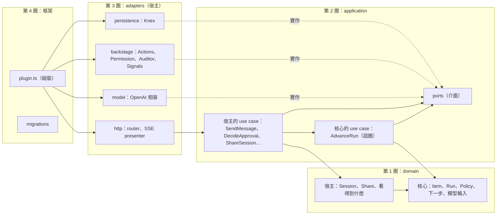
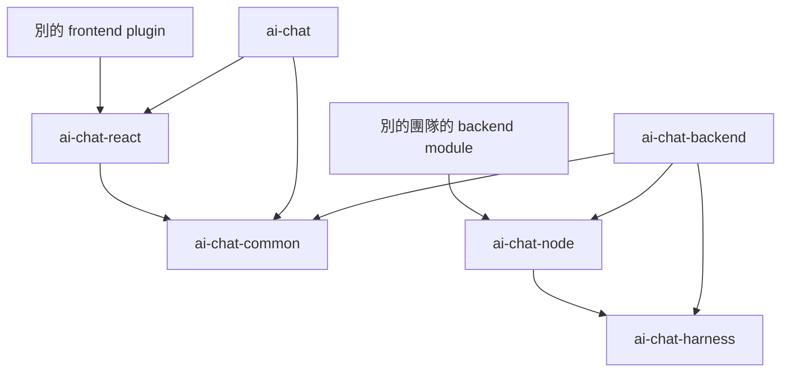

# AI Chat Harness 程式架構

| 欄位     | 內容                                                                                                   |
| -------- | ------------------------------------------------------------------------------------------------------ |
| 狀態     | 已定案，進入實作                                                                                       |
| 版本     | 1.0（2026-11-24）                                                                                      |
| 對應規格 | [harness-spec.zh-TW.md](harness-spec.zh-TW.md) 1.0，主要是 D-15 到 D-19、D-23、D-25，以及需求 4.9（A） |
| 下一份   | [implementation-plan.zh-TW.md](implementation-plan.zh-TW.md)                                           |

這份文件說明程式怎麼分層、每一層放什麼、介面長什麼樣。它不重複規格裡的「為什麼」。

## 1. 結論

- **照 Clean Architecture 分四圈：domain、application、adapters、框架。依賴只能往內。**
- **核心（`ai-chat-harness`）只有裡面兩圈。** 它是純 TypeScript 的函式庫，沒有任何 `@backstage/*` 的依賴。
- **宿主（`ai-chat-backend`）四圈都有。** 它裡面兩圈管 Session 和分享，外面兩圈把 Backstage 接上來。
- **所有對外的東西都在 port 後面。** 資料庫、模型、Actions Registry、Permission、Auditor、Signals、時間、亂數都是 port。換掉任何一個，只動 adapters 那一圈。
- **整個系統只有一個地方 `new` 出 adapter**：宿主的 `plugin.ts`。



## 2. 四圈的規則

| 圈            | 放什麼                                       | 可以 import                                     | 不可以 import                                        |
| ------------- | -------------------------------------------- | ----------------------------------------------- | ---------------------------------------------------- |
| 1 domain      | 型別和純函式。沒有 `async`，沒有 I/O         | 同一圈；宿主的 domain 可以 import 核心的 domain | 其他所有東西                                         |
| 2 application | use case 和 port 的介面。流程在這裡          | domain、同一圈                                  | adapters、`@backstage/*`、`express`、`knex`、`fetch` |
| 3 adapters    | port 的實作、HTTP 的 controller 和 presenter | application、domain、Backstage 和第三方套件     | 其他 adapter 的內部檔案                              |
| 4 框架        | 組裝、migration、設定的 schema               | 全部                                            | —                                                    |

另外四條：

1. **use case 的輸入和輸出是純資料。** 它不收 `Request`，不回 `Response`，不丟 HTTP 的錯誤。
2. **身分是不透明的值。** application 那一圈拿到的是 `Principal`，裡面的 `credentials` 型別是 `unknown`。只有 Backstage 的 adapter 知道它是 `BackstageCredentials`。
3. **錯誤是 domain 的錯誤。** 例如 `RunAlreadyActive`、`NotSessionOwner`。HTTP 的狀態碼由 http adapter 對應。
4. **時間和 id 都是 port。** 測試可以固定時間和 id。

## 3. 套件

| 套件                               | 路徑                       | Backstage role    | 內容                                                                         | 分期                         |
| ---------------------------------- | -------------------------- | ----------------- | ---------------------------------------------------------------------------- | ---------------------------- |
| `ai-chat-harness`                  | `packages/ai-chat-harness` | `node-library`    | 核心：domain 和 application。另有 `/testing` 入口，放假模型和記憶體版的 port | P1                           |
| `backstage-plugin-ai-chat-common`  | `plugins/ai-chat-common`   | `common-library`  | 前後端共用：HTTP 的資料型別、permission 的定義                               | P1（型別）、P2（permission） |
| `backstage-plugin-ai-chat-backend` | `plugins/ai-chat-backend`  | `backend-plugin`  | 宿主：四圈                                                                   | P1                           |
| `backstage-plugin-ai-chat`         | `plugins/ai-chat`          | `frontend-plugin` | 前端                                                                         | P1                           |
| `backstage-plugin-ai-chat-node`    | `plugins/ai-chat-node`     | `node-library`    | backend 的擴充點 `aiChatHarnessExtensionPoint`                               | P3                           |
| `backstage-plugin-ai-chat-react`   | `plugins/ai-chat-react`    | `web-library`     | 前端的擴充點：開啟對話的元件、結果顯示元件、client tool                      | P2 開始                      |

套件之間的依賴：



別的團隊只會碰到 `ai-chat-node` 和 `ai-chat-react`。它們不需要 import 宿主或核心的內部檔案。

## 4. 核心：`ai-chat-harness`

### 4.1 目錄

```
packages/ai-chat-harness/src/
  domain/                      第 1 圈
    item.ts                    Item 的型別（九種 kind）
    run.ts                     RunStatus、合法的狀態轉移
    tool.ts                    ToolDescriptor、ToolCall、ToolResult
    policy.ts                  decidePolicy()
    agent.ts                   AgentDefinition、Limits
    plan.ts                    Plan、currentPlan()
    nextAction.ts              decideNextAction()：從紀錄算出下一步
    modelInput.ts              buildModelInput()：從紀錄算出送給模型的內容
    errors.ts
  application/                 第 2 圈
    ports/
      ItemLog.ts               讀和寫 Item
      ModelClient.ts           呼叫模型，回傳串流
      ToolGateway.ts           列出工具、執行工具
      RunControl.ts            續租、讀取停止要求、更新用量
      Clock.ts
      IdGenerator.ts
      extensions.ts            ContextProvider、Skill、Hooks
    AdvanceRun.ts              迴圈
    steps/
      callModel.ts
      executeTools.ts
      summarize.ts
    builtins/
      updatePlan.ts            P3
      loadSkill.ts             P3
      delegate.ts              P4
    events.ts                  HarnessEvent
  testing/                     另一個入口：ai-chat-harness/testing
    ScriptedModel.ts           照劇本回答的假模型
    InMemoryItemLog.ts
    FakeToolGateway.ts
    itemLogContract.ts         ItemLog 的共用測試（A-10）
  index.ts
```

### 4.2 Domain

**Item** 是整個設計的中心。它是一個聯集型別，每種 `kind` 有自己的 `payload`。

```ts
export type ItemBody =
  | { kind: 'user_message'; text: string }
  | { kind: 'agent_message'; text: string }
  | {
      kind: 'tool_call';
      callId: string;
      toolId: string;
      input: JsonObject;
      schemaHash: string;
      policy: 'allow' | 'ask';
      readOnly: boolean;
      step: number;
      position: number;
    }
  | {
      kind: 'approval';
      callId: string;
      decision: 'allow' | 'deny';
      decidedBy: string;
    }
  | { kind: 'tool_started'; callId: string }
  | {
      kind: 'tool_result';
      callId: string;
      status: 'ok' | 'error' | 'timeout' | 'denied' | 'invalid' | 'unknown';
      output?: JsonValue;
      truncated?: boolean;
      message?: string;
    }
  | { kind: 'plan_update'; plan: Plan }
  | { kind: 'summary'; coversUpToSeq: number; text: string }
  | { kind: 'note'; text: string };

export type Item = ItemBody & {
  sessionId: string;
  seq: number; // 每段 Session 從 1 遞增
  runId?: string;
  createdAt: string; // ISO 8601
};
```

**三個純函式**裝了大部分的規則。它們沒有 I/O，用表格式的測試就能測完。

```ts
// 規格 D-06、T-03、T-04
export function decidePolicy(
  tool: ToolDescriptor,
  settings: PolicySettings,
): 'allow' | 'ask' | 'deny';

// 規格 D-18、D-25、H-05
export function decideNextAction(
  items: readonly Item[],
  run: RunUsage,
  limits: Limits,
): NextAction;

export type NextAction =
  | { type: 'call_model' }
  | {
      type: 'execute_tools';
      calls: ToolCallItem[];
      interrupted: ToolCallItem[];
    }
  | { type: 'wait_approval'; pending: ToolCallItem[] }
  | { type: 'complete' }
  | { type: 'stop'; reason: 'max_steps' | 'max_tool_calls' | 'timeout' };

// 規格 A-05、H-09
export function buildModelInput(
  items: readonly Item[],
  agent: AgentDefinition,
  extra: { context: string[]; tools: ToolDescriptor[] },
  budget: ContextBudget,
): ModelInput;
```

`decideNextAction` 的規則，由上往下，先符合的先用：

| 紀錄的狀態                                         | 下一步                                                                                        |
| -------------------------------------------------- | --------------------------------------------------------------------------------------------- |
| 用量超過上限                                       | `stop`                                                                                        |
| 最後一步有工具呼叫是 `ask`，還沒有 `approval`      | `wait_approval`                                                                               |
| 最後一步有工具呼叫還沒有 `tool_result`             | `execute_tools`。有 `tool_started` 但沒有結果的放進 `interrupted`，不執行，結果寫成 `unknown` |
| 最後一筆是 `agent_message`，而且那一步沒有工具呼叫 | `complete`                                                                                    |
| 其他（最後是使用者訊息，或工具結果都齊了）         | `call_model`                                                                                  |

### 4.3 Application

**Ports**（核心要求外面提供的東西）：

```ts
export interface ItemLog {
  read(sessionId: string, opts?: { afterSeq?: number }): Promise<Item[]>;
  /** 一次寫入多筆，序號連續。dedupeKey 重複時丟 DuplicateItem。 */
  append(
    sessionId: string,
    drafts: ItemDraft[],
    fence: RunFence,
  ): Promise<Item[]>;
}

export interface ModelClient {
  stream(
    input: ModelInput,
    opts: { signal: AbortSignal },
  ): AsyncIterable<ModelChunk>;
  readonly capabilities: { parallelToolCalls: boolean };
}

export interface ToolGateway {
  list(ctx: CallContext): Promise<ToolDescriptor[]>;
  validate(
    toolId: string,
    input: JsonObject,
    ctx: CallContext,
  ): Promise<ValidationResult>;
  execute(
    call: ToolCallItem,
    ctx: CallContext,
    opts: { signal: AbortSignal },
  ): Promise<ToolOutput>;
}

export interface RunControl {
  /** 續租。租約已經不是自己的就丟 LeaseLost。 */
  heartbeat(fence: RunFence): Promise<{ cancelRequested: boolean }>;
  recordUsage(fence: RunFence, usage: RunUsage): Promise<void>;
}

/** 核心不解讀 principal，只把它交給 ToolGateway 和擴充點。 */
export interface CallContext {
  sessionId: string;
  runId: string;
  principal: unknown;
  page?: { path: string; entityRef?: string }; // 規格 B-01，不存進紀錄
}

/** 寫入時帶著，資料庫用它確認「這個 Run 的租約還是我的」。 */
export interface RunFence {
  runId: string;
  leaseOwner: string;
}
```

**Use case：`AdvanceRun`**。這就是迴圈。它沒有成員變數形式的狀態，每一步都重新讀紀錄。

```ts
export class AdvanceRun {
  constructor(
    private readonly deps: {
      items: ItemLog;
      model: ModelClient;
      tools: ToolGateway;
      run: RunControl;
      clock: Clock;
      ids: IdGenerator;
      extensions: Extensions;
    },
  ) {}

  async *execute(req: {
    agent: AgentDefinition;
    limits: Limits;
    fence: RunFence;
    ctx: CallContext;
    signal: AbortSignal;
  }): AsyncGenerator<HarnessEvent, RunOutcome> {
    for (;;) {
      const { cancelRequested } = await this.deps.run.heartbeat(req.fence);
      if (cancelRequested || req.signal.aborted) return { status: 'cancelled' };

      const items = await this.deps.items.read(req.ctx.sessionId);
      const action = decideNextAction(
        items,
        usageOf(items, req.fence.runId),
        req.limits,
      );

      switch (action.type) {
        case 'call_model':
          yield* callModel(this.deps, req, items);
          break;
        case 'execute_tools':
          yield* executeTools(this.deps, req, action);
          break;
        case 'wait_approval':
          return { status: 'waiting_approval' };
        case 'complete':
          return { status: 'completed' };
        case 'stop':
          return { status: 'completed', endReason: action.reason };
      }
    }
  }
}
```

要注意的三點：

- **核准之後的繼續，跟第一次執行是同一個函式。** 宿主寫入 `approval` 之後再呼叫一次 `execute()`。迴圈讀紀錄，發現有核准過但沒結果的呼叫，就去執行。
- **`callModel` 做四件事**：收集 Context provider 的輸出、呼叫 `buildModelInput`、把模型的串流轉成事件、把完成的 `agent_message` 和 `tool_call` 寫進紀錄。參數驗證不合格的呼叫，直接寫一筆 `invalid` 的結果退回給模型（T-05）。
- **`executeTools` 的順序**：唯讀的同時執行；不是唯讀的先寫 `tool_started`，再照 `position` 一個一個執行；被拒絕的寫 `denied`。結果照原本的順序寫入（P-03）。

**事件**（A-03）：

```ts
export type HarnessEvent =
  | { type: 'run.started'; runId: string }
  | { type: 'step.started'; step: number }
  | {
      type: 'item.started';
      draftId: string;
      kind: 'agent_message' | 'tool_call';
    }
  | { type: 'item.delta'; draftId: string; text: string } // 不存
  | { type: 'item.completed'; draftId?: string; item: Item } // 已經寫進紀錄
  | { type: 'step.ended'; step: number }
  | { type: 'run.ended'; outcome: RunOutcome };
```

## 5. 宿主：`ai-chat-backend`

### 5.1 目錄

```
plugins/ai-chat-backend/
  migrations/                          第 4 圈
  config.d.ts                          第 4 圈
  src/
    domain/                            第 1 圈
      session.ts                       Session、可以改哪些欄位
      principal.ts                     Principal { userRef, ownershipRefs, credentials: unknown }
      share.ts                         Share、ShareMode、到期的處理
      visibility.ts                    visibleItems()：某個檢視者看得到哪些 Item
      fork.ts                          forkItems()：複製時帶走哪些 Item
      toolset.ts                       Toolset、enabledTools()
      retention.ts
      errors.ts                        NotFound、NotSessionOwner、RunAlreadyActive…
    application/                       第 2 圈
      ports/
        SessionRepository.ts
        RunRepository.ts               建立 Run、租約、狀態轉移。也實作核心的 RunControl
        ShareRepository.ts             P2
        AccessControl.ts               能不能讀這段 Session、能不能用這個 Toolset
        AuditLog.ts
        Notifier.ts                    P2：通知畫面「狀態變了」
        AgentCatalog.ts                有哪些 Agent、Toolset
        Scheduler.ts                   定期工作
      usecases/
        CreateSession.ts
        GetSession.ts                  回傳 Session 和檢視者看得到的 Item
        ListSessions.ts
        UpdateSession.ts               改名、釘選、封存、開關 Toolset
        DeleteSession.ts
        SendMessage.ts
        DecideApproval.ts
        CancelRun.ts
        FollowSession.ts               P2：用序號接回
        ShareSession.ts                P2
        UpdateShare.ts                 P2：更新快照、開關工具輸出、停止
        ForkSession.ts                 P2
        ExpireStaleRuns.ts
        PurgeExpiredSessions.ts        P2
      RunSupervisor.ts                 這一台正在跑的 Run：啟動、續租、訂閱、關機
    adapters/                          第 3 圈
      http/
        router.ts
        controllers/                   每個 use case 一個，只做轉換
        presenters/uiMessageStream.ts  HarnessEvent 轉成 UI message stream
        errorMapping.ts                domain 的錯誤轉成 HTTP 狀態碼
      persistence/
        KnexItemLog.ts
        KnexSessionRepository.ts
        KnexRunRepository.ts
        KnexShareRepository.ts
      backstage/
        ActionsToolGateway.ts          Actions Registry 轉成 ToolGateway
        PermissionAccessControl.ts
        AuditorAuditLog.ts
        SignalsNotifier.ts
        ConfigAgentCatalog.ts
        principalFromRequest.ts        httpAuth、userInfo 轉成 Principal
        BackstageScheduler.ts
      model/
        OpenAiCompatibleModelClient.ts
      system/
        SystemClock.ts
        UuidGenerator.ts
    plugin.ts                          第 4 圈：組裝
    index.ts
```

### 5.2 Domain

宿主的 domain 管「誰」和「看得到什麼」。這些是核心不知道的事。

```ts
// 規格 SH-02、SH-08、SH-09、SH-11
export function visibleItems(
  items: readonly Item[],
  viewer: { isOwner: true } | { isOwner: false; share: Share },
  now: string,
): VisibleItem[];

// 規格 SH-04
export function forkItems(visible: readonly VisibleItem[]): ItemDraft[];

// 規格 T-02、T-11、D-24
export function enabledTools(
  all: readonly ToolDescriptor[],
  toolsets: readonly Toolset[],
  sessionChoice: readonly string[],
): ToolDescriptor[];
```

`visibleItems` 的規則：

| 檢視者       | 看得到的 Item                    | 工具輸出                                                                |
| ------------ | -------------------------------- | ----------------------------------------------------------------------- |
| 擁有者       | 全部                             | 全部                                                                    |
| 快照分享     | 序號不超過 `up_to_seq` 的        | 序號不超過 `outputs_up_to_seq` 的。超過的只留狀態，輸出換成「沒有分享」 |
| 持續更新     | 全部                             | 同上。預設 `outputs_up_to_seq` 是分享當下的序號                         |
| 過了到期時間 | 當成快照，停在到期當下的最後一筆 | 同上                                                                    |

### 5.3 Use case

每個 use case 一個類別，只有一個 `execute` 方法。

| Use case                      | 做什麼                                            | 用到的 port                                                | 規格                   |
| ----------------------------- | ------------------------------------------------- | ---------------------------------------------------------- | ---------------------- |
| `CreateSession`               | 建立 Session，套用 Toolset 的預設值               | SessionRepository、AgentCatalog                            | SE-01、T-01            |
| `GetSession`                  | 檢查權限，回傳 Session、Run 的狀態、看得到的 Item | SessionRepository、ItemLog、AccessControl、ShareRepository | SH-02、SH-05           |
| `UpdateSession`               | 改名、釘選、封存、開關 Toolset                    | SessionRepository、AgentCatalog                            | SE-03、T-11            |
| `SendMessage`                 | 建立 Run、寫入使用者訊息、啟動迴圈、回傳事件串流  | RunRepository、ItemLog、RunSupervisor、AccessControl       | H-01、H-03、B-01       |
| `DecideApproval`              | 寫入 `approval`。全部決定後重新啟動迴圈           | ItemLog、RunRepository、RunSupervisor、AuditLog            | D-05、T-06、T-07、P-04 |
| `CancelRun`                   | 設定停止要求。Run 在這一台就直接中止              | RunRepository、RunSupervisor                               | H-06                   |
| `FollowSession`               | 先回傳缺的 Item，再接上即時事件                   | ItemLog、RunSupervisor、AccessControl                      | A-07                   |
| `ShareSession`、`UpdateShare` | 建立和修改分享                                    | ShareRepository、ItemLog、AuditLog、Notifier               | SH-01、SH-06 到 SH-11  |
| `ForkSession`                 | 複製成自己的 Session                              | SessionRepository、ItemLog、AccessControl、AuditLog        | SH-04                  |
| `ExpireStaleRuns`             | 租約過期的 Run 標成 `expired`                     | RunRepository                                              | H-04                   |
| `PurgeExpiredSessions`        | 刪除超過保存期限的 Session                        | SessionRepository                                          | SE-05                  |

`SendMessage` 的樣子：

```ts
export class SendMessage {
  constructor(
    private readonly deps: {
      sessions: SessionRepository;
      runs: RunRepository;
      items: ItemLog;
      access: AccessControl;
      supervisor: RunSupervisor;
      agents: AgentCatalog;
    },
  ) {}

  async execute(input: {
    principal: Principal;
    sessionId: string;
    text: string;
    page?: { path: string; entityRef?: string };
  }): Promise<RunSubscription> {
    const session = await this.deps.sessions.get(input.sessionId);
    assertOwner(session, input.principal); // 丟 NotSessionOwner

    const run = await this.deps.runs.start(session.id); // 丟 RunAlreadyActive
    await this.deps.items.append(
      session.id,
      [{ kind: 'user_message', text: input.text }],
      run.fence,
    );
    return this.deps.supervisor.launch(run, {
      agent: await this.deps.agents.get(session.agentId),
      ctx: {
        sessionId: session.id,
        runId: run.id,
        principal: input.principal,
        page: input.page,
      },
    });
  }
}
```

### 5.4 `RunSupervisor`

它管理「這一台 backend 正在跑的 Run」。它在 application 那一圈，只用 port。

- **啟動**：呼叫核心的 `AdvanceRun.execute()`，在背景消費事件。HTTP 的回應只是其中一個訂閱者。
- **訂閱**：每個 Run 可以有多個訂閱者。訂閱者斷線不影響 Run（H-07、A-06）。
- **續租**：核心每一步呼叫一次 `heartbeat`。模型呼叫很久時，另外有計時器每 10 秒續租一次。租約長度 30 秒。
- **結束**：依照 `RunOutcome` 更新 Run 的狀態，清掉 `active_session_id`，通知 Notifier。
- **關機**：停止接新的 Run。等進行中的 Run 最多 20 秒。沒跑完的中止並標成 `expired`（H-11）。

### 5.5 Adapters

| Port                                                               | Adapter                        | 用到的 Backstage 服務                                                             |
| ------------------------------------------------------------------ | ------------------------------ | --------------------------------------------------------------------------------- |
| `ItemLog`、`SessionRepository`、`RunRepository`、`ShareRepository` | `Knex*`                        | `coreServices.database`                                                           |
| `ToolGateway`                                                      | `ActionsToolGateway`           | `actionsServiceRef`（`@backstage/backend-plugin-api/alpha`）的 `list` 和 `invoke` |
| `ModelClient`                                                      | `OpenAiCompatibleModelClient`  | 沒有。用 `fetch`                                                                  |
| `AccessControl`                                                    | `PermissionAccessControl`      | `coreServices.permissions`（P2 之前只檢查擁有者）                                 |
| `AuditLog`                                                         | `AuditorAuditLog`              | `coreServices.auditor`                                                            |
| `Notifier`                                                         | `SignalsNotifier`              | `signalsServiceRef`。沒有安裝時用不做事的版本                                     |
| `AgentCatalog`                                                     | `ConfigAgentCatalog`           | `coreServices.rootConfig`，加上擴充點註冊的內容                                   |
| `Scheduler`                                                        | `BackstageScheduler`           | `coreServices.scheduler`                                                          |
| `Clock`、`IdGenerator`                                             | `SystemClock`、`UuidGenerator` | 沒有                                                                              |
| （HTTP 的身分）                                                    | `principalFromRequest`         | `coreServices.httpAuth`、`coreServices.userInfo`                                  |

`ActionsToolGateway` 負責的轉換：

- action 的 `attributes.readOnly` 轉成 `ToolDescriptor.readOnly`。沒有標的當成不是唯讀（D-06）。
- action 的 id 對照 Toolset 的樣式（例如 `catalog:*`），算出每個工具屬於哪一組、是不是 `egress`。
- 用 action 的 input schema 驗證參數，並算出 schema 雜湊（T-05、T-06）。
- 執行時把 `CallContext.principal` 還原成 `BackstageCredentials`，交給 `actions.invoke`。

### 5.6 組裝

`plugin.ts` 是唯一知道所有具體類別的地方。

```ts
export const aiChatPlugin = createBackendPlugin({
  pluginId: 'ai-chat',
  register(env) {
    const extensions = new ExtensionRegistry();
    env.registerExtensionPoint(aiChatHarnessExtensionPoint, extensions);   // P3

    env.registerInit({
      deps: { /* logger、rootConfig、database、httpAuth、userInfo、httpRouter、
                 auditor、permissions、scheduler、lifecycle、actions */ },
      async init(d) {
        const knex = await d.database.getClient();
        const clock = new SystemClock();
        const ids = new UuidGenerator();

        // 第 3 圈
        const items = new KnexItemLog(knex, clock);
        const sessions = new KnexSessionRepository(knex, clock);
        const runs = new KnexRunRepository(knex, clock, ids);
        const agents = new ConfigAgentCatalog(d.rootConfig, extensions);
        const tools = new ActionsToolGateway(d.actions, agents);
        const model = new OpenAiCompatibleModelClient(readModelConfig(d.rootConfig));
        const access = new PermissionAccessControl(d.permissions);
        const audit = new AuditorAuditLog(d.auditor);

        // 第 2 圈
        const advanceRun = new AdvanceRun({ items, model, tools, run: runs, clock, ids, extensions });
        const supervisor = new RunSupervisor({ advanceRun, runs, clock });
        const useCases = {
          sendMessage: new SendMessage({ sessions, runs, items, access, supervisor, agents }),
          decideApproval: new DecideApproval({ sessions, runs, items, supervisor, audit, tools }),
          /* 其餘 use case */
        };

        // 第 3 圈：HTTP
        d.httpRouter.use(createRouter({ useCases, principalFromRequest: /* … */ }));
        d.lifecycle.addShutdownHook(() => supervisor.shutdown());
      },
    });
  },
});
```

## 6. 擴充點

### 6.1 Backend：`ai-chat-node`

擴充點的介面在規格第 7 節。型別定義在核心的 `application/ports/extensions.ts`，`ai-chat-node` 重新匯出它們，並定義 `aiChatHarnessExtensionPoint`。

別的團隊的 module 長這樣：

```ts
export default createBackendModule({
  pluginId: 'ai-chat',
  moduleId: 'sre',
  register(env) {
    env.registerInit({
      deps: {
        harness: aiChatHarnessExtensionPoint,
        catalog: catalogServiceRef,
      },
      async init({ harness, catalog }) {
        harness.addContextProvider({
          id: 'oncall',
          async provide(ctx) {
            /* 回傳「目前值班的人是誰」 */
          },
        });
        harness.addHook('beforeToolCall', async call =>
          call.toolId.startsWith('temporal:') && isFreezeWindow()
            ? { action: 'deny', reason: '目前是凍結期' }
            : { action: 'continue' },
        );
      },
    });
  },
});
```

擴充點在這個架構裡的位置：它們是核心 application 那一圈的 port。別的團隊寫的是 adapter。所以擴充的程式碼天生不能繞過政策，它只拿得到 port 給它的東西。

### 6.2 Frontend：`ai-chat-react`

| 擴充點       | 形式                                                                   | 分期 |
| ------------ | ---------------------------------------------------------------------- | ---- |
| 頁面上下文   | 內建。前端從 router 和 entity context 讀取，每則訊息帶上               | P1   |
| 入口         | `<AiChatLauncher prompt="…" entityRef="…" />`，以及 `useAiChatPanel()` | P2   |
| 結果顯示元件 | `AiChatToolResultBlueprint`：為某個 action id 註冊一個元件             | P3   |
| Client tool  | `AiChatClientToolBlueprint`：在瀏覽器執行的工具                        | P4   |

## 7. 資料庫

id 是字串（64），時間是 ISO 8601 字串（32）。這跟 PR #1 的慣例一樣，SQLite 和 PostgreSQL 的行為相同。

```
sessions
  id                    string(64)   PK
  owner_ref             string(255)  not null, index
  agent_id              string(64)   not null
  title                 string(255)  null
  entity_ref            string(255)  null, index
  enabled_toolsets      text         not null   JSON 陣列
  next_seq              integer      not null default 1
  forked_from_session   string(64)   null
  forked_from_seq       integer      null
  pinned                boolean      not null default false
  archived_at           string(32)   null
  created_at, updated_at string(32)  not null
  index (owner_ref, updated_at)

runs
  id                    string(64)   PK
  session_id            string(64)   not null, FK sessions on delete cascade
  parent_run_id         string(64)   null
  status                string(24)   not null
  active_session_id     string(64)   null, UNIQUE       進行中才有值（H-03）
  lease_owner           string(64)   null
  lease_expires_at      string(32)   null, index
  steps_used            integer      not null default 0
  tool_calls_used       integer      not null default 0
  cancel_requested      boolean      not null default false
  end_reason            string(32)   null
  started_at            string(32)   not null
  ended_at              string(32)   null

items
  session_id            string(64)   not null, FK sessions on delete cascade
  seq                   integer      not null
  run_id                string(64)   null
  kind                  string(24)   not null
  payload               text         not null   JSON
  dedupe_key            string(96)   null
  created_at            string(32)   not null
  PK (session_id, seq)
  UNIQUE (session_id, dedupe_key)               空值不算重複（T-07、D-25）

shares                                           P2
  id                    string(64)   PK
  session_id            string(64)   not null, FK sessions on delete cascade
  subject_ref           string(255)  not null, index    user:… 或 group:…
  up_to_seq             integer      null       空值是持續更新
  outputs_up_to_seq     integer      null       空值是範圍內都給看
  expires_at            string(32)   null
  created_by            string(255)  not null
  created_at            string(32)   not null
  revoked_at            string(32)   null
```

寫入 Item 的 transaction：

1. 確認 `runs` 裡這個 Run 的 `lease_owner` 是自己，而且狀態是 `running`。宿主寫 `user_message` 和 `approval` 時不檢查這一項，改成檢查 Run 的狀態。
2. 讀取並遞增 `sessions.next_seq`。
3. 插入 Item。
4. 更新 `sessions.updated_at`。

`dedupe_key` 重複時，資料庫會拒絕。adapter 把它轉成 `DuplicateItem`。`DecideApproval` 收到這個錯誤時，回傳已經存在的那個決定。

## 8. HTTP 介面

路徑都在 `/api/ai-chat` 底下。

| 方法和路徑                                                                    | Use case                  | 回應                                  | 分期                      |
| ----------------------------------------------------------------------------- | ------------------------- | ------------------------------------- | ------------------------- |
| `GET /sessions`                                                               | ListSessions              | JSON                                  | P1                        |
| `POST /sessions`                                                              | CreateSession             | JSON                                  | P1                        |
| `GET /sessions/:id`                                                           | GetSession                | JSON：Session、Run 狀態、Item         | P1                        |
| `PATCH /sessions/:id`                                                         | UpdateSession             | JSON                                  | P1（Toolset）、P2（其他） |
| `DELETE /sessions/:id`                                                        | DeleteSession             | 204                                   | P1                        |
| `POST /sessions/:id/runs`                                                     | SendMessage               | SSE                                   | P1                        |
| `POST /sessions/:id/runs/:runId/cancel`                                       | CancelRun                 | 202                                   | P1                        |
| `POST /sessions/:id/tool-calls/:callId/decision`                              | DecideApproval            | 還有別的要決定：JSON。全部決定了：SSE | P1                        |
| `GET /sessions/:id/stream?afterSeq=`                                          | FollowSession             | SSE                                   | P2                        |
| `GET/POST /sessions/:id/shares`、`PATCH/DELETE /sessions/:id/shares/:shareId` | ShareSession、UpdateShare | JSON                                  | P2                        |
| `POST /sessions/:id/fork`                                                     | ForkSession               | JSON                                  | P2                        |
| `GET /toolsets`、`GET /agents`                                                | AgentCatalog              | JSON                                  | P1、P3                    |

Controller 只做三件事：把請求轉成 use case 的輸入、呼叫 use case、把結果交給 presenter。

**SSE 的格式**是 AI SDK 的 UI message stream（鎖定 `ai@7.0.166`）。`uiMessageStream.ts` 把 `HarnessEvent` 轉過去。回應的 header：`content-type: text/event-stream`、`cache-control: no-cache`、`x-vercel-ai-ui-message-stream: v1`、`x-accel-buffering: no`。每個事件一行 `data: <JSON>`，結尾 `data: [DONE]`。

| HarnessEvent                                                    | UI message stream                                                                    |
| --------------------------------------------------------------- | ------------------------------------------------------------------------------------ |
| `run.started`                                                   | `start`（`messageId` 每個 Run 一個），加 `data-run`（`transient`，Run 的 id 和狀態） |
| `step.started`、`step.ended`                                    | `start-step`、`finish-step`                                                          |
| `item.started`（agent_message）、`item.delta`、`item.completed` | `text-start`、`text-delta`、`text-end`                                               |
| `item.completed`（tool_call）                                   | `tool-input-available`                                                               |
| `item.completed`（tool_call，政策是 ask）                       | 再加 `tool-approval-request`（`approvalId` 等於 `toolCallId`）                       |
| `approval` Item                                                 | `tool-approval-response`（`approved`），放在核准後接續串流的開頭                     |
| `item.completed`（tool_result，成功）                           | `tool-output-available`                                                              |
| `item.completed`（tool_result，失敗）                           | `tool-output-error`                                                                  |
| `item.completed`（tool_result，被拒絕）                         | `tool-output-denied`                                                                 |
| `item.completed`（plan_update）                                 | `data-plan`（固定 `id`，後送的取代先送的）                                           |
| 每一筆完成的 Item                                               | `data-item`（`transient`，序號和 kind），給 A-07 接回用                              |
| `run.ended`（等核准）                                           | `data-run`（`transient`），然後 `finish`（`finishReason: 'tool-calls'`）             |
| `run.ended`（完成）                                             | `data-run`（`transient`），然後 `finish`（`finishReason: 'stop'`）                   |
| `run.ended`（失敗）                                             | `error`，然後 `data-run`（`transient`）和 `finish`                                   |
| `run.ended`（取消）                                             | `data-run`（`transient`），然後 `abort`                                              |

`data-*` 事件標 `transient: true` 時不進訊息，只送給用戶端的 `onData`。

「停在核准上」用協定原生的 `tool-approval-request`。核准是另一個請求（`decision`），它的回應用同一個 `messageId`，從 `tool-approval-response` 開始，接在同一則訊息上。不用 `signature`：歷史在伺服器的紀錄裡，用戶端不送歷史。

重新整理後接回（A-07）：伺服器從目前 Run 的第一個 Item 重送，再接著送新的。只送缺的 Item 時，`useChat` 會蓋掉已載入的部分訊息。

每一列都用 `ai@7.0.166` 的解析器和 `useChat` 實測過。細節在 [protocol-check.zh-TW.md](protocol-check.zh-TW.md)。協定只出現在這一個檔案；要換協定，改這個檔案和前端對應的 adapter。

## 9. 前端：`ai-chat`

前端的分層比較輕，但是方向一樣：畫面元件不直接呼叫 `fetch`，狀態的規則是純函式。

```
plugins/ai-chat/src/
  domain/
    itemsToMessages.ts      把 GET /sessions/:id 的 Item 轉成 UIMessage（純函式）
    approval.ts             哪些卡片還在等、能不能送新訊息（讀 UIMessage 的 part，純函式）
  application/              React hooks，每個對應一個使用情境。包 useChat
    useSession.ts           useChat 加 resume、onData（記住最後的序號）
    useSendMessage.ts
    useApproval.ts          addToolApprovalResponse
    useSessionList.ts
    usePageContext.ts       B-01
  adapters/
    AiChatClient.ts         實作 aiChatApiRef
    AiChatTransport.ts      實作 ai 的 ChatTransport：送訊息、決定、接回串流
  ui/
    ChatPage.tsx  SessionList.tsx  MessageList.tsx
    ToolCallCard.tsx  ApprovalCard.tsx
    ShareDialog.tsx（P2）  SharedBanner.tsx（P2）  PlanPanel.tsx（P3）
  alpha.tsx                 新 frontend system 的 extension
  plugin.ts                 舊 frontend system
```

前端用 `@ai-sdk/react` 的 `useChat`，加我們的 `ChatTransport`。`AiChatTransport` 只送最後一則使用者文字，不送整段歷史；`sendMessages` 看到有 `approval-responded` 的 part 時，改打 `decision` 端點；`reconnectToStream` 打 `GET /sessions/:id/stream`，`resumeStreamIsReplay` 設成 `true`。判斷依據在 [protocol-check.zh-TW.md](protocol-check.zh-TW.md) 第 5 節。在 Backstage CLI 的 jest 裡可以 import `ai` 和 `@ai-sdk/react`，也能處理串流，已用探針確認（那份文件的 5.3 節）。

PR #1 的 `chatState.ts` 的 Item 轉換搬到 `domain/itemsToMessages.ts`，`useChat.ts` 拆進 `application/`，`api/` 搬到 `adapters/`。

## 10. 測試

| 圈                    | 測什麼                                                                             | 怎麼測                                                   | 需要什麼                        |
| --------------------- | ---------------------------------------------------------------------------------- | -------------------------------------------------------- | ------------------------------- |
| domain                | `decidePolicy`、`decideNextAction`、`buildModelInput`、`visibleItems`、`forkItems` | 表格式的單元測試。每條規則至少一列                       | 什麼都不用                      |
| application（核心）   | 迴圈：一般回答、工具、核准後繼續、拒絕、上限、停止、當掉後接手                     | 用 `ScriptedModel`、`InMemoryItemLog`、`FakeToolGateway` | 什麼都不用                      |
| application（宿主）   | 每個 use case 的權限和流程                                                         | 記憶體版的 port                                          | 什麼都不用                      |
| adapters：persistence | 每個 `Knex*`                                                                       | 跑 A-10 的共用測試。SQLite 和 PostgreSQL 都跑            | `TestDatabases`                 |
| adapters：backstage   | `ActionsToolGateway` 的屬性對應和 schema 驗證                                      | 假的 ActionsService                                      | `@backstage/backend-test-utils` |
| adapters：http        | 路由、狀態碼、SSE 的內容                                                           | `startTestBackend` 加 supertest                          | 同上                            |
| 整體                  | 兩台 backend 共用一個資料庫：一台送訊息，另一台核准                                | 整合測試                                                 | PostgreSQL                      |
| 端對端                | 送訊息、核准、停止、重新整理                                                       | Playwright（PR #1 已有）                                 | 假的模型伺服器                  |

目標：裡面兩圈的測試不啟動 Backstage，全部在幾秒內跑完。

## 11. 用 lint 守住方向

三層檢查，CI 都會擋（A-09）：

1. **核心的 `package.json` 沒有任何 `@backstage/*`。** Backstage 內建的 `@backstage/no-undeclared-imports` 規則會擋掉沒宣告的 import。
2. **`import/no-restricted-paths`** 設定各圈的方向：

   ```js
   // plugins/ai-chat-backend/.eslintrc.js（核心的設定相同，少了 adapters）
   'import/no-restricted-paths': ['error', { zones: [
     { target: './src/domain',      from: './src/application' },
     { target: './src/domain',      from: './src/adapters' },
     { target: './src/application', from: './src/adapters' },
     { target: './src/adapters/http',        from: './src/adapters/persistence' },
     { target: './src/adapters/persistence', from: './src/adapters/http' },
   ]}],
   ```

3. **`no-restricted-imports`** 在 `src/domain` 和 `src/application` 禁止 `@backstage/*`、`express`、`knex`。

## 12. 要改東西時動哪裡

| 要做的事                       | 動哪裡                                                                                       | 不用動                               |
| ------------------------------ | -------------------------------------------------------------------------------------------- | ------------------------------------ |
| 換資料庫，或加快取             | `adapters/persistence`                                                                       | 其他全部                             |
| 換串流協定                     | `presenters/uiMessageStream.ts`、前端的 `adapters/uiMessageStream.ts`                        | 核心、use case                       |
| 換模型供應商                   | `adapters/model`，或用擴充點註冊                                                             | 核心                                 |
| 加一種 Item                    | 核心的 `domain/item.ts`、`nextAction.ts`、`modelInput.ts`；宿主的 `visibility.ts`；presenter | 資料庫的 schema（`payload` 是 JSON） |
| 加一條政策規則                 | 核心的 `domain/policy.ts` 和它的測試                                                         | adapters                             |
| 把迴圈搬到獨立的 worker        | 寫新的宿主，重用核心和 `Knex*`                                                               | 核心                                 |
| 接到別的畫面（例如別人的前端） | 多寫一個 presenter 和 router                                                                 | 核心、use case、資料庫               |
