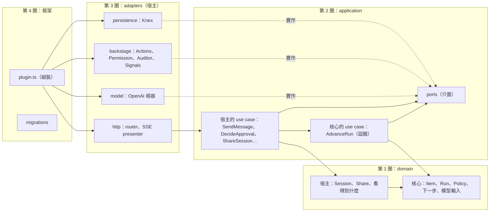
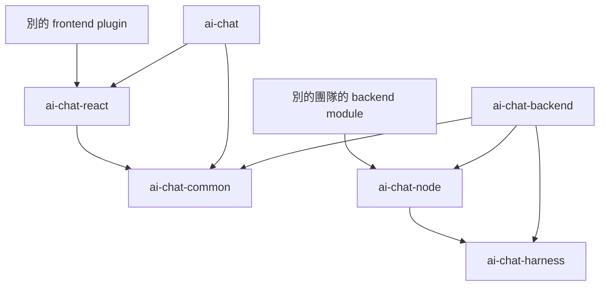

# AI Chat Harness 程式架構

| 欄位     | 內容                                                                                                   |
| -------- | ------------------------------------------------------------------------------------------------------ |
| 狀態     | 已定案，P1 完成（P1-01 到 P1-11）                                                                      |
| 版本     | 1.0（2026-11-24）                                                                                      |
| 對應規格 | [harness-spec.zh-TW.md](harness-spec.zh-TW.md) 1.0，主要是 D-15 到 D-19、D-23、D-25，以及需求 4.9（A） |
| 下一份   | [implementation-plan.zh-TW.md](implementation-plan.zh-TW.md)                                           |

這份文件說明程式怎麼分層、每一層放什麼、介面長什麼樣。它不重複規格裡的「為什麼」。

## 1. 結論

- **照 Clean Architecture 分四圈：domain、application、adapters、框架。依賴只能往內。**
- **核心（`ai-chat-harness`）只有裡面兩圈。** 它是純 TypeScript 的函式庫，沒有任何 `@backstage/*` 的依賴。
- **宿主（`ai-chat-backend`）四圈都有。** 它裡面兩圈管 Session 和分享，外面兩圈把 Backstage 接上來。
- **所有對外的東西都在 port 後面。** 資料庫、模型、Actions Registry、Permission、Auditor、Signals、時間、亂數都是 port。換掉任何一個，只動 adapters 那一圈。
- **整個系統只有一個地方 `new` 出 adapter**：宿主的 `plugin.ts`。



## 2. 四圈的規則

| 圈            | 放什麼                                       | 可以 import                                     | 不可以 import                                        |
| ------------- | -------------------------------------------- | ----------------------------------------------- | ---------------------------------------------------- |
| 1 domain      | 型別和純函式。沒有 `async`，沒有 I/O         | 同一圈；宿主的 domain 可以 import 核心的 domain | 其他所有東西                                         |
| 2 application | use case 和 port 的介面。流程在這裡          | domain、同一圈                                  | adapters、`@backstage/*`、`express`、`knex`、`fetch` |
| 3 adapters    | port 的實作、HTTP 的 controller 和 presenter | application、domain、Backstage 和第三方套件     | 其他 adapter 的內部檔案                              |
| 4 框架        | 組裝、migration、設定的 schema               | 全部                                            | —                                                    |

另外四條：

1. **use case 的輸入和輸出是純資料。** 它不收 `Request`，不回 `Response`，不丟 HTTP 的錯誤。
2. **身分是不透明的值。** application 那一圈拿到的是 `Principal`，裡面的 `credentials` 型別是 `unknown`。只有 Backstage 的 adapter 知道它是 `BackstageCredentials`。
3. **錯誤是 domain 的錯誤。** 例如 `RunAlreadyActive`、`NotSessionOwner`。HTTP 的狀態碼由 http adapter 對應。
4. **時間和 id 都是 port。** 測試可以固定時間和 id。

## 3. 套件

| 套件                               | 路徑                       | Backstage role    | 內容                                                                         | 分期                         |
| ---------------------------------- | -------------------------- | ----------------- | ---------------------------------------------------------------------------- | ---------------------------- |
| `ai-chat-harness`                  | `packages/ai-chat-harness` | `node-library`    | 核心：domain 和 application。另有 `/testing` 入口，放假模型和記憶體版的 port | P1                           |
| `backstage-plugin-ai-chat-common`  | `plugins/ai-chat-common`   | `common-library`  | 前後端共用：HTTP 的資料型別、permission 的定義                               | P1（型別）、P2（permission） |
| `backstage-plugin-ai-chat-backend` | `plugins/ai-chat-backend`  | `backend-plugin`  | 宿主：四圈                                                                   | P1                           |
| `backstage-plugin-ai-chat`         | `plugins/ai-chat`          | `frontend-plugin` | 前端                                                                         | P1                           |
| `backstage-plugin-ai-chat-node`    | `plugins/ai-chat-node`     | `node-library`    | backend 的擴充點 `aiChatHarnessExtensionPoint`                               | P3                           |
| `backstage-plugin-ai-chat-react`   | `plugins/ai-chat-react`    | `web-library`     | 前端的擴充點：開啟對話的元件、結果顯示元件、client tool                      | P2 開始                      |

套件之間的依賴：



別的團隊只會碰到 `ai-chat-node` 和 `ai-chat-react`。它們不需要 import 宿主或核心的內部檔案。

## 4. 核心：`ai-chat-harness`

### 4.1 目錄

```
packages/ai-chat-harness/src/
  domain/                      第 1 圈
    item.ts                    Item 的型別（九種 kind）
    run.ts                     RunStatus、合法的狀態轉移
    tool.ts                    ToolDescriptor、ToolCall、ToolResult
    policy.ts                  decidePolicy()、needsApproval()
    agent.ts                   AgentDefinition、Limits
    plan.ts                    Plan、currentPlan()
    nextAction.ts              decideNextAction()：從紀錄算出下一步
    modelInput.ts              buildModelInput()、planSummary()、buildSummaryInput()、estimateTokens()：從紀錄算出送給模型的內容，套用 token 預算
    errors.ts
  application/                 第 2 圈
    ports/
      ItemLog.ts               讀和寫 Item、ItemDraft、RunFence
      ModelClient.ts           呼叫模型，回傳串流；ModelChunk
      ToolGateway.ts           列出工具、驗證、執行；CallContext、ToolOutput、ValidationResult
      RunControl.ts            續租、讀取停止要求、更新用量
      Clock.ts
      IdGenerator.ts
      extensions.ts            P3 才有內容。現在 Extensions 是空型別
    AdvanceRun.ts              迴圈
    types.ts                   AdvanceRunDeps、AdvanceRunRequest
    steps/
      callModel.ts
      executeTools.ts
      summarize.ts             用模型產生摘要，寫成 summary Item
    events.ts                  HarnessEvent、RunOutcome
    （還沒有：builtins/（updatePlan、loadSkill 是 P3，delegate 是 P4）、extensions 的內容（P3））
  testing/                     另一個入口：ai-chat-harness/testing
    ScriptedModel.ts           照劇本回答的假模型
    InMemoryItemLog.ts
    FakeToolGateway.ts
    fakes.ts                   FakeClock、SequentialIdGenerator、FakeRunControl
    itemLogContract.ts         ItemLog 的共用測試（A-10）
    fixture.ts                 核心迴圈測試用的組合（不對外匯出）
  index.ts
```

### 4.2 Domain

**Item** 是整個設計的中心。它是一個聯集型別，每種 `kind` 有自己的 `payload`。

```ts
export type ItemBody =
  | {
      kind: 'user_message';
      text: string;
      page?: { path: string; entityRef?: string };
    } // 規格 B-01
  | { kind: 'agent_message'; text: string }
  | {
      kind: 'tool_call';
      callId: string;
      toolId: string;
      input: JsonObject;
      schemaHash: string;
      policy: 'allow' | 'ask';
      readOnly: boolean;
      step: number;
      position: number;
    }
  | {
      kind: 'approval';
      callId: string;
      decision: 'allow' | 'deny';
      decidedBy: string;
    }
  | { kind: 'tool_started'; callId: string }
  | {
      kind: 'tool_result';
      callId: string;
      status: 'ok' | 'error' | 'timeout' | 'denied' | 'invalid' | 'unknown';
      output?: JsonValue;
      truncated?: boolean;
      message?: string;
    }
  | { kind: 'plan_update'; plan: Plan }
  | { kind: 'summary'; coversUpToSeq: number; text: string }
  | { kind: 'note'; text: string };

export type Item = ItemBody & {
  sessionId: string;
  seq: number; // 每段 Session 從 1 遞增
  runId?: string;
  createdAt: string; // ISO 8601
};
```

**三個純函式**裝了大部分的規則。它們沒有 I/O，用表格式的測試就能測完。

```ts
// 規格 D-06、T-03、T-04
export function decidePolicy(
  tool: ToolDescriptor,
  settings: PolicySettings,
): 'allow' | 'ask' | 'deny';

// 規格 D-18、D-25、H-05
export function decideNextAction(
  items: readonly Item[],
  run: RunUsage,
  limits: Limits,
): NextAction;

export type NextAction =
  | { type: 'call_model' }
  | {
      type: 'execute_tools';
      calls: ToolCallItem[];
      interrupted: ToolCallItem[];
    }
  | { type: 'wait_approval'; pending: ToolCallItem[] }
  | { type: 'complete' }
  | { type: 'stop'; reason: 'max_steps' | 'max_tool_calls' | 'timeout' };

// 規格 A-05、H-09、B-01：user_message 有 page 時，那則 user 訊息的內容前面加一行
// 「The user is on the page of "<entityRef>" ("<path>").」（沒有 entity 時「The user is on the page "<path>".」），
// 值用 JSON.stringify 寫（page 是用戶端給的，換行和引號不能讓這一行結束），
// 空一行後是原文；這一行在訊息裡，不在 system prompt。
export function buildModelInput(
  items: readonly Item[],
  agent: AgentDefinition,
  extra: { context: string[]; tools: ToolDescriptor[] },
  budget: ContextBudget, // { tokenBudget, keepRecentSteps }
): ModelInput;

// 規格 H-09：舊的 Step 該不該換成摘要，換哪一段。不需要時回傳 undefined
export function planSummary(/* 同 buildModelInput 的參數 */):
  | SummaryPlan
  | undefined;
export type SummaryPlan = {
  coversUpToSeq: number;
  previousSummary?: string;
  items: Item[]; // 上一份摘要之後，到 coversUpToSeq 為止
};

// 產生摘要的那次模型呼叫的輸入：舊的 Step 轉成一段文字，沒有工具
export function buildSummaryInput(
  plan: SummaryPlan,
  budget: ContextBudget,
): ModelInput;

// 規格 V-04：用字數估計 token
export function estimateTokens(text: string): number;
```

**上下文預算**（H-09）。四個函式都是純函式，沒有 async；產生摘要的模型呼叫在 application（`steps/summarize.ts`）。

- **大小**用 `estimateTokens`：ASCII 字元算 1/4 個 token，其他字元（中日韓）算 1 個，無條件進位。`ModelClient` 的串流不回傳用量，所以一律用估計。系統提示、工具清單、摘要訊息、每則訊息都算進去。
- **分段**：紀錄分成「一則使用者訊息」和「一個 Step」（agent 的文字、同一步的工具呼叫、每個呼叫的回答）。預算只整段增減，所以工具呼叫和它的結果不會被拆開。
- **保留最近的 Step**：最近 `keepRecentSteps` 個 Step（至少 1 個）和它們前面連著的使用者訊息不會被縮短、省略或摘要。只有這些就超過預算時，送出的內容會超過預算。
- **最新的使用者訊息永遠原文送出**：它不被摘要涵蓋（`coversUpToSeq` 最多到它的 `seq` 減 1，所以 `fromLatestSummary` 讀得到它），也不被省略。同一個 Run 裡超過 `keepRecentSteps` 的 Step（在這則訊息之後、最近的 Step 之前）照規則先縮短、再省略，但不摘要：摘要只涵蓋這則訊息之前的部分。
- **超過預算時依序處理**：
  1. 舊的 Step 的工具輸出換成一行（保留 `status`，`message` 是 `The output was left out to keep the context short.`），從最舊的開始，夠了就停。
  2. 還是超過，`planSummary` 回傳要摘要的範圍：從上一份摘要之後，到最新的使用者訊息之前（它在最近的 Step 之前時；否則到最近的 Step 之前）。`AdvanceRun` 產生摘要，寫成 `summary` Item。
  3. 沒有摘要可用（摘要失敗，或沒有舊的 Step 可以摘要），`buildModelInput` 從最舊的 Step 起整段省略，直到符合預算。省略要讓模型知道，訊息都算進預算：
     - 跨 Run 的舊內容（最新的使用者訊息之前）被省略，而且沒有摘要時，最前面放一則固定的 `user` 訊息 `The earlier part of the conversation was left out.`，所以送出的第一則訊息一定是 `user`。
     - 同一個 Run 的中間 Step（最新的使用者訊息之後、最近的 Step 之前）被省略時，不管有沒有摘要，都在那則使用者訊息後面放 `Some earlier steps of this answer were left out.`。
     - 事件 `context.trimmed`（`parts` 是 `earlier` 和 `steps` 的子集合）讓畫面知道有東西被省略。摘要失敗、摘要沒有用而直接省略時也會發。
- **摘要沒有用時不做**：不會被省略的部分（系統提示、工具清單、最新的使用者訊息、最近的 Step）加上摘要預留（`min(600, tokenBudget 的十分之一)` token）已經超過預算時，`planSummary` 回傳 `undefined`，不然每一步都會重做一次摘要而大小不變。
- **有摘要之後**：最新的 `summary`（`seq` 最大的）取代 `seq <= coversUpToSeq` 的 Item。它的文字加上說明（`This is a summary of the earlier part ...`，並註明內容含工具輸出，是不可信的資料）是第一則訊息，角色是 `user`。新的摘要包含上一份摘要的文字，所以每一份都涵蓋從頭到 `coversUpToSeq`。
- **已知限制**：
  - 同一個 Run 的中間 Step 只縮短和省略，不摘要。原因：摘要的涵蓋範圍是 `seq` 的前綴（`coversUpToSeq`），摘要中間的 Step 會連最新的使用者訊息一起蓋掉，違反「問題永遠原文」。Run 很長（`maxSteps` 調高）時，中間的 Step 會被省略。排到 P3 評估，或調高 `maxSteps` 預設值時評估。
  - 摘要（或「已省略」的說明）後面接著問題，會有連續兩則 `user`。少數要求 `user` 和 `assistant` 嚴格交替的 chat template 可能拒絕（未查證）。
- **預算是估計**：`estimateTokens` 對 JSON 和程式碼可能低估（每字元的 token 比文字多），`tokenBudget` 要設得比模型的上下文視窗小很多。
- **摘要的輸入**：`buildSummaryInput` 把要摘要的 Item 轉成一則 `user` 訊息（`User:`、`Agent:`、`Agent called`、`Result of`），每個工具輸出最多 1500 字元，整段不超過 `tokenBudget`（超過時留下最新的部分）。上一份摘要放在最前面。

`decideNextAction` 的規則，由上往下，先符合的先用：

| 紀錄的狀態                                                              | 下一步                                                                                        |
| ----------------------------------------------------------------------- | --------------------------------------------------------------------------------------------- |
| 最後一筆對話 Item 是 `agent_message`，而且最後一步沒有未完成的呼叫      | `complete`                                                                                    |
| 總時間用完                                                              | `stop`（`timeout`）                                                                           |
| 最後一步有要核准的呼叫（`needsApproval`），還沒有 `approval` 也沒有結果 | `wait_approval`                                                                               |
| 最後一步有工具呼叫還沒有 `tool_result`                                  | `execute_tools`。有 `tool_started` 但沒有結果的放進 `interrupted`，不執行，結果寫成 `unknown` |
| Step 數用完                                                             | `stop`（`max_steps`）                                                                         |
| 工具呼叫數用完                                                          | `stop`（`max_tool_calls`）                                                                    |
| 其他（最後是使用者訊息，或工具結果都齊了）                              | `call_model`                                                                                  |

Step 數和工具呼叫數的上限只擋新的模型呼叫，不會讓最後一步的呼叫沒有結果。一步裡的呼叫超過 `maxToolCallsPerRun` 的部分，由 `callModel` 寫入時處理（見 4.3）。「要核准」的判斷是 domain 的 `needsApproval(call)`：`policy === 'ask'`，或 `readOnly !== true`。宿主也用它。

### 4.3 Application

**Ports**（核心要求外面提供的東西）：

```ts
export interface ItemLog {
  /**
   * `afterSeq`：只回傳 `seq` 比它大的 Item。
   * `fromLatestSummary`：只回傳最新的 `summary` 涵蓋範圍之後的 Item
   * （`seq` 大於它的 `coversUpToSeq`，包含摘要本身）；沒有摘要就回傳全部。
   * 兩個都有時取較大的界線。
   */
  read(
    sessionId: string,
    opts?: { afterSeq?: number; fromLatestSummary?: boolean },
  ): Promise<Item[]>;
  /**
   * 一次寫入多筆，序號連續（Session 的第一筆是 1）。
   * - `dedupeKeyOf` 和紀錄裡的 Item 相同，或同一批裡有兩筆相同，都丟 DuplicateItem，整批不寫入。
   * - fence 不是這個 Run 的租約持有者，或這個 Run 不屬於這段 Session，丟 LeaseLost，整批不寫入。
   */
  append(
    sessionId: string,
    drafts: ItemDraft[],
    fence: RunFence,
  ): Promise<Item[]>;
}

/** 核心要寫的內容。紀錄補上 Session、序號、Run（來自 fence）和時間。 */
export type ItemDraft = ItemBody;

export type ModelChunk =
  | { type: 'text'; text: string }
  | {
      type: 'tool_call';
      modelCallId: string; // 模型給的 id，只用來區分同一個回答裡的呼叫
      toolId: string;
      input: JsonValue; // 已解析。不是物件的輸入會得到 invalid 結果
    };

export interface ModelClient {
  /** 呼叫失敗時丟例外，迴圈把 Run 結束成 failed。signal 中止時停止。 */
  stream(
    input: ModelInput,
    opts: { signal: AbortSignal },
  ): AsyncIterable<ModelChunk>;
  readonly capabilities: { parallelToolCalls: boolean };
}

export type ValidationResult =
  | { valid: true }
  | { valid: false; message: string };

export type ToolOutput = {
  status: 'ok' | 'error' | 'timeout';
  output?: JsonValue;
  truncated?: boolean;
  message?: string;
};

export interface ToolGateway {
  list(ctx: CallContext): Promise<ToolDescriptor[]>;
  validate(
    toolId: string,
    input: JsonObject,
    ctx: CallContext,
  ): Promise<ValidationResult>;
  execute(
    call: ToolCallItem,
    ctx: CallContext,
    opts: { signal: AbortSignal },
  ): Promise<ToolOutput>;
}

export interface RunControl {
  /** 續租。租約已經不是自己的就丟 LeaseLost。 */
  heartbeat(fence: RunFence): Promise<{ cancelRequested: boolean }>;
  /**
   * 宿主把用量跟 Run 一起存下來，包含 `elapsedSeconds`（不含等核准的時間）。
   * 核准後再呼叫迴圈時，宿主把存下的用量帶進 request。
   */
  recordUsage(fence: RunFence, usage: RunUsage): Promise<void>;
}

/** 核心不解讀 principal，只把它交給 ToolGateway 和擴充點。 */
export interface CallContext {
  sessionId: string;
  runId: string;
  principal: unknown;
  page?: { path: string; entityRef?: string }; // 規格 B-01：這個請求的頁面。送訊息的請求另外存在 user_message
}

/** 寫入時帶著，資料庫用它確認「這個 Run 的租約還是我的」。 */
export interface RunFence {
  runId: string;
  leaseOwner: string;
}

export interface Clock {
  now(): Date;
}
export interface IdGenerator {
  next(): string; // 核心的 port，宿主提供實作（P1 用 UUID）
}
```

**Use case：`AdvanceRun`**。這就是迴圈。它沒有成員變數形式的狀態，每一輪都重新讀紀錄。

```ts
export type AdvanceRunDeps = {
  items: ItemLog;
  model: ModelClient;
  tools: ToolGateway;
  run: RunControl;
  clock: Clock;
  ids: IdGenerator;
  extensions: Extensions; // P3 才有內容，現在是空型別
};

export type AdvanceRunRequest = {
  agent: AgentDefinition;
  limits: Limits;
  budget: ContextBudget;
  policy: PolicySettings; // 每個呼叫的政策都用它算
  fence: RunFence;
  ctx: CallContext;
  signal: AbortSignal;
  usage: RunUsage; // 這個 Run 之前用掉的量。新的 Run 是 0，核准後接續是宿主存下的值
};

export class AdvanceRun {
  constructor(private readonly deps: AdvanceRunDeps) {}

  async *execute(
    req: AdvanceRunRequest,
  ): AsyncGenerator<HarnessEvent, RunOutcome> {
    yield { type: 'run.started', runId: req.fence.runId };
    // 每一輪：
    //   1. heartbeat；cancelRequested 或 signal 中止 → cancelled
    //   2. 讀紀錄（只讀最新的摘要涵蓋範圍之後），decideNextAction(items, usage, limits)
    //   3. call_model     → callModel(deps, req, items, usage)（需要時先 summarize）
    //      execute_tools  → executeTools(deps, req, items, action)
    //      wait_approval  → waiting_approval（pending 是還沒決定的呼叫）
    //      complete       → completed
    //      stop           → completed，endReason 是上限的名稱
    //   4. recordUsage
    yield { type: 'run.ended', outcome };
    return outcome;
  }
}

export type RunOutcome =
  | { status: 'completed'; endReason?: StopReason }
  | { status: 'waiting_approval'; pending: ToolCallItem[] }
  | { status: 'cancelled' }
  | { status: 'failed'; message: string; cause?: unknown };

// 內部步驟
function callModel(
  deps,
  req,
  items,
  usage,
): AsyncGenerator<HarnessEvent, CallModelResult>;
function executeTools(
  deps,
  req,
  items,
  action: { calls; interrupted },
): AsyncGenerator<HarnessEvent, 'cancelled' | undefined>;
```

要注意的地方：

- **核准之後的繼續，跟第一次執行是同一個函式。** 宿主寫入 `approval` 之後再呼叫一次 `execute()`，並帶入存下的 `usage`。迴圈讀紀錄，發現有核准過但沒結果的呼叫，就去執行。
- **已用時間不從紀錄算。** 已用時間（扣掉等核准的時間）紀錄裡沒有，由 request 帶入，迴圈每一輪之後呼叫 `recordUsage`。步數取帶入值和紀錄裡這個 Run 最大 `step` 的較大者（模型的回答是空的時候不寫任何 Item，所以帶入值不能省）。時間 = 帶入的 `elapsedSeconds` 加這次呼叫內經過的時間（用 `Clock`）。
- **步驟編號** = max(`usage.stepsUsed`，紀錄裡這個 Run 的 `tool_call` 最大的 `step`) + 1。這樣在 `recordUsage` 之前當掉，接手的 backend 也不會重複編號，或超過 `maxSteps`。
- **`callModel`**：
  - 先用 `planSummary` 判斷輸入會不會超過預算。會的話先 `summarize`（見下），再呼叫 `buildModelInput`；Context provider 的輸出 P3 才有。
  - 被政策 `deny` 的工具不給模型看。
  - 把模型的串流轉成事件，完成後把 `agent_message` 和所有 `tool_call` 用同一次 `append` 寫入，文字在前；空白文字不寫。
  - 每個呼叫的 `callId` 在收到呼叫時由 `IdGenerator` 產生，不用模型的 id。
  - `policy` 一律由 `decidePolicy` 算。
  - 不能執行的呼叫，結果寫在同一次 `append`，排在所有 `tool_call` 之後：
    - 未知的工具、輸入不是物件、`validate` 不合格（或丟例外，訊息固定為 `The input could not be checked.`）→ `invalid`（T-05，不產生核准）。
    - 政策 `deny` → `denied`。
    - 超過 `maxToolCallsPerRun` 剩餘額度 → `denied`，訊息 `tool call limit`。
  - `tool_call` 的 `policy` 型別沒有 `deny`。立即被拒絕的呼叫存成 `ask`，靠同一批的結果把它關閉，所以不會等核准。
  - 模型沒有文字也沒有呼叫：什麼都不寫，Run 結束成 `failed`。再問一次輸入相同。
  - 模型呼叫失敗：Run 結束成 `failed`，`message` 是固定文字 `The model call failed.`，供應商的原文放 `cause`。`cause` 只給宿主記 log，不給使用者看。
  - 寫入之前再檢查一次 `signal`（驗證會 `await`）。中止的話什麼都不寫。
- **`summarize`**（H-09、A-05）：
  - 在需要它的那一步的模型呼叫之前跑，不是獨立的一輪，也不算 Step：不增加 `stepsUsed`，不發 `step.started`。一次 `callModel` 最多做一份摘要；只有跨 Run 的舊內容移出最近範圍時，後面的 `callModel` 才會再做摘要；同一個 Run 的中間 Step 只縮短和省略，不摘要。
  - 用 Run 的 `ModelClient`、不給工具、用 Run 的 `signal`（所以截止時間也會中止它）。回答的文字去掉前後空白，寫成 `summary` Item（`coversUpToSeq` 來自 `planSummary`）。寫入是在紀錄最後新增一筆，舊的 Item 一個字都不改（A-05）。
  - 模型呼叫失敗，或回答沒有文字：不寫任何 Item，回報 `summary.failed`（`cause` 放原始錯誤，只給宿主記 log），Run **不會**失敗，照常呼叫模型，只是舊的 Step 被省略。同一次 `execute()` 不再試。下一次 `execute()`（下一則訊息或核准後）會再試。
  - 摘要文字最多 4000 字元，超過的截掉，避免模型不守長度時每一步都觸發。
  - 摘要寫入後呼叫一次 `heartbeat`，`cancelRequested` 就結束成 `cancelled`（摘要留著，不算 Step）。
  - `signal` 中止：不寫任何 Item，也不發 `summary.failed`。使用者中止是 `cancelled`，截止時間是 `completed`（`endReason: 'timeout'`），跟模型呼叫一樣。
  - 紀錄的例外（`LeaseLost`）照常丟出來。
- **`executeTools`**：
  - 先把 `interrupted` 的呼叫寫成 `unknown`，不執行。
  - 呼叫分成批次：連續的唯讀呼叫一批，每個不是唯讀的呼叫自己一批。P1 每個呼叫依序執行；P3 的平行唯讀（D-09）只要改批次內的執行方式，結果照 `position` 寫入（P-03）。
  - 只在決定是 `allow` 時執行：需要核准的看 `approval`（`needsApproval`），其他的看政策。`deny` 寫 `denied`，不執行。沒有決定的不動。決定不是 `allow` 也不是 `deny` 時丟錯。
  - 不是唯讀的工具：先 `heartbeat`，看到 `cancelRequested` 就停止（回傳 `'cancelled'`，這個呼叫和後面的都不開始）；再寫 `tool_started`；再檢查 `signal`；才執行（D-25）。
  - 工具丟例外，或沒有回傳結果，寫成 `error`。`signal` 中止時什麼都不寫。
  - 每個 Item 準備好就寫，當掉時已完成的不會丟。
- **停止**：使用者按停止時，`heartbeat` 回 `cancelRequested`。迴圈在每一輪開頭、每個不是唯讀的呼叫之前、摘要寫入之後呼叫 `heartbeat`，所以一步裡的第二個寫入工具在停止之後不會開始。
- **一步之內的時間上限**：迴圈從 `limits.runTimeoutSeconds` 減去 `usage.elapsedSeconds` 算出剩餘時間，設一個計時器，到時候中止傳給模型和工具的 `signal`。因此執行中的模型呼叫或工具在截止時間結束。這時 Run 結束成 `completed`，`endReason: 'timeout'`，不是 `cancelled`。使用者的 `signal` 先中止則是 `cancelled`。每一輪開頭仍用 `Clock` 檢查總時間。計時器已 `unref`，不會讓程序保持運作；宿主要自己讓程序活著，直到 generator 結束。沒有 HTTP server 的宿主（CLI、worker、demo 腳本）要注意：沒有別的 I/O 時，程序會直接結束，Run 沒有收尾。
- **例外**：port 丟的例外（例如 `LeaseLost`）直接丟出來，沒有 `run.ended`。宿主要自己更新 Run 的狀態。

**事件**（A-03）：

```ts
export type HarnessEvent =
  | { type: 'run.started'; runId: string }
  | { type: 'step.started'; step: number }
  | {
      type: 'item.started';
      draftId: string;
      kind: 'agent_message' | 'tool_call';
      modelCallId?: string; // tool_call：模型給的 id
    }
  | { type: 'item.delta'; draftId: string; text: string } // 不存
  | { type: 'item.completed'; draftId?: string; item: Item } // 已經寫進紀錄
  | { type: 'step.ended'; step: number }
  | { type: 'summary.started'; coversUpToSeq: number }
  | { type: 'summary.failed'; cause?: unknown }
  | { type: 'context.trimmed'; parts: ('earlier' | 'steps')[] }
  | { type: 'run.ended'; outcome: RunOutcome };
```

- 寫進紀錄的每一筆 Item 都回報一次 `item.completed`，依序號，包含 `tool_started` 和迴圈自己寫的結果。`approval` 由宿主寫，由宿主回報。
- `draftId`：`agent_message` 是迴圈產生的 id；`tool_call` 就是它在紀錄裡的 `callId`（同一步裡模型的 id 可能重複，所以不用模型的 id）。結果沒有 `draftId`。
- 一個 step 是一次模型呼叫：`step.started` 在呼叫之前，`step.ended` 在這次的 Item 寫完之後。工具的結果在 `step.ended` 之後。
- 摘要在需要它的 Step 之前：`summary.started`，然後 `summary` Item 的 `item.completed`；失敗時是 `summary.failed`。摘要不是 Step，沒有 `step.started`。
- `context.trimmed` 在 `step.started` 之前：預算讓迴圈把舊內容拿出送給模型的輸入時發。同一次 `execute()` 內只有 `parts` 跟上一步發的不同才發（不會每一步重發）；核准後接續的 `execute()` 會再發一次。`earlier` 是最新的使用者訊息之前的部分，`steps` 是同一個 Run 裡它之後的 Step。
- 模型呼叫失敗或中止時，已送出的 `item.started` 沒有對應的 `item.completed`。畫面要能忽略它們。

## 5. 宿主：`ai-chat-backend`

### 5.1 目錄

```
plugins/ai-chat-backend/
  migrations/                          第 4 圈
  config.d.ts                          第 4 圈
  src/
    domain/                            第 1 圈
      session.ts                       Session、NewSession、SessionPatch（可以改哪些欄位）
      run.ts                           Run、LeasedRun（Run 加上 fence）
      principal.ts                     Principal { userRef, ownershipRefs, credentials: unknown, credentialsExpireAt? }
      approval.ts                      callsAwaitingDecision()：哪些呼叫在等決定（用核心的 needsApproval）
      runLimits.ts                     runLimits()：Run 的工作時間不超過憑證的有效期（V-06）
      systemPrompt.ts                  buildSystemPrompt()
      share.ts                         Share、ShareMode、到期的處理
      visibility.ts                    visibleItems()：某個檢視者看得到哪些 Item
      fork.ts                          forkItems()：複製時帶走哪些 Item
      toolset.ts                       Toolset、enabledTools()
      retention.ts
      errors.ts                        SessionNotFound、RunNotFound、RunAlreadyActive（P1-05）；NotSessionOwner、ToolCallNotFound、ToolCallNotWaiting、RunNotWaiting、AgentNotFound、UnknownToolset、ShuttingDown（P1-08）
    application/                       第 2 圈
      ports/
        SessionRepository.ts           create、get、listByOwner、update、delete
        RunRepository.ts               start、acquireLease、transition、requestCancel、expireStale。也實作核心的 RunControl（heartbeat、recordUsage）
        ShareRepository.ts             P2
        AccessControl.ts               P2：能不能讀這段 Session、能不能用這個 Toolset。P1 只檢查擁有者（domain 的 assertOwner）
        AuditLog.ts                    begin() 回傳 AuditSpan（success、fail）
        Logger.ts
        Notifier.ts                    P2：通知畫面「狀態變了」
        AgentCatalog.ts                agent()、defaultAgentId()、toolsets()、policy()
        Scheduler.ts                   P2：定期工作。P1 的 `plugin.ts` 直接用 `coreServices.scheduler` 排 ExpireStaleRuns
      usecases/
        CreateSession.ts
        GetSession.ts                  回傳 Session 和檢視者看得到的 Item
        ListSessions.ts
        UpdateSession.ts               改名、釘選、封存、開關 Toolset
        DeleteSession.ts
        SendMessage.ts
        DecideApproval.ts
        ResumeRun.ts                   全部已決定但迴圈沒有啟動時接續（不帶新的決定）
        CancelRun.ts
        FollowSession.ts               接回（從目前 Run 的第一個 Item 重送）。P1-09 只接這一台 backend 跑的 Run；跨 backend 是 P2
        ListToolsets.ts                管理者定義的 Toolset 清單
        ShareSession.ts                P2
        UpdateShare.ts                 P2：更新快照、開關工具輸出、停止
        ForkSession.ts                 P2
        ExpireStaleRuns.ts
        PurgeExpiredSessions.ts        P2
      RunSupervisor.ts                 這一台正在跑的 Run：啟動、續租、訂閱、關機
      resumeIfDecided.ts               DecideApproval 和 ResumeRun 共用：全部已決定就 acquireLease 並啟動迴圈
      EventChannel.ts                  給一個訂閱者的事件佇列
      AuditedToolGateway.ts            包住 ToolGateway：不是唯讀的工具執行時寫稽核（O-02）
      buildRunRequest.ts               組出 AdvanceRun 的 request（agent、政策、限制、用量）
    adapters/                          第 3 圈
      http/
        router.ts                      路由；取出身分、呼叫 controller、把 use case 的錯誤交給 errorMapping
        controllers/
          sessions.ts                  JSON 路由：Session 的建立、讀取、修改、刪除、Toolset 清單
          runs.ts                      串流路由：送訊息、決定、接續、取消、接回
        presenters/
          uiMessageStream.ts           HarnessEvent 轉成 UI message stream（協定只出現在這個檔案、uiMessageChunk.ts 和 sse.ts）
          uiMessageChunk.ts            送出的事件的型別
          session.ts                   Session、Run、Item 轉成 ai-chat-common 的 API 型別（只給明列的欄位）
        requestSchemas.ts              請求內容的檢查（zod）
        sse.ts                         寫出 SSE 回應；客戶端離開時停止讀取，Run 照跑
        errorMapping.ts                domain 的錯誤轉成 Backstage 的錯誤（404、409、400、503）
      persistence/
        KnexItemLog.ts
        KnexSessionRepository.ts
        KnexRunRepository.ts
        KnexShareRepository.ts         P2
        uniqueViolation.ts             判斷資料庫的唯一性錯誤（SQLite、PostgreSQL 各一種格式）
      backstage/
        ActionsToolGateway.ts          Actions Registry 轉成 ToolGateway
        PermissionAccessControl.ts
        AuditorAuditLog.ts
        SignalsNotifier.ts
        ConfigAgentCatalog.ts
        principalFromRequest.ts        httpAuth、userInfo、auth（getLimitedUserToken 取 token 的到期時間）轉成 Principal
        BackstageScheduler.ts
      model/
        OpenAiCompatibleClient.ts      用 `fetch` 呼叫 OpenAI 相容的伺服器
        OpenAiCompatibleModelClient.ts 把上面的 client 包成核心的 ModelClient
      system/
        SystemClock.ts
        UuidGenerator.ts
    host.ts                            第 4 圈：createHost() 把核心迴圈、RunSupervisor 和 use case 接在 port 上（plugin.ts 和測試共用）
    plugin.ts                          第 4 圈：組裝
    index.ts
```

### 5.2 Domain

宿主的 domain 管「誰」和「看得到什麼」。這些是核心不知道的事。

```ts
// 規格 SH-02、SH-08、SH-09、SH-11
export function visibleItems(
  items: readonly Item[],
  viewer: { isOwner: true } | { isOwner: false; share: Share },
  now: string,
): VisibleItem[];

// 規格 SH-04
export function forkItems(visible: readonly VisibleItem[]): ItemDraft[];

// 規格 T-02、T-11、D-24
export function enabledTools(
  all: readonly ToolDescriptor[],
  toolsets: readonly Toolset[],
  sessionChoice: readonly string[],
): ToolDescriptor[];
```

`visibleItems` 的規則：

| 檢視者       | 看得到的 Item                    | 工具輸出                                                                |
| ------------ | -------------------------------- | ----------------------------------------------------------------------- |
| 擁有者       | 全部                             | 全部                                                                    |
| 快照分享     | 序號不超過 `up_to_seq` 的        | 序號不超過 `outputs_up_to_seq` 的。超過的只留狀態，輸出換成「沒有分享」 |
| 持續更新     | 全部                             | 同上。預設 `outputs_up_to_seq` 是分享當下的序號                         |
| 過了到期時間 | 當成快照，停在到期當下的最後一筆 | 同上                                                                    |

### 5.3 Use case

每個 use case 一個類別，只有一個 `execute` 方法。

| Use case                      | 做什麼                                                                      | 用到的 port                                                                                 | 規格                   |
| ----------------------------- | --------------------------------------------------------------------------- | ------------------------------------------------------------------------------------------- | ---------------------- |
| `CreateSession`               | 建立 Session，套用 Toolset 的預設值                                         | SessionRepository、AgentCatalog                                                             | SE-01、T-01            |
| `GetSession`                  | 檢查權限，回傳 Session、進行中的 Run、看得到的 Item                         | SessionRepository、RunRepository、ItemLog、（P2：AccessControl、ShareRepository）           | SH-02、SH-05           |
| `UpdateSession`               | 改名、釘選、封存、開關 Toolset                                              | SessionRepository、AgentCatalog                                                             | SE-03、T-11            |
| `SendMessage`                 | 建立 Run、寫入使用者訊息、啟動迴圈、回傳事件串流                            | SessionRepository、RunRepository、ItemLog、RunSupervisor、AgentCatalog（P2：AccessControl） | H-01、H-03、B-01       |
| `DecideApproval`              | 寫入 `approval`。全部決定後重新啟動迴圈                                     | SessionRepository、ItemLog、RunRepository、RunSupervisor、AgentCatalog、AuditLog            | D-05、T-06、T-07、P-04 |
| `ResumeRun`                   | 全部已決定但 Run 還在等核准時接續，不帶新的決定                             | SessionRepository、RunRepository、ItemLog、RunSupervisor、AgentCatalog                      | P-04                   |
| `CancelRun`                   | 設定停止要求。Run 在這一台就直接中止                                        | RunRepository、RunSupervisor                                                                | H-06                   |
| `FollowSession`               | 從目前 Run 的第一個 Item 重送，再接上即時事件。只接這一台跑的 `running` Run | SessionRepository、RunRepository、ItemLog、RunSupervisor（P2：AccessControl）               | A-07                   |
| `ShareSession`、`UpdateShare` | 建立和修改分享                                                              | ShareRepository、ItemLog、AuditLog、Notifier                                                | SH-01、SH-06 到 SH-11  |
| `ForkSession`                 | 複製成自己的 Session                                                        | SessionRepository、ItemLog、AccessControl、AuditLog                                         | SH-04                  |
| `ExpireStaleRuns`             | 租約過期的 Run 標成 `expired`                                               | RunRepository                                                                               | H-04                   |
| `PurgeExpiredSessions`        | 刪除超過保存期限的 Session                                                  | SessionRepository                                                                           | SE-05                  |

`SendMessage` 的樣子（P1 沒有 `AccessControl`，擁有者檢查是 domain 的 `assertOwner`）：

```ts
export class SendMessage {
  constructor(
    private readonly deps: {
      sessions: SessionRepository;
      runs: RunRepository;
      items: ItemLog;
      supervisor: RunSupervisor;
      agents: AgentCatalog;
      clock: Clock;
      settings: RunSettings; // limits、budget
    },
  ) {}

  async execute(input: {
    principal: Principal;
    sessionId: string;
    text: string;
    page?: { path: string; entityRef?: string };
  }): Promise<RunHandle> {
    const session = await this.deps.sessions.get(input.sessionId);
    assertOwner(session, input.principal); // 丟 NotSessionOwner
    if (!this.deps.supervisor.accepting) throw new ShuttingDown();

    const run = await this.deps.runs.start(session.id); // 丟 RunAlreadyActive
    try {
      const request = await buildRunRequest(/* agent、政策、限制、用量 */);
      await this.deps.items.append(
        session.id,
        [
          {
            kind: 'user_message',
            text: input.text,
            ...(input.page && { page: input.page }),
          },
        ],
        run.fence,
      );
      return this.deps.supervisor.launch(run, request);
    } catch (error) {
      await this.abandon(run); // transition(run, 'failed', { leaseOwner })，Session 不會卡住
      throw error;
    }
  }
}
```

各個 use case 的規則：

- **`SendMessage`**：先建立 Run（`start` 擋下第二個進行中的 Run），成功之後才寫 `user_message`，所以被拒絕的訊息不會留在紀錄裡。`buildRunRequest` 在寫入之前，找不到 Agent 這類錯誤不會留下訊息。啟動迴圈之前任何一步失敗，Run 以 `failed`（`end_reason` 是 `not_started`）結束，Session 可以再開新的 Run。
- **`DecideApproval`**：先讀紀錄。呼叫不存在丟 `ToolCallNotFound`；已經有決定就回傳那個決定（T-07，不再寫稽核）；沒有決定時，呼叫要 `needsApproval`（核心的規則）、沒有結果、而且 Run 是這個呼叫所屬、狀態是 `waiting_approval`，否則丟 `ToolCallNotWaiting` 或 `RunNotWaiting`。決定寫入的前後記稽核（`tool-call-approve` 或 `tool-call-deny`）；寫入時不需要租約（Run 在等核准，沒有人持有）；兩個請求同時決定同一個呼叫時，輸的那個得到先寫入的決定。寫完之後重讀紀錄：`callsAwaitingDecision` 還有呼叫就回傳（P-04，其他的仍在等）；沒有了就交給 `resumeIfDecided`：這一台不接新的 Run（關機中）就丟 `ShuttingDown`，決定已存下，Run 維持 `waiting_approval`，由別台接手；否則 `acquireLease`，只有拿到租約的那個請求啟動迴圈，其他請求（同一台或別台）得到沒有 `run` 的結果。啟動迴圈時丟 `ShuttingDown`（競爭）就用 `leaseOwner` 把 Run 放回 `waiting_approval`，其他錯誤才轉 `failed`。接手用這個請求的 `principal`（工具用這個請求的憑證）。
- **`ResumeRun`**：「全部已決定但迴圈沒有啟動」（決定的請求存下決定後當掉）的接續，不帶新的決定。做擁有者檢查，然後同樣交給 `resumeIfDecided`（含關機中的 `ShuttingDown`）：還有呼叫在等、沒有進行中的 Run、或別的請求先接手，都回傳 `undefined`。接手用這個請求的 `principal`。
- **`GetSession`**：除了 Item，還回傳 `awaitingDecision`（還在等決定的 `callId`，用 `callsAwaitingDecision`，不受 `afterSeq` 影響，另外讀整段紀錄）和 `resumable`（Run 是 `waiting_approval` 而且沒有呼叫要決定，表示要送接續請求）。路由 `POST /sessions/:id/resume` 對應 `ResumeRun`（SSE，沒有東西可接續時 204）；P1-10 的畫面開啟 Session 看到 `resumable` 時自動送接續請求，但自己剛送出決定之後不要自動接續（見實作規劃 P1-10）。
- **`CancelRun`**：`requestCancel` 存下停止要求；這一台有迴圈就 `abort`；然後一律再查一次狀態，是 `waiting_approval`（沒有迴圈）就直接 `transition` 成 `cancelled`（`end_reason` 是 `user`）；別台的迴圈在下一次續租看到停止要求。停止要求在迴圈最後一次 `heartbeat` 之後才存進來、迴圈照樣寫成 `waiting_approval` 的情形，由 `RunSupervisor` 收尾時處理（見 5.4）。
- **`DeleteSession`**：有進行中的 Run 就丟 `RunAlreadyActive`（鎖的順序見規劃的 P1-08）。檢查和刪除之間仍有一個很短的空隙：這時新開的 Run 會在刪除時被連帶刪掉，它的迴圈下一次寫入得到 `LeaseLost` 而結束。
- **`CreateSession`**：一定把 Toolset 存進 `enabled_toolsets`：沒給就用 `default: true` 的組，也可能是空陣列；不認得的 id 丟 `UnknownToolset`。`UpdateSession` 同樣檢查。
- **`ExpireStaleRuns`**：`plugin.ts` 每 30 秒排一次。

### 5.4 `RunSupervisor`

它管理「這一台 backend 正在跑的 Run」。它在 application 那一圈，只用 port。

- **啟動**：`launch(run, request)` 用 `start` 或 `acquireLease` 拿到的 fence 呼叫核心的 `AdvanceRun.execute()`，在背景消費事件，回傳 `RunHandle { runId, events, done }`。`events` 是第一個訂閱者，從頭收到所有事件；要讀到最後，或對它的 iterator 呼叫 `return()`（`for await` 裡 `break` 就會），不然它的事件會留在記憶體直到 Run 結束。HTTP 的回應只是其中一個訂閱者。`done` 在迴圈結束、Run 的狀態更新之後完成。supervisor 一定把 generator 跑完或 `return()`：核心的截止計時器已 `unref`，宿主要自己讓程序活著，直到 generator 結束。
- **fence 表**：`Map<runId, fence>` 記這個程序正在跑的 Run 和它持有的 fence。核准後重新接手時 fence 會換，Map 跟著換。迴圈結束（包括丟出 `LeaseLost`）時只在 Map 裡還是自己的 fence 時移除，所以舊迴圈的收尾不會移掉新迴圈的項目。
- **訂閱**：每個 Run 可以有多個訂閱者（`subscribe(runId)` 從現在起收事件，`FollowSession` 在 P2 用它）。訂閱者斷線不影響 Run（H-07、A-06）。
- **續租**：核心每一輪呼叫一次 `heartbeat`；執行不是唯讀的工具之前也會呼叫，讓停止要求在兩個寫入工具之間生效。模型呼叫很久時，另外有計時器每 10 秒續租一次；續租得到 `LeaseLost` 或停止要求時中止迴圈。其他錯誤（資料庫暫時很慢）只記 warn，不中止：一次失敗不代表租約丟了，下一次續租或核心自己的 `heartbeat` 會再試。租約長度 30 秒。
- **結束**：依照 `RunOutcome` 用 `transition(runId, to, { leaseOwner })` 更新 Run 的狀態（`completed` 的 `end_reason` 是 `endReason`，`failed` 是 `error`，使用者取消是 `user`），清掉 `active_session_id`。先更新狀態，再把 `run.ended` 交給訂閱者：收到串流結束的用戶端馬上送決定時，Run 已經是 `waiting_approval`。`transition` 得到 `LeaseLost` 或 `InvalidRunTransition`（Run 已被別人結束或接手）就略過。`failed` 的 `cause` 和 `summary.failed` 的 `cause` 只記 log，交給訂閱者的事件是拿掉 `cause` 的副本。寫成 `waiting_approval` 之後如果回傳的 Run 帶著 `cancelRequested`（停止要求在迴圈最後一次 `heartbeat` 之後才存進來），再 `transition` 成 `cancelled`（`end_reason` 是 `user`），Run 不會卡在等核准。其餘事件（`summary.started`、`context.trimmed` 等）只交給訂閱者，不影響 Run 的狀態。
- **port 丟例外**：核心的 port 丟例外（例如 `LeaseLost`）時迴圈沒有 `run.ended`。supervisor 自己處理：`LeaseLost` 表示租約已在別人手上，Run 的狀態不動；其他例外用 `leaseOwner` 把 Run 標成 `failed`（`end_reason` 是 `error`）並記 log。兩種情形都給訂閱者一個 `run.ended`（`failed`，固定文字 `The run stopped.`，沒有 `cause`）。
- **已用時間**：等核准的時間不算。核心每次呼叫只算這次呼叫內經過的時間，加上 request 帶入的 `usage.elapsedSeconds`；宿主接手時帶入存在 Run 裡的用量（`acquireLease` 回傳的 Run），不用現在時間減 `started_at`。
- **關機**（H-11）：`shutdown(graceMs = 20 秒)` 先停止接新的 Run（`launch` 丟 `ShuttingDown`，`SendMessage` 在 `start` 之前就檢查），等進行中的 Run 最多 `graceMs`。沒跑完的，只對 Map 裡的 Run 中止迴圈並呼叫 `transition(runId, 'expired', { leaseOwner: fence.leaseOwner })`；得到 `LeaseLost` 表示已被別台接手，略過。不用沒帶 `leaseOwner` 的 `transition` 結束 Run：那會結束別台接手的 Run。
- **當掉的 backend**：靠 `ExpireStaleRuns`（H-04）。

租約在 `KnexRunRepository` 裡的規則。同時進來的呼叫由資料庫決定：`start` 靠唯一索引，`heartbeat`、`recordUsage`、`acquireLease`、`requestCancel`、`expireStale` 各是一個帶條件的 UPDATE，`transition` 在 transaction 裡先 `SELECT … FOR UPDATE` 再 UPDATE：

- `start`：INSERT 一個 `running` 的 Run，期限是現在加租約長度。`lease_owner` 是用 `IdGenerator` 產生的新值（UUID），每次 `start` 和每次 `acquireLease` 都產生一個，fence 就是 `{runId, leaseOwner}`；同一台 backend 再接手同一個 Run 也拿到不同的 fence，舊的迴圈寫入、續租都會被拒絕。`active_session_id` 的唯一索引擋下第二個進行中的 Run，adapter 把它轉成 `RunAlreadyActive`（H-03）。
- `heartbeat`：`lease_owner` 是自己、狀態是 `running` 才更新期限，同時回傳 `cancel_requested`。否則丟 `LeaseLost`。`recordUsage` 的條件相同。
- `acquireLease`：接手一個 Run。條件是狀態為 `waiting_approval`，或狀態為 `running` 而租約沒有主人或已過期。有效的租約不能再接手，持有者自己也一樣。同時有多個呼叫（不論同一台或不同台）時只有一個拿到；等核准的 Run 這時改成 `running`。
- `transition`：`waiting_approval` 和結束的狀態都會清掉租約；結束的狀態同時清掉 `active_session_id`，讓這段 Session 可以開新的 Run。帶 `leaseOwner` 時不是這個持有者就丟 `LeaseLost`；不帶時是宿主替使用者操作（例如取消一個等核准的 Run）。
- `expireStale`：狀態 `running` 而 `lease_expires_at` 已過的 Run 標成 `expired`，`end_reason` 是 `lease_expired`。等核准的 Run 沒有租約，不在其中。
- 租約長度預設 30 秒（建構時可指定）。
- 各台 backend 的時鐘要同步：租約期限和過期判斷用的是各台自己的時鐘，誤差要小於租約長度減續租間隔（目前 30 − 10 = 20 秒）。

### 5.5 Adapters

| Port                                                               | Adapter                        | 用到的 Backstage 服務                                                             |
| ------------------------------------------------------------------ | ------------------------------ | --------------------------------------------------------------------------------- |
| `ItemLog`、`SessionRepository`、`RunRepository`、`ShareRepository` | `Knex*`                        | `coreServices.database`                                                           |
| `ToolGateway`                                                      | `ActionsToolGateway`           | `actionsServiceRef`（`@backstage/backend-plugin-api/alpha`）的 `list` 和 `invoke` |
| `ModelClient`                                                      | `OpenAiCompatibleModelClient`  | 沒有。包住 `llm/` 裡用 `fetch` 的 client                                          |
| `AccessControl`                                                    | `PermissionAccessControl`      | `coreServices.permissions`（P2。P1 只檢查擁有者，是 domain 的 `assertOwner`）     |
| `AuditLog`                                                         | `AuditorAuditLog`              | `coreServices.auditor`                                                            |
| `Notifier`                                                         | `SignalsNotifier`              | `signalsServiceRef`。沒有安裝時用不做事的版本                                     |
| `AgentCatalog`                                                     | `ConfigAgentCatalog`           | `coreServices.rootConfig`，加上擴充點註冊的內容                                   |
| `Scheduler`                                                        | `BackstageScheduler`           | `coreServices.scheduler`                                                          |
| `Clock`、`IdGenerator`                                             | `SystemClock`、`UuidGenerator` | 沒有                                                                              |
| （HTTP 的身分）                                                    | `principalFromRequest`         | `coreServices.httpAuth`、`userInfo`、`auth`                                       |

`ActionsToolGateway` 負責的轉換。它是 adapter 裡唯一用到 `actionsServiceRef` 的檔案（V-02）。`plugin.ts` 的組裝把它交進來：

- 建構時收到 `actions`（`ActionsService`）、`catalog`（`AgentCatalog`）、`logger`、`maxOutputChars`，以及 `enabledToolsets(ctx)`：回傳這個 Session 開啟的 Toolset id，`undefined` 表示沒選過，用預設值（`default: true` 的組）。
- `list`：用呼叫者的憑證呼叫 `actions.list`。要 `secrets` 的 action 不給（聊天沒辦法提供）。每個 action 轉成 `ToolDescriptor`：`id` 是 action id，`readOnly` 只有 `attributes.readOnly === true` 才是 `true`，沒有標的當成不是唯讀（D-06）；`egress` 由 Toolset 算出（所屬的任一組標了 `egress` 就是）；`inputSchema` 是 action 的 input schema 去掉 `$schema`，不是 object 型別時換成空的 object schema；`schemaHash` 是這份 schema 排序鍵之後的 SHA-256（T-06）。最後用 domain 的 `enabledTools` 只留下 Session 開啟的 Toolset 裡的工具（T-02、T-11）；不在任何 Toolset 的 action 不會出現。
- `validate`：用 `ajv`（draft-07，不檢查 `format`）驗證參數。找不到工具、schema 編不出來，都回傳不合格；訊息是 ajv 的錯誤文字，最多 2000 字（T-05）。
- `execute`：先用現在的 action 和政策檢查這筆存下來的呼叫（T-06）。政策在提出呼叫時和執行前各檢查一次。工具已經不在清單裡、呼叫存成唯讀但 action 現在不是唯讀、`schemaHash` 變了而存下的輸入不符合新 schema、現在的政策是 `deny`、或存下時不需核准而現在政策要 `ask`（例如事後改成 `egress`），都不執行，回傳 `error` 結果。存下時要核准的呼叫，核准之後現在的政策仍是 `ask` 就照常執行。通過就把 `CallContext.principal` 的 `credentials` 交給 `actions.invoke`。`invoke` 沒有 signal 參數，所以 signal 中止時不再等它並丟出例外（核心看到 signal 已中止就不寫結果）；action 本身可能仍會跑完。action 丟出的例外轉成 `error` 結果。回傳值一律整理成 `ToolOutput` 物件：沒有值是 `{ status: 'ok' }`，字串、數字、`null`、陣列放進 `output`；序列化後超過 `maxOutputChars` 的，`output` 換成 `{ text, originalLength }`（序列化後不超過 `maxOutputChars`），`truncated: true`。
- 政策的警告：政策把不是唯讀或屬於 `egress` Toolset 的 action 設成 `allow` 時，第一次在 `list` 看到它就記一筆警告，同一個工具只記一次。執行時 `decidePolicy` 仍然算出 `ask`。Actions Registry 要用憑證才能列出 action，所以啟動時沒有清單可查。

`ConfigAgentCatalog` 在建構時讀取並檢查 `aiChat.toolsets` 和 `aiChat.policy`，值不對就丟 `InputError`，後端啟動失敗。它實作 `AgentCatalog { agent(); defaultAgentId(); toolsets(); policy() }`：現在只有 `default` 這一個 Agent（內建的系統提示加 `aiChat.systemPrompt`），設定檔裡的 Agent 留到 P3。

- Toolset 的欄位：`actions`（樣式，不可為空）、`exclude`（不屬於這組的樣式）、`title`、`default`（預設 `false`）、`egress`（預設 `false`）。id 以字母開頭，只能是字母、數字，以及夾在中間的 `-`、`_`。`policy` 的鍵只接受完整的 action id，含 `*` 會丟 `InputError`。
- `policy` 在設定檔是平的 `{ toolId: allow|ask|deny }`，轉成 domain 的 `PolicySettings { byTool }`。
- 沒有 `toolsets` 時，用淘汰的 `actions.include`、`actions.exclude` 組成一個 `default` Toolset，所有 Session 預設開啟；兩個都空就是所有 action。只要其中一個有設，啟動時記一筆警告；有 `toolsets` 時 catalog 不用它們。有 `toolsets` 時兩個清單被忽略，警告也這樣說。

### 5.6 組裝

`plugin.ts` 是唯一 `new` 出 adapter 的地方。它把 adapter 交給 `host.ts` 的 `createHost()`，後者組出核心的 `AdvanceRun`、`RunSupervisor` 和所有 use case（測試用同一個函式接真的資料庫和假的模型）。`createHost()` 把 `ToolGateway` 包上 `AuditedToolGateway`，所以每一個不是唯讀的工具執行都有稽核（O-02）。

```ts
export const aiChatPlugin = createBackendPlugin({
  pluginId: 'ai-chat',
  register(env) {
    env.registerInit({
      deps: {
        /* logger、rootConfig、database、httpAuth、userInfo、auth、httpRouter、
                 auditor、scheduler、lifecycle、actions */
      },
      async init(d) {
        const db = await d.database.getClient();
        const clock = new SystemClock();
        const ids = new UuidGenerator();

        // 第 3 圈
        const catalog = new ConfigAgentCatalog(d.rootConfig, d.logger); // P3 再加 extensions
        const sessions = new KnexSessionRepository(db, clock, ids);
        const host = createHost({
          items: new KnexItemLog(db, clock),
          sessions,
          runs: new KnexRunRepository(db, clock, ids),
          agents: catalog,
          tools: new ActionsToolGateway({
            actions: d.actions,
            catalog,
            logger: d.logger,
            enabledToolsets: async ctx =>
              (await sessions.get(ctx.sessionId)).enabledToolsets,
            maxOutputChars: config.maxToolOutputChars,
          }),
          model: new OpenAiCompatibleModelClient(
            new OpenAiCompatibleClient(config.llm),
          ),
          audit: new AuditorAuditLog(d.auditor),
          clock,
          ids,
          logger: d.logger,
          settings: {
            limits: { maxSteps, maxToolCallsPerRun, runTimeoutSeconds },
            budget: config.context,
          },
        });

        d.lifecycle.addShutdownHook(() => host.supervisor.shutdown());
        await d.scheduler.scheduleTask({
          id: 'ai-chat-expire-stale-runs' /* 每 30 秒 */,
          fn: () => host.useCases.expireStaleRuns.execute(),
        });

        // 第 3 圈：HTTP
        d.httpRouter.use(
          createRouter({
            principal: req => principalFromRequest(req, d),
            useCases: host.useCases,
            logger: d.logger,
          }),
        );
      },
    });
  },
});
```

**憑證和 Run 的時間上限（V-06）**：

- 工具用「啟動或接續這個迴圈的那個請求」的憑證執行：`SendMessage` 的請求，或最後一個 `decision` 的請求。`principalFromRequest` 只收使用者（`allow: ['user']`），並用 `auth.getLimitedUserToken` 取得 token 的到期時間，放進 `Principal.credentialsExpireAt`。Actions Registry 每次 `invoke` 都用這份憑證發一個新的 plugin token，它的到期時間不會晚於使用者 token 的到期時間，所以 token 過期後工具呼叫會失敗。
- 因此 Run 不在 token 過期之後繼續工作：`runLimits` 把工作時間限制在「設定的剩餘時間」和「距離 token 到期減 30 秒」之中較短的一個。到期時間不明（取不到）就只用設定值。
- 設定的 `aiChat.runTimeoutSeconds` 預設 300，上限 600：Backstage 的 `auth.backstageTokenExpiration` 預設 1 小時，最短 10 分鐘，所以 600 秒內不會超過任何合法設定的 token 壽命。
- 等核准時 token 可以過期：核准的請求帶著新的憑證，迴圈用它接續，用量（已用時間）只含工作的時間。

## 6. 擴充點

### 6.1 Backend：`ai-chat-node`

擴充點的介面在規格第 7 節。型別定義在核心的 `application/ports/extensions.ts`，`ai-chat-node` 重新匯出它們，並定義 `aiChatHarnessExtensionPoint`。

別的團隊的 module 長這樣：

```ts
export default createBackendModule({
  pluginId: 'ai-chat',
  moduleId: 'sre',
  register(env) {
    env.registerInit({
      deps: {
        harness: aiChatHarnessExtensionPoint,
        catalog: catalogServiceRef,
      },
      async init({ harness, catalog }) {
        harness.addContextProvider({
          id: 'oncall',
          async provide(ctx) {
            /* 回傳「目前值班的人是誰」 */
          },
        });
        harness.addHook('beforeToolCall', async call =>
          call.toolId.startsWith('temporal:') && isFreezeWindow()
            ? { action: 'deny', reason: '目前是凍結期' }
            : { action: 'continue' },
        );
      },
    });
  },
});
```

擴充點在這個架構裡的位置：它們是核心 application 那一圈的 port。別的團隊寫的是 adapter。所以擴充的程式碼天生不能繞過政策，它只拿得到 port 給它的東西。

### 6.2 Frontend：`ai-chat-react`

| 擴充點       | 形式                                                                   | 分期 |
| ------------ | ---------------------------------------------------------------------- | ---- |
| 頁面上下文   | 內建。前端從 router 和 entity context 讀取，每則訊息帶上               | P1   |
| 入口         | `<AiChatLauncher prompt="…" entityRef="…" />`，以及 `useAiChatPanel()` | P2   |
| 結果顯示元件 | `AiChatToolResultBlueprint`：為某個 action id 註冊一個元件             | P3   |
| Client tool  | `AiChatClientToolBlueprint`：在瀏覽器執行的工具                        | P4   |

## 7. 資料庫

id 是字串（64），時間是 ISO 8601 字串（32）。這跟 PR #1 的慣例一樣，SQLite 和 PostgreSQL 的行為相同。

```
sessions
  id                    string(64)   PK
  owner_ref             string(255)  not null, index
  agent_id              string(64)   not null
  title                 string(255)  null
  entity_ref            string(255)  null, index
  enabled_toolsets      text         not null   JSON 陣列
  next_seq              integer      not null default 1
  forked_from_session   string(64)   null
  forked_from_seq       integer      null
  pinned                boolean      not null default false
  archived_at           string(32)   null
  created_at, updated_at string(32)  not null
  index (owner_ref, updated_at)

runs
  id                    string(64)   PK
  session_id            string(64)   not null, FK sessions on delete cascade
  parent_run_id         string(64)   null
  status                string(24)   not null
  active_session_id     string(64)   null, UNIQUE       進行中才有值（H-03）
  lease_owner           string(64)   null
  lease_expires_at      string(32)   null, index
  steps_used            integer      not null default 0
  tool_calls_used       integer      not null default 0
  elapsed_seconds       double       not null default 0   不含等核准的已用時間（RunUsage.elapsedSeconds）
  cancel_requested      boolean      not null default false
  end_reason            string(32)   null
  started_at            string(32)   not null
  ended_at              string(32)   null

items
  session_id            string(64)   not null, FK sessions on delete cascade
  seq                   integer      not null
  run_id                string(64)   null
  kind                  string(24)   not null
  payload               text         not null   JSON
  dedupe_key            string(96)   null
  created_at            string(32)   not null
  PK (session_id, seq)
  UNIQUE (session_id, dedupe_key)               空值不算重複（T-07、D-25）

shares                                           P2
  id                    string(64)   PK
  session_id            string(64)   not null, FK sessions on delete cascade
  subject_ref           string(255)  not null, index    user:… 或 group:…
  up_to_seq             integer      null       空值是持續更新
  outputs_up_to_seq     integer      null       空值是範圍內都給看
  expires_at            string(32)   null
  created_by            string(255)  not null
  created_at            string(32)   not null
  revoked_at            string(32)   null
```

SQLite 和 PostgreSQL 對唯一索引裡的空值的行為相同：空值之間不算重複，只有相同的非空值才算（V-03，測試在 `sessionLogMigration.test.ts`，兩種資料庫都跑）。所以 `active_session_id` 在 Run 結束後設成空值，同一段 Session 可以有任意多個結束的 Run；`dedupe_key` 是空值的 Item 可以有任意多筆。兩個唯一索引都不依賴別的行為。

寫入 Item 的 transaction（`KnexItemLog.append`）：

1. 用共享鎖讀取 `runs` 裡 fence 的那個 Run，確認它屬於這段 Session。接著分兩種：
   - 批次裡只有 `user_message` 和 `approval`（宿主替使用者寫的）：Run 的狀態是 `running` 或 `waiting_approval` 即可，不看 `lease_owner`。核准可以由任何一台 backend 寫入，而等核准的 Run 沒有租約。
   - 其餘（迴圈寫的，批次裡有任何一筆就算）：Run 的狀態是 `running`，而且 `lease_owner` 是 fence 的 `leaseOwner`。
     不符合時丟 `LeaseLost`，整批不寫。
2. 用一個 UPDATE 把 `sessions.next_seq` 加上這一批的筆數，取回新的值，新值減筆數就是這一批的第一個序號。UPDATE 鎖住那一列，同一段 Session 的寫入一個接一個，序號不重複、不跳號；寫入失敗時 transaction 一起回復，序號不會用掉。
3. 檢查批次裡的 `dedupe_key` 有沒有在紀錄裡，或在批次裡重複，有就丟 `DuplicateItem`。
4. 插入 Item，更新 `sessions.updated_at`。

讀取（`KnexItemLog.read`）：`afterSeq` 是 `seq > afterSeq` 的條件。`fromLatestSummary` 用兩個普通查詢（不包 transaction：兩次查詢之間多寫入的 Item 只會是更後面的 Item，界線仍然正確）先查這段 Session 最新的 `summary`（`kind = 'summary'`，依 `seq` 由大到小取第一筆），從 `payload` 的 JSON 解析出 `coversUpToSeq`，再讀 `seq` 大於它的 Item；`coversUpToSeq` 不是有限數字時當成沒有摘要，讀全部；兩個選項都有時取較大的界線，沒有摘要就讀全部。沒有另加欄位或 migration：主鍵 `(session_id, seq)` 讓「最新的摘要」從尾端往回找，摘要的 `coversUpToSeq` 只在這裡用到，不需要索引。

`dedupe_key` 的唯一索引才是保證：第 3 步擋不到的情況下（例如有人繞過紀錄直接寫表），資料庫仍會拒絕，adapter 把這個錯誤也轉成 `DuplicateItem`。`DecideApproval` 收到這個錯誤時，回傳已經存在的那個決定。

## 8. HTTP 介面

路徑都在 `/api/ai-chat` 底下。

| 方法和路徑                                                                    | Use case                  | 回應                                                                    | 分期                      |
| ----------------------------------------------------------------------------- | ------------------------- | ----------------------------------------------------------------------- | ------------------------- |
| `GET /sessions`                                                               | ListSessions              | JSON                                                                    | P1                        |
| `POST /sessions`                                                              | CreateSession             | JSON                                                                    | P1                        |
| `GET /sessions/:id`                                                           | GetSession                | JSON：Session、Run 狀態、Item                                           | P1                        |
| `PATCH /sessions/:id`                                                         | UpdateSession             | JSON                                                                    | P1（Toolset）、P2（其他） |
| `DELETE /sessions/:id`                                                        | DeleteSession             | 204                                                                     | P1                        |
| `POST /sessions/:id/runs`                                                     | SendMessage               | SSE                                                                     | P1                        |
| `POST /sessions/:id/runs/:runId/cancel`                                       | CancelRun                 | 202；Run 已結束時 409                                                   | P1                        |
| `POST /sessions/:id/tool-calls/:callId/decision`                              | DecideApproval            | 還有別的要決定：JSON。全部決定了：SSE                                   | P1                        |
| `POST /sessions/:id/resume`                                                   | ResumeRun                 | SSE；沒有東西可接續時 204                                               | P1                        |
| `GET /sessions/:id/stream?afterSeq=`（`afterSeq` 選用）                       | FollowSession             | SSE；這一台跑的 Run 是 running 時才串流，否則 204                       | P1（跨 backend 是 P2）    |
| `GET/POST /sessions/:id/shares`、`PATCH/DELETE /sessions/:id/shares/:shareId` | ShareSession、UpdateShare | JSON                                                                    | P2                        |
| `POST /sessions/:id/fork`                                                     | ForkSession               | JSON                                                                    | P2                        |
| `GET /toolsets`                                                               | ListToolsets              | JSON                                                                    | P1                        |
| `GET /sessions/:id/tools`                                                     | ListSessionTools          | JSON：這個 Session 現在給模型的工具（id、title、description、readOnly） | P1                        |
| `GET /agents`                                                                 | AgentCatalog              | JSON                                                                    | P3                        |

Controller 只做三件事：把請求轉成 use case 的輸入、呼叫 use case、把結果交給 presenter。請求內容用 zod 檢查（`requestSchemas.ts`），不合格是 400。回應的型別在 `ai-chat-common`（前後端共用）。

**狀態碼和錯誤**。use case 丟的 domain 錯誤由 `errorMapping.ts` 轉成 Backstage 的錯誤，Backstage 的錯誤處理接手，回應是 JSON：

| 情形                                                                                                                      | 狀態碼                                                                                                                                       |
| ------------------------------------------------------------------------------------------------------------------------- | -------------------------------------------------------------------------------------------------------------------------------------------- |
| 沒有登入；服務 token                                                                                                      | 401；403                                                                                                                                     |
| Session、Run、呼叫不存在；Session 不是這個使用者的（文字和「不存在」相同，不洩漏存在）                                    | 404                                                                                                                                          |
| 請求內容不合格；請求指名的 Toolset 或 Agent 不存在                                                                        | 400                                                                                                                                          |
| 已有進行中的 Run（也包含停在等核准的 Run）；刪除有進行中 Run 的 Session；呼叫不在等決定、Run 不在等核准；取消已結束的 Run | 409                                                                                                                                          |
| 這一台正在關機（送訊息、最後一個決定、接續）                                                                              | 503                                                                                                                                          |
| `resume` 沒有東西可接續；`stream` 沒有東西可接                                                                            | 204                                                                                                                                          |
| 在你讀取的空檔，Run 被別人接手或結束（`LeaseLost`、`InvalidRunTransition`）                                               | 409                                                                                                                                          |
| 其他沒預期的錯誤                                                                                                          | 500，文字固定為 `The request failed.`；原文只記 log（Backstage 的錯誤處理會把非 Backstage 錯誤的名稱和訊息送給用戶端，例如資料庫錯誤帶 SQL） |

串流開始之後不能再改狀態碼：錯誤不應該發生；真的發生時記 log，送一個固定文字的 `error` 加 `[DONE]`。

**決定的回應**。`decision` 的請求內容是 `{ approved, page? }`。決定先存下。還有別的呼叫要決定、或別的請求搶到接續時，回應是 JSON `{ approved }`（成立的決定：呼叫先前已決定過時是先前的決定，T-07）。這個請求是最後一個決定、而且拿到租約時，回應是 Run 的 SSE，開頭是 `start`（同一個 `messageId`）和 `tool-approval-response`。同一個呼叫第二次決定得到第一次的結果，不再執行。

**訊息的 id**：每個 Run 一個，`run_<runId>`（`ai-chat-common` 的 `messageIdOfRun`）。第一個串流、核准後的串流、接回的串流都用同一個，畫面從紀錄還原助理訊息時也用同一個。

**SSE 的格式**是 AI SDK 的 UI message stream（鎖定 `ai@7.0.166`）。`uiMessageStream.ts` 把 `HarnessEvent` 轉過去。回應的 header：`content-type: text/event-stream`、`cache-control: no-cache, no-transform`、`x-vercel-ai-ui-message-stream: v1`、`x-accel-buffering: no`。每個事件一行 `data: <JSON>`，結尾 `data: [DONE]`。`no-transform` 讓 Backstage root router 的 `compression()` 不壓縮這個回應（壓縮會把串流累積到結尾才送）；每次寫入後也 flush。串流閒置時每 15 秒寫一行 `: keep-alive` 註解（SSE 的註解行，解析器略過），避免 proxy 關掉閒置的連線，串流結束時清掉計時器。

| HarnessEvent                                                    | UI message stream                                                                                                     |
| --------------------------------------------------------------- | --------------------------------------------------------------------------------------------------------------------- |
| `run.started`                                                   | `start`（`messageId` 每個 Run 一個），加 `data-run`（`transient`，Run 的 id 和狀態）                                  |
| `step.started`、`step.ended`                                    | `start-step`、`finish-step`                                                                                           |
| `item.started`（agent_message）、`item.delta`、`item.completed` | `text-start`、`text-delta`、`text-end`                                                                                |
| `item.completed`（tool_call）                                   | `tool-input-available`                                                                                                |
| `run.ended`（等核准）的 `pending`，每個呼叫                     | 各送一次 `tool-approval-request`（`approvalId` 等於 `toolCallId`），放在 `data-run` 之前                              |
| `approval` Item                                                 | `tool-approval-response`（`approved`），放在核准後接續串流的開頭                                                      |
| `item.completed`（tool_result，成功）                           | `tool-output-available`                                                                                               |
| `item.completed`（tool_result，失敗）                           | `tool-output-error`                                                                                                   |
| `item.completed`（tool_result，`unknown`）                      | `tool-output-error`，`errorText` 固定為 `TOOL_RESULT_NOT_KNOWN`（`ai-chat-common`），畫面即時和還原都顯示「結果不明」 |
| `item.completed`（tool_result，被拒絕）                         | `tool-output-denied`                                                                                                  |
| `summary.started`                                               | `data-notice`（`transient`，`code: 'summarizing'`，「整理較早的內容」）                                               |
| `context.trimmed`                                               | `data-notice`（`transient`，`code: 'context_trimmed'`，「較早的內容已省略」）                                         |
| `summary.failed`                                                | 同上，同一個串流只送一次。不含 `cause`                                                                                |
| `item.completed`（summary）                                     | 忽略：摘要不是訊息，只給模型看（還原畫面時也略過）。`data-item` 照送                                                  |
| `item.completed`（plan_update）                                 | `data-plan`（固定 `id`，同一則訊息內後送的取代先送的）                                                                |
| 每一筆完成的 Item                                               | `data-item`（`transient`，序號和 kind），給 A-07 接回用                                                               |
| `run.ended`（等核准）                                           | `data-run`（`transient`），然後 `finish`（`finishReason: 'tool-calls'`）                                              |
| `item.started`（tool_call）                                     | 忽略。`tool-input-available` 在 `item.completed` 才送                                                                 |
| `run.ended`（完成）                                             | `data-run`（`transient`），然後 `finish`（`finishReason: 'stop'`）                                                    |
| `run.ended`（失敗）                                             | `data-run`（`transient`），然後 `error`。不送 `finish`，`useChat` 遇到 `error` 就丟例外                               |
| `run.ended`（取消）                                             | `data-run`（`transient`），然後 `abort`                                                                               |

- 串流中，要核准的呼叫由 `run.ended`（等核准）的 `pending` 決定，每個各送一次 `tool-approval-request`。
- 從紀錄還原畫面（重新整理、接回、GetSession）時，「要核准」是 `needsApproval(call)`、沒有 `approval`、沒有 `tool_result`，而且 Run 是 `waiting_approval`、這個呼叫在它的最後一步。不看 `policy` 欄位：立即被拒絕的呼叫存成 `ask`，但它有結果，所以不算要核准。已決定但還沒有結果的呼叫（P-04 部分決定）顯示成 `approval-responded`（見 5.5），只在 Run 是 `waiting_approval` 或 `running` 時。Run 已經結束（`completed`、`cancelled`、`expired`）時，沒有結果的呼叫一律看有沒有 `tool_started`：有就顯示成「結果不明」，沒有就顯示成沒有執行。
- `run.ended`（失敗）的 `error` 只顯示固定文字（`outcome.message`，例如 `The model call failed.`）。`outcome.cause` 是供應商的原文，宿主記 log，不送給畫面，也不在任何 JSON 回應裡。
- 任何回應都沒有系統提示（H-10）：Item 裡沒有它，`GET /sessions/:id` 只回明列的欄位（Run 不含租約）。
- `data-notice` 的資料是 `{ code, text }`：`code` 給要翻譯的畫面，`text` 是英文。
- 一個 Item 的 `data-item` 照送，包含 `summary`、`note`、`user_message`、`tool_started`，畫面不把它們顯示成訊息。

`data-*` 事件標 `transient: true` 時不進訊息，只送給用戶端的 `onData`。

「停在核准上」用協定原生的 `tool-approval-request`。核准是另一個請求（`decision`），它的回應用同一個 `messageId`，從 `tool-approval-response` 開始，接在同一則訊息上。不用 `signature`：歷史在伺服器的紀錄裡，用戶端不送歷史。

重新整理後接回（A-07，`GET /sessions/:id/stream`）：重送的 `approval` Item 前面先補一個 `tool-approval-request`（`approvalId` 等於 `callId`），不然 SDK 找不到那個決定的 part 而丟錯；佇列裡屬於已重送的 Step 的 `step.started`、`step.ended` 略過，不多送空的 Step。Step 的編號取重送的 `tool_call` 的 `step` 和重送時開的 Step 數兩者的較大者，所以只有 `agent_message` 的 Step 也算已重送（`agent_message` 本身沒有 `step` 欄位）。先訂閱 Run 的事件，再讀紀錄，所以兩者之間寫入的 Item 不會漏；紀錄裡已有的 Item 再來一次時，presenter 用 `seq` 略過。回應先送 `start`（同一個 `messageId`）和 `data-run`，從目前 Run 的第一個 Item（包含它的 `user_message`）重送，再接著送新的事件。接回的串流不送逐字片段：每則 `agent_message` 在完成時整段送（`text-start`、一個 `text-delta`、`text-end`），不送缺開頭的 `text-delta`（`useChat` 會報錯）。只送缺的 Item 時，`useChat` 會蓋掉已載入的部分訊息。`afterSeq` 給不用 `useChat` 的用戶端當下限（略過的 Item 的事件也不會再來）。Run 是 `running` 而且在這一台跑時才串流；`waiting_approval`、已結束、沒有 Run、或 Run 在別台 backend 時回 204（停在核准上的 Session 開著串流，`useChat` 會停在 `streaming`，按核准不會自動送出；跨 backend 接回要等 P2）。客戶端離開只取消訂閱，Run 照跑（A-06）。

`data-plan` 的「後送的取代先送的」只在同一則訊息裡成立。前一個 Run 的計畫留在舊訊息，畫面取最新的。

每一列都用 `ai@7.0.166` 的解析器和 `useChat` 實測過（失敗那一列的順序也測過，見 protocol-check 3.4）。細節在 [protocol-check.zh-TW.md](protocol-check.zh-TW.md)。協定只出現在這一個檔案；要換協定，改這個檔案和前端對應的 adapter。

## 9. 前端：`ai-chat`

前端的分層比較輕，但是方向一樣：畫面元件不直接呼叫 `fetch`，狀態的規則是純函式。

```
plugins/ai-chat/src/
  domain/
    types.ts                ChatUiMessage（UIMessage 加上 data-run、data-item、data-notice、data-plan）
    itemsToMessages.ts      把 GET /sessions/:id 的 Item 轉成 UIMessage；lastRunInterrupted、lastUserText（純函式）
    approval.ts             還在等的呼叫、是不是最後一個要決定的呼叫（讀 UIMessage 的 part，純函式）
    toolView.ts             呼叫的狀態（等核准、已允許、完成、失敗、拒絕、結果不明、沒有執行）和標題
  api/                      aiChatApiRef 和 AiChatApi（port）
  adapters/
    AiChatClient.ts         實作 AiChatApi；串流的路由直接回傳 Response
    AiChatTransport.ts      實作 ai 的 ChatTransport：送訊息、決定、接續、接回串流
    describeError.ts
  application/              React hooks，包 useChat
    useSessionChat.ts       一個 Session 的 useChat：還原、決定、接續、停止、重新讀取
    useSessionList.ts       Session 列表
    useToolsets.ts          GET /toolsets
    useSessionTools.ts      GET /sessions/:id/tools
    usePageContext.ts       B-01：路徑和 entityRef
  ui/
    ChatPage.tsx            路由（SE-01）、Session 列表、新對話
    SessionView.tsx         一個 Session：Toolset、訊息、輸入框
    MessageList.tsx  Composer.tsx  ToolsetPanel.tsx
    ToolCallCard.tsx        ApprovalCard、ToolCallRow
    ShareDialog.tsx（P2）  SharedBanner.tsx（P2）  PlanPanel.tsx（P3）
  alpha.tsx                 新 frontend system 的 extension
  plugin.ts                 舊 frontend system
```

前端用 `@ai-sdk/react` 的 `useChat`，加我們的 `ChatTransport`。型別、路徑、`messageIdOfRun` 來自 `ai-chat-common`，前端沒有自己的一份。

**網址（SE-01）**。頁面掛在 `<path>/*` 底下：`<path>` 是新對話，`<path>/<sessionId>` 是那一段 Session，直接打開網址會載入它。第一則訊息先 `POST /sessions`，再導向新 Session 的網址（訊息放在 location state），該頁載入之後送出它，並把 state 清掉。

**一個 Session 一個 `useChat`**。`SessionView` 以 Session id 當 key，載入 `GET /sessions/:id` 之後才建立；`useChat` 的 `messages` 是 `itemsToMessages` 還原的結果。

**從紀錄還原**（`itemsToMessages`）：

- `user_message` 是使用者訊息（id `item_<seq>`）。同一個 Run 的其他 Item 是一則助理訊息，id 用 `messageIdOfRun`，和串流的 `start.messageId` 相同，所以接續的串流接在這一則上。`summary`、`note`、`tool_started` 不顯示成訊息；`plan_update` 取同一個 Run 最後一個，放成 `data-plan`。
- 每次工具結果、決定之後的下一個文字或呼叫前面放 `step-start`，`lastAssistantMessageIsCompleteWithApprovalResponses` 看最後一個 `step-start` 之後的呼叫。
- 呼叫的狀態：有 `tool_result` 看它的 `status`（`ok` 完成、`denied` 被拒絕、`unknown` 結果不明、其他失敗）。沒有結果時：在進行中的 Run（`detail.run`）裡，`awaitingDecision` 有它是 `approval-requested`，有 `approval` Item 是 `approval-responded`，都沒有是 `input-available`；`approval-requested` 和 `approval-responded` 都帶 `approval.id` 等於 `callId`，不然 decision 串流的 `tool-approval-response` 會讓 SDK 丟 `No tool invocation found`。其他 Run（都已結束）：有 `tool_started` 是「結果不明」，沒有是「沒有執行」。
- 「已過期可重送」：沒有進行中的 Run，而且紀錄不是以 agent 的訊息結尾（Run 過期、被取消或失敗），畫面顯示「上一次執行在給出答案前停了」和「再送一次」，按下去重送最後一則使用者訊息。

**決定**。每次按 Allow 或 Reject 立刻存下。`useSessionChat.decide` 先看它是不是最後一個要決定的呼叫（`approval.ts`，看最後一步的 `approval-requested`）：

- 不是最後一個：直接呼叫 `decision` 端點，成功後呼叫 `addToolApprovalResponse` 讓那張卡片更新；`pendingDecision` 不設，所以 `sendAutomaticallyWhen` 為假，不送請求。回應如果是 SSE（別的分頁已經決定了其他呼叫，這一個才是最後），關掉它的 body，改用 `resumeStream()`（`GET /stream`）接。
- 是最後一個：設 `pendingDecision`，呼叫 `addToolApprovalResponse({ id, approved, options: { body: { callId, approved } } })`。`sendAutomaticallyWhen` 要求 `pendingDecision != null` 和全部有回應。`AiChatTransport.sendMessages` 讀 `body.callId`、`body.approved`，清空 `pendingDecision`，打 `decision` 端點：`text/event-stream` 就是 Run 的串流，接在同一則訊息上；JSON 就是別的請求搶到接續，transport 回傳沒有事件的串流，並通知畫面，畫面在請求結束後用 `resumeStream()` 接 `GET /stream`，接完再讀一次 `GET /sessions/:id`。
- 有決定在處理時，所有核准卡片的按鈕停用。
- 決定請求失敗（例如關機中的 503，決定已存下、迴圈沒有啟動）：畫面重新讀取 `GET /sessions/:id`，`resumable` 為真就送一次接續（這是自己的請求，確定沒有別的請求接手；再失敗不重試，直到使用者再操作）。

**接續**。開啟 Session 時（只有這個時機）`resumable` 為真，送 `sendMessage(undefined, { body: { resume: true } })`，transport 打 `POST /sessions/:id/resume`。串流不重送前面的內容，要帶著還原的訊息（核准是 `approval-requested` 或 `approval-responded`）。`resume` 回 204（兩個分頁同時接續，另一邊搶到）：改用 `GET /stream` 接，接完重新讀取。自己剛送出決定之後不看 `resumable`：那個決定的回應自己會接續（決定請求失敗的例外見「決定」）。

**接回**。`useChat({ resume })` 在載入時 Run 是 `running` 才為真，`reconnectToStream` 打 `GET /sessions/:id/stream`（204 回 `null`），不帶 `afterSeq`（帶了 SDK 找不到前面的 tool part）；`resumeStreamIsReplay` 為真，SDK 在第一個 `start` 把訊息重置，所以重送不會讓文字重複。

**停止**。畫面有進行中的 Run（載入時的 `run`，之後由 `data-run` 更新）就顯示 Stop，也包含停在等核准的 Run（新訊息要等 Run 結束）。Stop 呼叫 `POST …/runs/:runId/cancel`（409 忽略），不呼叫 `useChat.stop()`：後端結束 Run 時串流自己以 `abort` 結束。沒有串流開著（Run 在等核准）時，畫面自己重新讀取。`data-run` 是 `failed`、`cancelled`、`expired`，或串流出錯時，結束後重新讀取 `GET /sessions/:id`，畫面以紀錄為準。

**`data-notice`**。畫面用 `code` 查表顯示英文（`summarizing`、`context_trimmed`）；`text` 不用。`summary` Item 不顯示。

**頁面上下文（B-01）**。`usePageContext` 從 router 讀路徑，從查詢參數 `entityRef` 讀 entity（entity 頁面連到 `…/ai-chat?entityRef=component:default/x`），每則訊息、決定、接續的請求都帶 `page`。`entityRef` 在導向 Session 網址時保留。`page` 是用戶端給的，模型會讀它，所以兩邊都檢查：前端 `usePageContext` 用 `isEntityRef`、`isPagePath`（`ai-chat-common`）檢查，不合格的值不送，聊天照常；後端的 zod（`requestSchemas.ts`，送訊息、decision、resume 都一樣）不合格回 400，OpenAPI 有同樣的 pattern。後端把送訊息帶的 `page` 存在那則 `user_message`，`buildModelInput` 在那則訊息前加一行讓模型看到（見第 4 節）；決定和接續的 `page` 只給工具的 `CallContext`。

**Toolset（T-11）**。`useToolsets` 讀 `GET /toolsets`；新對話用 `default` 的 Toolset 建立 Session，Session 裡的開關呼叫 `PATCH /sessions/:id`，失敗時還原。進行中的 Run 不能改。

**工具的標題、說明和「誰決定的」**。串流和紀錄只有 `toolId`，所以畫面用 `GET /sessions/:id/tools`（擁有者才能讀，用使用者的憑證列出這個 Session 現在給模型的工具）取得標題、說明和 `readOnly`，依 `toolId` 對應；列不到的工具（例如 Toolset 已關掉）把 `toolId` 最後一段轉成標題。卡片顯示標題和說明；等核准時依 `readOnly` 加一行「這個動作會改東西，要你核准才會執行」，唯讀工具（政策要求核准）則說明是管理員的政策。決定之後顯示「Allowed by <誰> at <時間>」，來源是 `approval` Item 的 `decidedBy` 和 `createdAt`；在這個分頁剛做的決定，串流沒有這兩項，Run 結束後讀一次 `GET /sessions/:id` 補上，補不到就只顯示結果。按鈕是 Allow 和 Deny。`destructive` 沒有來源，不顯示。

做法和實測在 [protocol-check.zh-TW.md](protocol-check.zh-TW.md) 第 5 節。在 Backstage CLI 的 jest 裡可以 import `ai` 和 `@ai-sdk/react`，也能處理串流（那份文件的 5.3 節）。

## 10. 測試

| 圈                    | 測什麼                                                                                                  | 怎麼測                                                             | 需要什麼                        |
| --------------------- | ------------------------------------------------------------------------------------------------------- | ------------------------------------------------------------------ | ------------------------------- |
| domain                | `decidePolicy`、`decideNextAction`、`buildModelInput`、`visibleItems`、`forkItems`                      | 表格式的單元測試。每條規則至少一列                                 | 什麼都不用                      |
| application（核心）   | 迴圈：一般回答、工具、核准後繼續、拒絕、上限、停止、當掉後接手                                          | 用 `ScriptedModel`、`InMemoryItemLog`、`FakeToolGateway`           | 什麼都不用                      |
| application（宿主）   | 每個 use case 的權限和流程                                                                              | 記憶體版的 port                                                    | 什麼都不用                      |
| adapters：persistence | 每個 `Knex*`                                                                                            | 跑 A-10 的共用測試。SQLite 和 PostgreSQL 都跑                      | `TestDatabases`                 |
| adapters：backstage   | `ActionsToolGateway` 的屬性對應和 schema 驗證                                                           | 假的 ActionsService                                                | `@backstage/backend-test-utils` |
| adapters：http        | 路由、狀態碼、SSE 的內容                                                                                | `startTestBackend` 加 supertest                                    | 同上                            |
| 整體                  | 兩台 backend 共用一個資料庫：一台送訊息，另一台核准；關機只結束自己的 Run；沒關機就當掉由另一台標成過期 | 整合測試（`integration/twoBackends.test.ts`、`hostFlows.test.ts`） | SQLite；CI 加跑 PostgreSQL      |
| 端對端                | 送訊息、核准、停止、重新整理                                                                            | Playwright（PR #1 已有）                                           | 假的模型伺服器                  |

目標：裡面兩圈的測試不啟動 Backstage，全部在幾秒內跑完。

## 11. 用 lint 守住方向

三層檢查，CI 都會擋（A-09）：

1. **核心的 `package.json` 沒有任何 `@backstage/*`。** Backstage 內建的 `@backstage/no-undeclared-imports` 規則會擋掉沒宣告的 import。
2. **`import/no-restricted-paths`** 設定各圈的方向：

   ```js
   // plugins/ai-chat-backend/.eslintrc.js（核心的設定相同，少了 adapters）
   'import/no-restricted-paths': ['error', { zones: [
     { target: './src/domain',      from: './src/application' },
     { target: './src/domain',      from: './src/adapters' },
     { target: './src/application', from: './src/adapters' },
     { target: './src/adapters/http',        from: './src/adapters/persistence' },
     { target: './src/adapters/persistence', from: './src/adapters/http' },
   ]}],
   ```

3. **`no-restricted-imports`** 在 `src/domain` 和 `src/application` 禁止 `@backstage/*`、`express`、`knex` 和全域的 `fetch`。宿主的這兩圈還禁止所有 Node.js 內建模組（含 `node:*`）。核心的 `src/domain` 禁止所有 Node.js 內建模組，`src/application` 禁止能執行程式碼或碰檔案系統的那幾個（`fs`、`child_process`、`vm`、`worker_threads`、`cluster`）和 `eval`、`new Function`（S-01：核心唯一的作用管道是工具）。`src/domain` 另外禁止 `async`、`await` 和 `Promise`。

實際的設定在 `plugins/ai-chat-backend/.eslintrc.js`，和核心一樣，`import/no-restricted-paths` 是白名單：`domain` 只能 import `domain`，`application` 只能 import `domain` 和 `application`（`src/index.ts`、`plugin.ts`、`config.ts` 都不行）。測試在 `src/lintRules.test.ts`。`adapters/http` 和 `adapters/persistence` 互不 import 的那兩條，測試在同一個檔案：兩邊互相 import 會被擋，兩邊 import `domain`、`application` 或 `adapters/backstage` 不會。

## 12. 要改東西時動哪裡

| 要做的事                       | 動哪裡                                                                                       | 不用動                               |
| ------------------------------ | -------------------------------------------------------------------------------------------- | ------------------------------------ |
| 換資料庫，或加快取             | `adapters/persistence`                                                                       | 其他全部                             |
| 換串流協定                     | `presenters/uiMessageStream.ts`、前端的 `adapters/AiChatTransport.ts`                        | 核心、use case                       |
| 換模型供應商                   | `adapters/model`，或用擴充點註冊                                                             | 核心                                 |
| 加一種 Item                    | 核心的 `domain/item.ts`、`nextAction.ts`、`modelInput.ts`；宿主的 `visibility.ts`；presenter | 資料庫的 schema（`payload` 是 JSON） |
| 加一條政策規則                 | 核心的 `domain/policy.ts` 和它的測試                                                         | adapters                             |
| 把迴圈搬到獨立的 worker        | 寫新的宿主，重用核心和 `Knex*`                                                               | 核心                                 |
| 接到別的畫面（例如別人的前端） | 多寫一個 presenter 和 router                                                                 | 核心、use case、資料庫               |
