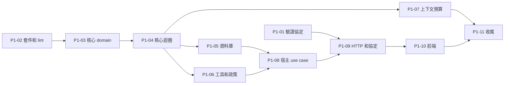
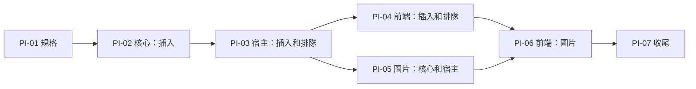

# AI Chat Harness 實作規劃

| 欄位     | 內容                                                                                                                   |
| -------- | ---------------------------------------------------------------------------------------------------------------------- |
| 狀態     | 已定案，P1 完成（P1-01 到 P1-11）。PI 規劃中                                                                           |
| 版本     | 1.1（2026-11-24）                                                                                                      |
| 對應文件 | 規格：[harness-spec.zh-TW.md](harness-spec.zh-TW.md) 1.1。程式架構：[architecture.zh-TW.md](architecture.zh-TW.md) 1.1 |

這份文件把 PI 和四期拆成工作項目。一個工作項目是一個 PR。每一項寫明範圍、完成哪些需求、怎麼驗收。

## 1. 結論

- **P1 有 11 個 PR，由內往外做**：先寫 domain，再寫迴圈，再接資料庫和 Backstage，最後換協定和前端。
- **P1 的前 4 個 PR 不碰 PR #1 的程式。** 它們只新增核心套件，可以跟現有功能並存。
- **第 5 到第 9 個 PR 把宿主換成新架構。** 換完的那一個 PR（P1-09）是唯一會改變對外行為的地方。
- **PI（輸入：圖片、插入、排隊）有 7 個 PR，排在 P2 之前。** PI-01 只改文件。
- **P2 有 7 個 PR，P3 有 10 個，P4 有 3 個。**
- **PR #1 已經合併當基準**（2026-11-24）。它的 repo 基礎設施、畫面元件、模型呼叫留下來；backend 的迴圈、儲存、路由在 P1 重寫，舊的資料表直接刪除。

大小的意思：S 是一個檔案群、幾百行以內；M 是一個完整的模組；L 是跨多個模組。這不是工時的估計。

## 2. 開始之前

| 項目         | 說明                                                                        | 狀態                 |
| ------------ | --------------------------------------------------------------------------- | -------------------- |
| PR #1 的處理 | 合併當基準。後面的 PR 在它上面逐步替換                                      | 已合併（2026-11-24） |
| 這幾份文件   | 放在 `docs/design/`，開一個文件 PR                                          | 已開 PR              |
| 套件名稱     | 核心叫 `ai-chat-harness`，放在 `packages/`。其他套件照 Backstage 的命名慣例 | 已定                 |

## 3. P1：核心

完成後的狀態：對外的功能跟 PR #1 一樣，再加上斷線不丟結果、可以多台部署、上下文不會爆。程式換成新架構。

| 編號  | 工作項目                         | 大小 | 完成的需求                                           | PR         | 狀態 |
| ----- | -------------------------------- | ---- | ---------------------------------------------------- | ---------- | ---- |
| P1-01 | 驗證協定                         | S    | D-19                                                 | #4         | 完成 |
| P1-02 | 套件和 lint 規則                 | S    | A-01、A-09                                           | #3         | 完成 |
| P1-03 | 核心 domain                      | M    | A-04、A-05、T-03、T-04、H-02、H-05、S-03、D-18、D-25 | #5         | 完成 |
| P1-04 | 核心迴圈                         | L    | A-02、A-03、A-08、A-10、H-05、H-06、P-04、S-01、T-05 | #6、#7、#8 | 完成 |
| P1-05 | 資料庫                           | M    | H-03、H-04、T-07、A-04、A-10                         | #10        | 完成 |
| P1-06 | 工具和政策的 adapter             | M    | T-01 到 T-06、T-11、D-06、D-24                       | #9、#12    | 完成 |
| P1-07 | 上下文預算和摘要                 | M    | H-09                                                 | #11、#13   | 完成 |
| P1-08 | 宿主的 use case 和 RunSupervisor | L    | H-01、H-04、H-06、H-07、H-08、H-11、A-06、O-02       | #14        | 完成 |
| P1-09 | HTTP 和新的串流協定              | M    | D-19、H-10、SE-01                                    | #15        | 完成 |
| P1-10 | 前端                             | M    | SE-01、B-01、T-11、S-02                              | #16        | 完成 |
| P1-11 | 收尾                             | S    | 整體驗收                                             | #17        | 完成 |

### P1-01 驗證協定

- **範圍**：一份短文件，加一支可以丟掉的測試程式。對照鎖定版本的 AI SDK 文件，確認三件事：
  1. 程式架構第 8 節的事件對照表，每一列的事件名稱和欄位。
  2. 「停下來等核准，之後由另一個請求繼續」在協定裡怎麼表示。協定有原生的核准事件就用它，沒有就用自訂資料。
  3. 前端用 `@ai-sdk/react` 的 `useChat` 接我們的端點，還是只用協定、自己寫狀態。
- **驗收**：對照表更新成確認過的版本。第 3 點有結論和理由。
- **為什麼先做**：這是整個 P1 裡唯一我沒有親自驗證過的對外介面。先花小成本確認，再寫 presenter。

### P1-02 套件和 lint 規則

- **範圍**：新增 `packages/ai-chat-harness` 和 `plugins/ai-chat-common` 兩個空套件。加上程式架構第 11 節的三層 lint 規則。CI 納入新套件。
- **驗收**：在核心裡寫一行 `import '@backstage/errors'`，lint 會失敗。在 `domain/` 裡 import `application/`，lint 會失敗。這兩個反例寫成 lint 的測試。

### P1-03 核心 domain

- **範圍**：`domain/` 底下所有檔案。重點是 `decidePolicy`、`decideNextAction`、`buildModelInput`（先不含摘要）。
- **驗收**：
  - `decideNextAction` 的每一列規則至少一個測試，包含「有 `tool_started` 沒有結果」這一列。
  - `decidePolicy`：不是唯讀的工具設成 `allow` 時，結果仍然是 `ask`。`egress` 的唯讀工具是 `ask`。
  - 這個 PR 沒有任何 `async` 函式。

### P1-04 核心迴圈

- **範圍**：ports、`AdvanceRun`、`callModel`、`executeTools`、事件型別。`testing/` 入口：`ScriptedModel`、`InMemoryItemLog`、`FakeToolGateway`、`itemLogContract`。
- **驗收**（都用假模型，不啟動 Backstage）：
  - 一般回答：事件順序正確，紀錄裡有一筆 `agent_message`。
  - 唯讀工具：直接執行，結果進紀錄，模型看得到結果。
  - 要核准的工具：迴圈回傳 `waiting_approval`。寫入 `approval` 後再呼叫一次，工具被執行一次。
  - 一步裡兩個要核准的：只決定一個時仍然是 `waiting_approval`（P-04）。
  - 拒絕：寫入 `denied` 的結果，模型收到。
  - 參數不合格：不產生核准，模型收到 `invalid`（T-05）。
  - 上限：Step 數、工具呼叫數、時間各一個測試。
  - 停止：`heartbeat` 回傳 `cancelRequested` 後，迴圈在下一步之前結束。
  - 當掉後接手：紀錄裡有 `tool_started` 沒有結果時，工具不會被執行第二次，結果是 `unknown`（A-08）。
  - `InMemoryItemLog` 通過 `itemLogContract`。
  - **P1-03 審查時定下的七項約定**，每一項都要有測試鎖住：
    1. `callId` 在 Session 內唯一，由核心的 `IdGenerator` port 產生，不是模型給的 id。模型 id 和 `callId` 的對應由 `callModel` 處理（model adapter 回傳的是模型 id）。domain 裡把 `IdGenerator` 說成「宿主」的註解改成「核心的 port，宿主只提供實作」。
    2. `tool_call` 的 `policy` 一律由 `decidePolicy` 算出，不信任其他來源。
    3. 同一步的 `agent_message` 和 `tool_call` 在同一次 `append` 寫入，文字在前。空白的回答不寫 `agent_message`。
    4. `maxToolCallsPerRun`：`callModel` 寫入時，超過剩餘額度的呼叫直接寫 `tool_result{status:'denied', message:'tool call limit'}`。
    5. `executeTools` 只在 decision 是 `allow` 時執行；不是唯讀的工具先寫 `tool_started` 再執行（D-25）；`interrupted` 的寫 `unknown` 結果，不執行。
    6. domain 匯出 `needsApproval(call)`（`policy === 'ask'` 或 `readOnly !== true`），`decideNextAction` 用它，宿主之後也用它。
    7. `InMemoryItemLog` 用 `dedupeKeyOf` 擋重複（含 `tool_call:${callId}`），並通過 `itemLogContract`。contract 涵蓋：序號從 1 連續遞增、一次 `append` 多筆序號連續、重複丟 `DuplicateItem` 而且那次 `append` 整批不寫入、`afterSeq` 讀取、fence 不符丟 `LeaseLost`。
  - 事件（`HarnessEvent`）要能無損對應到 [protocol-check](protocol-check.zh-TW.md) 的 UI message stream：只有 `item.completed` 的 Item 進紀錄，`item.delta` 不進（A-03）。

### P1-05 資料庫

- **範圍**：新的 migration（四張表裡的前三張）。`KnexItemLog`、`KnexSessionRepository`、`KnexRunRepository`。
- **補充**：`runs` 表要有欄位存「不含等核准的已用時間」（`RunUsage` 的 `elapsedSeconds`，由宿主扣掉等待核准的時間）。`KnexItemLog` 用 `dedupeKeyOf` 產生 `dedupe_key`，`tool_call` 也算（`tool_call:${callId}`）。
- **舊資料不搬**：PR #1 的三張表在這個 PR 不動，新表和它們並存。P1-09 刪掉舊程式時，同一個 PR 加一個 migration 把舊表刪除。
- **驗收**：
  - `KnexItemLog` 通過 `itemLogContract`，SQLite 和 PostgreSQL 都跑。
  - 兩個連線同時對同一段 Session 開 Run，只有一個成功（H-03）。
  - 同一個 `callId` 寫兩次 `approval`，第二次被拒絕（T-07）。
  - 租約不是自己的時候，寫入被拒絕。
- **完成時的補充**：宿主的 `domain/`（`Session`、`Run`、錯誤）和 `application/ports/`（`SessionRepository`、`RunRepository`）先放最小的一組，P1-08 補其餘。`KnexRunRepository` 也實作核心的 `RunControl`，並提供 `acquireLease`（接手；每次接手產生新的 `lease_owner`，所以同一台再接手也有新的 fence）、`transition`、`requestCancel`、`expireStale`。細節見程式架構第 5.4 和第 7 節。

### P1-06 工具和政策的 adapter

- **範圍**：`ActionsToolGateway`、`ConfigAgentCatalog`（只有 Toolset 和 policy，Agent 留到 P3）。設定檔的 `toolsets` 和 `policy`。PR #1 的 include、exclude 設定保留一版並標成淘汰。設定檔的 `policy` 是平的 `{toolId: deny}`，要轉成 domain 的 `PolicySettings {byTool}`。
- **驗收**：
  - 沒有標 `readOnly` 的 action 被當成不是唯讀。
  - 設定把不是唯讀的 action 寫成 `allow` 時，第一次列出工具時記一筆警告（啟動時沒有使用者憑證，列不出 action），執行時仍然是 `ask`。
  - Session 沒開的 Toolset，工具不會出現在給模型的清單裡。
  - 參數不符合 schema 時，`validate` 回傳錯誤訊息。
  - action 的 schema 在呼叫存下之後改變：核准時重新驗證（T-06）。

### P1-07 上下文預算和摘要

- **範圍**：`buildModelInput` 加上預算：先把舊的工具輸出換成一行說明，還是超過就把舊的 Step 換成摘要。`summarize` 這一步用模型產生摘要，寫成 `summary` Item。
- **補充**：
  - `ItemLog.read` 加選項 `fromLatestSummary`：只讀最新的摘要涵蓋範圍之後的 Item。迴圈每一輪都用它，Session 長了也不會每一步讀整段。`itemLogContract` 加了對應的測試，`KnexItemLog`（P1-05）要實作：查最新的 `summary` 取它的 `coversUpToSeq`，再讀 `seq` 比它大的 Item。
  - 摘要在需要它的那一步之前由 `callModel` 呼叫 `summarize` 產生，不算 Step。失敗時 Run 不失敗，舊的 Step 被省略（細節在程式架構 4.3）。
  - V-04：模型串流沒有用量，一律用字數估計 token（ASCII 1/4、其他字元 1）。
- **已知限制**（排到 P3 評估，或調高 `maxSteps` 預設值時評估）：同一個 Run 的中間 Step 只縮短和省略，不摘要，因為摘要的涵蓋範圍是 `seq` 的前綴，摘要中間的 Step 會蓋掉最新的使用者訊息。另外，摘要或說明之後接問題會有連續兩則 `user`，少數要求嚴格交替的 chat template 可能拒絕（未查證）。
- **驗收**：
  - 紀錄的內容在摘要前後完全一樣（A-05）。
  - 一段超過預算的長對話：送給模型的內容在預算以內，最近的幾步是完整的。
  - 工具呼叫和它的結果不會被拆開（只留其中一個，模型的 API 會拒絕）。
  - 摘要的模型呼叫失敗、被中止、遇到截止時間時，Run 不丟未處理的例外：失敗時照常往下走，中止是 `cancelled`，截止時間是 `timeout`。
  - 有摘要之後只讀摘要涵蓋範圍之後的 Item。500 筆 Item 的 Session 量測結果在 PR 說明。

### P1-08 宿主的 use case 和 RunSupervisor

- **範圍**：宿主的 `domain/`、`application/`（P1 的 use case）、`RunSupervisor`、`AuditorAuditLog`、`principalFromRequest`、`plugin.ts` 的組裝。這個 PR 結束時，舊的 `ChatService` 還在，路由還沒換。
- **補充**：
  - `SendMessage` 先建立 Run，成功之後才寫入 `user_message`。
  - `DecideApproval` 用 domain 的 `needsApproval` 判斷哪些呼叫要核准。
  - 一個 Run 同時只能有一個迴圈在跑。兩個 decision 請求同時判定「全部決定了」時，只能有一個啟動迴圈。
  - 核心的 port 丟例外（例如 `LeaseLost`）時沒有 `run.ended`，宿主要自己更新 Run 的狀態。
  - `IdGenerator` 的實作用 UUID。
  - `CreateSession` 一定要把 Toolset 的預設值存進 `enabled_toolsets`。`sessions.enabled_toolsets` 不能是空值，沒給時存 `[]`；P1-06 的 gateway 把「沒給」當成用預設，接上之後不會走到那一條。
  - Run 進行中不能刪除 Session。`append` 的鎖順序是先 Run 後 Session，刪除 Session 時資料庫會先鎖 Session 再連帶刪 Run，兩者順序相反，PostgreSQL 可能死結。
  - 實作時的決定：`AdvanceRun` 的 request 的 `budget` 來自設定 `aiChat.context`；Run 的限制來自 `aiChat.maxTurns`、`maxToolCallsPerRun`、`runTimeoutSeconds`。`AccessControl` 是 P2，P1 的擁有者檢查是 domain 的 `assertOwner`。`ExpireStaleRuns` 由 `plugin.ts` 每 30 秒排一次。細節見程式架構第 5 節。
  - `yarn.config.cjs` 那條「核心套件不能依賴 repo 內其他 workspace」要放寬，讓 backend 依賴 `ai-chat-harness` 和 `ai-chat-common`。只放寬這個方向，核心依賴其他 workspace 仍然不行。（已放寬：`yarn.config.cjs` 允許 backend 依賴 `ai-chat-harness` 或 `ai-chat-common`，不必再改。）
- **驗收**：
  - 不是擁有者送訊息或核准：被拒絕。
  - 訂閱者中途離開：Run 跑完，紀錄完整（H-07）。
  - 核准由「另一個 `RunSupervisor` 實例」處理（模擬另一台 backend）：工具被執行一次。
  - 租約過期：`ExpireStaleRuns` 把 Run 標成 `expired`，之後可以開新的 Run。
  - 關機：進行中的 Run 被標成 `expired`，沒有留下 `running` 的紀錄（H-11）。
  - 核准、拒絕、不是唯讀的工具的執行都有稽核紀錄（O-02）。

### P1-09 HTTP 和新的串流協定

- **範圍**：新的 router、controller、`uiMessageStream` presenter、錯誤對應。路徑從 `/conversations` 改成 `/sessions`。OpenAPI 更新。刪除舊的 `ChatService`、`ChatStore`、`routes/`，並用一個 migration 刪除舊的三張表（資料不搬）。
- **串流的補充**：presenter 忽略 `tool_call` 的 `item.started`，`tool-input-available` 在 `item.completed` 才送。`failed` 的 `error` 只顯示固定文字，`outcome.cause` 只記 log。
- **摘要的串流**：presenter 把 `summary.failed` 轉成 transient 通知（例如 `data-notice`，文字「較早的內容已省略」）。`summary.started` 可以轉成「整理較早的內容」的進度提示。`context.trimmed`（預算讓舊內容被省略，包含摘要沒有用而直接省略的情況）轉成同一種 transient 通知，可以跟 `summary.failed` 合併成一則。`summary` Item 不顯示成訊息；從紀錄還原畫面時也略過它。
- **接續**：新增 `POST /sessions/:id/resume`（對應 `ResumeRun`，SSE；沒有東西可接續時 204）。`GET /sessions/:id` 的回應帶 `awaitingDecision` 和 `resumable`（`GetSession` 已提供）。
- **共用型別**：把前後端共用的型別搬進 `ai-chat-common` 時，拿掉 `scripts/sync-common.mjs`（和它在 `package.json` 的 script、`.husky/pre-commit`、`CONTRIBUTING.md` 裡的說明）。
- **這是破壞性的變更**：API 路徑和串流格式都變了。前端在 P1-10 跟上。兩個 PR 要一起發版，changeset 標成 minor 並寫明。
- **完成時的補充**：
  - `RunSupervisor` 把等核准轉成 `cancelled` 時，發給訂閱者的 `run.ended` 也換成 `cancelled`（P1-08 審查留下的項目），畫面不會顯示已取消的 Run 的核准按鈕。
  - 前後端共用的型別、路徑、`messageIdOfRun` 在 `ai-chat-common`；後端不再匯出 `/common`；`scripts/sync-common.mjs` 和它的 script、hook、說明都拿掉。前端自己的 `src/common` 還是第一版的型別，P1-10 換掉。`yarn.config.cjs` 允許前端依賴 `ai-chat-common`。
  - `llm/` 搬進 `adapters/model/`。migration `20260103000000_drop_conversations` 刪除舊的三張表；`down` 重建三張空表（讓逐一往回退時能到 `init`）。
  - `GET /sessions/:id/stream`（`FollowSession`）提前到 P1：P1-10 的 transport 需要它，驗收也要求接回的內容。只接這一台 backend 跑的 `running` Run；接回的串流不送逐字片段，每則 `agent_message` 完成時整段送。跨 backend 接回仍是 P2-06。
  - 新增 `GET /toolsets`（`ListToolsets`）：P1-10 的 T-11 需要列出可開關的 Toolset。
  - 取消已結束的 Run 回 409。`decision` 的 JSON 回應是 `{ approved }`。
  - 沒有登入 401、服務 token 403、不是擁有者和找不到都是 404（文字相同）、已有進行中的 Run 409、關機中 503。
- **驗收**：
  - 每條路由的狀態碼：沒登入、不是擁有者、找不到、已有進行中的 Run、`resume` 的 204、關機中的 503。
  - SSE 的內容符合 P1-01 確認過的對照表：一般回答、唯讀工具、要核准、核准後接續（`tool-approval-response` 在開頭）、拒絕、參數不合格、失敗（`data-run` 在 `error` 之前，沒有 `finish`）、取消（`abort`）、等核准結束（`finish` 的 `tool-calls`）、`GET /stream` 在不是 `running` 時 204、A-07 重送。測試用 AI SDK 自己的解析器讀回。
  - 任何回應裡都沒有系統提示（H-10），也沒有供應商的錯誤原文。
  - OpenAPI 的測試通過。

### P1-10 前端

- **範圍**：前端照程式架構第 9 節分層。接新的 API 和協定。Session 有自己的網址（SE-01）。每則訊息帶上頁面上下文（B-01）。Session 裡可以開關 Toolset（T-11）。新的狀態：已過期可重送、結果不明。
- **接續**：開啟 Session 時 `resumable` 為真（Run 在等核准，但所有呼叫都已決定），自動送接續請求。
  - 畫面在自己剛送出決定之後，不要因為看到 `resumable` 就自動接續。另一個分頁可能剛好在「決定已寫入、還沒 `acquireLease`」時看到 `resumable`；最後只會啟動一個迴圈，但做決定的那個用戶端可能拿不到串流，要等 P2 的 FollowSession 跨 backend 接回才補得上。
  - `reconnectToStream` 打 `GET /sessions/:id/stream`（204 回 `null`）；`decision` 回 JSON 時只更新那一張卡片，回 SSE 時接在同一則訊息上；停止按鈕呼叫 `POST /sessions/:id/runs/:runId/cancel`；Toolset 清單來自 `GET /toolsets`；`data-notice` 的 `code` 給畫面翻譯。從紀錄還原時助理訊息的 id 用 `messageIdOfRun`，並略過 `summary` Item。
  - `decision` 的回應依 `Content-Type` 處理：`text/event-stream` 接在同一則訊息上；收到 JSON（別的呼叫還在等，或別的請求搶到接續）就改用 `GET /sessions/:id/stream` 接。
  - `POST /sessions/:id/resume` 的串流不重送前面的內容，只有接續之後的事件；用戶端要帶著從 `GET /sessions/:id` 還原的訊息接續（那則訊息裡的核准要是 `approval-requested` 或 `approval-responded`）。`decision` 的串流也一樣：它只送這次決定的 `tool-approval-response`，前面的 `tool-approval-request` 要在用戶端的訊息裡。只有 `GET /stream` 的重送會補 `tool-approval-request`。
- **驗收**：
  - 端對端測試（Playwright）：送訊息、看到工具呼叫、核准、拒絕、停止。
  - 送訊息之後重新整理：看到已存的結果，沒有重複。
  - 直接打開 Session 的網址：載入那一段。
  - 兩個要核准的呼叫，決定一個後重新整理：那個決定還在，另一個仍在等；再決定另一個：Run 接著執行，第一個決定沒有重送（P-04）。
  - 從 entity 頁面打開：模型的上下文裡有那個 entity。

### P1-11 收尾

- **範圍**：兩台 backend 的整合測試。README、`config.d.ts`、設定的說明。把這三份設計文件裡 P1 的需求標成完成。
- **驗收**：規格裡所有標 P1 的需求，都對得到一個測試。對照表放在這個 PR 的說明裡。
- **完成時的補充**：
  - 對照表在 [p1-coverage.zh-TW.md](p1-coverage.zh-TW.md)：35 條 P1 需求都有測試。新增的測試補 H-08（串流的結果和存下的相同）、S-01（核心的 lint 規則擋掉執行程式碼、檔案系統、網路的 import，`eval`、`new Function`，以及 `require`、`process`、`globalThis`、動態 `import()` 等繞過 import 的寫法）、S-02（不載入圖片）。
  - 兩台 backend 的整合測試是 `integration/twoBackends.test.ts`：另一台決定、兩台同時決定、關機只結束自己的 Run、沒關機就當掉由另一台標成過期、不是跑 Run 的那台的 `GET /stream` 回 204。
  - README 的設定範例由 `config.test.ts` 檢查（後端接受它），也用 `yarn backstage-cli config:check --lax --strict --package backend --config app-config.yaml --config <範例>` 驗過（值改錯會失敗）。
  - P1-10 留下的限制已修：presenter 判斷「已重送的 Step」時，除了 `tool_call` 的 `step`，也算重送時開了幾個 Step，所以只有 `agent_message` 的 Step 的事件也會略過，不多送空的 Step。不用改 Item 的形狀或 port。
  - 用途說明頁（`usage.zh-TW.html`）改成實際的畫面：Allow 和 Deny、可展開的 Toolsets、核准卡片的內容、P1 的列表沒有自動標題；拿掉外部字型，頁面不載入任何外部資源。
  - 已知限制（P2 處理）：`GET /sessions/:id/stream` 只接這一台 backend 跑的 Run（P2-06）；對話列表沒有自動標題（P2-01）。

## 4. PI：輸入

完成後的狀態：使用者在 Run 進行中也能送訊息（插入或排隊），訊息可以帶圖片。設計見程式架構第 13 節，需求見規格 4.11。PI 排在 P2 之前。

| 編號  | 工作項目         | 大小 | 完成的需求                          | PR       | 狀態                   |
| ----- | ---------------- | ---- | ----------------------------------- | -------- | ---------------------- |
| PI-01 | 規格和設計文件   | S    | D-27 到 D-30；IN-01 到 IN-19 的定義 |          | 進行中                 |
| PI-02 | 核心：插入       | M    | IN-10、IN-11、IN-17（核心的部分）   | #25      | 進行中                 |
| PI-03 | 宿主：插入和排隊 | L    | IN-10 到 IN-17                      | #26      | 進行中                 |
| PI-04 | 前端：插入和排隊 | M    | IN-12、IN-13、IN-15、IN-18          | #28      | 進行中                 |
| PI-05 | 核心和宿主：圖片 | L    | IN-01 到 IN-07                      | #30、#32 | 進行中                 |
| PI-06 | 前端：圖片       | M    | IN-08、IN-09                        | #41      | 後端完成，畫面在 PU-04 |
| PI-07 | 收尾             | S    | 整體驗收                            |          |                        |

順序：PI-02 到 PI-05 依序做，PI-04 和 PI-05 互相獨立（PI-03 之後都可以開始）。PI-03 的排隊先不帶附件（`attachment_ids` 一律是空陣列），PI-05 加上保留和標記。IN-19 屬於 P2，在 P2-04、P2-05 做。

### PI-01 規格和設計文件

- **範圍**：只改文件。規格（D-27 到 D-30、4.11、資料模型、設定、分期）、程式架構第 13 節和相關表格、這一節。不改程式。port 和型別跟用到它們的 PR 一起加（PI-02、PI-03、PI-05），不在這個 PR。
- **驗收**：三份文件的編號、欄位名稱、路由、錯誤名稱一致；`yarn prettier:check` 和邊界檢查通過。

### PI-02 核心：插入

- **範圍**：
  - Item：`user_message` 加 `delivery`，`agent_message` 和 `tool_call` 加 `readUpToSeq`；`callModel` 寫入它們。
  - domain：`unreadInserted`、`insertStatesOf`；`decideNextAction` 的兩處改動；`buildModelInput` 的 Run 的使用者訊息規則（`pinned` 和 `boundarySeq`），並且不放已結束 Run 的 `unread` 插入訊息。`readUpToSeq` 是這一輪開始讀紀錄時的最大序號，不含這一步自己寫的摘要。
  - 事件 `message.read`。
  - `RunUsage`、port 不變。`InMemoryItemLog` 接受新欄位，`itemLogContract` 補測試。
- **依賴**：PI-01。
- **驗收**（都用假模型，不啟動 Backstage）：
  - 模型串流到一半時有訊息插入（在 `ScriptedModel` 的劇本裡寫入）：這一次的輸出照常寫入，`readUpToSeq` 小於插入的序號；下一輪 `decideNextAction` 回 `call_model`，不是 `complete`；下一次的模型輸入有這則訊息。
  - 模型的最後回答之後、迴圈判斷之前有訊息插入：Run 不結束，再呼叫一次模型，讀到之後才 `completed`。
  - 插入的訊息夾在 `tool_call` 和它的 `tool_result` 之間：`buildModelInput` 的順序是 assistant、所有 `tool`、插入的 `user`。兩個呼叫、插入在兩個結果之間，也是同樣的順序。
  - 工具已核准但還沒執行時插入：`decideNextAction` 仍回 `execute_tools`，工具照常執行（`callsOfLastStep` 的起點）。
  - Step 數用完時有未讀的插入訊息：`stop`（`max_steps`），不再呼叫模型；`insertStatesOf` 回 `unread`。
  - 插入的訊息不增加 `stepsUsed`；讀到它的模型呼叫增加一個。
  - 在很小的預算下，Run 的第一則訊息和所有插入的訊息都原文留下；摘要的 `coversUpToSeq` 小於第一則的序號。
  - `message.read` 在 `step.started` 之前、每則訊息只送一次（第二次模型呼叫不再送）。
  - 沒有 `readUpToSeq` 的舊 Item（P1 的紀錄）：行為跟 P1 相同，P1 的測試不改。
  - 插入發生在「讀紀錄」和「寫 `summary`」之間（在 `ScriptedModel` 的摘要呼叫裡插入）：模型輸出的 `readUpToSeq` 是讀紀錄時的最大序號，小於插入的序號，所以那則訊息是未讀，下一輪才被讀到；摘要的序號不會把它算成已讀。
  - 已結束的 Run 留下的 `unread` 插入訊息：之後的 Run 的模型輸入不含它；同一個 Run 裡還沒讀的插入訊息照常放進輸入。
  - `itemLogContract` 通過：新欄位原樣存取。

### PI-03 宿主：插入和排隊

- **範圍**：
  - migration：`runs.read_up_to_seq`、`queued_messages`。
  - `KnexItemLog.append`：插入的寫入規則（要求 `running`、租約沒過期；上限在 `UPDATE sessions` 之後檢查；附件用 `FOR UPDATE` 確認）；模型輸出的批次在 `checkFence` 取 `FOR NO KEY UPDATE`，第一步更新 `runs.read_up_to_seq`，再碰 `sessions`。每種寫入的取鎖順序照架構 13.8 的表。
  - `KnexRunRepository.transition` 的 `requireAllRead`；`UnreadMessages`。
  - `RunSupervisor`：被拒絕時重跑迴圈、`afterRun`、`queue.state` 事件。
  - port `QueuedMessageRepository` 和 `KnexQueuedMessageRepository`（`startNext` 的 transaction）。
  - use case：`InsertMessage`、`QueueMessage`、`UpdateQueuedMessage`、`DeleteQueuedMessage`、`ReorderQueue`、`ListQueue`、`StartNextQueued`、`ResumeQueue`；`GetSession` 回傳佇列和 `insertState`。
  - 路由、zod、錯誤對應、OpenAPI、presenter（`data-inserted`、`data-queue`；`message.read` 不走 `seq` 去重，改用已送過的插入序號集合）、設定（`input.insert`、`input.queue`）。
  - 稽核：自動送出寫 `queued-message-send`。
  - 核心的型別 `InsertState`（`read`、`unread`）改名為 `ReadState`：`GetSession` 的 `insertState` 另外有 `pending`，兩者不同值，不再同名。
  - 不在這個 PR（PI-05）：附件。`attachment_ids` 一律是空陣列，`attachments` 表、附件的 `FOR UPDATE` 和保留、`GET /input-config` 都沒有；下面驗收裡「附件的中繼資料」那幾處等 PI-05。migration `20260104000000_input.js` 只有 `runs.read_up_to_seq` 和 `queued_messages`；`attachments` 在 PI-05 自己的 migration。
- **依賴**：PI-02。V-07、V-10 要在開始前確認（結論見 V 表下面）。
- **驗收**（SQLite 和 PostgreSQL 都跑）：
  - **插入先於結束**：用同步點讓插入的 transaction 在迴圈的 `complete` 判斷之後、`transition` 之前 commit。`transition` 丟 `UnreadMessages`，Run 維持 `running`；supervisor 再跑一次迴圈，模型讀到訊息，之後 `completed`；訂閱者只收到一個 `run.ended`、一個 `run.started`。
  - **結束先於插入**：`transition` 先 commit；之後的插入得到 409，紀錄裡沒有那則訊息。
  - **真正同時**（PostgreSQL，兩個連線）：反覆跑兩者同時開始。每一輪的不變式：回 201 的插入，不是 `seq <= runs.read_up_to_seq`，就是它的 Run 以非正常方式結束；Run 以正常方式結束時，沒有 `seq > read_up_to_seq` 的 `user_message`。
  - **不死結**（PostgreSQL，兩個連線，各反覆一百輪）：插入對模型輸出的 `append`；排隊的 `add` 對模型輸出的 `append`。兩邊都完成，沒有 `deadlock detected`，`runs.read_up_to_seq` 只增不減。
  - 插入在 `waiting_approval`、`completed`、租約已過期、別的 Run 的 id：409，沒有寫入。插入第 6 則：409（`InsertLimitReached`）。
  - 插入先 commit、Run 才轉成 `waiting_approval`：核准後模型讀到它。
  - Stop 時有未讀的插入訊息：`GetSession` 的 `insertState` 是 `unread`；佇列暫停。
  - 租約過期（`ExpireStaleRuns`）時同上；核准由另一台 backend 接手後，插入的訊息照常被讀到。
  - 排隊：`add` 在沒有進行中的 Run 時 409（`NoActiveRun`）；第 6 則 409（`QueueFull`）；`add` 和 Run 的結束同時發生：不是訊息在佇列裡而且被自動送出，就是 409，不會留在佇列裡沒人送。
  - 兩個「分頁」交錯：A 刪掉一則，B 用舊的 id 清單重排，得到 409（`QueueChanged`）；B 修改已刪除的那則得到 404；位置在重排後是 1、2、3…。
  - 自動送出：`completed` 沒有 `endReason` 時，用最前面那則開新的 Run，`user_message` 的 `delivery` 是 `queued`，`page` 和附件的中繼資料跟排隊時相同，佇列少一列；`failed`、`cancelled`、`expired`、`completed` 加 `endReason` 都不送，`paused` 為真。
  - 兩次同時的 `startNext`（兩台 backend，或自動送出加「繼續」）：一個 Run、一則 `user_message`、佇列少一列，另一個回傳 `undefined`。`startNext` 在寫入 `user_message` 時失敗：Run 和佇列都回復。
  - IN-16：身分的到期時間不夠 `runTimeoutSeconds` 加餘裕、或不知道：不自動送出，`pausedReason` 是 `credentials`；足夠時送出，Run 的 `ctx.principal` 是那個身分。
  - 兩台 backend（`integration/twoBackends.test.ts`）：A 啟動 Run、B 做最後的核准；Run 結束後自動送出的 Run，用的是 B 的身分。
  - 「繼續」：佇列有東西、沒有進行中的 Run：開新的 Run，回傳 SSE；佇列是空的或有進行中的 Run：204。
  - 路由：每條新路由的狀態碼（沒登入 401、不是擁有者 404、錯誤的內容 400）；SSE 的 `data-inserted`、`data-queue` 用 AI SDK 的解析器讀回。
  - presenter：模型呼叫期間插入一則訊息，下一步的串流收到 `data-inserted`（沒有被 `seq` 去重吞掉）；接回（A-07）時重送階段已補送的插入訊息，之後的即時事件不再重送。
  - `afterRun`：`outcome` 是 `waiting_approval` 時回 `paused: false`，不送出，佇列不變；之後 Run 正常結束才送。
  - 稽核：自動送出有一筆事件（V-07 的結論決定怎麼寫）。
  - OpenAPI 的測試通過。

### PI-04 前端：插入和排隊

- **範圍**：
  - `Composer`：Run 進行中可以用；送出方式（Enter、Ctrl 或 Cmd 加 Enter、「排隊」按鈕）；等核准時只能排隊。
  - 「等待讀取」區、`data-inserted` 的顯示、`unread` 的標示和「再送一次」。
  - 排隊清單：顯示、修改、刪除、上下移；暫停的提示和「繼續」；Run 結束後接上自動送出的新 Run。
  - `itemsToMessages`：`data-inserted` 的位置、`unread`；`lastRunInterrupted` 和 `lastUserText` 以這個 Run 的第一則訊息為準（略過插入的訊息，架構 13.9 的「再送一次」）；`useSessionChat`：插入、排隊的狀態；`AiChatApi` 和 `AiChatClient` 加對應的呼叫。
- **依賴**：PI-03。
- **驗收**：
  - 元件測試：Run 進行中輸入框可用，各種狀態（含暫停）的 Enter 和 Ctrl 加 Enter 各送到正確的呼叫；失敗時文字還在輸入框。插入得到 409 的三種處理：`InsertLimitReached` 或 Run 是 `waiting_approval`，改排隊；Run 是 `running` 但 `runId` 不同，對新的 `runId` 再插入；沒有進行中的 Run，直接送出。
  - `itemsToMessages`：`read` 的插入訊息在對應 Step 之前；`pending` 不在對話裡；`unread` 是使用者訊息加標示。Run 以 agent 的回答結束、後面有一則沒讀到的插入訊息：不當成中斷，只有那則訊息有自己的「再送一次」。Run 沒有答案就停下來：只有一個「再送一次」，重送第一則訊息，沒讀到的插入訊息沒有按鈕。任何情形都不出現兩個重送按鈕。
  - 端對端（Playwright，假的模型伺服器）：
    - Run 進行中按 Enter：訊息先顯示在輸入框上方，下一步開始時出現在對話裡，模型的下一個回答用到它。
    - 工具要核准時：Enter 變成排隊，提示說明原因；決定之後 Run 結束，排隊的訊息自動送出，答案出現，不用重新整理。
    - 排隊清單：修改、刪除、上下移，重新整理後仍在。
    - 失敗的 Run：清單顯示暫停，不自動送；按「繼續」才送。
    - Stop 時有未讀的插入訊息：顯示「Agent 沒有讀到」；Run 沒有答案時只有一個「再送一次」，重送第一則訊息；重送之後模型的輸入沒有那則沒讀到的訊息。
    - 佇列暫停：輸入框提示「送出後，這次結束時會接著送佇列」，清單標明「新訊息先送，佇列接在後面」；直接送出新訊息後，新 Run 先跑，它正常結束時佇列才接著送。
    - 兩個分頁：A 刪掉一則，B 改它：B 看到說明並更新清單。
  - S-02 的測試不變。

### PI-05 核心和宿主：圖片

- **範圍**：
  - 核心：`UserMessageBody.attachments`、`ModelMessage.images`、`ModelClient.capabilities.images`、`ContextBudget.tokensPerImage`；`buildModelInput` 的圖片規則；`buildSummaryInput` 的 `[image: …]`。
  - 宿主：migration `attachments`；`AttachmentStore` 和 `KnexAttachmentStore`；`UploadAttachment`、`ReadAttachment`、`PurgeUnusedAttachments`；上傳和讀取的路由、raw body 的中介層、`checkImage`；`KnexItemLog.append` 標記 `used_seq`；排隊的保留和釋放；`SendMessage`、`InsertMessage`、`QueueMessage` 接受 `attachmentIds`；`OpenAiCompatibleModelClient` 讀位元組轉成 `image_url`；`GET /input-config`；設定（`aiChat.llm.images`、`input.images`，含 `maxBytesPerInput`；載入時要求它不小於 `maxPerMessage` 乘 `maxBytes`）。`ModelClient.stream` 的 `opts` 加 `sessionId`，adapter 用它讀附件。讀取回應的 `Cache-Control` 是 `private, no-cache`，加 `ETag`。複製的支援（`AttachmentStore.copy`）在 P2-05 用，這裡先加 port 和 `KnexAttachmentStore` 的實作與測試。現在的單一模型設定是 `aiChat.llm`，`images` 加在那裡；`models` 區塊是 P3。
- **依賴**：PI-03。V-08、V-09 要在開始前確認。
- **驗收**：
  - 上傳：四種型別各一個通過（201，回傳 `id`、`mediaType`、`name`、`size`）。`image/svg+xml` 回 415。`Content-Type` 是 PNG 但內容是 JPEG 回 400。空內容回 400。
  - 大小：`Content-Length` 超過 `maxBytes` 回 413，而且處理函式沒有被呼叫（記憶體沒有被用掉）；沒有 `Content-Length` 的請求在超過上限時回 413。
  - 擁有者：別人上傳或讀取回 404；沒登入 401；讀取時標頭有 `nosniff`、`inline`、`Content-Security-Policy`、存下的型別；`If-None-Match` 相符回 304。
  - 沒用到的附件已有 12 個：第 13 個回 409。
  - 綁定：訊息用別的 Session 的附件 id 回 400；一則 5 張回 400；不能讀圖片的模型收到帶圖片的訊息回 400。
  - 標記：送出之後附件的 `used_seq` 是那則訊息的序號；寫入失敗時附件沒有被標記；排隊保留（`reserved_by`），刪除排隊列後釋放，自動送出後 `used_seq` 有值。「再送一次」用同樣的附件 id 成功。
  - 清理（用假時鐘）：沒用到、超過 24 小時的被刪；有 `used_seq` 的、被保留的、不到 24 小時的留下；刪除 Session 時全部連帶刪除。
  - 模型轉接：送給假的 LLM 伺服器的請求，`user` 訊息的 `content` 是陣列，第一項是文字，後面是 `image_url`，data URL 解碼後的位元組和上傳的相同；沒有圖片的訊息仍是字串。附件讀不到時換成 `[image: …, not available]`，呼叫成功。`capabilities.images` 是 `false` 時請求裡沒有 `image_url`，有 `not sent` 的說明。
  - 位元組上限：輸入裡的圖片位元組加起來超過 `maxBytesPerInput` 時，舊訊息的圖片換成 `[image: <name>, left out]`，即使 token 預算夠；這個 Run 的使用者訊息的圖片不換。這個 Run 的圖片加上新插入的訊息超過上限：`InsertMessage` 回 400（`TooManyImageBytes`），沒有寫入。`maxBytesPerInput` 小於 `maxPerMessage` 乘 `maxBytes`：backend 啟動失敗。
  - 讀取附件的回應標頭是 `private, no-cache` 加 `ETag`；`If-None-Match` 相符回 304，但附件被刪除之後回 404。
  - 預算：每張圖片算 `tokensPerImage`；超過預算時，舊訊息的圖片先換成 `[image: <name>, left out]`，這個 Run 的使用者訊息的圖片不動；摘要的輸入只有 `[image: <name>]`。
  - 核心的測試不啟動 Backstage，PI-02 的測試不改。
- **實作和上面不同的地方**：
  - 上傳不用 `express.raw`，用 `readLimited`（V-09）。
  - 模型不能讀圖片時，上傳也回 400（`ImagesNotSupported`），不只是帶圖片的訊息。
  - `ContextBudget` 的 `tokensPerImage` 和 `maxImageBytesPerInput` 是選用的（沒有時用 1600、不限制），所以核心 PI-02 的測試不用改；模型能不能讀圖片由 `buildModelInput` 的 `extra.images` 帶入（`callModel` 從 `capabilities.images` 設）。
  - 訊息裡的附件 id 不屬於這段 Session：domain 的錯誤是 `UnknownAttachment`，回應的名稱是 `AttachmentNotFound`（400）。
  - `GET /input-config` 多回 `maxBytesPerInput` 和 `maxPendingPerSession`。
  - `AttachmentStore.put` 多收 `maxPending`；`QueuedMessage` 的 `attachments` 在 HTTP 型別（`ChatQueuedMessage`）是選用的，前端的 PI-04 測試不用改。

### PI-06 前端：圖片

- **範圍**：附加按鈕、貼上、拖放；草稿的縮圖、移除、上傳進度和失敗；訊息裡的縮圖（帶身分的 `fetch`，object URL）；`input-config` 說不能讀圖片時不顯示按鈕；新對話頁附加圖片時先建立 Session。
- **依賴**：PI-04、PI-05。
- **驗收**：
  - 元件測試：三種附加方式各加一張；型別不對、太大、超過張數的檔案不上傳並顯示原因；移除後送出的內容沒有它；上傳失敗（413）時文字還在；模型不能讀圖片時沒有按鈕，貼上圖片不上傳。
  - object URL 在元件卸載、訊息更新時釋放（測試檢查 `revokeObjectURL`）。
  - 縮圖載入失敗顯示「圖片已不存在」。
  - 端對端：附加圖片並送出，假的模型伺服器收到 `image_url`；縮圖出現在訊息裡，重新整理後仍在；新對話頁第一則訊息帶圖片可以送出；Run 進行中插入帶圖片的訊息。
  - S-02：Markdown 裡的圖片語法仍不載入任何資源（既有測試不改）。

### PI-07 收尾

- **範圍**：端對端（圖片加插入加排隊一起）、用途說明頁（`usage.zh-TW.html`）加這三件事的畫面和說明、對照表 `pi-coverage.zh-TW.md`（IN-01 到 IN-18 對到測試）、README 的設定範例（`input`、`images`）和「圖片會送到模型供應商」的說明、`config.d.ts` 說明。三份設計文件把 PI 的需求和 PR 標成完成。
- **依賴**：PI-06。
- **驗收**：規格裡所有標 PI 的需求都對得到一個測試；README 的設定範例由 `config.test.ts` 檢查；用途說明頁不載入外部資源。

## 5. P2：Session

完成後的狀態：可以管理自己的 Session，可以分享給同事（快照或持續更新），同事可以複製走。

| 編號  | 工作項目                    | 大小 | 完成的需求                                       | 驗收重點                                                                                                                                                                                                                                                                         | PR  | 狀態   |
| ----- | --------------------------- | ---- | ------------------------------------------------ | -------------------------------------------------------------------------------------------------------------------------------------------------------------------------------------------------------------------------------------------------------------------------------- | --- | ------ |
| P2-01 | 列表管理和自動標題          | M    | SE-03、SE-04                                     | 搜尋、釘選、改名、封存。標題在第一輪結束後產生，產生失敗不影響對話                                                                                                                                                                                                               |
| P2-02 | 保存期限                    | S    | SE-05                                            | 定期工作刪除過期的 Session。稽核紀錄還在。多台同時跑不會重複刪。逐項驗收見下方 P2-02                                                                                                                                                                                             | #34 | 完成   |
| P2-03 | Permission 和分享的資料模型 | M    | SH-01、SH-05、SH-08、SH-09、SH-11                | `shares` 表。`visibleItems` 每一列規則一個測試。條件規則「是擁有者」「有分享給我或我的群組」                                                                                                                                                                                     | #36 | 完成   |
| P2-04 | 分享的 use case 和 API      | M    | SH-02、SH-03、SH-06、SH-10、SH-11、IN-19（讀取） | 被分享的人送訊息和核准都被拒絕。到期後變成快照。每個動作有稽核紀錄                                                                                                                                                                                                               |
| P2-05 | 分享的畫面和複製            | M    | SH-04、SH-07、SH-10、SH-12、IN-19（複製）        | 分享對話框的說明文字。持續更新時上方的提示列。複製出來的 Session 沒有工具輸出                                                                                                                                                                                                    |
| P2-06 | 斷線接回和即時狀態          | M    | A-07、B-05                                       | 斷線後接回：從目前 Run 的第一個 Item 重送再接新的，先送 `start`，未完成的文字補送 `text-start` 加已累積的文字（Run 在別台時等它完成再整段送），Item 不重複不遺漏。逐字輸出到一半時重新整理，畫面接得上。Run 在別台時，每秒查一次新的 Item（沒有逐字片段）。沒裝 Signals 也能運作 | #38 | 進行中 |
| P2-07 | 側邊面板和入口元件          | M    | B-02                                             | 新增 `ai-chat-react`。面板在換頁時保留。別的 plugin 用 `<AiChatLauncher>` 開啟對話                                                                                                                                                                                               |

### P2-02 保存期限

- **範圍**：`aiChat.retention.days`。domain 判斷 Session 是否到期。`PurgeExpiredSessions`。`SessionRepository.purgeExpired`（PostgreSQL 用 `FOR UPDATE SKIP LOCKED`）。`plugin.ts` 排程。刪除沿用既有的連帶刪除（runs、items、queued messages、attachments）。不讀、不寫 Auditor。
- **依賴**：無。P2-01 獨立。作法對齊 `DeleteSession`（進行中的 Run 不刪、先鎖 runs 再鎖 session）和 `PurgeUnusedAttachments`（每小時、`SKIP LOCKED`）。
- **驗收**：
  - 到期：`updated_at` 早於「現在減 `days` 個整天（每個 24 小時）」的 Session 刪除；剛好在界線上、或更晚的留下。規則在 domain，不靠整合測試。
  - 設定：沒寫 `retention.days` 時是 90。`0` 不刪任何 Session。負數、或不是整數，backend 啟動失敗。
  - 連帶刪除：過期的 Session 刪掉之後，它的 runs、items、queued messages、attachments 都不在。沒過期的 Session 留著。
  - 進行中的 Run：`active_session_id` 還在（`running` 或 `waiting_approval`）的 Session 不刪，即使 `updated_at` 已過期。Run 結束後，下一次才刪。
  - 釘選和封存：不例外，過期一樣刪。這兩件事會更新 `updated_at`，期限從那個時間重算，所以剛釘選的留下、釘選已經很久的刪除。
  - 稽核：刪除不呼叫 Auditor，已寫下的稽核事件還在。稽核在 Backstage auditor，不在 Session 的表裡。
  - 多台：PostgreSQL 上兩個 purge 同時跑，過期的 Session 各刪一次（兩邊刪除數相加等於段數），而且不等別人已經鎖住的 session 或 run（`SKIP LOCKED`）。SQLite 沒有列鎖，這條只在 PostgreSQL 驗。
  - 排程：`plugin.ts` 每小時排 `ai-chat-purge-expired-sessions`，timeout 5 分鐘。
- **規格沒寫、實作選定的地方**（對齊既有刪除和定期工作，程式架構第 5.3 節有同樣的說明）：
  - 期限看 `sessions.updated_at`，不看 `created_at`。建立、修改 Session（改名、釘選、封存、開關 Toolset）、寫入 Item 會更新它。只排隊、只上傳附件不會。
  - 預設 90，和規格的設定範例一樣。`0` 代表保留，不刪。
  - 進行中的 Run 留下，和 `DeleteSession` 拒絕刪除一樣。釘選和封存不留下。
  - 每小時，和 `PurgeUnusedAttachments` 一樣。排程用 Backstage scheduler 的預設 global scope（同一時間只有一台執行）；列鎖是兩次工作重疊時的第二層。

### P2-06 斷線接回和即時狀態（後端與 `useSessionChat`）

- **範圍**：
  - `FollowSession`：Run 是 `running` 而且迴圈在這一台時，維持先訂閱再讀紀錄。回應先送 `start`（`messageId` 是 `run_<runId>`）和 `data-run`，從這個 Run 的第一個 Item 重送，再接上新的事件。紀錄裡已經有的 `seq` 再來一次就略過。
  - 這一台有還沒寫進紀錄的文字：重送已完成的 Item 之後，補 `text-start` 和訂閱當下已累積的文字。之後的 `text-delta` 只送還沒送出的部分。這則完成時不把已經送過的字再送一次；`append` 已寫入、`item.completed` 還沒發出的空檔也不補前綴。
  - Run 是 `running` 但迴圈在別台：不再回 204。先重送紀錄裡已有的 Item，然後每秒用 `afterSeq` 增量讀一次紀錄（短暫錯誤記 warn 重試，連續 3 次失敗才結束；只在 `waiting_approval` 時讀一次完整紀錄），只送新的、已完成的 Item，沒有逐字片段。`agent_message` 整段送（`text-start`、一個 `text-delta`、`text-end`）。Run 不再是 `running` 時，依紀錄狀態送出結束，然後停。
  - 連上來時沒有 Run、Run 已結束、或 Run 是 `waiting_approval`：仍回 204。停在核准上的 Session 若開著串流，`useChat` 會停在 `streaming`，按核准不會自動送出。
  - `Notifier`：通知擁有者「處理中、等核准、有新回覆、或閒置（`idle`）」。有 Signals 用 `SignalsNotifier`（`signalsServiceRef`）；沒有安裝時用不做事的版本。
  - `useSessionChat`：Run 是 `running` 就接回，並依傳入的 `liveActivity` 在變成 `running` 時接回、離開進行中狀態時重新讀取（列表與活動標籤 UI 留待新版前端實作）。
- **依賴**：無。跟分享無關，可以和 P2-03 平行。這一項不實作 P2-04 的分享讀取；接回維持擁有者檢查。
- **驗收**：
  - 這一台、Run 是 `running`：串流以 `start`（同一個 `messageId`）和 `data-run` 開頭，Item 從這個 Run 的第一個開始；已重送的 `seq` 不再送出。訂閱之後、讀紀錄之前寫入的 Item 仍會送到。`uiMessageStream.test.ts` 的 `starts with the same message id, replays the run from its first item and goes on with the new events`；`http.test.ts` 的 `sends a client that joins a run under way the run from its first item with the same message id, then what comes next (A-07)` 和 `resumes mid-text streaming through supervisor, FollowSession and controller with one text part and no duplicate`；`FollowSession.test.ts` 的 `subscribes before it reads, so an item written in between is not lost`。
  - 未完成的文字（這一台）：補 `text-start` 和訂閱當下已累積的文字，後面的 `text-delta` 接上去，`item.completed` 只送剩下的字和 `text-end`。讀紀錄的空檔這則已經寫完（不論 `item.completed` 是否已發出）時不補前綴，由重送或 `item.completed` 整段送。`FollowSession.test.ts` 的 `sends the text accumulated at subscribe time and not the deltas already queued`、`does not duplicate text when items.append stored the message before item.completed is emitted`、`still sends resumeText on a resumed run that already has an earlier agent_message`；`uiMessageStream.test.ts` 的 `continues an open draft from the text it was given, and does not send that text again`。
  - 別台、Run 是 `running`：不回 204。先重送已有的 Item，之後每秒用 `afterSeq` 增量讀一次。沒有逐字片段。新的 `agent_message` 是 `text-start`、一個帶全文的 `text-delta`、`text-end`。同一個 `seq` 不送兩次；兩次讀取之間寫入的 Item 下一次會讀到；短暫讀取失敗會重試。`FollowSession.test.ts` 的 `polls a run on another backend once a second and yields only completed items`、`polls with afterSeq and only reads the full log on waiting_approval`、`retries transient poll errors with a warning and fails only after repeated errors`；`twoBackends.test.ts` 的 `streams a run that another backend is running, without text fragments`。
  - 別台的 Run 離開 `running`：送出結束狀態。等核准是 `tool-approval-request`、`data-run`、`finish`（`tool-calls`）；完成是 `finish`（`stop`）；失敗／過期是 `data-run` 然後 `error`（訊息為 `"The run stopped."`），沒有 `finish`；取消是 `abort`。然後串流停止。`FollowSession.test.ts` 的 `ends the poll with the status stored for the run`。
  - 沒有 Run、Run 已結束、Run 是 `waiting_approval`：`FollowSession` 回 `undefined`，HTTP 204。`http.test.ts` 的 `answers 204 when the run is not running: no run, a run that waits for an approval, a run that ended`；`FollowSession.test.ts` 的 `returns nothing when there is no running run`。
  - 不是擁有者：拒絕，回應和找不到一樣（404）。`FollowSession.test.ts` 的 `rejects a principal that does not own the session`。
  - `afterSeq`：略過該序號以前的 Item，那些 Item 的事件也不再送。`useChat` 的接回不帶 `afterSeq`。`FollowSession.test.ts` 既有的 inserted 測試，加上 `a poll leaves out items up to afterSeq`。
  - 客戶端離開：停止輪詢或取消訂閱，Run 仍是 `running`。`FollowSession.test.ts` 的 `stops polling when the reader returns, and does not read again`；`twoBackends.test.ts` 的跨 backend 測試在取消回應之後 Run 仍是 `running`。
  - 重新整理、逐字到一半與 `liveActivity` 轉態：載入時 Run 是 `running`，接回串流含 `start`、已完成的內容、`text-start` 和已累積的文字，以及後面的 `text-delta`。畫面上的助理文字是接起來的全文，使用者訊息只有一則。開啟時已帶 `liveActivity: 'running'` 或串流中才變成 `'running'`，之後轉成 `waiting_approval` 再回到 `running` 時仍能再次接回。`useSessionChat.test.tsx` 的 `shows the text so far after a reload and continues it without duplicating the message`、`follows a run that becomes active while the session is open and idle`、`does not follow again a run that was already running when the page opened`、`follows when a run resumes after waiting_approval even if opened with liveActivity running`、`follows when liveActivity becomes running while the initial stream is active and later resumes`、`reloads once when an open run leaves running or waiting`。
  - Signals：Run 開始通知 `running`，進入等核准通知 `waiting_approval`，正常完成通知 `replied`；失敗、取消（包含取消等核准的 Run）、租約過期、以及啟動失敗都通知 `idle`。`SignalsNotifier` 用 `signalsServiceRef.publish`，頻道 `ai-chat`，收件人是擁有者。沒有 Signals 時不做事的 Notifier 成功返回、不丟錯。通知失敗不讓 Run 或 caller 失敗。`RunSupervisor.test.ts` 的 `tells the notifier when a run starts, waits, completes, or ends without a reply`；`hostFlows.test.ts` 的 `notifies idle when cancelling a waiting_approval run, expiring a stale run, or failing to start a run`；`SignalsNotifier.test.ts` 的 `publishes the activity to the owner on the ai-chat channel`、`swallows a failure of publish`、`resolves without a signals service`。
  - 清單：`GET /sessions` 的每一筆，有進行中的 Run 時帶 `activity`（`running` 或 `waiting_approval`），沒有就不帶。`ListSessions.test.ts` 的 `adds the activity of the active run`。
- **分享的安全測試**（第 5 節那一條屬於這一項的）：持續更新的分享，被分享的人用接回的端點也只收到他能看的內容。現在不能測：這一項不實作 P2-04 的分享讀取，`FollowSession` 維持 `assertOwner`。P2-04 接上可見範圍時，接回要走同一條讀取路徑，並補上這條測試。
- **規格沒寫、實作選定的地方**（對齊程式架構的 `Notifier`、`SignalsNotifier`、`signalsServiceRef`，以及第 8 節接回只在 `running` 時串流）：
  - 跨 backend 的間隔是 1 秒；單次讀取失敗會記 warn 並重試，連續失敗 3 次才結束。測試注入等待，不真的等一秒。
  - 通知頻道是 `ai-chat`。訊息是 `{ sessionId, activity }`，`activity` 為 `running`（處理中）、`waiting_approval`（等核准）、`replied`（有新回覆，Run 是 `completed`）、`idle`（失敗、取消、過期）。只發給擁有者的 user entity ref。`idle` 沒有出現在規格的三個名稱裡；不送的話，只聽 Signals 的畫面會把狀態留在「處理中」。
  - `replied` 不寫進清單欄位；清單的 `activity` 來自進行中的 Run，不是新的資料表。
  - 跨 backend 的串流在 Run 離開 `running` 時送結束，不在中途改成 204。204 只在連線當下沒有 `running` 的 Run。
  - 接回串流與同一台即時串流的三處差異：別台 `failed`／`expired` 一律送 `"The run stopped."`；別台只送已存的 Item，輪詢項目之間沒有 step 邊界；這一台接回時 `typing: false`，補完當時草稿後，同一個 Run 的下一則回答會在完成時整段送出。
  - 未完成文字的前綴是訂閱當下的草稿，不含這個訂閱已經排進佇列的 `text-delta`。佇列裡已有這則的 `item.completed` 或紀錄裡已有更新的 `agent_message` 時不補前綴。

順序：P2-01 和 P2-02 互相獨立。P2-03 之後才能做 P2-04 和 P2-05。P2-06 和 P2-07 跟分享無關，可以平行。

分享的安全測試單獨列出來，因為這一期最容易出錯的地方在這裡：

- 被分享的人直接呼叫 API 讀取序號超過 `up_to_seq` 的 Item：讀不到。
- 被分享的人讀取序號超過 `outputs_up_to_seq` 的工具輸出：只有狀態，沒有內容。
- 被分享的人讀取 `used_seq` 超過 `up_to_seq` 的附件：讀不到（IN-19）。複製出來的 Session：範圍內的訊息的圖片都在，是新的附件（新的 id、擁有者是複製的人），位元組和原來的相同；範圍以外的訊息的圖片不在；原 Session 的附件 id 讀不到複製出來的內容的權限（互不影響）。複製寫進 Auditor。
- 取消分享後，原本的網址立刻不能讀。
- 群組分享：不在群組裡的人讀不到；離開群組後讀不到。
- 持續更新的分享，被分享的人用接回的端點（P2-06）也只收到他能看的內容。
- `summary` 含工具輸出的內容，所以分享和複製（SH-04、SH-09、D-21）時，`summary` 跟工具輸出用同樣的規則：超過 `outputs_up_to_seq` 的摘要不給看，複製時不帶。

### P2-03 Permission 和分享的資料模型

- **範圍**：`shares` 表和 `KnexShareRepository`（程式架構第 7 節）。domain 的 `Share`、`visibleItems`（第 5.2 節的規則表）、持續更新時工具輸出範圍的預設（SH-09）。`ai-chat-common` 放讀取 Session 的 permission 定義；backend 用 Backstage permission 的條件規則實作「是擁有者」「有分享給我或我的群組」，`PermissionAccessControl` 實作 `AccessControl`（SH-05）。`GetSession` 改走 `AccessControl`：擁有者看到的和現在一樣；有有效分享的人只拿到 `visibleItems` 的結果；沒有權限的人得到 `NotSessionOwner`（HTTP 仍是 404，文字和找不到相同）。設定 `aiChat.sharing.live`。分享沒有寫入權限欄位：`subject_ref` 是 `user:…` 或 `group:…`，表達唯讀（SH-01）。
- **不做**：`ShareSession`、`UpdateShare`、`ForkSession`、`POST`／`PATCH`／`DELETE /sessions/:id/shares`、`POST /sessions/:id/fork`、附件讀取放行、複製、接回。其他 use case 仍只查擁有者（`assertOwner`）。送訊息和核准的拒絕是 P2-04，這裡不改那些路由。
- **依賴**：P1 的 Session、Item、`GetSession`。不依賴 P2-01、P2-02、PI-06。
- **驗收**（domain 的每一列是表格式單元測試，不靠整合測試）：
  - `shares` 的欄位就是第 7 節那一組（`id`、`session_id`、`subject_ref`、`up_to_seq`、`outputs_up_to_seq`、`expires_at`、`created_by`、`created_at`、`revoked_at`），沒有寫入權限或角色欄位。`session_id` 和 `subject_ref` 都有索引，存得下 `user:…` 和 `group:…`。`up_to_seq`、`outputs_up_to_seq`、`expires_at`、`revoked_at` 可以是空值。
  - 刪除 Session 時，它的分享列連帶刪除。Session 不存在時不能寫入分享。`down` 只拿掉 `shares`，其他表還在。SQLite 和 PostgreSQL 都跑。
  - `KnexShareRepository` 把一列原樣寫入再讀出（含空值）。依 `subject_ref` 列出時，只含這些對象、而且 `revoked_at` 是空值的列；已取消的、別人的不在裡面。
  - 擁有者：全部 Item、全部工具輸出都在，即使這段 Session 已有分享。
  - 快照（`up_to_seq` 有值）：序號大於 `up_to_seq` 的 Item 不在；等於的在。
  - 持續更新（`up_to_seq` 空值）且未到期：全部 Item 都在。
  - 工具輸出：序號不大於 `outputs_up_to_seq` 的 `tool_result` 保留輸出；大於的保留 `status`，輸出換成固定文字 `not shared`（文件裡的「沒有分享」；跟宿主其他存下來的說明一樣用英文，例如 `tool call limit`），`message` 和 `truncated` 拿掉，避免內容從那裡漏出。`tool_call` 的工具 id 和參數仍在（SH-09）。
  - `outputs_up_to_seq` 空值：看得到的範圍裡，工具輸出都保留。`0`：範圍裡每一筆 `tool_result` 都只有狀態。序號剛好等於界線的保留輸出，大 1 的換成 `not shared`。
  - `summary` 跟工具輸出同一條界線：`seq` 或 `coversUpToSeq` 大於 `outputs_up_to_seq` 的摘要整筆不在（摘要正文含工具輸出，不能只塗掉幾個字）。界線是空值時，看得到的範圍裡的摘要保留；界線是 `0` 時摘要都不在。
  - 其餘種類（`user_message`、`agent_message`、`approval`、`tool_started`、`plan_update`、`note`）在序號範圍內整筆保留。
  - 過了到期時間（`now` 晚於 `expires_at`；剛好等於還沒過）：當成快照，停在 `createdAt` 不大於 `expires_at` 的最後一筆序號。分享本來就有 `up_to_seq` 時，取兩者較小的，到期不會多露出快照以外的 Item。工具輸出仍用 `outputs_up_to_seq`。`expires_at` 空值不會因為時間被凍住。到期只縮小看得到的內容，不取消讀取。
  - 持續更新的預設（SH-09，domain 算出要存的兩個序號，不經 HTTP）：沒有另外指定工具輸出界線時，`outputs_up_to_seq` 是分享當下的序號，`up_to_seq` 是空值。明確給空值表示範圍內都給看（擁有者打開）；明確給數字就用那個數字。快照的 `up_to_seq` 是分享當下的序號；工具輸出界線沒給時是空值（範圍內都給看，也就是快照裡已有的輸出，D-13）。
  - 同一個人同時有多筆有效分享時，看得到的範圍是各筆的聯集：任一筆是未到期的持續更新，Item 就全部看得到；否則序號上界取各筆有效上界的最大。每一筆的工具輸出界線先限制在自己的序號上界之內（空的 `outputs_up_to_seq` 在這一筆裡是「到這筆的序號上界為止都給看」，不是「全部輸出都給看」），再取各筆這個值的最大；這個最大沒有上界，才是範圍內的輸出和摘要都給看。文件的 `visibleItems` 收一筆分享，多筆先收成這一筆再套規則。
  - 條件規則「是擁有者」：`ownerRef` 等於這個人的 user entity ref 才成立。群組 ref 不是擁有者。
  - 條件規則「有分享給我或我的群組」：有一筆 `revoked_at` 為空、`subject_ref` 是這個人或他的群組（`ownershipRefs`）的分享才成立。不在群組裡不成立；把群組從 `ownershipRefs` 拿掉（離開群組）後不成立；只剩已取消的分享不成立。直接分享給這個人時，離開群組仍成立。已到期的分享仍算數（內容被凍住，讀取還在）。
  - `PermissionAccessControl`：permission 服務回 `DENY` 時，連擁有者也不准讀。回 `ALLOW`（這個 app 預設沒有打開 permission 框架時就是這樣）時，改套上面兩條規則，所以陌生人還是不能讀。回 `CONDITIONAL` 時，只套政策交回來的條件。permission 和這兩條規則向 permission registry 註冊。
  - `GetSession`：擁有者（沒有分享、或已有分享）的 Item 和現在一樣。快照分享的人只拿到序號以內的 Item。持續更新的人拿到全部 Item，超過工具輸出界線的只有狀態。沒有分享、只有已取消的分享、不在群組裡、離開群組後，都是 `NotSessionOwner`。被分享的人看得到進行中的 Run，但佇列是空的、`awaitingDecision` 是空的、`resumable` 是假：那些是擁有者的操作。快照或已凍結的分享，不會回傳在序號上界之後才開始的 Run。政策是 CONDITIONAL 卻沒有一筆有效分享時，也是 `NotSessionOwner`，不會回傳空的 Session。
- **設定**（規格範例是 `enabled: true`、`defaultHours: 24`、`maxHours: 72`。沒寫的預設對齊 `config.ts`：選用區塊用規格範例的值，不合格就 `InputError`，後端不起來）：
  - 沒有 `sharing`，或沒有 `live`：`enabled` 為真、`defaultHours` 為 24、`maxHours` 為 72。
  - `enabled: false` 讀成假。這一項沒有建立分享的 use case，所以這個旗標只進設定；P2-04 用它拒絕建立持續更新。
  - `defaultHours`、`maxHours` 必須是正整數，而且 `defaultHours` 不大於 `maxHours`。超過、零、小數都啟動失敗。
  - README（英文和繁中）的設定範例含這個區塊，`config.test.ts` 照既有方式接受它。
- **第 5 節的安全測試，這一項測的**：超過 `up_to_seq` 的 Item 不在 `visibleItems`（也就是 `GetSession` 回給被分享的人的內容）。超過 `outputs_up_to_seq` 的工具輸出只有狀態。`summary` 同一條規則。不在群組、離開群組、`revoked_at` 已填，都讀不到。
- **留給後面的安全測試**：被分享的人直接打 HTTP（含用序號把 Item 再讀一次）是 P2-04，這一項不加分享路由。附件位元組的 HTTP 讀取是 P2-04 的 IN-19，`ReadAttachment` 仍只允許擁有者。複製是 P2-05。接回端點是 P2-06，`FollowSession` 仍只允許擁有者。

## 6. P3 和 P4

### P3：Harness

完成後的狀態：別的團隊可以用設定檔加一個 backend module 做自己的 Agent。

| 編號  | 工作項目                                                | 大小 | 完成的需求                         | PR  | 狀態 |
| ----- | ------------------------------------------------------- | ---- | ---------------------------------- | --- | ---- |
| P3-01 | `ai-chat-node`、擴充點、設定檔裡的 Agent                | M    | X-01、X-02                         | #39 | 完成 |
| P3-02 | Context provider 和 entity 綁定                         | M    | X-03、SE-02、SE-06                 |
| P3-03 | 計畫：`update_plan`、`planning: required`、畫面上的清單 | M    | X-06、X-07、D-07                   |
| P3-04 | Skills：讀 `SKILL.md`、`load_skill`                     | M    | X-04、D-22                         |
| P3-05 | Hooks                                                   | M    | X-05                               |
| P3-06 | TechDocs 搜尋的 action                                  | M    | X-08                               |
| P3-07 | 平行唯讀呼叫、每步上限、模型能力、限流                  | M    | P-01、P-02、P-03、P-05、P-06、X-09 |
| P3-08 | Toolset 的權限、輸出上限和遮蔽、寫入配額                | M    | T-08、T-09、T-10                   |
| P3-09 | 觀測                                                    | S    | O-01                               |
| P3-10 | 結果顯示元件                                            | M    | B-03                               |

順序：P3-01 最先。P3-03 和 P3-04 都需要 P3-01 的 Agent 定義。P3-06 到 P3-10 互相獨立。

每一項的驗收重點：

- **P3-01**：一個範例 module 註冊 Agent，不 import 宿主的任何內部檔案。逐項驗收見下方 P3-01。
- **P3-02**：在擴充點加上 `addContextProvider`。Context provider 和 entity 綁定的執行行為見這一項的其餘範圍。
- **P3-03**：`planning: required` 的 Agent，第一步送給模型的工具只有 `update_plan`。舊的 `plan_update` 可能在摘要涵蓋的範圍內，所以 `update_plan` 取目前的計畫要另外讀（例如查最新的 `plan_update`），或做摘要時把當時的計畫帶進摘要的輸入。
- **P3-04**：在擴充點加上 `addSkill`。上下文裡只有 Skill 的名稱和說明。載入全文之後才出現內容。
- **P3-05**：在擴充點加上 `addHook`。Hook 回傳 `continue` 時，`ask` 的工具仍然要核准。Hook 丟例外時，這個工具呼叫被拒絕，Run 繼續。
- **P3-06**：搜尋結果只有使用者有權限看的文件。先確認 Backstage 有沒有官方的 search action，有就直接用。
- **P3-07**：在擴充點加上 `setModelClient`。四個唯讀工具同時執行，其中一個逾時，其他三個的結果照原本順序交回。

### P3-01 `ai-chat-node`、擴充點、設定檔裡的 Agent

- **範圍**：
  - 核心：`AgentDefinition` 補上設定檔要記下的欄位（Toolsets、Skills、模型、上限、規劃模式；既有的 `id`、`title`、`systemPrompt` 保留）。`application/ports/extensions.ts` 公開 `AiChatHarnessExtensionPoint` 的 `addAgent`，以及 `AgentDefinition`、`AgentLimits`、`PlanningMode`。`addContextProvider`、`addSkill`、`addHook`、`setModelClient` 和它們的型別在 P3-02、P3-04、P3-05、P3-07 才加，連同迴圈的呼叫和測試一起進來。
  - 新套件 `plugins/ai-chat-node`（`@kwkevinchan/backstage-plugin-ai-chat-node`，`node-library`）：重新匯出 `addAgent` 用到的型別，並定義 `aiChatHarnessExtensionPoint`。它只依賴 harness。不重新匯出迴圈內部的 `Extensions`。
  - 宿主：`ai-chat-backend` 依賴 `ai-chat-node`。`plugin.ts` 註冊擴充點，模組的 init 跑完才建 `ConfigAgentCatalog`。Catalog 讀取並檢查 `aiChat.agents`，並納入擴充點註冊的 Agent。值不對就丟 `InputError`，後端啟動失敗。沒有 `aiChat.agents`、擴充點也沒有註冊 Agent 時，只有內建的 `default`（內建系統提示加 `aiChat.systemPrompt`）。
  - 範例 module：`plugins/ai-chat-backend-module-example`。它是可以照抄的私有範例，不是要發佈的套件。它只示範 `addAgent`，原始碼只 import `ai-chat-node` 和 Backstage 的公開 API。示範 backend（`packages/backend`）掛上它，讓煙霧測試跑得起來。
  - `yarn.config.cjs` 只放寬三個方向：`ai-chat-node` → harness、`ai-chat-backend` → `ai-chat-node`、`backend-plugin-module` → `ai-chat-node`。不放寬反方向，module 也不能依賴宿主或 harness。
  - 不做：`aiChat.models` 與 `aiChat.skills.directories` 的讀取和執行、`GET /agents`、把 Agent 的 Toolsets 拿來過濾送給模型的工具。
- **依賴**：無。P3-03 和 P3-04 使用這裡的 Agent 定義。
- **驗收**：
  - 沒有 `aiChat.agents`：`agent('default')` 的系統提示含內建規則；有 `aiChat.systemPrompt` 時那段文字也在；`defaultAgentId()` 是 `default`；其他 id 是 `AgentNotFound`。跟現在一樣。
  - 設定檔的 Agent：`agents.sre` 的 `title`、`systemPrompt`、`toolsets`、`skills`、`model`、`limits`、`planning` 都在 `agent('sre')` 上回得來。系統提示仍含內建規則（`Rules that always apply`），再接上該 Agent 的 `systemPrompt`。該 Agent 沒寫 `systemPrompt` 時，用全站的 `aiChat.systemPrompt`。設定檔沒有 `default` 時，內建的 `default` 還在，其他 Agent 照樣加進來。設定檔有 `default` 時，用它寫下的欄位（沒寫的 `title`、`toolsets`、`skills`、`model`、`limits`、`planning` 就是沒有），系統提示仍是內建規則加上該筆的 `systemPrompt`，該筆沒寫則用全站的 `aiChat.systemPrompt`。
  - 值不對就丟 `InputError`，訊息指出 `aiChat.agents…`：id 不符合工具組 id 的寫法；`toolsets` 不是字串陣列，或其中一個 id 不是已存在的工具組；`skills` 不是字串陣列、id 寫法不對，或同一個 Agent 裡重複；`model` 有寫但不是合格的 id；`planning` 不是 `required`；`limits` 的 `maxSteps`、`maxToolCallsPerRun` 不是大於等於 0 的整數，或 `runTimeoutSeconds` 不是 0 到 600 的整數；`agents` 或其中一筆不是物件。Backend 用這種設定啟動時失敗。
  - 擴充點註冊的 Agent 跟設定檔的 Agent 一起在 catalog 裡。`agent(id)` 回傳擴充點註冊的那一筆，系統提示同樣套 `buildSystemPrompt`（含內建規則，再接上 module 傳入的 `systemPrompt`）。同一個 id 出現兩次（設定檔和擴充點，或擴充點註冊兩次，或擴充點註冊 `default` 而內建或設定檔已經有 `default`）就丟 `InputError`，後端啟動失敗。
  - 範例 module 的原始碼沒有 import `@kwkevinchan/backstage-plugin-ai-chat-backend`、`@kwkevinchan/ai-chat-harness`，也沒有指向宿主或核心原始碼的相對路徑。它向擴充點註冊至少一個 Agent，說明文字用 `example.com`。`yarn constraints` 拒絕這個 module 依賴宿主或 harness，也拒絕 `ai-chat-node` 依賴宿主、宿主以外的套件依賴 `ai-chat-node` 以外的新方向。
  - 示範 backend 掛上範例 module。Plugin 組裝之後，用擴充點註冊的 Agent id 建立 Session 得到 201，`agentId` 是那個 id；logger 記下一筆擴充點的 Agent 數量。
- **規格沒寫、實作選定的地方**（對齊既有的工具組 id、`buildSystemPrompt`，和 domain 的 `Limits`）：
  - Agent、Skill、model、Context provider 的 id，跟工具組 id 同一套寫法：字母開頭，其餘是字母、數字，以及夾在中間的 `-`、`_`。
  - `limits` 只收 domain `Limits` 已有的三個欄位：`maxSteps`、`maxToolCallsPerRun`、`runTimeoutSeconds`。0 代表不允許（domain 已寫）。`runTimeoutSeconds` 上限 600，和全站的 `aiChat.runTimeoutSeconds` 一樣。這三個欄位只記在 Agent 上，這一項不拿來取代全站上限。
  - `planning` 只接受 `required`。沒寫就是沒有這個欄位，不表示另一種模式。
  - `model` 只檢查 id 的寫法，不讀 `aiChat.models`（模型轉接是 P3-07）。`skills` 只檢查 id 的寫法，不讀 `aiChat.skills.directories`，也不要求擴充點已經註冊同名 Skill（載入全文是 P3-04）。
  - 設定檔裡的 Agent，系統提示一律是內建規則再加上該 Agent 的 `systemPrompt`；該欄沒寫就用全站的 `aiChat.systemPrompt`。兩段額外說明不疊加。擴充點註冊的 Agent 也套 `buildSystemPrompt(systemPrompt)`，和設定檔同一條規則。
  - 沒有人定義 `default` 時才放內建的那一個。設定檔的 `agents.default` 取代它。擴充點再註冊 `default` 算重複，啟動失敗。

### P4：擴大

| 編號  | 工作項目           | 大小 | 完成的需求       | PR  | 狀態 |
| ----- | ------------------ | ---- | ---------------- | --- | ---- |
| P4-01 | 子任務：`delegate` | L    | P-07、P-08、P-09 |
| P4-02 | 題組測試           | M    | O-03             |
| P4-03 | Client tool        | L    | B-04             |

P4 開始之前要重新評估：先看 P3-07 的平行唯讀呼叫在實際使用上夠不夠。夠的話，P4-01 可以不做。

## 7. 實作時要驗證的事

這些是我設計時沒有親自驗證的地方。每一項都排在用到它的 PR 之前。

| 編號 | 要驗證的事                                                                                                                                                                                                                                              | 影響                          | 在哪裡處理                                                    |
| ---- | ------------------------------------------------------------------------------------------------------------------------------------------------------------------------------------------------------------------------------------------------------- | ----------------------------- | ------------------------------------------------------------- |
| V-01 | AI SDK 的 UI message stream 怎麼表示「等核准」和自訂資料，以及事件的確切名稱                                                                                                                                                                            | presenter 和前端的 adapter    | P1-01（已驗證，見 [protocol-check](protocol-check.zh-TW.md)） |
| V-02 | `actionsServiceRef` 還在 alpha。下一版 Backstage 的介面有沒有變                                                                                                                                                                                         | `ActionsToolGateway` 一個檔案 | P1-06 已確認（見下）。每次升級 Backstage 時檢查               |
| V-03 | SQLite 和 PostgreSQL 對「唯一索引裡的空值」的行為是否一致                                                                                                                                                                                               | H-03、T-07 的做法             | P1-05 的測試。已驗證：一致，空值不算重複                      |
| V-04 | 模型的 token 計算。OpenAI 相容的端點不一定回傳用量                                                                                                                                                                                                      | 上下文預算的準確度            | P1-07。沒有用量時用字數估計                                   |
| V-05 | Backstage 有沒有官方的 search 或 TechDocs action                                                                                                                                                                                                        | P3-06 的範圍                  | P3-06 開始前                                                  |
| V-06 | 使用者 token 的有效期在各種登入方式下是多少                                                                                                                                                                                                             | `runTimeoutSeconds` 的上限    | P1-08 已確認（見下）                                          |
| V-07 | `auditor` 在沒有 HTTP 請求時（自動送出排隊的訊息）能不能記事件，要帶什麼身分                                                                                                                                                                            | 自動送出的稽核寫法            | PI-03 已確認（見下）                                          |
| V-08 | OpenAI 相容的端點是否接受 `image_url` 的 data URL；各家對圖片大小和型別的限制                                                                                                                                                                           | 模型 adapter 的圖片格式       | PI-05 已確認（見下）                                          |
| V-09 | `express.raw` 的 `limit` 在沒有 `Content-Length` 時是否讀到上限就停；Backstage 的錯誤處理怎麼處理 body 太大的錯誤（要轉成 413）                                                                                                                         | 上傳的大小檢查                | PI-05 已確認（見下）：不用 `express.raw`                      |
| V-10 | 插入和 Run 結束的 transaction 同時進行時的結果：PostgreSQL 的 `FOR SHARE`、`FOR NO KEY UPDATE`、`FOR UPDATE` 的排序和不死結；SQLite 靠連線池只有一條連線排隊（knex 把鎖編成空字串），連線池開到多條時的行為（要「插入先」或「結束先」，不能是錯的結果） | 插入和結束的競爭（IN-11）     | PI-03 已確認（見下）                                          |

V-06 的確認結果（P1-08，Backstage 1.56.2，讀 `plugin-auth-backend` 0.30.2 和 `backend-defaults` 的程式）：

- 所有登入方式（GitHub、Google、guest 等 provider）最後都由 auth backend 發同一種 Backstage 使用者 token，有效期是 `auth.backstageTokenExpiration`：預設 3600 秒，最短 600、最長 86400（`readTokenExpiration`，超出範圍會被夾到邊界）。provider 自己的 token 有效期不影響它。
- Actions Registry 的 `invoke` 對使用者憑證呼叫 `auth.getPluginRequestToken({ onBehalfOf })`，發出新的 plugin token，到期時間是 `min(plugin token 壽命, 使用者 token 的到期時間)`（`DefaultPluginTokenHandler.issueToken`）。所以每次工具呼叫的 token 是新的，但不會比使用者 token 活得久；使用者 token 過期後，工具呼叫會因認證失敗而失敗。
- Run 開始時，使用者 token 已經用掉一部分壽命，宿主無法假設還有完整的一小時，但可以用 `auth.getLimitedUserToken(credentials).expiresAt` 取得確切的到期時間。
- 採用的做法：(1) `aiChat.runTimeoutSeconds` 預設 300、上限 600（最短的合法 token 壽命）。(2) `principalFromRequest` 把到期時間放進 `Principal.credentialsExpireAt`，`runLimits` 把 Run 的工作時間再限制在「距離到期減 30 秒」以內，所以 Run 在 token 過期之前結束（`completed`，`endReason: 'timeout'`），不會跑到一半沒有憑證。(3) 工具用「啟動或接續迴圈的那個請求」的憑證：等核准之後，由最後一個 `decision` 請求的新 token 接續，所以等核准的時間不受 token 壽命限制。(4) 取不到到期時間時只用設定值；工具呼叫在 token 過期後失敗，會是 `error` 結果，Run 繼續。沒有驗證的部分：還沒有在 `auth.backstageTokenExpiration` 設成 600 的環境實際跑過，這份結論來自讀程式。

V-07 的確認結果（PI-03，讀 `backend-defaults` 的 `DefaultAuditorService`）：

- `auditor.createEvent` 沒有 `request` 也能記：`getActorId` 沒有 request 時用外掛自己的服務身分（`auth.getOwnServiceCredentials()`），不丟錯；`ip`、`hostname`、`userAgent`、`request` 都是空的。已經有一處這樣用：迴圈裡的 `tool-call-invoke`。
- 所以自動送出的稽核事件 `queued-message-send` 用同一個 `AuditorAuditLog`：事件的 `meta` 帶 `actor`（使用者的 entity ref，來自 `afterRun` 收到的 `principal`）、`sessionId`、`runId`（新的 Run）、`queuedMessageId`。auditor 自己記的 actor 是外掛的服務身分，使用者在 `meta.actor`，跟 `tool-call-invoke` 一致。不需要備案。
- 使用者按「繼續」（`ResumeQueue`）也走 `StartNextQueued`，同樣寫 `queued-message-send`，因為訊息也是從佇列送出的；它有 HTTP 請求，但 auditor 讀到的 actor 同樣不用，一律放 `meta.actor`，兩條路徑的事件長一樣。
- 稽核在 `supervisor.launch` 之前開始（`begin`），之後 `success`；`begin` 丟錯時 Run 以 `not_started` 結束，不送沒有紀錄的訊息。

V-08 的確認結果（PI-05）：

- OpenAI 的圖片文件（`images-vision`）：圖片以 base64 的 data URL 放在使用者訊息 `content` 陣列的 `image_url` 項目，旁邊是 `text` 項目；支援 PNG、JPEG、WebP 和不含動畫的 GIF。文件沒有單張的位元組上限（用像素和 patch 數限制），整個請求最多 512 MB、1500 張。沒有使用任何 API key，也沒有呼叫模型服務：這是讀文件的結果。
- `OpenAiCompatibleModelClient` 送出的 `content` 是 `[{ type: 'text', text }, { type: 'image_url', image_url: { url: 'data:<型別>;base64,<位元組>' } }]`；沒有圖片的訊息維持字串。`OpenAiCompatibleModelClientImages.test.ts` 用本機 HTTP 伺服器收請求，確認 JSON 的形狀和 base64 解碼後的位元組和上傳的相同。`scripts/fake-llm.mjs` 也能讀這個形狀（陣列的 `content`），回應「I can see N image(s): <型別> <位元組數> bytes」。
- 沒有驗證的：各家相容伺服器（vLLM、Ollama、各種閘道）是否都接受 data URL；它們對 GIF 動畫和單張大小的限制。管理員用 `aiChat.llm.images` 決定模型能不能讀圖片；不能讀的模型不會收到 `image_url`。

V-09 的確認結果（PI-05，express 4.22.3、body-parser 1.20.9、raw-body 2.5.3，實際的小測試）：

- `express.raw({ limit })`：有 `Content-Length` 而且超過上限時，錯誤（`entity.too.large`、413）馬上建立，沒有把內容放進記憶體；但是 body-parser 在回應之前把整個請求內容讀完（`stream.resume()`，等 `finish` 才呼叫 `next(error)`），客戶端送多少，伺服器就讀多少，到結束才回 413。沒有 `Content-Length`（chunked）時也一樣：累計超過上限就不再保存，但繼續讀到請求結束才回 413。測試：宣告 100000 位元組、送 50000 位元組後不結束，600 ms 內沒有回應；連線關閉之後才出現錯誤。
- 所以 `express.raw` 的記憶體上限成立，但「大小在讀完內容之前就擋」不成立，也停不下大檔的上傳。採用的做法：`readLimited`（`adapters/http/rawBody.ts`）：`Content-Length` 超過上限時不讀就回 413；chunked 時計數，超過就停止讀取、回 413、回應帶 `Connection: close`。
- Backstage 的錯誤處理（`MiddlewareFactory.error`）從錯誤的 `statusCode` 或 `status` 欄位取狀態碼，所以 body-parser 的 413 也會得到 413，但名稱是 `PayloadTooLargeError`，訊息是 body-parser 的文字。`errorMapping.ts` 把 `AttachmentTooLarge` 轉成名稱固定為 `AttachmentTooLarge` 的 413。

V-10 的確認結果（PI-03）：

- PostgreSQL（兩條連線，CI 的 `Backend tests (PostgreSQL 16)`，`postgresConcurrency.test.ts`）：插入（`FOR SHARE`）和 Run 結束（`FOR UPDATE`）同時開始 100 輪，每一輪不是「訊息寫入、結束被 `UnreadMessages` 擋下、Run 仍是 `running`」，就是「Run 先結束、插入得到 `RunNotRunning`」；沒有「兩者都成功」的輪次，正常結束的 Run 沒有 `seq` 大於 `read_up_to_seq` 的 `user_message`。插入對模型輸出的 `append`（`FOR NO KEY UPDATE`，第一步更新 `runs.read_up_to_seq`）、排隊的 `add` 對模型輸出的 `append` 各 100 輪：兩邊都完成，沒有 `deadlock detected`，`read_up_to_seq` 只增不減。再加 30 組插入、排隊、輸出同時進行，`seq` 連續。
- 把模型輸出的 `append` 改成 `FOR SHARE` 再升級（並且在 `sessions` 之後才更新 `runs`）時，這些測試失敗：見 PR 說明的破壞測試。
- SQLite：knex 把 `forShare`、`forUpdate`、`forNoKeyUpdate` 編成空字串；測試用的 SQLite 資料庫只有一條連線（`min: 1, max: 1`，`databasePool.test.ts` 檢查），所有 transaction 排隊，結果仍是「插入先」或「結束先」。`inputFlows.test.ts` 用 `aroundTransition` 把兩種順序各做一次。
- 連線池開到多條的 SQLite 檔案資料庫（`better-sqlite3`，pool `max` 2，`busy_timeout` 200 ms，journal mode `delete` 和 `wal` 各 40 輪）：兩條連線都先讀到 Run 是 `running`，再同時寫入。沒有「兩邊都 commit」。插入寫入成功，結束的 `UPDATE` 得到 `SQLITE_BUSY`（`database is locked`），Run 維持 `running`，訊息留在紀錄裡。這不是「插入先」（結束應得到 `UnreadMessages`，Run 繼續）也不是「結束先」。`RunSupervisor` 只把 `UnreadMessages` 當成重讀，別的錯誤會把 Run 標成失敗。所以只支援一條 SQLite 連線：啟動時 `assertSingleSqliteConnection` 要求 pool 的 `max` 是 1（knex 對 SQLite 的預設，`databasePool.test.ts` 檢查測試用的資料庫）。`max` 不是 1 時 backend 不起來（`sqliteConnection.test.ts`，plugin 的啟動測試也擋）。正式環境用 PostgreSQL。Backstage 的 `Sqlite3Connector` 自己不改 pool，沿用 knex 的預設；有人在 `knexConfig.pool` 把 `max` 調大才會被擋。

V-02 的確認結果（P1-06，Backstage 1.56.2）：`actionsServiceRef` 的 `ActionsService` 有 `list({ credentials })`，回傳 `{ actions }`；和 `invoke({ id, input?, secrets?, credentials })`，回傳 `{ output }`，沒有 signal 參數。`ActionsServiceAction` 有 `id`、`title`、`description`、`schema.input`、`schema.secrets?` 和 `attributes.readOnly`、`destructive`、`idempotent`。`ActionsToolGateway` 只用這些。

## 8. 風險

| 風險                                                    | 可能性                                    | 處理                                                                                           |
| ------------------------------------------------------- | ----------------------------------------- | ---------------------------------------------------------------------------------------------- |
| P1-09 和 P1-10 是破壞性變更，中間有一段時間前後端對不上 | 確定會發生                                | 兩個 PR 一起發版。套件還在 0.x，changeset 寫明                                                 |
| 每一步讀整段紀錄，Session 很長時變慢                    | 中                                        | 有摘要之後只讀摘要涵蓋範圍之後的 Item。P1-07 一起做。用 500 筆 Item 的 Session 測量            |
| Run 在行程裡跑，部署時會被中斷                          | 確定會發生                                | H-11 的關機流程，加上畫面的「已過期，可以重送」。不是唯讀的工具有 D-25 保護                    |
| 分層之後檔案變多，小改動要動好幾個檔案                  | 中                                        | 接受。換來的是裡面兩圈不啟動 Backstage 就能測。程式架構第 12 節列了每種改動要動哪裡            |
| 持續更新的分享讓別人看到不該看的內容                    | 低，但後果嚴重                            | D-21 的三條保護，加上第 5 節的安全測試                                                         |
| Actions Registry 的介面改變                             | 中                                        | 只有一個 adapter 用到它                                                                        |
| 插入和 Run 結束同時發生，訊息被吞掉                     | 低（空檔很小），但使用者會以為 Agent 讀了 | 資料庫的鎖和結束前的檢查（架構 13.4）；PI-03 用 PostgreSQL 的兩個連線反覆測試                  |
| 圖片存在資料庫：資料庫變大，每個 Step 重讀              | 中                                        | 張數和大小上限、24 小時清理；`AttachmentStore` 是 port，之後可換物件儲存。只有帶圖片的輸入才讀 |
| 自動送出時身分快過期                                    | 中                                        | IN-16：剩下的時間不夠一個 Run 就暫停，等使用者按「繼續」                                       |
| 圖片（截圖）含敏感資料，而且會送到模型供應商            | 中                                        | 管理員可以把模型的 `images` 設成 `false`；README 說明；稽核不記圖片和文字                      |
| 自動送出讓前一個 Run 的錯誤擴大                         | 中                                        | 只有正常結束才送；失敗、取消、過期、因上限結束都暫停（D-30）                                   |

## 9. 每個 PR 的共同要求

- PR 的說明列出完成的需求編號。
- 新增或修改的規則，測試放在它所在的那一圈。domain 的規則不靠整合測試來保證。
- 對外行為有變化時附 changeset。
- lint、型別檢查、單元測試、API report 都通過。
- 不出現內部系統或公司的名稱。範例用 `example.com`。

## 10. 變更紀錄

| 日期       | 版本 | 變更                                                                                                                                                                                                                                                                                                                                                                                                                                                                                                                                                                                                                                                                                                 |
| ---------- | ---- | ---------------------------------------------------------------------------------------------------------------------------------------------------------------------------------------------------------------------------------------------------------------------------------------------------------------------------------------------------------------------------------------------------------------------------------------------------------------------------------------------------------------------------------------------------------------------------------------------------------------------------------------------------------------------------------------------------- |
| 2026-11-24 | 1.0  | 第一版                                                                                                                                                                                                                                                                                                                                                                                                                                                                                                                                                                                                                                                                                               |
| 2026-11-24 | 1.0  | PR #1 的舊資料不搬：P1-05 拿掉資料搬移，舊表改在 P1-09 刪除                                                                                                                                                                                                                                                                                                                                                                                                                                                                                                                                                                                                                                          |
| 2026-11-24 | 1.0  | P1-01 完成（V-01）：鎖定 `ai@7.0.166`。核准用原生的 `tool-approval-request`；新增被拒絕、失敗、取消的事件；前端改以 `useChat` 加 `ChatTransport` 為中心（程式架構第 9 節）；A-07 接回改為從目前 Run 的第一個 Item 重送。jest 探針已通過（Backstage CLI 的 jest 能 import `ai` 和 `@ai-sdk/react`）                                                                                                                                                                                                                                                                                                                                                                                                   |
| 2026-11-24 | 1.0  | P1-01 補充：A-07 改成從目前 Run 的第一個 Item 重送（P2-06 驗收同步）；每次按 Allow 或 Deny 立刻呼叫 decision 端點存下，P1-10 加一條驗收                                                                                                                                                                                                                                                                                                                                                                                                                                                                                                                                                              |
| 2026-11-24 | 1.0  | P1-01 審查後修正：核准改由畫面指定 `pendingDecision`（P1-10 驗收補一句）；失敗的順序改成 `data-run` 在前、`error` 在後；接回要先送 `start` 並補送 `text-start`（P2-06 驗收補一句）                                                                                                                                                                                                                                                                                                                                                                                                                                                                                                                   |
| 2026-11-24 | 1.0  | P1-03 審查後補充：P1-04 驗收加七項約定（`callId` 由 `IdGenerator` 產生、`policy` 一律由 `decidePolicy` 算、同一步一次 `append`、工具呼叫數上限、`executeTools` 只在 `allow` 時執行、`needsApproval`、`InMemoryItemLog` 的 dedupe 和 contract）；P1-05 加已用時間欄位和 `dedupeKeyOf`；P1-06 加 `policy` 設定的轉換；P1-08 加 `user_message` 的寫入時機、`needsApproval`、放寬 `yarn.config.cjs`；P1-09 加拿掉 `scripts/sync-common.mjs`                                                                                                                                                                                                                                                              |
| 2026-11-24 | 1.0  | P1-04 審查後：架構第 4 節照程式更新（ports、`AdvanceRun` 的 request、`RunOutcome`、事件、停止、截止時間、步驟編號）；第 8 節核准改由 `pending` 決定；`runs` 表加已用時間欄位；P1-08 加單一迴圈、port 例外、UUID；P1-09 加忽略 `item.started`、失敗只顯示固定文字                                                                                                                                                                                                                                                                                                                                                                                                                                     |
| 2026-11-24 | 1.0  | P1-04 複審後：從紀錄還原畫面時「要核准」的條件加上 Run 是 `waiting_approval` 且在最後一步，補上結果不明、沒有執行、`approval-responded` 的顯示；架構第 4.3 節改正用量的說明（步數取帶入值和紀錄的較大者）                                                                                                                                                                                                                                                                                                                                                                                                                                                                                            |
| 2026-11-24 | 1.0  | P1-04 複審後補充：還原畫面時 `approval-responded` 只在 Run 是 `waiting_approval` 或 `running` 時用，Run 已結束（含 `expired`）一律看 `tool_started` 顯示「結果不明」或「沒有執行」；架構補上截止計時器已 `unref`，宿主要自己讓程序活著                                                                                                                                                                                                                                                                                                                                                                                                                                                               |
| 2026-11-24 | 1.0  | P1-06 完成：`ActionsToolGateway`、`ConfigAgentCatalog`、設定檔 `toolsets` 和 `policy`；`include`、`exclude` 標成淘汰。V-02 確認 Backstage 1.56.2 的介面。政策警告改成第一次列出工具時記（啟動時沒有憑證，列不出 action）。新設定要等 P1-08 接上迴圈才生效。backend 依賴 `ai-chat-harness`，`yarn.config.cjs` 先放寬這個方向（P1-08 的放寬項目已完成）                                                                                                                                                                                                                                                                                                                                                |
| 2026-11-24 | 1.0  | P1-05 完成（V-03）：新增 `sessions`、`runs`、`items` 三張表和三個 `Knex*` adapter，通過 `itemLogContract`（SQLite 和 PostgreSQL）。V-03：兩種資料庫對唯一索引裡的空值行為一致，做法不依賴別的行為。`elapsed_seconds` 用 `double`。`yarn.config.cjs` 先放寬 backend 依賴 `ai-chat-harness`。程式架構第 5.1、5.4、7 節照實作更新                                                                                                                                                                                                                                                                                                                                                                       |
| 2026-11-24 | 1.0  | P1-05 審查後：每次 `start` 和 `acquireLease` 產生新的 `lease_owner`，同一台再接手也有新的 fence；架構 5.4 補時鐘要同步；P1-08 加 `CreateSession` 存預設 Toolset、進行中的 Run 不能刪 Session                                                                                                                                                                                                                                                                                                                                                                                                                                                                                                         |
| 2026-11-24 | 1.0  | P1-07：`ItemLog.read` 加 `fromLatestSummary`（P1-05 的 `KnexItemLog` 要實作，`itemLogContract` 已涵蓋）；`buildModelInput` 套用預算，新增 `planSummary`、`buildSummaryInput`、`estimateTokens`；`callModel` 在需要時先跑 `summarize`（不算 Step，失敗不讓 Run 失敗）；事件加 `summary.started`、`summary.failed`；程式架構 4.1、4.2、4.3 照實作更新                                                                                                                                                                                                                                                                                                                                                  |
| 2026-11-24 | 1.0  | P1-07 審查後：最新的使用者訊息永遠原文送出（摘要只涵蓋它之前）；最近的部分已超過預算時不做摘要；省略後最前面放固定的 `user` 訊息；摘要文字標明含不可信的工具輸出，最多 4000 字元，寫入後檢查停止要求；P1-09 加摘要事件的呈現，P2 加分享和複製的規則，P3-03 加計畫的讀法                                                                                                                                                                                                                                                                                                                                                                                                                              |
| 2026-11-24 | 1.0  | P1-07：`KnexItemLog.read` 實作 `fromLatestSummary`（同一個 transaction 查最新的 `summary`，解析 `payload` 的 `coversUpToSeq`，不加欄位）；程式架構第 7 節補上讀取的說明                                                                                                                                                                                                                                                                                                                                                                                                                                                                                                                              |
| 2026-11-24 | 1.0  | P1-07 複審後：同一個 Run 的中間 Step 被省略時在問題後面加說明；事件加 `context.trimmed`（P1-09 的 presenter 轉成 transient 通知）；已知限制寫進架構第 4 節和 P1-07                                                                                                                                                                                                                                                                                                                                                                                                                                                                                                                                   |
| 2026-11-24 | 1.0  | P1-07 後續：`context.trimmed` 同一次 `execute()` 內只在 `parts` 改變時發；`KnexItemLog.read` 改成兩個普通查詢；`coversUpToSeq` 不是有限數字時當成沒有摘要                                                                                                                                                                                                                                                                                                                                                                                                                                                                                                                                            |
| 2026-11-24 | 1.0  | P1-08 完成（V-06）：宿主的 domain、use case（`CreateSession`、`GetSession`、`ListSessions`、`UpdateSession`、`DeleteSession`、`SendMessage`、`DecideApproval`、`CancelRun`、`ExpireStaleRuns`）、`RunSupervisor`（fence 表、狀態先於 `run.ended`、關機只用 `leaseOwner`）、`AuditorAuditLog`、`principalFromRequest`、`OpenAiCompatibleModelClient`、`createHost`；後端加上圈層 lint 規則。V-06：使用者 token 預設 1 小時、最短 10 分鐘；`runTimeoutSeconds` 上限 600，並且不超過 token 的到期時間。程式架構第 5 節照實作更新；路由仍由 `ChatService` 處理，等 P1-09                                                                                                                                 |
| 2026-11-24 | 1.0  | P1-08 審查後：`RunSupervisor` 寫成 `waiting_approval` 之後看到停止要求就轉 `cancelled`，`CancelRun` 一律再查狀態；關機中收到最後一個核准丟 `ShuttingDown`、Run 維持 `waiting_approval`；續租失敗（非 `LeaseLost`）不中止迴圈；`cause` 不給訂閱者；`AuditedToolGateway` 結束稽核紀錄失敗只記 log；`GetSession` 加 `awaitingDecision`、`resumable`，新增 `ResumeRun`（P1-09 加路由，P1-10 自動接續）                                                                                                                                                                                                                                                                                                   |
| 2026-11-24 | 1.0  | P1-09 完成：`/sessions` 路由、`uiMessageStream` presenter、錯誤對應、OpenAPI；`resume` 路由、`GET /sessions/:id/stream` 和 `GET /toolsets` 提前到 P1；舊的 `ChatService`、`ChatStore`、`routes/` 和三張舊表刪除；共用型別搬進 `ai-chat-common`，拿掉 `sync-common`；`RunSupervisor` 轉成 `cancelled` 時訂閱者也收到 `cancelled`。P1-10 加：自己剛送出決定之後不自動接續、接回和取消的用法                                                                                                                                                                                                                                                                                                            |
| 2026-11-24 | 1.0  | P1-09 審查後：SSE 加 `no-transform` 和 flush（避免被 `compression()` 累積）、15 秒 keep-alive；接回時補 `tool-approval-request`、略過已重送 Step 的事件；沒預期的錯誤只回固定文字、`LeaseLost` 和 `InvalidRunTransition` 回 409；Run 結束後 `subscribe` 回 `undefined`。P1-10 加 decision 回 JSON 的處理和 resume 的接續方式                                                                                                                                                                                                                                                                                                                                                                         |
| 2026-11-24 | 1.0  | P1-10 完成：前端換成 `useChat` 加 `AiChatTransport`；分層照程式架構第 9 節（`domain`、`api`、`adapters`、`application`、`ui`）；Session 有自己的網址、每則訊息帶 `page`（`?entityRef=`）、Toolset 開關、已過期可重送、結果不明、`data-notice` 查表、停止呼叫 `cancel`。核准：不是最後一個的決定直接打 `decision`，最後一個走 `pendingDecision`；回應是 JSON 就改用 `GET /stream` 接。開啟 Session 時 `resumable` 才自動接續。程式架構第 9 節照實作更新；`uiMessageStream` 補上略過已重送 Step 的 `step.ended`；OpenAPI 的 `afterSeq` 說明加上 `useChat` 不要帶；E2E 加了重新整理、網址、兩個核准、核准後工具還在跑時重新整理、逐字、停止、entity、Toolset；`fake-llm` 和開發用 action 加了對應的情境 |
| 2026-11-24 | 1.0  | P1-10 審查後：B-01 改成宿主把 `page` 存進 `user_message`（`UserMessageBody.page`），`buildModelInput` 在該則訊息前加一行，不在 system prompt；新增 `GET /sessions/:id/tools`（`ListSessionTools`，`ToolDescriptor.title`），核准卡片顯示標題、說明、為什麼要核准、誰何時決定，按鈕改成 Allow / Deny；README 加上從 entity 頁面連到聊天的寫法                                                                                                                                                                                                                                                                                                                                                         |
| 2026-11-24 | 1.0  | P1-11 完成，P1 全部完成：對照表（[p1-coverage.zh-TW.md](p1-coverage.zh-TW.md)）、兩台 backend 的整合測試、README 和設定說明照新的 API 更新、用途說明頁照實際畫面更新。三份設計文件裡 P1 的需求和 PR 標成完成。補 H-08、S-01、S-02 的測試；presenter 把只有 `agent_message` 的 Step 也視為已重送                                                                                                                                                                                                                                                                                                                                                                                                      |
| 2026-11-24 | 1.1  | 新增 PI 輸入（第 4 節）：PI-01 到 PI-07，每項有範圍、依賴和驗收情境；P2 以後的節號順延一號；新增 V-07 到 V-10 和五條風險；P2-04、P2-05 加 IN-19（分享時圖片的讀取和複製）。PI-01 只改文件                                                                                                                                                                                                                                                                                                                                                                                                                                                                                                            |
| 2026-11-24 | 1.1  | PI 審查後：暫停時直接送出的順序寫進 IN-15、IN-18；複製帶走圖片（IN-19，P2-05 驗收）；模型輸出的 `append` 取 `FOR NO KEY UPDATE`、取鎖順序表；`readUpToSeq` 定義為這一輪開始讀紀錄時的最大序號；`afterRun` 對 `waiting_approval` 不送出；已結束 Run 的 `unread` 插入訊息不再送給模型；`message.read` 不走 `seq` 去重；插入 409 的三種處理；圖片位元組上限 `maxBytesPerInput`；`Cache-Control` 改 `private, no-cache`；`ModelClient.stream` 帶 `sessionId`；設定統一用 `aiChat.llm.images`；SQLite 的理由改寫                                                                                                                                                                                          |
| 2026-11-24 | 1.1  | PI-05 後續：刪除 Session 先鎖 `runs`（`FOR UPDATE`，依 `id`）再鎖 `sessions`，和 13.8 的取鎖順序一致，並加 PostgreSQL 的並行測試。SQLite 多連線實測是 `SQLITE_BUSY` 而不是「插入先」或「結束先」，啟動時要求 pool `max` 是 1。上傳路由的 OpenAPI 說明錯字改正；二進位 `requestBody` 仍不寫進規格（repo-tools 的 lint 仍要求 `application/json`）                                                                                                                                                                                                                                                                                                                                                     |
| 2026-11-25 | 1.1  | P2-02 完成（SE-05）：`aiChat.retention.days` 預設 90，`0` 不刪。每小時刪除 `updated_at` 早於期限的 Session（runs、items、queued messages、attachments 連帶刪除）。進行中的 Run 不刪；釘選和封存不例外。稽核在 Auditor，刪除不碰它。PostgreSQL 用 `FOR UPDATE SKIP LOCKED`，兩台同時跑不重複刪、也不等已鎖的列。程式架構第 5.3 節和第 13.8 節照實作更新                                                                                                                                                                                                                                                                                                                                               |
| 2026-11-25 | 1.1  | P2-03 完成（SH-01、SH-05、SH-08、SH-09、SH-11）：範圍、依賴和驗收清單（`shares`、`visibleItems` 每一列、兩條 permission 條件、`GetSession` 的讀取、`aiChat.sharing.live` 的預設）。第 5 節裡屬於附件 HTTP、複製、接回的安全測試留到 P2-04、P2-05、P2-06                                                                                                                                                                                                                                                                                                                                                                                                                                              |
| 2026-11-25 | 1.1  | P2-03 聯集規則更正：每一筆的工具輸出界線先限制在自己的序號上界之內，再取最大。空的 `outputs_up_to_seq` 不再在聯集時變成「全部輸出都給看」。                                                                                                                                                                                                                                                                                                                                                                                                                                                                                                                                                          |
| 2026-11-25 | 1.1  | P3-01 完成（X-01、X-02）。新增 `ai-chat-node` 與私有範例 module，設定檔讀取 `aiChat.agents`，擴充點公開 `addAgent`。模組註冊的 Agent 也套內建規則。                                                                                                                                                                                                                                                                                                                                                                                                                                                                                                                                                  |
| 2026-11-25 | 1.1  | PI-06（#41）：後端和 client 完成「只有圖片的訊息」（送出、插入、排隊）；PATCH 排隊訊息時用更新後的文字和附件一起檢查，兩個都空就回 400。畫面改在 PU-04。                                                                                                                                                                                                                                                                                                                                                                                                                                                                                                                                             |
| 2026-11-25 | 1.1  | P2-06 驗收清單：斷線接回（這一台補未完成文字的 `text-start` 和已累積文字；別台每秒用 `afterSeq` 增量讀已完成的 Item，短暫錯誤重試，不送逐字片段；沒有 Run、已結束、`waiting_approval` 仍 204）和即時狀態（Signals 通知處理中、等核准、有新回覆、`idle`；`useSessionChat` 依 `liveActivity` 接回與重載）。持續更新的分享用接回端點的那條安全測試留到 P2-04；列表 UI 留到新版前端                                                                                                                                                                                                                                                                                                                      |
| 2026-11-25 | 1.1  | P2-06：`FollowSession` 在別台每秒以 `afterSeq` 增量讀已完成的 Item，這一台補送訂閱當下的未完成文字並以 `emittedSeq` 擋掉已存檔草稿的重複前綴。`GET /sessions` 帶進行中 Run 的 `activity`。Signals 由 `ai-chat-backend` 的 signals module 裝上（plugin 本身不依賴它）。程式架構第 5、8、9 節、protocol-check 和 README 照實作與三處差異更新                                                                                                                                                                                                                                                                                                                                                           |
