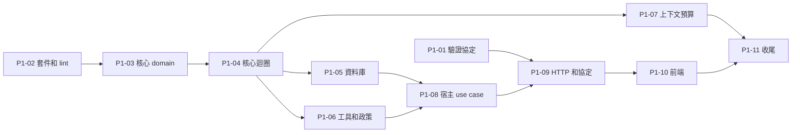

# AI Chat Harness 實作規劃

| 欄位     | 內容                                                                                                                   |
| -------- | ---------------------------------------------------------------------------------------------------------------------- |
| 狀態     | 已定案，P1 進行中                                                                                                      |
| 版本     | 1.0（2026-11-24）                                                                                                      |
| 對應文件 | 規格：[harness-spec.zh-TW.md](harness-spec.zh-TW.md) 1.0。程式架構：[architecture.zh-TW.md](architecture.zh-TW.md) 1.0 |

這份文件把四期拆成工作項目。一個工作項目是一個 PR。每一項寫明範圍、完成哪些需求、怎麼驗收。

## 1. 結論

- **P1 有 11 個 PR，由內往外做**：先寫 domain，再寫迴圈，再接資料庫和 Backstage，最後換協定和前端。
- **P1 的前 4 個 PR 不碰 PR #1 的程式。** 它們只新增核心套件，可以跟現有功能並存。
- **第 5 到第 9 個 PR 把宿主換成新架構。** 換完的那一個 PR（P1-09）是唯一會改變對外行為的地方。
- **P2 有 7 個 PR，P3 有 10 個，P4 有 3 個。**
- **PR #1 已經合併當基準**（2026-11-24）。它的 repo 基礎設施、畫面元件、模型呼叫留下來；backend 的迴圈、儲存、路由在 P1 重寫，舊的資料表直接刪除。

大小的意思：S 是一個檔案群、幾百行以內；M 是一個完整的模組；L 是跨多個模組。這不是工時的估計。

## 2. 開始之前

| 項目         | 說明                                                                        | 狀態                 |
| ------------ | --------------------------------------------------------------------------- | -------------------- |
| PR #1 的處理 | 合併當基準。後面的 PR 在它上面逐步替換                                      | 已合併（2026-11-24） |
| 這幾份文件   | 放在 `docs/design/`，開一個文件 PR                                          | 已開 PR              |
| 套件名稱     | 核心叫 `ai-chat-harness`，放在 `packages/`。其他套件照 Backstage 的命名慣例 | 已定                 |

## 3. P1：核心

完成後的狀態：對外的功能跟 PR #1 一樣，再加上斷線不丟結果、可以多台部署、上下文不會爆。程式換成新架構。

| 編號  | 工作項目                         | 大小 | 完成的需求                                           |
| ----- | -------------------------------- | ---- | ---------------------------------------------------- |
| P1-01 | 驗證協定                         | S    | D-19                                                 |
| P1-02 | 套件和 lint 規則                 | S    | A-01、A-09                                           |
| P1-03 | 核心 domain                      | M    | A-04、A-05、T-03、T-04、H-02、H-05、S-03、D-18、D-25 |
| P1-04 | 核心迴圈                         | L    | A-02、A-03、A-08、A-10、H-05、H-06、P-04、S-01、T-05 |
| P1-05 | 資料庫                           | M    | H-03、H-04、T-07、A-04、A-10                         |
| P1-06 | 工具和政策的 adapter             | M    | T-01 到 T-06、T-11、D-06、D-24                       |
| P1-07 | 上下文預算和摘要                 | M    | H-09                                                 |
| P1-08 | 宿主的 use case 和 RunSupervisor | L    | H-01、H-04、H-06、H-07、H-08、H-11、A-06、O-02       |
| P1-09 | HTTP 和新的串流協定              | M    | D-19、H-10、SE-01                                    |
| P1-10 | 前端                             | M    | SE-01、B-01、T-11、S-02                              |
| P1-11 | 收尾                             | S    | 整體驗收                                             |

### P1-01 驗證協定

- **範圍**：一份短文件，加一支可以丟掉的測試程式。對照鎖定版本的 AI SDK 文件，確認三件事：
  1. 程式架構第 8 節的事件對照表，每一列的事件名稱和欄位。
  2. 「停下來等核准，之後由另一個請求繼續」在協定裡怎麼表示。協定有原生的核准事件就用它，沒有就用自訂資料。
  3. 前端用 `@ai-sdk/react` 的 `useChat` 接我們的端點，還是只用協定、自己寫狀態。
- **驗收**：對照表更新成確認過的版本。第 3 點有結論和理由。
- **為什麼先做**：這是整個 P1 裡唯一我沒有親自驗證過的對外介面。先花小成本確認，再寫 presenter。

### P1-02 套件和 lint 規則

- **範圍**：新增 `packages/ai-chat-harness` 和 `plugins/ai-chat-common` 兩個空套件。加上程式架構第 11 節的三層 lint 規則。CI 納入新套件。
- **驗收**：在核心裡寫一行 `import '@backstage/errors'`，lint 會失敗。在 `domain/` 裡 import `application/`，lint 會失敗。這兩個反例寫成 lint 的測試。

### P1-03 核心 domain

- **範圍**：`domain/` 底下所有檔案。重點是 `decidePolicy`、`decideNextAction`、`buildModelInput`（先不含摘要）。
- **驗收**：
  - `decideNextAction` 的每一列規則至少一個測試，包含「有 `tool_started` 沒有結果」這一列。
  - `decidePolicy`：不是唯讀的工具設成 `allow` 時，結果仍然是 `ask`。`egress` 的唯讀工具是 `ask`。
  - 這個 PR 沒有任何 `async` 函式。

### P1-04 核心迴圈

- **範圍**：ports、`AdvanceRun`、`callModel`、`executeTools`、事件型別。`testing/` 入口：`ScriptedModel`、`InMemoryItemLog`、`FakeToolGateway`、`itemLogContract`。
- **驗收**（都用假模型，不啟動 Backstage）：
  - 一般回答：事件順序正確，紀錄裡有一筆 `agent_message`。
  - 唯讀工具：直接執行，結果進紀錄，模型看得到結果。
  - 要核准的工具：迴圈回傳 `waiting_approval`。寫入 `approval` 後再呼叫一次，工具被執行一次。
  - 一步裡兩個要核准的：只決定一個時仍然是 `waiting_approval`（P-04）。
  - 拒絕：寫入 `denied` 的結果，模型收到。
  - 參數不合格：不產生核准，模型收到 `invalid`（T-05）。
  - 上限：Step 數、工具呼叫數、時間各一個測試。
  - 停止：`heartbeat` 回傳 `cancelRequested` 後，迴圈在下一步之前結束。
  - 當掉後接手：紀錄裡有 `tool_started` 沒有結果時，工具不會被執行第二次，結果是 `unknown`（A-08）。
  - `InMemoryItemLog` 通過 `itemLogContract`。

### P1-05 資料庫

- **範圍**：新的 migration（四張表裡的前三張）。`KnexItemLog`、`KnexSessionRepository`、`KnexRunRepository`。
- **舊資料不搬**：PR #1 的三張表在這個 PR 不動，新表和它們並存。P1-09 刪掉舊程式時，同一個 PR 加一個 migration 把舊表刪除。
- **驗收**：
  - `KnexItemLog` 通過 `itemLogContract`，SQLite 和 PostgreSQL 都跑。
  - 兩個連線同時對同一段 Session 開 Run，只有一個成功（H-03）。
  - 同一個 `callId` 寫兩次 `approval`，第二次被拒絕（T-07）。
  - 租約不是自己的時候，寫入被拒絕。

### P1-06 工具和政策的 adapter

- **範圍**：`ActionsToolGateway`、`ConfigAgentCatalog`（只有 Toolset 和 policy，Agent 留到 P3）。設定檔的 `toolsets` 和 `policy`。PR #1 的 include、exclude 設定保留一版並標成淘汰。
- **驗收**：
  - 沒有標 `readOnly` 的 action 被當成不是唯讀。
  - 設定把不是唯讀的 action 寫成 `allow` 時，啟動時記一筆警告，執行時仍然是 `ask`。
  - Session 沒開的 Toolset，工具不會出現在給模型的清單裡。
  - 參數不符合 schema 時，`validate` 回傳錯誤訊息。
  - action 的 schema 在呼叫存下之後改變：核准時重新驗證（T-06）。

### P1-07 上下文預算和摘要

- **範圍**：`buildModelInput` 加上預算：先把舊的工具輸出換成一行說明，還是超過就把舊的 Step 換成摘要。`summarize` 這一步用模型產生摘要，寫成 `summary` Item。
- **驗收**：
  - 紀錄的內容在摘要前後完全一樣（A-05）。
  - 一段超過預算的長對話：送給模型的內容在預算以內，最近的幾步是完整的。
  - 工具呼叫和它的結果不會被拆開（只留其中一個，模型的 API 會拒絕）。

### P1-08 宿主的 use case 和 RunSupervisor

- **範圍**：宿主的 `domain/`、`application/`（P1 的 use case）、`RunSupervisor`、`AuditorAuditLog`、`principalFromRequest`、`plugin.ts` 的組裝。這個 PR 結束時，舊的 `ChatService` 還在，路由還沒換。
- **驗收**：
  - 不是擁有者送訊息或核准：被拒絕。
  - 訂閱者中途離開：Run 跑完，紀錄完整（H-07）。
  - 核准由「另一個 `RunSupervisor` 實例」處理（模擬另一台 backend）：工具被執行一次。
  - 租約過期：`ExpireStaleRuns` 把 Run 標成 `expired`，之後可以開新的 Run。
  - 關機：進行中的 Run 被標成 `expired`，沒有留下 `running` 的紀錄（H-11）。
  - 核准、拒絕、不是唯讀的工具的執行都有稽核紀錄（O-02）。

### P1-09 HTTP 和新的串流協定

- **範圍**：新的 router、controller、`uiMessageStream` presenter、錯誤對應。路徑從 `/conversations` 改成 `/sessions`。OpenAPI 更新。刪除舊的 `ChatService`、`ChatStore`、`routes/`，並用一個 migration 刪除舊的三張表（資料不搬）。
- **這是破壞性的變更**：API 路徑和串流格式都變了。前端在 P1-10 跟上。兩個 PR 要一起發版，changeset 標成 minor 並寫明。
- **驗收**：
  - 每條路由的狀態碼：沒登入、不是擁有者、找不到、已有進行中的 Run。
  - SSE 的內容符合 P1-01 確認過的對照表。
  - 任何回應裡都沒有系統提示（H-10）。
  - OpenAPI 的測試通過。

### P1-10 前端

- **範圍**：前端照程式架構第 9 節分層。接新的 API 和協定。Session 有自己的網址（SE-01）。每則訊息帶上頁面上下文（B-01）。Session 裡可以開關 Toolset（T-11）。新的狀態：已過期可重送、結果不明。
- **驗收**：
  - 端對端測試（Playwright）：送訊息、看到工具呼叫、核准、拒絕、停止。
  - 送訊息之後重新整理：看到已存的結果，沒有重複。
  - 直接打開 Session 的網址：載入那一段。
  - 兩個要核准的呼叫，決定一個後重新整理：那個決定還在，另一個仍在等；再決定另一個：Run 接著執行，第一個決定沒有重送（P-04）。
  - 從 entity 頁面打開：模型的上下文裡有那個 entity。

### P1-11 收尾

- **範圍**：兩台 backend 的整合測試。README、`config.d.ts`、設定的說明。把這三份設計文件裡 P1 的需求標成完成。
- **驗收**：規格裡所有標 P1 的需求，都對得到一個測試。對照表放在這個 PR 的說明裡。

## 4. P2：Session

完成後的狀態：可以管理自己的 Session，可以分享給同事（快照或持續更新），同事可以複製走。

| 編號  | 工作項目                    | 大小 | 完成的需求                        | 驗收重點                                                                                                                                                                                                                                         |
| ----- | --------------------------- | ---- | --------------------------------- | ------------------------------------------------------------------------------------------------------------------------------------------------------------------------------------------------------------------------------------------------ |
| P2-01 | 列表管理和自動標題          | M    | SE-03、SE-04                      | 搜尋、釘選、改名、封存。標題在第一輪結束後產生，產生失敗不影響對話                                                                                                                                                                               |
| P2-02 | 保存期限                    | S    | SE-05                             | 定期工作刪除過期的 Session。稽核紀錄還在。多台同時跑不會重複刪                                                                                                                                                                                   |
| P2-03 | Permission 和分享的資料模型 | M    | SH-01、SH-05、SH-08、SH-09、SH-11 | `shares` 表。`visibleItems` 每一列規則一個測試。條件規則「是擁有者」「有分享給我或我的群組」                                                                                                                                                     |
| P2-04 | 分享的 use case 和 API      | M    | SH-02、SH-03、SH-06、SH-10、SH-11 | 被分享的人送訊息和核准都被拒絕。到期後變成快照。每個動作有稽核紀錄                                                                                                                                                                               |
| P2-05 | 分享的畫面和複製            | M    | SH-04、SH-07、SH-10、SH-12        | 分享對話框的說明文字。持續更新時上方的提示列。複製出來的 Session 沒有工具輸出                                                                                                                                                                    |
| P2-06 | 斷線接回和即時狀態          | M    | A-07、B-05                        | 斷線後接回：從目前 Run 的第一個 Item 重送再接新的，先送 `start`，未完成的文字補送 `text-start` 加已累積的文字，Item 不重複不遺漏。逐字輸出到一半時重新整理，畫面接得上。Run 在別台時，每秒查一次新的 Item（沒有逐字片段）。沒裝 Signals 也能運作 |
| P2-07 | 側邊面板和入口元件          | M    | B-02                              | 新增 `ai-chat-react`。面板在換頁時保留。別的 plugin 用 `<AiChatLauncher>` 開啟對話                                                                                                                                                               |

順序：P2-01 和 P2-02 互相獨立。P2-03 之後才能做 P2-04 和 P2-05。P2-06 和 P2-07 跟分享無關，可以平行。

分享的安全測試單獨列出來，因為這一期最容易出錯的地方在這裡：

- 被分享的人直接呼叫 API 讀取序號超過 `up_to_seq` 的 Item：讀不到。
- 被分享的人讀取序號超過 `outputs_up_to_seq` 的工具輸出：只有狀態，沒有內容。
- 取消分享後，原本的網址立刻不能讀。
- 群組分享：不在群組裡的人讀不到；離開群組後讀不到。
- 持續更新的分享，被分享的人用接回的端點（P2-06）也只收到他能看的內容。

## 5. P3 和 P4

### P3：Harness

完成後的狀態：別的團隊可以用設定檔加一個 backend module 做自己的 Agent。

| 編號  | 工作項目                                                | 大小 | 完成的需求                         |
| ----- | ------------------------------------------------------- | ---- | ---------------------------------- |
| P3-01 | `ai-chat-node`、擴充點、設定檔裡的 Agent                | M    | X-01、X-02                         |
| P3-02 | Context provider 和 entity 綁定                         | M    | X-03、SE-02、SE-06                 |
| P3-03 | 計畫：`update_plan`、`planning: required`、畫面上的清單 | M    | X-06、X-07、D-07                   |
| P3-04 | Skills：讀 `SKILL.md`、`load_skill`                     | M    | X-04、D-22                         |
| P3-05 | Hooks                                                   | M    | X-05                               |
| P3-06 | TechDocs 搜尋的 action                                  | M    | X-08                               |
| P3-07 | 平行唯讀呼叫、每步上限、模型能力、限流                  | M    | P-01、P-02、P-03、P-05、P-06、X-09 |
| P3-08 | Toolset 的權限、輸出上限和遮蔽、寫入配額                | M    | T-08、T-09、T-10                   |
| P3-09 | 觀測                                                    | S    | O-01                               |
| P3-10 | 結果顯示元件                                            | M    | B-03                               |

順序：P3-01 最先。P3-03 和 P3-04 都需要 P3-01 的 Agent 定義。P3-06 到 P3-10 互相獨立。

每一項的驗收重點：

- **P3-01**：一個範例 module 註冊 Agent 和 Context provider，不 import 宿主的任何內部檔案。
- **P3-03**：`planning: required` 的 Agent，第一步送給模型的工具只有 `update_plan`。
- **P3-04**：上下文裡只有 Skill 的名稱和說明。載入全文之後才出現內容。
- **P3-05**：Hook 回傳 `continue` 時，`ask` 的工具仍然要核准。Hook 丟例外時，這個工具呼叫被拒絕，Run 繼續。
- **P3-06**：搜尋結果只有使用者有權限看的文件。先確認 Backstage 有沒有官方的 search action，有就直接用。
- **P3-07**：四個唯讀工具同時執行，其中一個逾時，其他三個的結果照原本順序交回。

### P4：擴大

| 編號  | 工作項目           | 大小 | 完成的需求       |
| ----- | ------------------ | ---- | ---------------- |
| P4-01 | 子任務：`delegate` | L    | P-07、P-08、P-09 |
| P4-02 | 題組測試           | M    | O-03             |
| P4-03 | Client tool        | L    | B-04             |

P4 開始之前要重新評估：先看 P3-07 的平行唯讀呼叫在實際使用上夠不夠。夠的話，P4-01 可以不做。

## 6. 實作時要驗證的事

這些是我設計時沒有親自驗證的地方。每一項都排在用到它的 PR 之前。

| 編號 | 要驗證的事                                                                   | 影響                          | 在哪裡處理                                                    |
| ---- | ---------------------------------------------------------------------------- | ----------------------------- | ------------------------------------------------------------- |
| V-01 | AI SDK 的 UI message stream 怎麼表示「等核准」和自訂資料，以及事件的確切名稱 | presenter 和前端的 adapter    | P1-01（已驗證，見 [protocol-check](protocol-check.zh-TW.md)） |
| V-02 | `actionsServiceRef` 還在 alpha。下一版 Backstage 的介面有沒有變              | `ActionsToolGateway` 一個檔案 | P1-06。每次升級 Backstage 時檢查                              |
| V-03 | SQLite 和 PostgreSQL 對「唯一索引裡的空值」的行為是否一致                    | H-03、T-07 的做法             | P1-05 的測試                                                  |
| V-04 | 模型的 token 計算。OpenAI 相容的端點不一定回傳用量                           | 上下文預算的準確度            | P1-07。沒有用量時用字數估計                                   |
| V-05 | Backstage 有沒有官方的 search 或 TechDocs action                             | P3-06 的範圍                  | P3-06 開始前                                                  |
| V-06 | 使用者 token 的有效期在各種登入方式下是多少                                  | `runTimeoutSeconds` 的上限    | P1-08                                                         |

## 7. 風險

| 風險                                                    | 可能性         | 處理                                                                                |
| ------------------------------------------------------- | -------------- | ----------------------------------------------------------------------------------- |
| P1-09 和 P1-10 是破壞性變更，中間有一段時間前後端對不上 | 確定會發生     | 兩個 PR 一起發版。套件還在 0.x，changeset 寫明                                      |
| 每一步讀整段紀錄，Session 很長時變慢                    | 中             | 有摘要之後只讀摘要涵蓋範圍之後的 Item。P1-07 一起做。用 500 筆 Item 的 Session 測量 |
| Run 在行程裡跑，部署時會被中斷                          | 確定會發生     | H-11 的關機流程，加上畫面的「已過期，可以重送」。不是唯讀的工具有 D-25 保護         |
| 分層之後檔案變多，小改動要動好幾個檔案                  | 中             | 接受。換來的是裡面兩圈不啟動 Backstage 就能測。程式架構第 12 節列了每種改動要動哪裡 |
| 持續更新的分享讓別人看到不該看的內容                    | 低，但後果嚴重 | D-21 的三條保護，加上第 4 節的安全測試                                              |
| Actions Registry 的介面改變                             | 中             | 只有一個 adapter 用到它                                                             |

## 8. 每個 PR 的共同要求

- PR 的說明列出完成的需求編號。
- 新增或修改的規則，測試放在它所在的那一圈。domain 的規則不靠整合測試來保證。
- 對外行為有變化時附 changeset。
- lint、型別檢查、單元測試、API report 都通過。
- 不出現內部系統或公司的名稱。範例用 `example.com`。

## 9. 變更紀錄

| 日期       | 版本 | 變更                                                                                                                                                                                                                                                                                               |
| ---------- | ---- | -------------------------------------------------------------------------------------------------------------------------------------------------------------------------------------------------------------------------------------------------------------------------------------------------- |
| 2026-11-24 | 1.0  | 第一版                                                                                                                                                                                                                                                                                             |
| 2026-11-24 | 1.0  | PR #1 的舊資料不搬：P1-05 拿掉資料搬移，舊表改在 P1-09 刪除                                                                                                                                                                                                                                        |
| 2026-11-24 | 1.0  | P1-01 完成（V-01）：鎖定 `ai@7.0.166`。核准用原生的 `tool-approval-request`；新增被拒絕、失敗、取消的事件；前端改以 `useChat` 加 `ChatTransport` 為中心（程式架構第 9 節）；A-07 接回改為從目前 Run 的第一個 Item 重送。jest 探針已通過（Backstage CLI 的 jest 能 import `ai` 和 `@ai-sdk/react`） |
| 2026-11-24 | 1.0  | P1-01 補充：A-07 改成從目前 Run 的第一個 Item 重送（P2-06 驗收同步）；每次按 Allow 或 Deny 立刻呼叫 decision 端點存下，P1-10 加一條驗收                                                                                                                                                            |
| 2026-11-24 | 1.0  | P1-01 審查後修正：核准改由畫面指定 `pendingDecision`（P1-10 驗收補一句）；失敗的順序改成 `data-run` 在前、`error` 在後；接回要先送 `start` 並補送 `text-start`（P2-06 驗收補一句）                                                                                                                 |
