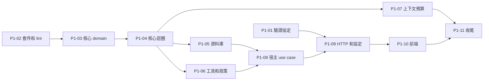
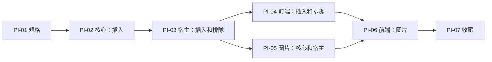
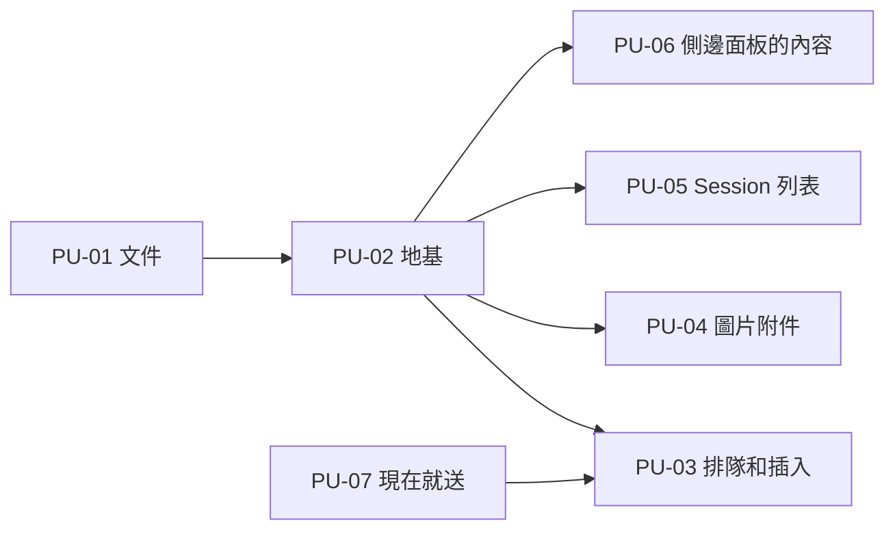

# AI Chat Harness 實作規劃

| 欄位     | 內容                                                                                                                   |
| -------- | ---------------------------------------------------------------------------------------------------------------------- |
| 狀態     | 已定案，P1 完成（P1-01 到 P1-11）。PI 核心與後端完成，文件收尾完成。PU（前端對齊 assistant-ui）進行中                  |
| 版本     | 1.2（2026-11-25）                                                                                                      |
| 對應文件 | 規格：[harness-spec.zh-TW.md](harness-spec.zh-TW.md) 1.2。程式架構：[architecture.zh-TW.md](architecture.zh-TW.md) 1.2 |

這份文件把 PI、PU 和四期拆成工作項目。一個工作項目是一個 PR。每一項寫明範圍、完成哪些需求、怎麼驗收。

## 1. 結論

- **P1 有 11 個 PR，由內往外做**：先寫 domain，再寫迴圈，再接資料庫和 Backstage，最後換協定和前端。
- **P1 的前 4 個 PR 不碰 PR #1 的程式。** 它們只新增核心套件，可以跟現有功能並存。
- **第 5 到第 9 個 PR 把宿主換成新架構。** 換完的那一個 PR（P1-09）是唯一會改變對外行為的地方。
- **PI（輸入：圖片、插入、排隊）有 7 個 PR，排在 P2 之前。** PI-01 只改文件。
- **P2 有 7 個 PR，P3 有 10 個，P4 有 3 個。**
- **PU（前端對齊 assistant-ui）有 7 個 PR，排在 P2 之後。** PU-01 只改文件。畫面改用 assistant-ui 的無樣式 primitives；狀態仍留在 `useSessionChat`。
- **PR #1 已經合併當基準**（2026-11-24）。它的 repo 基礎設施、畫面元件、模型呼叫留下來；backend 的迴圈、儲存、路由在 P1 重寫，舊的資料表直接刪除。

大小的意思：S 是一個檔案群、幾百行以內；M 是一個完整的模組；L 是跨多個模組。這不是工時的估計。

## 2. 開始之前

| 項目         | 說明                                                                        | 狀態                 |
| ------------ | --------------------------------------------------------------------------- | -------------------- |
| PR #1 的處理 | 合併當基準。後面的 PR 在它上面逐步替換                                      | 已合併（2026-11-24） |
| 這幾份文件   | 放在 `docs/design/`，開一個文件 PR                                          | 已開 PR              |
| 套件名稱     | 核心叫 `ai-chat-harness`，放在 `packages/`。其他套件照 Backstage 的命名慣例 | 已定                 |

## 3. P1：核心

完成後的狀態：對外的功能跟 PR #1 一樣，再加上斷線不丟結果、可以多台部署、上下文不會爆。程式換成新架構。

| 編號  | 工作項目                         | 大小 | 完成的需求                                           | PR         | 狀態 |
| ----- | -------------------------------- | ---- | ---------------------------------------------------- | ---------- | ---- |
| P1-01 | 驗證協定                         | S    | D-19                                                 | #4         | 完成 |
| P1-02 | 套件和 lint 規則                 | S    | A-01、A-09                                           | #3         | 完成 |
| P1-03 | 核心 domain                      | M    | A-04、A-05、T-03、T-04、H-02、H-05、S-03、D-18、D-25 | #5         | 完成 |
| P1-04 | 核心迴圈                         | L    | A-02、A-03、A-08、A-10、H-05、H-06、P-04、S-01、T-05 | #6、#7、#8 | 完成 |
| P1-05 | 資料庫                           | M    | H-03、H-04、T-07、A-04、A-10                         | #10        | 完成 |
| P1-06 | 工具和政策的 adapter             | M    | T-01 到 T-06、T-11、D-06、D-24                       | #9、#12    | 完成 |
| P1-07 | 上下文預算和摘要                 | M    | H-09                                                 | #11、#13   | 完成 |
| P1-08 | 宿主的 use case 和 RunSupervisor | L    | H-01、H-04、H-06、H-07、H-08、H-11、A-06、O-02       | #14        | 完成 |
| P1-09 | HTTP 和新的串流協定              | M    | D-19、H-10、SE-01                                    | #15        | 完成 |
| P1-10 | 前端                             | M    | SE-01、B-01、T-11、S-02                              | #16        | 完成 |
| P1-11 | 收尾                             | S    | 整體驗收                                             | #17        | 完成 |

### P1-01 驗證協定

- **範圍**：一份短文件，加一支可以丟掉的測試程式。對照鎖定版本的 AI SDK 文件，確認三件事：
  1. 程式架構第 8 節的事件對照表，每一列的事件名稱和欄位。
  2. 「停下來等核准，之後由另一個請求繼續」在協定裡怎麼表示。協定有原生的核准事件就用它，沒有就用自訂資料。
  3. 前端用 `@ai-sdk/react` 的 `useChat` 接我們的端點，還是只用協定、自己寫狀態。
- **驗收**：對照表更新成確認過的版本。第 3 點有結論和理由。
- **為什麼先做**：這是整個 P1 裡唯一我沒有親自驗證過的對外介面。先花小成本確認，再寫 presenter。

### P1-02 套件和 lint 規則

- **範圍**：新增 `packages/ai-chat-harness` 和 `plugins/ai-chat-common` 兩個空套件。加上程式架構第 11 節的三層 lint 規則。CI 納入新套件。
- **驗收**：在核心裡寫一行 `import '@backstage/errors'`，lint 會失敗。在 `domain/` 裡 import `application/`，lint 會失敗。這兩個反例寫成 lint 的測試。

### P1-03 核心 domain

- **範圍**：`domain/` 底下所有檔案。重點是 `decidePolicy`、`decideNextAction`、`buildModelInput`（先不含摘要）。
- **驗收**：
  - `decideNextAction` 的每一列規則至少一個測試，包含「有 `tool_started` 沒有結果」這一列。
  - `decidePolicy`：不是唯讀的工具設成 `allow` 時，結果仍然是 `ask`。`egress` 的唯讀工具是 `ask`。
  - 這個 PR 沒有任何 `async` 函式。

### P1-04 核心迴圈

- **範圍**：ports、`AdvanceRun`、`callModel`、`executeTools`、事件型別。`testing/` 入口：`ScriptedModel`、`InMemoryItemLog`、`FakeToolGateway`、`itemLogContract`。
- **驗收**（都用假模型，不啟動 Backstage）：
  - 一般回答：事件順序正確，紀錄裡有一筆 `agent_message`。
  - 唯讀工具：直接執行，結果進紀錄，模型看得到結果。
  - 要核准的工具：迴圈回傳 `waiting_approval`。寫入 `approval` 後再呼叫一次，工具被執行一次。
  - 一步裡兩個要核准的：只決定一個時仍然是 `waiting_approval`（P-04）。
  - 拒絕：寫入 `denied` 的結果，模型收到。
  - 參數不合格：不產生核准，模型收到 `invalid`（T-05）。
  - 上限：Step 數、工具呼叫數、時間各一個測試。
  - 停止：`heartbeat` 回傳 `cancelRequested` 後，迴圈在下一步之前結束。
  - 當掉後接手：紀錄裡有 `tool_started` 沒有結果時，工具不會被執行第二次，結果是 `unknown`（A-08）。
  - `InMemoryItemLog` 通過 `itemLogContract`。
  - **P1-03 審查時定下的七項約定**，每一項都要有測試鎖住：
    1. `callId` 在 Session 內唯一，由核心的 `IdGenerator` port 產生，不是模型給的 id。模型 id 和 `callId` 的對應由 `callModel` 處理（model adapter 回傳的是模型 id）。domain 裡把 `IdGenerator` 說成「宿主」的註解改成「核心的 port，宿主只提供實作」。
    2. `tool_call` 的 `policy` 一律由 `decidePolicy` 算出，不信任其他來源。
    3. 同一步的 `agent_message` 和 `tool_call` 在同一次 `append` 寫入，文字在前。空白的回答不寫 `agent_message`。
    4. `maxToolCallsPerRun`：`callModel` 寫入時，超過剩餘額度的呼叫直接寫 `tool_result{status:'denied', message:'tool call limit'}`。
    5. `executeTools` 只在 decision 是 `allow` 時執行；不是唯讀的工具先寫 `tool_started` 再執行（D-25）；`interrupted` 的寫 `unknown` 結果，不執行。
    6. domain 匯出 `needsApproval(call)`（`policy === 'ask'` 或 `readOnly !== true`），`decideNextAction` 用它，宿主之後也用它。
    7. `InMemoryItemLog` 用 `dedupeKeyOf` 擋重複（含 `tool_call:${callId}`），並通過 `itemLogContract`。contract 涵蓋：序號從 1 連續遞增、一次 `append` 多筆序號連續、重複丟 `DuplicateItem` 而且那次 `append` 整批不寫入、`afterSeq` 讀取、fence 不符丟 `LeaseLost`。
  - 事件（`HarnessEvent`）要能無損對應到 [protocol-check](protocol-check.zh-TW.md) 的 UI message stream：只有 `item.completed` 的 Item 進紀錄，`item.delta` 不進（A-03）。

### P1-05 資料庫

- **範圍**：新的 migration（四張表裡的前三張）。`KnexItemLog`、`KnexSessionRepository`、`KnexRunRepository`。
- **補充**：`runs` 表要有欄位存「不含等核准的已用時間」（`RunUsage` 的 `elapsedSeconds`，由宿主扣掉等待核准的時間）。`KnexItemLog` 用 `dedupeKeyOf` 產生 `dedupe_key`，`tool_call` 也算（`tool_call:${callId}`）。
- **舊資料不搬**：PR #1 的三張表在這個 PR 不動，新表和它們並存。P1-09 刪掉舊程式時，同一個 PR 加一個 migration 把舊表刪除。
- **驗收**：
  - `KnexItemLog` 通過 `itemLogContract`，SQLite 和 PostgreSQL 都跑。
  - 兩個連線同時對同一段 Session 開 Run，只有一個成功（H-03）。
  - 同一個 `callId` 寫兩次 `approval`，第二次被拒絕（T-07）。
  - 租約不是自己的時候，寫入被拒絕。
- **完成時的補充**：宿主的 `domain/`（`Session`、`Run`、錯誤）和 `application/ports/`（`SessionRepository`、`RunRepository`）先放最小的一組，P1-08 補其餘。`KnexRunRepository` 也實作核心的 `RunControl`，並提供 `acquireLease`（接手；每次接手產生新的 `lease_owner`，所以同一台再接手也有新的 fence）、`transition`、`requestCancel`、`expireStale`。細節見程式架構第 5.4 和第 7 節。

### P1-06 工具和政策的 adapter

- **範圍**：`ActionsToolGateway`、`ConfigAgentCatalog`（只有 Toolset 和 policy，Agent 留到 P3）。設定檔的 `toolsets` 和 `policy`。PR #1 的 include、exclude 設定保留一版並標成淘汰。設定檔的 `policy` 是平的 `{toolId: deny}`，要轉成 domain 的 `PolicySettings {byTool}`。
- **驗收**：
  - 沒有標 `readOnly` 的 action 被當成不是唯讀。
  - 設定把不是唯讀的 action 寫成 `allow` 時，第一次列出工具時記一筆警告（啟動時沒有使用者憑證，列不出 action），執行時仍然是 `ask`。
  - Session 沒開的 Toolset，工具不會出現在給模型的清單裡。
  - 參數不符合 schema 時，`validate` 回傳錯誤訊息。
  - action 的 schema 在呼叫存下之後改變：核准時重新驗證（T-06）。

### P1-07 上下文預算和摘要

- **範圍**：`buildModelInput` 加上預算：先把舊的工具輸出換成一行說明，還是超過就把舊的 Step 換成摘要。`summarize` 這一步用模型產生摘要，寫成 `summary` Item。
- **補充**：
  - `ItemLog.read` 加選項 `fromLatestSummary`：只讀最新的摘要涵蓋範圍之後的 Item。迴圈每一輪都用它，Session 長了也不會每一步讀整段。`itemLogContract` 加了對應的測試，`KnexItemLog`（P1-05）要實作：查最新的 `summary` 取它的 `coversUpToSeq`，再讀 `seq` 比它大的 Item。
  - 摘要在需要它的那一步之前由 `callModel` 呼叫 `summarize` 產生，不算 Step。失敗時 Run 不失敗，舊的 Step 被省略（細節在程式架構 4.3）。
  - V-04：模型串流沒有用量，一律用字數估計 token（ASCII 1/4、其他字元 1）。
- **已知限制**（排到 P3 評估，或調高 `maxSteps` 預設值時評估）：同一個 Run 的中間 Step 只縮短和省略，不摘要，因為摘要的涵蓋範圍是 `seq` 的前綴，摘要中間的 Step 會蓋掉最新的使用者訊息。另外，摘要或說明之後接問題會有連續兩則 `user`，少數要求嚴格交替的 chat template 可能拒絕（未查證）。
- **驗收**：
  - 紀錄的內容在摘要前後完全一樣（A-05）。
  - 一段超過預算的長對話：送給模型的內容在預算以內，最近的幾步是完整的。
  - 工具呼叫和它的結果不會被拆開（只留其中一個，模型的 API 會拒絕）。
  - 摘要的模型呼叫失敗、被中止、遇到截止時間時，Run 不丟未處理的例外：失敗時照常往下走，中止是 `cancelled`，截止時間是 `timeout`。
  - 有摘要之後只讀摘要涵蓋範圍之後的 Item。500 筆 Item 的 Session 量測結果在 PR 說明。

### P1-08 宿主的 use case 和 RunSupervisor

- **範圍**：宿主的 `domain/`、`application/`（P1 的 use case）、`RunSupervisor`、`AuditorAuditLog`、`principalFromRequest`、`plugin.ts` 的組裝。這個 PR 結束時，舊的 `ChatService` 還在，路由還沒換。
- **補充**：
  - `SendMessage` 先建立 Run，成功之後才寫入 `user_message`。
  - `DecideApproval` 用 domain 的 `needsApproval` 判斷哪些呼叫要核准。
  - 一個 Run 同時只能有一個迴圈在跑。兩個 decision 請求同時判定「全部決定了」時，只能有一個啟動迴圈。
  - 核心的 port 丟例外（例如 `LeaseLost`）時沒有 `run.ended`，宿主要自己更新 Run 的狀態。
  - `IdGenerator` 的實作用 UUID。
  - `CreateSession` 一定要把 Toolset 的預設值存進 `enabled_toolsets`。`sessions.enabled_toolsets` 不能是空值，沒給時存 `[]`；P1-06 的 gateway 把「沒給」當成用預設，接上之後不會走到那一條。
  - Run 進行中不能刪除 Session。`append` 的鎖順序是先 Run 後 Session，刪除 Session 時資料庫會先鎖 Session 再連帶刪 Run，兩者順序相反，PostgreSQL 可能死結。
  - 實作時的決定：`AdvanceRun` 的 request 的 `budget` 來自設定 `aiChat.context`；Run 的限制來自 `aiChat.maxTurns`、`maxToolCallsPerRun`、`runTimeoutSeconds`。`AccessControl` 是 P2，P1 的擁有者檢查是 domain 的 `assertOwner`。`ExpireStaleRuns` 由 `plugin.ts` 每 30 秒排一次。細節見程式架構第 5 節。
  - `yarn.config.cjs` 那條「核心套件不能依賴 repo 內其他 workspace」要放寬，讓 backend 依賴 `ai-chat-harness` 和 `ai-chat-common`。只放寬這個方向，核心依賴其他 workspace 仍然不行。（已放寬：`yarn.config.cjs` 允許 backend 依賴 `ai-chat-harness` 或 `ai-chat-common`，不必再改。）
- **驗收**：
  - 不是擁有者送訊息或核准：被拒絕。
  - 訂閱者中途離開：Run 跑完，紀錄完整（H-07）。
  - 核准由「另一個 `RunSupervisor` 實例」處理（模擬另一台 backend）：工具被執行一次。
  - 租約過期：`ExpireStaleRuns` 把 Run 標成 `expired`，之後可以開新的 Run。
  - 關機：進行中的 Run 被標成 `expired`，沒有留下 `running` 的紀錄（H-11）。
  - 核准、拒絕、不是唯讀的工具的執行都有稽核紀錄（O-02）。

### P1-09 HTTP 和新的串流協定

- **範圍**：新的 router、controller、`uiMessageStream` presenter、錯誤對應。路徑從 `/conversations` 改成 `/sessions`。OpenAPI 更新。刪除舊的 `ChatService`、`ChatStore`、`routes/`，並用一個 migration 刪除舊的三張表（資料不搬）。
- **串流的補充**：presenter 忽略 `tool_call` 的 `item.started`，`tool-input-available` 在 `item.completed` 才送。`failed` 的 `error` 只顯示固定文字，`outcome.cause` 只記 log。
- **摘要的串流**：presenter 把 `summary.failed` 轉成 transient 通知（例如 `data-notice`，文字「較早的內容已省略」）。`summary.started` 可以轉成「整理較早的內容」的進度提示。`context.trimmed`（預算讓舊內容被省略，包含摘要沒有用而直接省略的情況）轉成同一種 transient 通知，可以跟 `summary.failed` 合併成一則。`summary` Item 不顯示成訊息；從紀錄還原畫面時也略過它。
- **接續**：新增 `POST /sessions/:id/resume`（對應 `ResumeRun`，SSE；沒有東西可接續時 204）。`GET /sessions/:id` 的回應帶 `awaitingDecision` 和 `resumable`（`GetSession` 已提供）。
- **共用型別**：把前後端共用的型別搬進 `ai-chat-common` 時，拿掉 `scripts/sync-common.mjs`（和它在 `package.json` 的 script、`.husky/pre-commit`、`CONTRIBUTING.md` 裡的說明）。
- **這是破壞性的變更**：API 路徑和串流格式都變了。前端在 P1-10 跟上。兩個 PR 要一起發版，changeset 標成 minor 並寫明。
- **完成時的補充**：
  - `RunSupervisor` 把等核准轉成 `cancelled` 時，發給訂閱者的 `run.ended` 也換成 `cancelled`（P1-08 審查留下的項目），畫面不會顯示已取消的 Run 的核准按鈕。
  - 前後端共用的型別、路徑、`messageIdOfRun` 在 `ai-chat-common`；後端不再匯出 `/common`；`scripts/sync-common.mjs` 和它的 script、hook、說明都拿掉。前端自己的 `src/common` 還是第一版的型別，P1-10 換掉。`yarn.config.cjs` 允許前端依賴 `ai-chat-common`。
  - `llm/` 搬進 `adapters/model/`。migration `20260103000000_drop_conversations` 刪除舊的三張表；`down` 重建三張空表（讓逐一往回退時能到 `init`）。
  - `GET /sessions/:id/stream`（`FollowSession`）提前到 P1：P1-10 的 transport 需要它，驗收也要求接回的內容。只接這一台 backend 跑的 `running` Run；接回的串流不送逐字片段，每則 `agent_message` 完成時整段送。跨 backend 接回仍是 P2-06。
  - 新增 `GET /toolsets`（`ListToolsets`）：P1-10 的 T-11 需要列出可開關的 Toolset。
  - 取消已結束的 Run 回 409。`decision` 的 JSON 回應是 `{ approved }`。
  - 沒有登入 401、服務 token 403、不是擁有者和找不到都是 404（文字相同）、已有進行中的 Run 409、關機中 503。
- **驗收**：
  - 每條路由的狀態碼：沒登入、不是擁有者、找不到、已有進行中的 Run、`resume` 的 204、關機中的 503。
  - SSE 的內容符合 P1-01 確認過的對照表：一般回答、唯讀工具、要核准、核准後接續（`tool-approval-response` 在開頭）、拒絕、參數不合格、失敗（`data-run` 在 `error` 之前，沒有 `finish`）、取消（`abort`）、等核准結束（`finish` 的 `tool-calls`）、`GET /stream` 在不是 `running` 時 204、A-07 重送。測試用 AI SDK 自己的解析器讀回。
  - 任何回應裡都沒有系統提示（H-10），也沒有供應商的錯誤原文。
  - OpenAPI 的測試通過。

### P1-10 前端

- **範圍**：前端照程式架構第 9 節分層。接新的 API 和協定。Session 有自己的網址（SE-01）。每則訊息帶上頁面上下文（B-01）。Session 裡可以開關 Toolset（T-11）。新的狀態：已過期可重送、結果不明。訊息串、輸入框、工具卡片和 Markdown 的畫面在 PU-02 重做。
- **接續**：開啟 Session 時 `resumable` 為真（Run 在等核准，但所有呼叫都已決定），自動送接續請求。
  - 畫面在自己剛送出決定之後，不要因為看到 `resumable` 就自動接續。另一個分頁可能剛好在「決定已寫入、還沒 `acquireLease`」時看到 `resumable`；最後只會啟動一個迴圈，但做決定的那個用戶端可能拿不到串流，要等 P2 的 FollowSession 跨 backend 接回才補得上。
  - `reconnectToStream` 打 `GET /sessions/:id/stream`（204 回 `null`）；`decision` 回 JSON 時只更新那一張卡片，回 SSE 時接在同一則訊息上；停止按鈕呼叫 `POST /sessions/:id/runs/:runId/cancel`；Toolset 清單來自 `GET /toolsets`；`data-notice` 的 `code` 給畫面翻譯。從紀錄還原時助理訊息的 id 用 `messageIdOfRun`，並略過 `summary` Item。
  - `decision` 的回應依 `Content-Type` 處理：`text/event-stream` 接在同一則訊息上；收到 JSON（別的呼叫還在等，或別的請求搶到接續）就改用 `GET /sessions/:id/stream` 接。
  - `POST /sessions/:id/resume` 的串流不重送前面的內容，只有接續之後的事件；用戶端要帶著從 `GET /sessions/:id` 還原的訊息接續（那則訊息裡的核准要是 `approval-requested` 或 `approval-responded`）。`decision` 的串流也一樣：它只送這次決定的 `tool-approval-response`，前面的 `tool-approval-request` 要在用戶端的訊息裡。只有 `GET /stream` 的重送會補 `tool-approval-request`。
- **驗收**：
  - 端對端測試（Playwright）：送訊息、看到工具呼叫、核准、拒絕、停止。
  - 送訊息之後重新整理：看到已存的結果，沒有重複。
  - 直接打開 Session 的網址：載入那一段。
  - 兩個要核准的呼叫，決定一個後重新整理：那個決定還在，另一個仍在等；再決定另一個：Run 接著執行，第一個決定沒有重送（P-04）。
  - 從 entity 頁面打開：模型的上下文裡有那個 entity。

### P1-11 收尾

- **範圍**：兩台 backend 的整合測試。README、`config.d.ts`、設定的說明。把這三份設計文件裡 P1 的需求標成完成。
- **驗收**：規格裡所有標 P1 的需求，都對得到一個測試。對照表放在這個 PR 的說明裡。
- **完成時的補充**：
  - 對照表在 [p1-coverage.zh-TW.md](p1-coverage.zh-TW.md)：35 條 P1 需求都有測試。新增的測試補 H-08（串流的結果和存下的相同）、S-01（核心的 lint 規則擋掉執行程式碼、檔案系統、網路的 import，`eval`、`new Function`，以及 `require`、`process`、`globalThis`、動態 `import()` 等繞過 import 的寫法）、S-02（不載入圖片）。
  - 兩台 backend 的整合測試是 `integration/twoBackends.test.ts`：另一台決定、兩台同時決定、關機只結束自己的 Run、沒關機就當掉由另一台標成過期、不是跑 Run 的那台的 `GET /stream` 回 204。
  - README 的設定範例由 `config.test.ts` 檢查（後端接受它），也用 `yarn backstage-cli config:check --lax --strict --package backend --config app-config.yaml --config <範例>` 驗過（值改錯會失敗）。
  - P1-10 留下的限制已修：presenter 判斷「已重送的 Step」時，除了 `tool_call` 的 `step`，也算重送時開了幾個 Step，所以只有 `agent_message` 的 Step 的事件也會略過，不多送空的 Step。不用改 Item 的形狀或 port。
  - 用途說明頁（`usage.zh-TW.html`）改成實際的畫面：Allow 和 Deny、可展開的 Toolsets、核准卡片的內容、P1 的列表沒有自動標題；拿掉外部字型，頁面不載入任何外部資源。
  - 已知限制（P2 處理）：`GET /sessions/:id/stream` 只接這一台 backend 跑的 Run（P2-06）；對話列表沒有自動標題（P2-01）。

## 4. PI：輸入

完成後的狀態：使用者在 Run 進行中也能送訊息（插入或排隊），訊息可以帶圖片。設計見程式架構第 13 節，需求見規格 4.11。PI 排在 P2 之前。

| 編號  | 工作項目         | 大小 | 完成的需求                          | PR       | 狀態                      |
| ----- | ---------------- | ---- | ----------------------------------- | -------- | ------------------------- |
| PI-01 | 規格和設計文件   | S    | D-27 到 D-30；IN-01 到 IN-19 的定義 | #18      | 完成                      |
| PI-02 | 核心：插入       | M    | IN-10、IN-11、IN-17（核心的部分）   | #25      | 完成                      |
| PI-03 | 宿主：插入和排隊 | L    | IN-10 到 IN-17                      | #26、#29 | 完成                      |
| PI-04 | 前端：插入和排隊 | M    | IN-12、IN-13、IN-15、IN-18          | #28      | 完成（畫面在 PU-03 重做） |
| PI-05 | 核心和宿主：圖片 | L    | IN-01 到 IN-07                      | #30、#32 | 完成                      |
| PI-06 | 前端：圖片       | M    | IN-08、IN-09                        | #41、#64 | 完成（畫面在 PU-04）      |
| PI-07 | 收尾             | S    | 整體驗收                            | #49、#70 | 完成                      |

順序：PI-02 到 PI-05 依序做，PI-04 和 PI-05 互相獨立（PI-03 之後都可以開始）。PI-03 的排隊先不帶附件（`attachment_ids` 一律是空陣列），PI-05 加上保留和標記。IN-19 屬於 P2，在 P2-04、P2-05 做。

### PI-01 規格和設計文件

- **範圍**：只改文件。規格（D-27 到 D-30、4.11、資料模型、設定、分期）、程式架構第 13 節和相關表格、這一節。不改程式。port 和型別跟用到它們的 PR 一起加（PI-02、PI-03、PI-05），不在這個 PR。
- **驗收**：三份文件的編號、欄位名稱、路由、錯誤名稱一致；`yarn prettier:check` 和邊界檢查通過。

### PI-02 核心：插入

- **範圍**：
  - Item：`user_message` 加 `delivery`，`agent_message` 和 `tool_call` 加 `readUpToSeq`；`callModel` 寫入它們。
  - domain：`unreadInserted`、`insertStatesOf`；`decideNextAction` 的兩處改動；`buildModelInput` 的 Run 的使用者訊息規則（`pinned` 和 `boundarySeq`），並且不放已結束 Run 的 `unread` 插入訊息。`readUpToSeq` 是這一輪開始讀紀錄時的最大序號，不含這一步自己寫的摘要。
  - 事件 `message.read`。
  - `RunUsage`、port 不變。`InMemoryItemLog` 接受新欄位，`itemLogContract` 補測試。
- **依賴**：PI-01。
- **驗收**（都用假模型，不啟動 Backstage）：
  - 模型串流到一半時有訊息插入（在 `ScriptedModel` 的劇本裡寫入）：這一次的輸出照常寫入，`readUpToSeq` 小於插入的序號；下一輪 `decideNextAction` 回 `call_model`，不是 `complete`；下一次的模型輸入有這則訊息。
  - 模型的最後回答之後、迴圈判斷之前有訊息插入：Run 不結束，再呼叫一次模型，讀到之後才 `completed`。
  - 插入的訊息夾在 `tool_call` 和它的 `tool_result` 之間：`buildModelInput` 的順序是 assistant、所有 `tool`、插入的 `user`。兩個呼叫、插入在兩個結果之間，也是同樣的順序。
  - 工具已核准但還沒執行時插入：`decideNextAction` 仍回 `execute_tools`，工具照常執行（`callsOfLastStep` 的起點）。
  - Step 數用完時有未讀的插入訊息：`stop`（`max_steps`），不再呼叫模型；`insertStatesOf` 回 `unread`。
  - 插入的訊息不增加 `stepsUsed`；讀到它的模型呼叫增加一個。
  - 在很小的預算下，Run 的第一則訊息和所有插入的訊息都原文留下；摘要的 `coversUpToSeq` 小於第一則的序號。
  - `message.read` 在 `step.started` 之前、每則訊息只送一次（第二次模型呼叫不再送）。
  - 沒有 `readUpToSeq` 的舊 Item（P1 的紀錄）：行為跟 P1 相同，P1 的測試不改。
  - 插入發生在「讀紀錄」和「寫 `summary`」之間（在 `ScriptedModel` 的摘要呼叫裡插入）：模型輸出的 `readUpToSeq` 是讀紀錄時的最大序號，小於插入的序號，所以那則訊息是未讀，下一輪才被讀到；摘要的序號不會把它算成已讀。
  - 已結束的 Run 留下的 `unread` 插入訊息：之後的 Run 的模型輸入不含它；同一個 Run 裡還沒讀的插入訊息照常放進輸入。
  - `itemLogContract` 通過：新欄位原樣存取。

### PI-03 宿主：插入和排隊

- **範圍**：
  - migration：`runs.read_up_to_seq`、`queued_messages`。
  - `KnexItemLog.append`：插入的寫入規則（要求 `running`、租約沒過期；上限在 `UPDATE sessions` 之後檢查；附件用 `FOR UPDATE` 確認）；模型輸出的批次在 `checkFence` 取 `FOR NO KEY UPDATE`，第一步更新 `runs.read_up_to_seq`，再碰 `sessions`。每種寫入的取鎖順序照架構 13.8 的表。
  - `KnexRunRepository.transition` 的 `requireAllRead`；`UnreadMessages`。
  - `RunSupervisor`：被拒絕時重跑迴圈、`afterRun`、`queue.state` 事件。
  - port `QueuedMessageRepository` 和 `KnexQueuedMessageRepository`（`startNext` 的 transaction）。
  - use case：`InsertMessage`、`QueueMessage`、`UpdateQueuedMessage`、`DeleteQueuedMessage`、`ReorderQueue`、`ListQueue`、`StartNextQueued`、`ResumeQueue`；`GetSession` 回傳佇列和 `insertState`。
  - 路由、zod、錯誤對應、OpenAPI、presenter（`data-inserted`、`data-queue`；`message.read` 不走 `seq` 去重，改用已送過的插入序號集合）、設定（`input.insert`、`input.queue`）。
  - 稽核：自動送出寫 `queued-message-send`。
  - 核心的型別 `InsertState`（`read`、`unread`）改名為 `ReadState`：`GetSession` 的 `insertState` 另外有 `pending`，兩者不同值，不再同名。
  - 不在這個 PR（PI-05）：附件。`attachment_ids` 一律是空陣列，`attachments` 表、附件的 `FOR UPDATE` 和保留、`GET /input-config` 都沒有；下面驗收裡「附件的中繼資料」那幾處等 PI-05。migration `20260104000000_input.js` 只有 `runs.read_up_to_seq` 和 `queued_messages`；`attachments` 在 PI-05 自己的 migration。
- **依賴**：PI-02。V-07、V-10 要在開始前確認（結論見 V 表下面）。
- **驗收**（SQLite 和 PostgreSQL 都跑）：
  - **插入先於結束**：用同步點讓插入的 transaction 在迴圈的 `complete` 判斷之後、`transition` 之前 commit。`transition` 丟 `UnreadMessages`，Run 維持 `running`；supervisor 再跑一次迴圈，模型讀到訊息，之後 `completed`；訂閱者只收到一個 `run.ended`、一個 `run.started`。
  - **結束先於插入**：`transition` 先 commit；之後的插入得到 409，紀錄裡沒有那則訊息。
  - **真正同時**（PostgreSQL，兩個連線）：反覆跑兩者同時開始。每一輪的不變式：回 201 的插入，不是 `seq <= runs.read_up_to_seq`，就是它的 Run 以非正常方式結束；Run 以正常方式結束時，沒有 `seq > read_up_to_seq` 的 `user_message`。
  - **不死結**（PostgreSQL，兩個連線，各反覆一百輪）：插入對模型輸出的 `append`；排隊的 `add` 對模型輸出的 `append`。兩邊都完成，沒有 `deadlock detected`，`runs.read_up_to_seq` 只增不減。
  - 插入在 `waiting_approval`、`completed`、租約已過期、別的 Run 的 id：409，沒有寫入。插入第 6 則：409（`InsertLimitReached`）。
  - 插入先 commit、Run 才轉成 `waiting_approval`：核准後模型讀到它。
  - Stop 時有未讀的插入訊息：`GetSession` 的 `insertState` 是 `unread`；佇列暫停。
  - 租約過期（`ExpireStaleRuns`）時同上；核准由另一台 backend 接手後，插入的訊息照常被讀到。
  - 排隊：`add` 在沒有進行中的 Run 時 409（`NoActiveRun`）；第 6 則 409（`QueueFull`）；`add` 和 Run 的結束同時發生：不是訊息在佇列裡而且被自動送出，就是 409，不會留在佇列裡沒人送。
  - 兩個「分頁」交錯：A 刪掉一則，B 用舊的 id 清單重排，得到 409（`QueueChanged`）；B 修改已刪除的那則得到 404；位置在重排後是 1、2、3…。
  - 自動送出：`completed` 沒有 `endReason` 時，用最前面那則開新的 Run，`user_message` 的 `delivery` 是 `queued`，`page` 和附件的中繼資料跟排隊時相同，佇列少一列；`failed`、`cancelled`、`expired`、`completed` 加 `endReason` 都不送，`paused` 為真。
  - 兩次同時的 `startNext`（兩台 backend，或自動送出加「繼續」）：一個 Run、一則 `user_message`、佇列少一列，另一個回傳 `undefined`。`startNext` 在寫入 `user_message` 時失敗：Run 和佇列都回復。
  - IN-16：身分的到期時間不夠 `runTimeoutSeconds` 加餘裕、或不知道：不自動送出，`pausedReason` 是 `credentials`；足夠時送出，Run 的 `ctx.principal` 是那個身分。
  - 兩台 backend（`integration/twoBackends.test.ts`）：A 啟動 Run、B 做最後的核准；Run 結束後自動送出的 Run，用的是 B 的身分。
  - 「繼續」：佇列有東西、沒有進行中的 Run：開新的 Run，回傳 SSE；佇列是空的或有進行中的 Run：204。
  - 路由：每條新路由的狀態碼（沒登入 401、不是擁有者 404、錯誤的內容 400）；SSE 的 `data-inserted`、`data-queue` 用 AI SDK 的解析器讀回。
  - presenter：模型呼叫期間插入一則訊息，下一步的串流收到 `data-inserted`（沒有被 `seq` 去重吞掉）；接回（A-07）時重送階段已補送的插入訊息，之後的即時事件不再重送。
  - `afterRun`：`outcome` 是 `waiting_approval` 時回 `paused: false`，不送出，佇列不變；之後 Run 正常結束才送。
  - 稽核：自動送出有一筆事件（V-07 的結論決定怎麼寫）。
  - OpenAPI 的測試通過。

### PI-04 前端：插入和排隊

- **範圍**：
  - `Composer`：Run 進行中可以用；送出方式（Enter、Ctrl 或 Cmd 加 Enter、「排隊」按鈕）；等核准時只能排隊。
  - 「等待讀取」區、`data-inserted` 的顯示、`unread` 的標示和「再送一次」。
  - 排隊清單：顯示、修改、刪除、上下移；暫停的提示和「繼續」；Run 結束後接上自動送出的新 Run。
  - `itemsToMessages`：`data-inserted` 的位置、`unread`；`lastRunInterrupted` 和 `lastUserText` 以這個 Run 的第一則訊息為準（略過插入的訊息，架構 13.9 的「再送一次」）；`useSessionChat`：插入、排隊的狀態；`AiChatApi` 和 `AiChatClient` 加對應的呼叫。
  - 佇列區塊、插入的顯示、輸入框的排隊和插入，畫面在 PU-03 重做。
- **依賴**：PI-03。
- **驗收**：
  - 元件測試：Run 進行中輸入框可用，各種狀態（含暫停）的 Enter 和 Ctrl 加 Enter 各送到正確的呼叫；失敗時文字還在輸入框。插入得到 409 的三種處理：`InsertLimitReached` 或 Run 是 `waiting_approval`，改排隊；Run 是 `running` 但 `runId` 不同，對新的 `runId` 再插入；沒有進行中的 Run，直接送出。
  - `itemsToMessages`：`read` 的插入訊息在對應 Step 之前；`pending` 不在對話裡；`unread` 是使用者訊息加標示。Run 以 agent 的回答結束、後面有一則沒讀到的插入訊息：不當成中斷，只有那則訊息有自己的「再送一次」。Run 沒有答案就停下來：只有一個「再送一次」，重送第一則訊息，沒讀到的插入訊息沒有按鈕。任何情形都不出現兩個重送按鈕。
  - 端對端（Playwright，假的模型伺服器）：
    - Run 進行中按 Enter：訊息先顯示在輸入框上方，下一步開始時出現在對話裡，模型的下一個回答用到它。
    - 工具要核准時：Enter 變成排隊，提示說明原因；決定之後 Run 結束，排隊的訊息自動送出，答案出現，不用重新整理。
    - 排隊清單：修改、刪除、上下移，重新整理後仍在。
    - 失敗的 Run：清單顯示暫停，不自動送；按「繼續」才送。
    - Stop 時有未讀的插入訊息：顯示「Agent 沒有讀到」；Run 沒有答案時只有一個「再送一次」，重送第一則訊息；重送之後模型的輸入沒有那則沒讀到的訊息。
    - 佇列暫停：輸入框提示「送出後，這次結束時會接著送佇列」，清單標明「新訊息先送，佇列接在後面」；直接送出新訊息後，新 Run 先跑，它正常結束時佇列才接著送。
    - 兩個分頁：A 刪掉一則，B 改它：B 看到說明並更新清單。
  - S-02 的測試不變。

### PI-05 核心和宿主：圖片

- **範圍**：
  - 核心：`UserMessageBody.attachments`、`ModelMessage.images`、`ModelClient.capabilities.images`、`ContextBudget.tokensPerImage`；`buildModelInput` 的圖片規則；`buildSummaryInput` 的 `[image: …]`。
  - 宿主：migration `attachments`；`AttachmentStore` 和 `KnexAttachmentStore`；`UploadAttachment`、`ReadAttachment`、`PurgeUnusedAttachments`；上傳和讀取的路由、raw body 的中介層、`checkImage`；`KnexItemLog.append` 標記 `used_seq`；排隊的保留和釋放；`SendMessage`、`InsertMessage`、`QueueMessage` 接受 `attachmentIds`；`OpenAiCompatibleModelClient` 讀位元組轉成 `image_url`；`GET /input-config`；設定（`aiChat.llm.images`、`input.images`，含 `maxBytesPerInput`；載入時要求它不小於 `maxPerMessage` 乘 `maxBytes`）。`ModelClient.stream` 的 `opts` 加 `sessionId`，adapter 用它讀附件。讀取回應的 `Cache-Control` 是 `private, no-cache`，加 `ETag`。複製的支援（`AttachmentStore.copy`）在 P2-05 用，這裡先加 port 和 `KnexAttachmentStore` 的實作與測試。現在的單一模型設定是 `aiChat.llm`，`images` 加在那裡；`models` 區塊是 P3。
- **依賴**：PI-03。V-08、V-09 要在開始前確認。
- **驗收**：
  - 上傳：四種型別各一個通過（201，回傳 `id`、`mediaType`、`name`、`size`）。`image/svg+xml` 回 415。`Content-Type` 是 PNG 但內容是 JPEG 回 400。空內容回 400。
  - 大小：`Content-Length` 超過 `maxBytes` 回 413，而且處理函式沒有被呼叫（記憶體沒有被用掉）；沒有 `Content-Length` 的請求在超過上限時回 413。
  - 擁有者：別人上傳或讀取回 404；沒登入 401；讀取時標頭有 `nosniff`、`inline`、`Content-Security-Policy`、存下的型別；`If-None-Match` 相符回 304。
  - 沒用到的附件已有 12 個：第 13 個回 409。
  - 綁定：訊息用別的 Session 的附件 id 回 400；一則 5 張回 400；不能讀圖片的模型收到帶圖片的訊息回 400。
  - 標記：送出之後附件的 `used_seq` 是那則訊息的序號；寫入失敗時附件沒有被標記；排隊保留（`reserved_by`），刪除排隊列後釋放，自動送出後 `used_seq` 有值。「再送一次」用同樣的附件 id 成功。
  - 清理（用假時鐘）：沒用到、超過 24 小時的被刪；有 `used_seq` 的、被保留的、不到 24 小時的留下；刪除 Session 時全部連帶刪除。
  - 模型轉接：送給假的 LLM 伺服器的請求，`user` 訊息的 `content` 是陣列，第一項是文字，後面是 `image_url`，data URL 解碼後的位元組和上傳的相同；沒有圖片的訊息仍是字串。附件讀不到時換成 `[image: …, not available]`，呼叫成功。`capabilities.images` 是 `false` 時請求裡沒有 `image_url`，有 `not sent` 的說明。
  - 位元組上限：輸入裡的圖片位元組加起來超過 `maxBytesPerInput` 時，舊訊息的圖片換成 `[image: <name>, left out]`，即使 token 預算夠；這個 Run 的使用者訊息的圖片不換。這個 Run 的圖片加上新插入的訊息超過上限：`InsertMessage` 回 400（`TooManyImageBytes`），沒有寫入。`maxBytesPerInput` 小於 `maxPerMessage` 乘 `maxBytes`：backend 啟動失敗。
  - 讀取附件的回應標頭是 `private, no-cache` 加 `ETag`；`If-None-Match` 相符回 304，但附件被刪除之後回 404。
  - 預算：每張圖片算 `tokensPerImage`；超過預算時，舊訊息的圖片先換成 `[image: <name>, left out]`，這個 Run 的使用者訊息的圖片不動；摘要的輸入只有 `[image: <name>]`。
  - 核心的測試不啟動 Backstage，PI-02 的測試不改。
- **實作和上面不同的地方**：
  - 上傳不用 `express.raw`，用 `readLimited`（V-09）。
  - 模型不能讀圖片時，上傳也回 400（`ImagesNotSupported`），不只是帶圖片的訊息。
  - `ContextBudget` 的 `tokensPerImage` 和 `maxImageBytesPerInput` 是選用的（沒有時用 1600、不限制），所以核心 PI-02 的測試不用改；模型能不能讀圖片由 `buildModelInput` 的 `extra.images` 帶入（`callModel` 從 `capabilities.images` 設）。
  - 訊息裡的附件 id 不屬於這段 Session：domain 的錯誤是 `UnknownAttachment`，回應的名稱是 `AttachmentNotFound`（400）。
  - `GET /input-config` 多回 `maxBytesPerInput` 和 `maxPendingPerSession`。
  - `AttachmentStore.put` 多收 `maxPending`；`QueuedMessage` 的 `attachments` 在 HTTP 型別（`ChatQueuedMessage`）是選用的，前端的 PI-04 測試不用改。

### PI-06 前端：圖片

- **範圍**：附加按鈕、貼上、拖放；草稿的縮圖、移除、上傳進度和失敗；訊息裡的縮圖（帶身分的 `fetch`，object URL）；`input-config` 說不能讀圖片時不顯示按鈕；新對話頁附加圖片時先建立 Session。附件按鈕、草稿和訊息裡的縮圖，畫面在 PU-04 重做。
- **依賴**：PI-04、PI-05。
- **驗收**：
  - 元件測試：三種附加方式各加一張；型別不對、太大、超過張數的檔案不上傳並顯示原因；移除後送出的內容沒有它；上傳失敗（413）時文字還在；模型不能讀圖片時沒有按鈕，貼上圖片不上傳。
  - object URL 在元件卸載、訊息更新時釋放（測試檢查 `revokeObjectURL`）。
  - 縮圖載入失敗顯示「圖片已不存在」。
  - 端對端：附加圖片並送出，假的模型伺服器收到 `image_url`；縮圖出現在訊息裡，重新整理後仍在；新對話頁第一則訊息帶圖片可以送出；Run 進行中插入帶圖片的訊息。
  - S-02：Markdown 裡的圖片語法仍不載入任何資源（既有測試不改）。

### PI-07 收尾

- **範圍**：對照表 [pi-coverage.zh-TW.md](pi-coverage.zh-TW.md)（IN-01 到 IN-18 對到測試）、README 的設定範例（`input`、`images`）和「圖片會送到模型供應商」的說明、`config.d.ts` 說明、三份設計文件標註 PI 的需求／PR 狀態與 P4-01（`delegate`）不做，以及綜合端對端（`e2e-tests/images.test.ts`：圖片＋插入＋排隊）和用途說明頁（`docs/design/usage.zh-TW.html`）的畫面與說明（#49、#70）。
- **依賴**：PI-06（後端和 client）。
- **驗收**：核心與後端的 PI 需求都對得到測試（[pi-coverage.zh-TW.md](pi-coverage.zh-TW.md)）；README 的 `input` 和 `images` 設定範例由 `config.test.ts` 檢查；用途說明頁（`usage.zh-TW.html`）由 `config.test.ts` 檢查不載入外部資源。

## 5. P2：Session

完成後的狀態：可以管理自己的 Session，可以分享給同事（快照或持續更新），同事可以複製走。

| 編號  | 工作項目                    | 大小 | 完成的需求                                       | 驗收重點                                                                                                                                                                                                                                                                         | PR  | 狀態                   |
| ----- | --------------------------- | ---- | ------------------------------------------------ | -------------------------------------------------------------------------------------------------------------------------------------------------------------------------------------------------------------------------------------------------------------------------------- | --- | ---------------------- |
| P2-01 | 列表管理和自動標題          | M    | SE-03、SE-04                                     | 搜尋、釘選、改名、封存。標題在第一輪結束後產生，產生失敗不影響對話                                                                                                                                                                                                               | #35 | 後端完成，畫面在 PU-05 |
| P2-02 | 保存期限                    | S    | SE-05                                            | 定期工作刪除過期的 Session。稽核紀錄還在。多台同時跑不會重複刪。逐項驗收見下方 P2-02                                                                                                                                                                                             | #34 | 完成                   |
| P2-03 | Permission 和分享的資料模型 | M    | SH-01、SH-05、SH-08、SH-09、SH-11                | `shares` 表。`visibleItems` 每一列規則一個測試。條件規則「是擁有者」「有分享給我或我的群組」                                                                                                                                                                                     | #36 | 完成                   |
| P2-04 | 分享的 use case 和 API      | M    | SH-02、SH-03、SH-06、SH-10、SH-11、IN-19（讀取） | 被分享的人送訊息和核准都被拒絕。到期後變成快照。每個動作有稽核紀錄。逐項驗收見下方 P2-04                                                                                                                                                                                         | #62 | 完成                   |
| P2-05 | 分享的畫面和複製            | M    | SH-04、SH-07、SH-10、SH-12、IN-19（複製）        | 分享對話框的說明文字。持續更新時上方的提示列。複製出來的 Session 沒有工具輸出；範圍內的圖片複製成新的附件。逐項驗收見下方 P2-05                                                                                                                                                  | #68 | 完成                   |
| P2-06 | 斷線接回和即時狀態          | M    | A-07、B-05                                       | 斷線後接回：從目前 Run 的第一個 Item 重送再接新的，先送 `start`，未完成的文字補送 `text-start` 加已累積的文字（Run 在別台時等它完成再整段送），Item 不重複不遺漏。逐字輸出到一半時重新整理，畫面接得上。Run 在別台時，每秒查一次新的 Item（沒有逐字片段）。沒裝 Signals 也能運作 | #44 | 後端完成，畫面在 PU-05 |
| P2-07 | 側邊面板和入口元件          | M    | B-02                                             | 新增 `ai-chat-react`。面板在換頁時保留。別的 plugin 用 `<AiChatLauncher>` 開啟對話。逐項驗收見下方 P2-07                                                                                                                                                                         | #46 | 完成                   |

### P2-02 保存期限

- **範圍**：`aiChat.retention.days`。domain 判斷 Session 是否到期。`PurgeExpiredSessions`。`SessionRepository.purgeExpired`（PostgreSQL 用 `FOR UPDATE SKIP LOCKED`）。`plugin.ts` 排程。刪除沿用既有的連帶刪除（runs、items、queued messages、attachments）。不讀、不寫 Auditor。
- **依賴**：無。P2-01 獨立。作法對齊 `DeleteSession`（進行中的 Run 不刪、先鎖 runs 再鎖 session）和 `PurgeUnusedAttachments`（每小時、`SKIP LOCKED`）。
- **驗收**：
  - 到期：`updated_at` 早於「現在減 `days` 個整天（每個 24 小時）」的 Session 刪除；剛好在界線上、或更晚的留下。規則在 domain，不靠整合測試。
  - 設定：沒寫 `retention.days` 時是 90。`0` 不刪任何 Session。負數、或不是整數，backend 啟動失敗。
  - 連帶刪除：過期的 Session 刪掉之後，它的 runs、items、queued messages、attachments 都不在。沒過期的 Session 留著。
  - 進行中的 Run：`active_session_id` 還在（`running` 或 `waiting_approval`）的 Session 不刪，即使 `updated_at` 已過期。Run 結束後，下一次才刪。
  - 釘選和封存：不例外，過期一樣刪。這兩件事會更新 `updated_at`，期限從那個時間重算，所以剛釘選的留下、釘選已經很久的刪除。
  - 稽核：刪除不呼叫 Auditor，已寫下的稽核事件還在。稽核在 Backstage auditor，不在 Session 的表裡。
  - 多台：PostgreSQL 上兩個 purge 同時跑，過期的 Session 各刪一次（兩邊刪除數相加等於段數），而且不等別人已經鎖住的 session 或 run（`SKIP LOCKED`）。SQLite 沒有列鎖，這條只在 PostgreSQL 驗。
  - 排程：`plugin.ts` 每小時排 `ai-chat-purge-expired-sessions`，timeout 5 分鐘。
- **規格沒寫、實作選定的地方**（對齊既有刪除和定期工作，程式架構第 5.3 節有同樣的說明）：
  - 期限看 `sessions.updated_at`，不看 `created_at`。建立、修改 Session（改名、釘選、封存、開關 Toolset）、寫入 Item 會更新它。只排隊、只上傳附件不會。
  - 預設 90，和規格的設定範例一樣。`0` 代表保留，不刪。
  - 進行中的 Run 留下，和 `DeleteSession` 拒絕刪除一樣。釘選和封存不留下。
  - 每小時，和 `PurgeUnusedAttachments` 一樣。排程用 Backstage scheduler 的預設 global scope（同一時間只有一台執行）；列鎖是兩次工作重疊時的第二層。

### P2-06 斷線接回和即時狀態（後端與 `useSessionChat`）

- **範圍**：
  - `FollowSession`：Run 是 `running` 而且迴圈在這一台時，維持先訂閱再讀紀錄。回應先送 `start`（`messageId` 是 `run_<runId>`）和 `data-run`，從這個 Run 的第一個 Item 重送，再接上新的事件。紀錄裡已經有的 `seq` 再來一次就略過。
  - 這一台有還沒寫進紀錄的文字：重送已完成的 Item 之後，補 `text-start` 和訂閱當下已累積的文字。之後的 `text-delta` 只送還沒送出的部分。這則完成時不把已經送過的字再送一次；`append` 已寫入、`item.completed` 還沒發出的空檔也不補前綴。
  - Run 是 `running` 但迴圈在別台：不再回 204。先重送紀錄裡已有的 Item，然後每秒用 `afterSeq` 增量讀一次紀錄（短暫錯誤記 warn 重試，連續 3 次失敗才結束；只在 `waiting_approval` 時讀一次完整紀錄），只送新的、已完成的 Item，沒有逐字片段。`agent_message` 整段送（`text-start`、一個 `text-delta`、`text-end`）。Run 不再是 `running` 時，依紀錄狀態送出結束，然後停。
  - 連上來時沒有 Run、Run 已結束、或 Run 是 `waiting_approval`：仍回 204。停在核准上的 Session 若開著串流，`useChat` 會停在 `streaming`，按核准不會自動送出。
  - `Notifier`：通知擁有者「處理中、等核准、有新回覆、或閒置（`idle`）」。有 Signals 用 `SignalsNotifier`（`signalsServiceRef`）；沒有安裝時用不做事的版本。
  - `useSessionChat`：Run 是 `running` 就接回，並依傳入的 `liveActivity` 在變成 `running` 時接回、離開進行中狀態時重新讀取（列表與活動標籤 UI 留待新版前端實作）。
- **依賴**：無。跟分享無關，可以和 P2-03 平行。這一項不實作 P2-04 的分享讀取；接回維持擁有者檢查。
- **驗收**：
  - 這一台、Run 是 `running`：串流以 `start`（同一個 `messageId`）和 `data-run` 開頭，Item 從這個 Run 的第一個開始；已重送的 `seq` 不再送出。訂閱之後、讀紀錄之前寫入的 Item 仍會送到。`uiMessageStream.test.ts` 的 `starts with the same message id, replays the run from its first item and goes on with the new events`；`http.test.ts` 的 `sends a client that joins a run under way the run from its first item with the same message id, then what comes next (A-07)` 和 `resumes mid-text streaming through supervisor, FollowSession and controller with one text part and no duplicate`；`FollowSession.test.ts` 的 `subscribes before it reads, so an item written in between is not lost`。
  - 未完成的文字（這一台）：補 `text-start` 和訂閱當下已累積的文字，後面的 `text-delta` 接上去，`item.completed` 只送剩下的字和 `text-end`。讀紀錄的空檔這則已經寫完（不論 `item.completed` 是否已發出）時不補前綴，由重送或 `item.completed` 整段送。`FollowSession.test.ts` 的 `sends the text accumulated at subscribe time and not the deltas already queued`、`does not duplicate text when items.append stored the message before item.completed is emitted`、`still sends resumeText on a resumed run that already has an earlier agent_message`；`uiMessageStream.test.ts` 的 `continues an open draft from the text it was given, and does not send that text again`。
  - 別台、Run 是 `running`：不回 204。先重送已有的 Item，之後每秒用 `afterSeq` 增量讀一次。沒有逐字片段。新的 `agent_message` 是 `text-start`、一個帶全文的 `text-delta`、`text-end`。同一個 `seq` 不送兩次；兩次讀取之間寫入的 Item 下一次會讀到；短暫讀取失敗會重試。`FollowSession.test.ts` 的 `polls a run on another backend once a second and yields only completed items`、`polls with afterSeq and only reads the full log on waiting_approval`、`retries transient poll errors with a warning and fails only after repeated errors`；`twoBackends.test.ts` 的 `streams a run that another backend is running, without text fragments`。
  - 別台的 Run 離開 `running`：送出結束狀態。等核准是 `tool-approval-request`、`data-run`、`finish`（`tool-calls`）；完成是 `finish`（`stop`）；失敗／過期是 `data-run` 然後 `error`（訊息為 `"The run stopped."`），沒有 `finish`；取消是 `abort`。然後串流停止。`FollowSession.test.ts` 的 `ends the poll with the status stored for the run`。
  - 沒有 Run、Run 已結束、Run 是 `waiting_approval`：`FollowSession` 回 `undefined`，HTTP 204。`http.test.ts` 的 `answers 204 when the run is not running: no run, a run that waits for an approval, a run that ended`；`FollowSession.test.ts` 的 `returns nothing when there is no running run`。
  - 不是擁有者：拒絕，回應和找不到一樣（404）。`FollowSession.test.ts` 的 `rejects a principal that does not own the session`。
  - `afterSeq`：略過該序號以前的 Item，那些 Item 的事件也不再送。`useChat` 的接回不帶 `afterSeq`。`FollowSession.test.ts` 既有的 inserted 測試，加上 `a poll leaves out items up to afterSeq`。
  - 客戶端離開：停止輪詢或取消訂閱，Run 仍是 `running`。`FollowSession.test.ts` 的 `stops polling when the reader returns, and does not read again`；`twoBackends.test.ts` 的跨 backend 測試在取消回應之後 Run 仍是 `running`。
  - 重新整理、逐字到一半與 `liveActivity` 轉態：載入時 Run 是 `running`，接回串流含 `start`、已完成的內容、`text-start` 和已累積的文字，以及後面的 `text-delta`。畫面上的助理文字是接起來的全文，使用者訊息只有一則。開啟時已帶 `liveActivity: 'running'` 或串流中才變成 `'running'`，之後轉成 `waiting_approval` 再回到 `running` 時仍能再次接回。`useSessionChat.test.tsx` 的 `shows the text so far after a reload and continues it without duplicating the message`、`follows a run that becomes active while the session is open and idle`、`does not follow again a run that was already running when the page opened`、`follows when a run resumes after waiting_approval even if opened with liveActivity running`、`follows when liveActivity becomes running while the initial stream is active and later resumes`、`reloads once when an open run leaves running or waiting`。
  - Signals：Run 開始通知 `running`，進入等核准通知 `waiting_approval`，正常完成通知 `replied`；失敗、取消（包含取消等核准的 Run）、租約過期、以及啟動失敗都通知 `idle`。`SignalsNotifier` 用 `signalsServiceRef.publish`，頻道 `ai-chat`，收件人是擁有者。沒有 Signals 時不做事的 Notifier 成功返回、不丟錯。通知失敗不讓 Run 或 caller 失敗。`RunSupervisor.test.ts` 的 `tells the notifier when a run starts, waits, completes, or ends without a reply`；`hostFlows.test.ts` 的 `notifies idle when cancelling a waiting_approval run, expiring a stale run, or failing to start a run`；`SignalsNotifier.test.ts` 的 `publishes the activity to the owner on the ai-chat channel`、`swallows a failure of publish`、`resolves without a signals service`。
  - 清單：`GET /sessions` 的每一筆，有進行中的 Run 時帶 `activity`（`running` 或 `waiting_approval`），沒有就不帶。`ListSessions.test.ts` 的 `adds the activity of the active run`。
- **分享的安全測試**（第 5 節那一條）：持續更新的分享，被分享的人用接回的端點也只收到他能看的內容。這一項的 `FollowSession` 只給擁有者；被分享的人的接回在 P2-04，走同一條讀取路徑，測試在 P2-04 的驗收。
- **規格沒寫、實作選定的地方**（對齊程式架構的 `Notifier`、`SignalsNotifier`、`signalsServiceRef`，以及第 8 節接回只在 `running` 時串流）：
  - 跨 backend 的間隔是 1 秒；單次讀取失敗會記 warn 並重試，連續失敗 3 次才結束。測試注入等待，不真的等一秒。
  - 通知頻道是 `ai-chat`。訊息是 `{ sessionId, activity }`，`activity` 為 `running`（處理中）、`waiting_approval`（等核准）、`replied`（有新回覆，Run 是 `completed`）、`idle`（失敗、取消、過期）。只發給擁有者的 user entity ref。`idle` 沒有出現在規格的三個名稱裡；不送的話，只聽 Signals 的畫面會把狀態留在「處理中」。
  - `replied` 不寫進清單欄位；清單的 `activity` 來自進行中的 Run，不是新的資料表。
  - 跨 backend 的串流在 Run 離開 `running` 時送結束，不在中途改成 204。204 只在連線當下沒有 `running` 的 Run。
  - 接回串流與同一台即時串流的三處差異：別台 `failed`／`expired` 一律送 `"The run stopped."`；別台只送已存的 Item，輪詢項目之間沒有 step 邊界；這一台接回時 `typing: false`，補完當時草稿後，同一個 Run 的下一則回答會在完成時整段送出。
  - 未完成文字的前綴是訂閱當下的草稿，不含這個訂閱已經排進佇列的 `text-delta`。佇列裡已有這則的 `item.completed` 或紀錄裡已有更新的 `agent_message` 時不補前綴。

### P2-07 側邊面板和入口元件

- **範圍**：新增 `plugins/ai-chat-react`（公開名稱 `@kwkevinchan/backstage-plugin-ai-chat-react`，`web-library`）。公開出口是 `aiChatPanelApiRef`、`AiChatPanelApi`、`useAiChatPanel()` 和 `<AiChatLauncher prompt="…" entityRef="…" className="…" />`。`ai-chat` 前端依賴 `ai-chat-react` 並實作與註冊 `aiChatPanelApiRef` Utility API（新前端系統用 `ApiBlueprint`、舊前端系統用 plugin 的 `apis`）。別的 frontend plugin 只依賴 `ai-chat-react`，不 import 宿主或核心的內部檔案。側邊面板由 `ai-chat` 畫在路由外面，等 `identityApiRef.getBackstageIdentity()` 解析後才顯示，換頁不卸下進行中的對話。Launcher 開啟面板，並把 prompt 和 entity 帶進那一次開啟的對話；`aiChatPanelApiRef` 未註冊時不畫按鈕。不做結果顯示元件（B-03，P3）和 client tool（B-04，P4）。
- **依賴**：無。P2-06 獨立，可以平行。頁面上下文沿用已完成的 B-01（`isEntityRef`、`isPagePath`）。
- **驗收**（`ai-chat-react` 只定義 Utility API 契約、hook 與 launcher；規則與 store 在 `ai-chat`，畫面行為在 `ai-chat` 的 ui；不靠煙霧測試）：
  - 套件：`package.json` 的 role 是 `web-library`，名稱是 `@kwkevinchan/backstage-plugin-ai-chat-react`。runtime dependency 為 `@backstage/core-plugin-api`，沒有 `ai-chat`、`ai-chat-backend`、`ai-chat-common`、`ai-chat-harness`。測試讀這份 `package.json`。
  - 出口：套件匯出 `aiChatPanelApiRef`、`AiChatPanelApi`（`isOpen`、`open`、`close`、`subscribe`）、`useAiChatPanel` 和 `AiChatLauncher`。沒有 `AiChatPanelProvider`、`createAiChatPanelStore`、`AiChatToolResultBlueprint`、`AiChatClientToolBlueprint`。測試對照出口。
  - 帶入的上下文（domain，`launchContextOf`）：`prompt` 去掉前後空白後還有字才算有 prompt，送出的文字是去掉前後空白的那段。只有空白不算有 prompt。`entityRef` 通過 `isEntityRef` 才留下，不合格就沒有 entity。
  - 送出時的頁面（domain，`panelMessagePage`）：有帶入合格的 entity 時，訊息的 `page.entityRef` 用它，不用網址上另一個 `entityRef` 蓋掉。沒有帶入 entity 時，沿用畫面自己的 page context（B-01）。`page.path` 用送出當下的路徑：換頁之後再送，路徑換成新的那一頁。
  - 面板狀態（domain，`applyLaunch`、`applyClose`、`applySession`）：`open` 把面板打開。這次有 prompt 時清掉目前的 session（換成新的對話）；沒有 prompt 時 session 留著。`close` 只把 `open` 設成關，session 和帶入的上下文都還在。沒有任何轉移會因為路由改變而關面板或清 session：狀態裡不放路由。
  - `useAiChatPanel()`：透過 `useApiHolder().get(aiChatPanelApiRef)` 訂閱 `isOpen` 並委派 `open(request?)`、`close()`；API 未註冊時 `isOpen` 為假且呼叫不報錯。測試用 `TestApiProvider`。
  - `<AiChatLauncher prompt entityRef className>`：是一顆按鈕，`aiChatPanelApiRef` 存在時渲染並套用 `className`，按下之後呼叫 `open` 並帶上這兩個 prop（沒有 prop 時呼叫 `open()`）；`aiChatPanelApiRef` 不存在時回傳 `null`。
  - 換頁仍保留（ui）：面板畫在 `<Routes>` 外面。面板裡已經有一段對話（使用者訊息在畫面上、session id 不變）時，路由從一個頁面換到另一個，同一段文字還在，而且不會再向 API 要一次這段 session。
  - Launcher 開啟並帶入上下文（ui，假的 `AiChatApi`）：按下 Launcher（有 prompt、有合格的 entityRef）之後，面板打開，建立 session，`sendMessage` 的文字是那個 prompt，`page.entityRef` 是那個 entity，`page.path` 是按下時的路徑。entityRef 不合格時，訊息仍送出，`page` 沒有 `entityRef`。只有 entity、沒有 prompt 時，不建立 session；下一則從面板送出的訊息帶那個 entity。
  - 從面板自己開對話（ui）：面板有輸入框。送出後建立 session 並送出那段文字。沒有 Launcher 時，`page` 用目前路由（B-01）。prompt 送出建立 session 尚未完成時若被只有 entity 的開啟中斷，輸入框送出按鈕保持可用，不會卡在停用。
  - 登入頁不顯示（ui）：`identityApiRef.getBackstageIdentity()` 尚未完成或被拒絕時，面板不渲染任何內容；登入完成後才顯示開關按鈕。
  - 關上再打開（ui）：進行中的對話還在，session 沒有清掉，也不重新跟 API 要這段 session。
  - 既有的 `/ai-chat` 頁面不改行為（既有的頁面測試仍通過）。新前端系統的 plugin 註冊 `aiChatPanelApi` 並多掛一個 app root 上的面板，註冊 plugin 就有，不要求 app 再包一層。
- **規格沒寫、實作選定的地方**（程式架構第 6.2 節和第 9 節照這份選定更新）：
  - 面板透過 Backstage Utility API（`aiChatPanelApiRef`）在 `ai-chat-react` 與 `ai-chat` 之間傳遞狀態，不使用模組層級的全域單例或獨立 React Provider。
  - 面板在畫面右側，等登入完成後每一頁都在，預設關上。邊上有一顆「AI chat」按鈕可以打開，面板裡有關閉。關上時，已經開始的對話元件不卸載，所以進行中的 Run 不會因為關上或換頁而停。還沒開始對話時，關上的面板只有那顆按鈕，不畫第二個對話區。
  - 有 prompt 的開啟會開始一段新的對話，並立刻送出那個 prompt（跟聊天頁的第一則訊息一樣：先 `POST /sessions`，再送出）。沒有 prompt 時只打開面板，entity 留給下一則從面板送出的訊息。
  - 帶入的 entity 在這段面板對話之後的訊息也用，直到下一次有 prompt 的開啟換成新的對話。路徑每次送出時用當時的頁面。
  - 面板一次一段對話，不做列表（列表是 P2-01）。`/ai-chat` 的完整頁面保持原樣。
  - 舊前端系統要在路由外面掛一次面板（開發用的 `packages/app` 已掛）。新前端系統用 app root element 掛同一塊面板。
  - 開發用的舊版 app 在側邊欄放一顆 `<AiChatLauncher>`，prompt 問目前的頁面，entity 是 `component:default/example.com`。這是別的 plugin 的接法，不是另一項產品功能。

順序：P2-01 和 P2-02 互相獨立。P2-03 之後才能做 P2-04 和 P2-05。P2-06 和 P2-07 跟分享無關，可以平行。

### P2-01 列表管理和自動標題

- **範圍**：SE-03、SE-04 的後端與非畫面的 client。`GET /sessions?q=`、釘選、改名、封存，以及第一輪正常結束後自動產生標題（產生失敗不影響對話）。改名、釘選、封存沿用 `UpdateSession`、`PATCH /sessions/:id` 和既有欄位。列表畫面（搜尋、釘選、改名、封存、「顯示已封存」、輸入防抖）在 PU-05。不做保存期限、分享、複製、斷線接回、側邊面板。
- **依賴**：P1 的 Session、`UpdateSession`，以及 `RunSupervisor` 寫完 Run 狀態的那條路徑。
- **決定**（規格和架構沒有寫死的部分）：
  - **搜尋**：`GET /sessions?q=`。比對存下的 `title`，不分大小寫的子字串。JavaScript 只去掉兩端空白；SQL 用 `lower(title) like lower(?)`，SQLite 和 PostgreSQL 兩邊都走同一個 `lower()`。ASCII 的大小寫在兩個資料庫都忽略；非 ASCII 的大小寫折疊跟該資料庫的 `lower()` 走。沒有標題的 Session 對不上。空白和沒給 `q` 一樣。`%` 和 `_` 是字面字，不是萬用字元。仍只列出自己的；預設不含已封存。`includeArchived` 和 `limit` 照舊，`limit` 算的是符合條件的筆數。不搜訊息內容。
  - **排序**：釘選的在前。同一組裡 `updated_at` 新的在前，再以 `id` 排，順序才穩定。
  - **封存**：`archived: true` 封存，`archived: false` 恢復。預設列表不含已封存，要 `includeArchived` 才列出。「顯示已封存」的畫面在 PU-05。
  - **改名**：`PATCH` 的 `title`。使用者設過的標題（含第一輪結束前就改的，以及模型還在寫標題時改的）不會被自動標題蓋掉。空白不送出、不把標題清掉，是列表畫面的規則（PU-05）。
  - **自動標題**：掛在 `RunSupervisor` 已把 Run 狀態寫入、佇列的 `afterRun` 處理完、把 `run.ended` 交給訂閱者並結束訂閱之後，不另做一條生命週期。仍在迴圈裡，所以關機會等到寫完。標題的模型呼叫用 `AbortSignal.any([迴圈的 signal, AbortSignal.timeout(8 秒)])`。用這台已經在用的 `ModelClient`，沒有第二個模型。提示詞要求只回一行、最多 80 字元、不要引號；對話內容當資料，不當指示。送給模型的只有該輪的使用者文字和助理文字，各最多 500 字元，不含工具輸出、不含圖片。回答取第一行、去掉一層引號、空白折成一行，超過 80 字元就截斷；空的就當作沒產生。寫入條件是 `title` 仍是空的，所以和手動改名同時發生時，手動的留下。
  - **第一輪**：這段 Session 第一次正常結束的 Run。正常結束和佇列相同（`isNormalEnd`：`completed` 而且沒有 `endReason`）。更早的 Run 若是失敗、取消、過期或因上限結束，不算這一輪，下一次正常結束仍會產生。這一次產生失敗（模型錯誤、逾時、空的回答）就不為後來的 Run 再產生，標題維持沒有。
  - **失敗不影響對話**：錯誤只記 log。Run 的狀態已經寫好，不改；串流仍送出 `run.ended`。模型呼叫最多等 8 秒，逾時當作沒產生。對話可以繼續，列表照常。
- **驗收**：
  - domain（`sessionList.test.ts`）：`searchLikePattern`（去掉兩端空白、保留大小寫、`%` `_` `!` 跳脫）；`titleFromModelAnswer`（第一行、引號、80 字元、空的）；`shouldAutoTitle`（沒有標題、正常結束、沒有更早的正常結束才產生；已有標題、不是正常結束、已經正常結束過，都不產生）。
  - application：`NameSession.test.ts` 在該產生時呼叫模型並寫入；模型丟錯、逾時、空回答都不寫、也不丟出；逾時時模型收到的 `AbortSignal` 已被中止；已有標題或不是第一次正常結束時不呼叫模型；模型還在回答時寫入的標題不會被蓋掉。`RunSupervisor.test.ts`：只有正常結束才呼叫；先讓訂閱者收到 `run.ended` 再寫標題，寫標題仍在 `done` 裡；呼叫丟錯時 Run 仍是 `completed`，訂閱者仍收到 `run.ended`。
  - persistence：`KnexSessionRepository.test.ts` 搜尋（含 ASCII 不分大小寫、非 ASCII 大寫標題例如「Über build」，SQLite 和 PostgreSQL 都跑）、釘選排序、`setTitleIfAbsent` 不蓋掉已有標題、`%` 不是萬用字元。`KnexRunRepository.test.ts` 的 `hasOtherNormalEnd`。
  - HTTP（`http.test.ts`）：`GET /sessions?q=`、釘選排在較新的未釘選之前、已封存要 `includeArchived` 才列出。
  - 前端非畫面（`AiChatClient.test.ts`）：`listSessions` 帶 `query`、`includeArchived`，以及更新釘選、標題、封存。
  - 整合（`hostFlows.test.ts`）：第一輪正常結束後寫入標題；Run 失敗沒有標題；手動標題留著。產生失敗不讓 Run 失敗，由 application 和 `RunSupervisor` 的測試保證。

分享的安全測試單獨列出來，因為這一期最容易出錯的地方在這裡：

- 被分享的人直接呼叫 API 讀取序號超過 `up_to_seq` 的 Item：讀不到。
- 被分享的人讀取序號超過 `outputs_up_to_seq` 的工具輸出：只有狀態，沒有內容。
- 被分享的人讀取 `used_seq` 超過 `up_to_seq` 的附件：讀不到（IN-19）。複製出來的 Session：範圍內的訊息的圖片都在，是新的附件（新的 id、擁有者是複製的人），位元組和原來的相同；範圍以外的訊息的圖片不在；原 Session 的附件 id 讀不到複製出來的內容的權限（互不影響）。複製寫進 Auditor。
- 取消分享後，原本的網址立刻不能讀。
- 群組分享：不在群組裡的人讀不到；離開群組後讀不到。
- 持續更新的分享，被分享的人用接回的端點（P2-06）也只收到他能看的內容。
- `summary` 含工具輸出的內容，所以分享和複製（SH-04、SH-09、D-21）時，`summary` 跟工具輸出用同樣的規則：超過 `outputs_up_to_seq` 的摘要不給看，複製時不帶。

### P2-03 Permission 和分享的資料模型

- **範圍**：`shares` 表和 `KnexShareRepository`（程式架構第 7 節）。domain 的 `Share`、`visibleItems`（第 5.2 節的規則表）、持續更新時工具輸出範圍的預設（SH-09）。`ai-chat-common` 放讀取 Session 的 permission 定義；backend 用 Backstage permission 的條件規則實作「是擁有者」「有分享給我或我的群組」，`PermissionAccessControl` 實作 `AccessControl`（SH-05）。`GetSession` 改走 `AccessControl`：擁有者看到的和現在一樣；有有效分享的人只拿到 `visibleItems` 的結果；沒有權限的人得到 `NotSessionOwner`（HTTP 仍是 404，文字和找不到相同）。設定 `aiChat.sharing.live`。分享沒有寫入權限欄位：`subject_ref` 是 `user:…` 或 `group:…`，表達唯讀（SH-01）。
- **不做**：`ShareSession`、`UpdateShare`、`ForkSession`、`POST`／`PATCH`／`DELETE /sessions/:id/shares`、`POST /sessions/:id/fork`、附件讀取放行、複製、接回。其他 use case 仍只查擁有者（`assertOwner`）。送訊息和核准的拒絕是 P2-04，這裡不改那些路由。
- **依賴**：P1 的 Session、Item、`GetSession`。不依賴 P2-01、P2-02、PI-06。
- **驗收**（domain 的每一列是表格式單元測試，不靠整合測試）：
  - `shares` 的欄位就是第 7 節那一組（`id`、`session_id`、`subject_ref`、`up_to_seq`、`outputs_up_to_seq`、`expires_at`、`created_by`、`created_at`、`revoked_at`），沒有寫入權限或角色欄位。`session_id` 和 `subject_ref` 都有索引，存得下 `user:…` 和 `group:…`。`up_to_seq`、`outputs_up_to_seq`、`expires_at`、`revoked_at` 可以是空值。
  - 刪除 Session 時，它的分享列連帶刪除。Session 不存在時不能寫入分享。`down` 只拿掉 `shares`，其他表還在。SQLite 和 PostgreSQL 都跑。
  - `KnexShareRepository` 把一列原樣寫入再讀出（含空值）。依 `subject_ref` 列出時，只含這些對象、而且 `revoked_at` 是空值的列；已取消的、別人的不在裡面。
  - 擁有者：全部 Item、全部工具輸出都在，即使這段 Session 已有分享。
  - 快照（`up_to_seq` 有值）：序號大於 `up_to_seq` 的 Item 不在；等於的在。
  - 持續更新（`up_to_seq` 空值）且未到期：全部 Item 都在。
  - 工具輸出：序號不大於 `outputs_up_to_seq` 的 `tool_result` 保留輸出；大於的保留 `status`，輸出換成固定文字 `not shared`（文件裡的「沒有分享」；跟宿主其他存下來的說明一樣用英文，例如 `tool call limit`），`message` 和 `truncated` 拿掉，避免內容從那裡漏出。`tool_call` 的工具 id 和參數仍在（SH-09）。
  - `outputs_up_to_seq` 空值：看得到的範圍裡，工具輸出都保留。`0`：範圍裡每一筆 `tool_result` 都只有狀態。序號剛好等於界線的保留輸出，大 1 的換成 `not shared`。
  - `summary` 跟工具輸出同一條界線：`seq` 或 `coversUpToSeq` 大於 `outputs_up_to_seq` 的摘要整筆不在（摘要正文含工具輸出，不能只塗掉幾個字）。界線是空值時，看得到的範圍裡的摘要保留；界線是 `0` 時摘要都不在。
  - 其餘種類（`user_message`、`agent_message`、`approval`、`tool_started`、`plan_update`、`note`）在序號範圍內整筆保留。
  - 過了到期時間（`now` 晚於 `expires_at`；剛好等於還沒過）：當成快照，停在 `createdAt` 不大於 `expires_at` 的最後一筆序號。分享本來就有 `up_to_seq` 時，取兩者較小的，到期不會多露出快照以外的 Item。工具輸出仍用 `outputs_up_to_seq`。`expires_at` 空值不會因為時間被凍住。到期只縮小看得到的內容，不取消讀取。
  - 持續更新的預設（SH-09，domain 算出要存的兩個序號，不經 HTTP）：沒有另外指定工具輸出界線時，`outputs_up_to_seq` 是分享當下的序號，`up_to_seq` 是空值。明確給空值表示範圍內都給看（擁有者打開）；明確給數字就用那個數字。快照的 `up_to_seq` 是分享當下的序號；工具輸出界線沒給時是空值（範圍內都給看，也就是快照裡已有的輸出，D-13）。
  - 同一個人同時有多筆有效分享時，看得到的範圍是各筆的聯集：任一筆是未到期的持續更新，Item 就全部看得到；否則序號上界取各筆有效上界的最大。每一筆的工具輸出界線先限制在自己的序號上界之內（空的 `outputs_up_to_seq` 在這一筆裡是「到這筆的序號上界為止都給看」，不是「全部輸出都給看」），再取各筆這個值的最大；這個最大沒有上界，才是範圍內的輸出和摘要都給看。文件的 `visibleItems` 收一筆分享，多筆先收成這一筆再套規則。
  - 條件規則「是擁有者」：`ownerRef` 等於這個人的 user entity ref 才成立。群組 ref 不是擁有者。
  - 條件規則「有分享給我或我的群組」：有一筆 `revoked_at` 為空、`subject_ref` 是這個人或他的群組（`ownershipRefs`）的分享才成立。不在群組裡不成立；把群組從 `ownershipRefs` 拿掉（離開群組）後不成立；只剩已取消的分享不成立。直接分享給這個人時，離開群組仍成立。已到期的分享仍算數（內容被凍住，讀取還在）。
  - `PermissionAccessControl`：permission 服務回 `DENY` 時，連擁有者也不准讀。回 `ALLOW`（這個 app 預設沒有打開 permission 框架時就是這樣）時，改套上面兩條規則，所以陌生人還是不能讀。回 `CONDITIONAL` 時，只套政策交回來的條件。permission 和這兩條規則向 permission registry 註冊。
  - `GetSession`：擁有者（沒有分享、或已有分享）的 Item 和現在一樣。快照分享的人只拿到序號以內的 Item。持續更新的人拿到全部 Item，超過工具輸出界線的只有狀態。沒有分享、只有已取消的分享、不在群組裡、離開群組後，都是 `NotSessionOwner`。被分享的人看得到進行中的 Run，但佇列是空的、`awaitingDecision` 是空的、`resumable` 是假：那些是擁有者的操作。快照或已凍結的分享，不會回傳在序號上界之後才開始的 Run。政策是 CONDITIONAL 卻沒有一筆有效分享時，也是 `NotSessionOwner`，不會回傳空的 Session。
- **設定**（規格範例是 `enabled: true`、`defaultHours: 24`、`maxHours: 72`。沒寫的預設對齊 `config.ts`：選用區塊用規格範例的值，不合格就 `InputError`，後端不起來）：
  - 沒有 `sharing`，或沒有 `live`：`enabled` 為真、`defaultHours` 為 24、`maxHours` 為 72。
  - `enabled: false` 讀成假。這一項沒有建立分享的 use case，所以這個旗標只進設定；P2-04 用它拒絕建立持續更新。
  - `defaultHours`、`maxHours` 必須是正整數，而且 `defaultHours` 不大於 `maxHours`。超過、零、小數都啟動失敗。
  - README（英文和繁中）的設定範例含這個區塊，`config.test.ts` 照既有方式接受它。
- **第 5 節的安全測試，這一項測的**：超過 `up_to_seq` 的 Item 不在 `visibleItems`（也就是 `GetSession` 回給被分享的人的內容）。超過 `outputs_up_to_seq` 的工具輸出只有狀態。`summary` 同一條規則。不在群組、離開群組、`revoked_at` 已填，都讀不到。
- **留給後面的安全測試**：被分享的人直接打 HTTP（含用序號把 Item 再讀一次）、附件位元組的讀取（IN-19）、接回端點，都在 P2-04。複製是 P2-05。

### P2-04 分享的 use case 和 API

- **範圍**：
  - 共用套件：`ChatShare`、`ChatShareList`、`CreateChatShareRequest`、`UpdateChatShareRequest`，路徑 `chatPaths.shares`、`chatPaths.share`。
  - 宿主：
    - use case `ListShares`、`ShareSession`、`UpdateShare`、`RevokeShare`，只有擁有者能用。路由 `GET`／`POST /sessions/:id/shares`、`PATCH`／`DELETE /sessions/:id/shares/:shareId`，OpenAPI 同步。
    - `ShareRepository` 加 `get`、`update`、`revoke`。`update` 和 `revoke` 只改還沒取消的列。`NewShare` 可以帶 `id`，稽核事件在寫入之前就有分享的 id。
    - 讀取的共用路徑 `application/sessionRead.ts`：`authorizeRead`（問 `AccessControl`，帶上這段 Session 的分享）和 `shareeView`（有效分享的聯集、`visibleItems`）。`GetSession`、`ReadAttachment`、`FollowSession` 都用它。
    - IN-19（讀取）：`ReadAttachment` 讓被分享的人讀他看得到的 `user_message` 用到的附件。
    - `FollowSession`：被分享的人用接回端點時，只拿到他看得到的 Item。
    - 稽核事件 `session-share`、`session-share-update`、`session-share-revoke`（SH-06）。
    - 設定 `aiChat.sharing.live` 生效：`enabled: false` 時不能建立持續更新；`defaultHours`、`maxHours` 決定到期時間（SH-11）。
  - 前端 client（不含畫面）：`AiChatApi` 和 `AiChatClient` 加 `listShares`、`createShare`、`updateShare`、`revokeShare`。
  - 不做：分享對話框、持續更新的提示列、被分享的人的畫面（P2-05）；複製（`ForkSession`、SH-04、IN-19 的複製，P2-05）；「分享給我的」Session 列表；檢查分享對象在 catalog 裡存在；通知被分享的人。
- **依賴**：P2-03（`shares`、`visibleItems`、`effectiveShare`、permission）、P2-06（`FollowSession` 的跨 backend 輪詢）、PI-05（附件）。
- **API**：
  - `POST /sessions/:id/shares`：`{ subjectRef, mode?, includeToolOutputs?, includeLaterToolOutputs?, hours? }`，回 201 和 `ChatShare`。`mode` 是 `snapshot`（預設）或 `live`。`includeToolOutputs` 預設真。`includeLaterToolOutputs`、`hours` 只給 `live`。
  - `PATCH /sessions/:id/shares/:shareId`：`{ refresh?, includeToolOutputs?, includeLaterToolOutputs?, hours? }`，至少一項，回 `ChatShare`。`refresh: true` 只給快照。
  - `DELETE /sessions/:id/shares/:shareId`：取消，回 204。
  - `GET /sessions/:id/shares`：`{ items: ChatShare[] }`，沒有取消的分享，舊的在前。
  - `ChatShare`：`id`、`subjectRef`、`mode`、`upToSeq`（快照）、`outputsUpToSeq`、`expiresAt`（持續更新）、`expired`、`createdBy`、`createdAt`。
- **兩個序號怎麼來**（用 P2-03 的 `shareScope`；「現在的序號」是寫入當下紀錄的最後一筆，空的紀錄是 0）：

  | 請求                                      | `up_to_seq` | `outputs_up_to_seq`  |
  | ----------------------------------------- | ----------- | -------------------- |
  | 快照，`includeToolOutputs` 真（預設）     | 現在的序號  | 空值（範圍內都給看） |
  | 快照，`includeToolOutputs: false`         | 現在的序號  | 0                    |
  | 持續更新，預設                            | 空值        | 現在的序號（SH-09）  |
  | 持續更新，`includeLaterToolOutputs: true` | 空值        | 空值                 |
  | 持續更新，`includeToolOutputs: false`     | 空值        | 0                    |

  `PATCH` 的 `refresh` 把快照的 `up_to_seq` 移到現在的序號，`outputs_up_to_seq` 不變。`includeToolOutputs: false` 設成 0。`includeToolOutputs: true` 在快照設成空值，在持續更新設成現在的序號。`includeLaterToolOutputs: true` 設成空值，`false` 設成現在的序號。`hours` 把到期時間設成現在加上那麼多小時。

- **驗收**：
  - 建立（SH-01、SH-08）：擁有者把 Session 分享給 `user:…` 或 `group:…`，回 201，列表看得到。快照的 `upToSeq` 是建立當下的序號；之後寫入的 Item 被分享的人看不到，擁有者 `refresh` 之後才看得到。不合格的 `subjectRef`（不是 `user`、`group`，或缺名字）、分享給自己、快照帶 `hours` 或 `includeLaterToolOutputs`、`includeToolOutputs: false` 又帶 `includeLaterToolOutputs: true`，都是 400 `InvalidShare`，不寫入。`shareRoutes.test.ts` 的 `shares a snapshot that stops at that moment until the owner refreshes it (SH-01, SH-08)`、`refuses a request that does not fit, and stores nothing`、`matches a group written with capitals to the lower-case refs of its members`；`share.test.ts` 的 `normalizeSubjectRef`、`createShareScope`。
  - 工具輸出（SH-02、SH-09）：預設的快照看得到範圍內的工具輸出。`includeToolOutputs: false` 時每一筆 `tool_result` 只有狀態，輸出是 `not shared`，`summary` 不在；`tool_call` 的工具和參數還在。預設的持續更新：分享之前的輸出看得到，之後的只有狀態；擁有者打開 `includeLaterToolOutputs` 之後看得到。`shareRoutes.test.ts` 的 `sees the tool output of a snapshot unless the owner leaves it out (SH-02)`、`hides the later tool output of a live share until the owner shows it (SH-09)`；`share.test.ts` 的 `updatedShareScope`。
  - 不能操作（SH-03）：被分享的人（快照或持續更新）送訊息、核准或拒絕、接續、取消、插入、排隊、上傳附件、改 Session、刪 Session、管理分享，都是 404，回應和找不到一樣。之後紀錄裡沒有新的 Run、`user_message`、`approval`，沒有 `tool-call-approve` 的稽核，動作沒有執行，Session 沒變。`shareRoutes.test.ts` 的 `answers every change of a sharee of a %s share like a session that does not exist, and changes nothing`（快照和持續更新各一次，含排隊的改、刪、重排、插入）。Policy 回 DENY 時擁有者的讀取、附件、接回都是 404：`refuses the owner too, on every read, when the policy denies ai-chat.session.read`。
  - 稽核（SH-06）：建立、修改、取消各寫一筆，`eventId` 依序是 `session-share`、`session-share-update`、`session-share-revoke`，`meta` 有操作的人、Session、分享的 id、對象、模式、兩個序號、到期時間。寫入失敗時那一筆是 `fail`。不是擁有者、不合格的請求、找不到的分享不寫。`shareRoutes.test.ts` 的 `writes each change to the auditor, and nothing for a refused request (SH-06)`；`shareChanges.test.ts`；`AuditorAuditLog.test.ts` 的 `puts the share as it is after the change in the meta, null for what it lacks`。
  - 持續更新的對象（SH-10）：`GET /sessions/:id/shares` 列出每一筆沒有取消的分享（對象、模式、到期時間、`expired`），只有擁有者能列。取消之後不在列表裡。`shareRoutes.test.ts` 的 `lists the shares that are not cancelled for the owner only, and a stop takes one off (SH-10)`。
  - 到期（SH-11）：沒帶 `hours` 時到期時間是現在加 `defaultHours`。`hours` 是 1 到 `maxHours` 的整數，其他是 400。`sharing.live.enabled: false` 時建立持續更新是 400 `LiveSharingDisabled`，快照照常。過了到期時間，被分享的人讀到的停在到期當下（之後寫入的 Item 不在），讀取還在；列表的 `expired` 是真。擁有者用 `hours` 延長之後又持續更新。`shareRoutes.test.ts` 的 `freezes a live share at its expiry, and a new life lets it go on`、`takes the default and the maximum life from the configuration, and refuses live shares when they are off`；`share.test.ts` 的 `liveShareExpiry`。
  - 取消：取消後同一個網址（`GET /sessions/:id`、附件、接回）立刻 404，在另一台後端也是。已取消或不存在的分享，`PATCH`、`DELETE` 都是 404 `ShareNotFound`。同時取消兩次只有一次成功，只有一筆成功的稽核。`shareRoutes.test.ts` 的 `a cancelled share stops every read at once, and cannot be changed (section 5)`；`KnexShareRepository.test.ts` 的 `cancels a share once, and changes no cancelled share`。
  - 直接打 API（第 5 節的安全測試）：被分享的人用 `afterSeq` 再讀一次，也只拿到範圍內的 Item；超過 `outputs_up_to_seq` 的輸出只有狀態。群組分享：不在群組的人讀不到，離開群組後讀不到。`shareRoutes.test.ts` 的 snapshot 那一條（`afterSeq`）和 `a group share is read by its members only, and not after one leaves (section 5)`。
  - 附件（IN-19 讀取）：被分享的人讀得到他看得到的 `user_message` 用到的圖片，位元組和 `ETag` 跟擁有者讀到的一樣。`used_seq` 超過 `up_to_seq` 的附件、還沒進訊息的附件、排隊保留的附件，都是 404 `AttachmentNotFound`，跟不存在一樣。持續更新看得到所有已經進訊息的附件；到期之後只到停住的那一筆。`shareRoutes.test.ts` 的 `lets the sharee read the images of the messages the share shows, and no other`、`stops at the expiry of a live share`。
  - 接回（第 5 節的安全測試）：持續更新的被分享的人用 `GET /sessions/:id/stream` 只收到他看得到的 Item：分享之後的工具輸出只有狀態，沒有逐字片段，最後等核准時沒有 `tool-approval-request`。分享是快照、或已經到期時，回 204。串流中分享被取消或到期，串流結束，之後的 Item 不送。`shareRoutes.test.ts` 的 `sends a live sharee only what the share shows, and no call to approve`；`FollowSession.test.ts` 的 `FollowSession for a sharee` 六條（含只讀游標之後的紀錄）。
  - 兩台後端：A 建立分享，B 上被分享的人立刻讀得到；A 取消，B 立刻讀不到。PostgreSQL 上兩個取消同時進行，只有一個成功；取消和修改同時進行，結束時一定是取消的。`twoBackends.test.ts` 的 `made on A is read on B at once, and a cancel on A stops the reads on B at once`；`postgresConcurrency.test.ts` 的 `shares (SH-06)` 兩條（只在 PostgreSQL 跑）。
- **規格沒寫、實作選定的地方**：
  - 被分享的人做任何寫入都是 404，跟沒有權限一樣，不另外用 403：寫入的 use case 仍只查擁有者（`assertOwner`），分享不會變成寫入的權限。
  - 讀取的路徑全部經過 `AccessControl`（SH-05 的 `ai-chat.session.read`）。所以 permission policy 回 DENY 時，擁有者的接回和附件讀取也被拒絕，跟 `GetSession` 一樣。
  - 快照沒有到期時間：SH-11 只寫持續更新。持續更新的到期時間可以用 `hours` 延長，上限一樣是 `maxHours`，從延長的那一刻算起。
  - `includeToolOutputs` 用一個布林值，對應規格的「包含工具輸出」；持續更新另外用 `includeLaterToolOutputs` 表示「之後的工具輸出也給看」。
  - `subjectRef` 要寫成 `user:<namespace>/<name>` 或 `group:<namespace>/<name>`；沒寫 namespace 時用 `default`。整串轉成小寫，和 `normalizeEntityRef` 一樣：使用者和他的群組的 ref（`ownershipRefs`）是小寫，分享用字串比對。補上 `default` 之後超過 255 字元是 400 `InvalidShare`。不查 catalog。
  - 同一個對象可以有多筆分享，被分享的人看到的是聯集（P2-03 的規則）。
  - 已取消的分享不能再改或再取消，回 404。取消時先寫稽核，再寫入；寫入時發現已經被取消，那一筆是 `fail`，回 404。
  - 接回時被分享的人一律走輪詢（每秒讀一次游標之後的紀錄，套一次 `visibleItems`；有一筆分享已經到期時讀完整紀錄，因為到期的分享停在哪一筆要看之前每一筆的時間），即使 Run 在同一台：這一台的事件裡有沒遮的工具輸出和逐字片段。每次讀取重新讀分享，所以取消、到期在一秒內生效。Permission policy 和群組在接回開始時檢查一次，串流中途不再問。
  - 被分享的人讀到的 Run 停在等核准時，結束的事件不帶要核准的呼叫：核准是擁有者的操作。

### P2-05 分享的畫面和複製

- **範圍**：
  - 共用套件（`ai-chat-common`）：`ChatSharedView`（掛在 `ChatSessionDetail.shared`，只有被分享的人讀取時有值，用來分辨快照與持續更新，SH-12）；`chatPaths.forkSession`（`/sessions/:id/fork`）。
  - 宿主（`ai-chat-backend`）：
    - `GetSession`：被分享的人讀取時帶上 `shared`（`mode: 'snapshot' | 'live'`，快照附時間 `snapshotAt`，持續更新附 `expiresAt`）。擁有者不帶 `shared`。
    - `ForkSession`（SH-04、SH-06、IN-19 複製）：`POST /sessions/:id/fork`，回 201 和新的 `ChatSession`。走 `authorizeRead` + `shareeView`（擁有者也可複製自己的 Session）；只複製可見範圍內的 `user_message`、`agent_message`、`plan_update`（重新編號 `seq` 從 1 起、不含 `runId`、`readUpToSeq`），不帶 `tool_call`、`tool_started`、`tool_result`、`approval`、`summary`、`note`、佇列與分享。
    - 圖片複製（IN-19）：只複製可見範圍內 `user_message` 用到的附件，經 `AttachmentStore.copy` 產生新的附件 id，擁有者是複製的人，位元組與原附件相同，不受原 Session 的 `maxPending` 限制，與原 Session 的附件權限互不影響。
    - 稽核（SH-06、IN-19）：`AuditLog` 加 `session-fork` 事件，記錄操作人、來源 Session、新 Session、複製的 Item 數與附件數。
    - OpenAPI 同步更新 `POST /sessions/{id}/fork` 與 `ChatSessionDetail.shared`。
  - 前端（`ai-chat`）：
    - `AiChatApi` / `AiChatClient` 加 `forkSession(sessionId)`。
    - 分享對話框（SH-07、SH-08、SH-09、SH-11）：擁有者的 `SessionView` 提供「Share」按鈕與對話框，顯示管理既有的分享（更新快照、停止分享）與建立新分享（對象、快照／持續更新、是否含工具輸出／之後的工具輸出、到期小時）。對話框寫明：對方會看到用你的權限查到的工具輸出；對方可以複製，複製出去的訊息、計畫和圖片收不回來；對象是 `group:` 時另外提醒之後加入群組的人也看得到。
    - 持續更新提示列（SH-10）：Session 有未過期的持續更新分享時，擁有者的畫面上方一直顯示分享對象，旁邊有停止按鈕。
    - 被分享的人的畫面（SH-04、SH-12）：`detail.shared` 存在時顯示唯讀橫幅，標明這是快照（附時間）還是持續更新（附到期時間），隱藏輸入框、工具組切換、佇列與分享按鈕；提供「Copy to my sessions」按鈕呼叫 `forkSession` 並跳轉至新 Session。
- **依賴**：P2-03、P2-04（分享 API 與可見範圍）、PI-05（`AttachmentStore.copy`）、PU-02／PU-03／PU-04（前端畫面）。
- **驗收**：
  - 複製的內容過濾（SH-04、第 5 節安全測試）：被分享的人呼叫 `POST /sessions/:id/fork` 得到 201 與新 Session（`ownerRef` 是複製的人）；新 Session 的紀錄只含可見範圍內的 `user_message`、`agent_message`、`plan_update`，不含 `tool_call`、`tool_started`、`tool_result`、`approval`、`summary`、`note`；超過 `up_to_seq` 的訊息不在裡面；沒有複製原 Session 的佇列或分享。
  - 圖片複製與隔離（IN-19、第 5 節安全測試）：可見範圍內的 `user_message` 附件複製成新 Session 的新附件（新的 id、擁有者是複製的人、位元組相同）；超過 `up_to_seq` 的訊息附件、未使用的附件、排隊保留的附件不複製；原 Session 的附件 id 不能用來讀新 Session 的附件，新 Session 的附件 id 也不能用來讀原 Session；原分享取消後，複製出來的新 Session 與附件仍可正常讀取。
  - 複製權限與稽核（SH-04、SH-06）：沒有讀取權限的人（陌生人、分享已取消、離開群組、permission policy 拒絕）呼叫 `POST /sessions/:id/fork` 一律 404 且不寫稽核；成功複製寫入 `session-fork` 稽核事件（`actor`、`sourceSessionId`、`sessionId`）。
  - 分享模式資訊（SH-12）：`GET /sessions/:id` 對擁有者不帶 `shared`；對快照或已到期持續更新的被分享者帶 `shared: { mode: 'snapshot', snapshotAt }`；對未到期持續更新的被分享者帶 `shared: { mode: 'live', expiresAt }`。
  - 分享對話框（SH-07）：擁有者打開對話框看得到「對方會看到用你的權限查到的工具輸出」與「對方可以複製，複製出去的訊息、計畫和圖片收不回來」的說明；輸入 `group:` 對象時顯示「之後加入群組的人也看得到」提醒；可建立分享、更新快照、停止分享。
  - 持續更新提示列（SH-10）：擁有者開啟有未過期持續更新分享的 Session 時，畫面上方顯示對象清單與停止按鈕；按下停止後呼叫 `revokeShare` 並更新提示列。
  - 被分享的人的畫面（SH-04、SH-12）：快照模式顯示「Snapshot」與時間；持續更新模式顯示「Live」；不顯示輸入框與分享按鈕；按「Copy to my sessions」呼叫 `forkSession` 並導向新 Session。

### P2-06 斷線接回和即時狀態

- **範圍**：後端，以及不含畫面的前端部分。斷線後接回串流（A-07）、`useSessionChat` 的接回，以及列表用的 `activity` 資料。列表上的即時狀態標籤在 PU-05。
- **依賴**：P1 的 `FollowSession`。和分享無關，可以和 P2-03 以後的分享項目平行。

### P2-07 側邊面板和入口元件

- **範圍**：後端，以及不含畫面的前端部分。新增 `ai-chat-react`、面板外殼、Utility API、`<AiChatLauncher>`。面板裡的對話內容在 PU-06 換成新的訊息串。
- **依賴**：P1 的 Session 和前端。和分享無關，可以和 P2-03 以後的分享項目平行。

## 6. PU：前端對齊 assistant-ui

完成後的狀態：訊息串、輸入框、附件、工具卡片、Session 列表、排隊和插入，都用 assistant-ui 的無樣式 primitives。樣式用 `@backstage/ui` 的 token。狀態留在 `useSessionChat`。工具組面板、佇列暫停和「繼續」、「Agent 沒有讀到」和「再送一次」、上限提示、搜尋框，由我們自己畫。

| 編號  | 工作項目                              | 大小 | 依賴                         | 驗收重點                                                                  | PR  | 狀態 |
| ----- | ------------------------------------- | ---- | ---------------------------- | ------------------------------------------------------------------------- | --- | ---- |
| PU-01 | 文件                                  | S    | 無                           | 規格 D-31、架構第 9 節、這一節的驗收清單。三份文件一致                    | #43 | 完成 |
| PU-02 | 地基：runtime、訊息串、工具、Markdown | L    | PU-01                        | runtime、訊息轉換、訊息串、工具卡片和核准、Markdown、契約測試、瀏覽器 e2e | #55 | 完成 |
| PU-03 | 排隊和插入                            | M    | PU-02、PU-07                 | `queueAdapter`、佇列區塊、暫停和未讀的小元件、契約測試                    | #63 | 完成 |
| PU-04 | 圖片附件                              | M    | PU-02、PI-06 的後端          | `attachmentAdapter`、草稿和訊息裡的縮圖                                   | #64 | 完成 |
| PU-05 | Session 列表                          | M    | PU-02、P2-01 和 P2-06 的後端 | `threadListAdapter`、搜尋、釘選、封存、即時狀態                           |     |      |
| PU-06 | 側邊面板的內容                        | S    | PU-02、P2-07                 | 面板接上新的訊息串；和整頁同時開著同一段對話時兩邊都正確                  | #67 | 完成 |
| PU-07 | 後端：把排隊的訊息改成插入            | M    | 無                           | 「現在就送」的 API 一次做完；和 `startNext` 並行時只有一邊成功            | #47 | 完成 |

順序：PU-07 和 PU-01 沒有互相依賴，都可以先做。PU-02 做完之前，PU-03 到 PU-06 不能開始。PU-03、PU-04、PU-05 彼此獨立。PU-03 還要等 PU-07。PU-04 要等 PI-06 的後端；PU-05 要等 P2-01 和 P2-06 的後端；PU-06 要等 P2-07。

### PU-01 文件

- **範圍**：只改文件。規格（D-31、D-19 的理由、S-02、第 12 節）、程式架構第 9 節、這一節。不改程式、不改 `package.json`。
- **依賴**：無。
- **驗收**：
  - 三份文件互相一致，沒有還寫著舊分層的段落。
  - PU-02 到 PU-07 的驗收清單寫完，每一條能對到測試。
  - `yarn prettier:check` 和邊界檢查通過。

### PU-02 前端地基：runtime、訊息串、工具卡片、Markdown

- **範圍**：
  - `plugins/ai-chat` 加 `@assistant-ui/react` 0.15.38、`@assistant-ui/react-markdown` 0.14.26、`remark-gfm`。版本寫死，不用 `^`。不裝 `@assistant-ui/react-ai-sdk`、`@assistant-ui/react-ui`、`@assistant-ui/styles`、Tailwind。
  - `adapters/assistantUi/toThreadMessage.ts`：把 `ChatUiMessage` 轉成 `ThreadMessageLike`。
  - `adapters/assistantUi/sessionRuntime.ts`：`useExternalStoreRuntime`，接上 `useSessionChat` 的 `messages`、`isRunning`、送出、Stop（`onCancel`）、核准（`onRespondToToolApproval`）。
  - 訊息串用 `ThreadPrimitive`、`MessagePrimitive.Parts`，自動捲動用它的 viewport。輸入框用 `ComposerPrimitive`（Input、Send、Cancel）：這一項先做「沒有 Run 時送出」和 Stop；Run 進行中的插入和排隊沿用現有的 `QueuePanel`、`PendingInserts`，PU-03 再換。
  - `ToolCallCard` 的內容保留，改成吃工具元件的 props（`args`、`result`、`approval`、`respondToApproval`）。核准、拒絕、誰決定的、等待中、失敗的顯示都要在。
  - 文字用 `MarkdownTextPrimitive` 加 `remark-gfm`。設定：`disallowedElements` 含 `img`；不加 `rehype-raw`；`urlTransform` 只放行 `http`、`https`、`mailto`。刪掉 `Markdown.tsx`。
  - 樣式沿用 `chat.module.css` 和 `@backstage/ui` 的 token。按鈕統一用 `@backstage/ui` 的 `Button`；先試 primitive 的 `asChild` 能不能包它，不行就用 primitive 自己的按鈕套 BUI 的 class，在 PR 說明寫結果。
  - 工具組面板、notice、錯誤、「再送一次」照舊，放在訊息串的對應位置。
  - 不加排隊和插入的新畫面、附件、列表、側邊面板。不用它內建的瀏覽器佇列。不做程式碼高亮。
- **依賴**：PU-01。
- **驗收**：
  - 契約測試：`toThreadMessage` 涵蓋文字、工具呼叫（輸入、結果、失敗、核准的每個狀態）、資料片段（`data-run`、`unread`、notice），以及串流到一半、等核准、核准後、拒絕、工具失敗、Run 失敗、未讀的插入訊息。
  - lint 規則或測試：只有 `adapters/assistantUi/` 和 `ui/` 可以 import `@assistant-ui/*`。
  - S-02：`ui/MarkdownText.test.tsx` 對新的元件跑。餵進 `<script>`、``、`[x](javascript:…)`、``、`<iframe>`，確認畫面上沒有 `img`、`script`、`iframe`，連結沒有 `javascript:`。再加一個表格的案例確認 GFM 有效。這組測試之後不能刪、不能放寬。
  - `ui/` 的元件測試（`SessionView`、`ToolCallCard`）改寫。`application/` 的測試不應該要改；要改的話在 PR 說明寫原因。
  - 端對端（Playwright，在瀏覽器跑）：送出、串流、核准後接續、Stop、重新整理後接回、自動捲動。
  - 測試輸出沒有一堆 React `act()` 警告（assistant-ui 的 store 在測試外更新）。
  - 畫面上原本有的功能都還在（PR 說明列一張對照表）。打包大小在 PR 說明寫出前後的數字。

### PU-03 前端：排隊和插入

- **範圍**：
  - `adapters/assistantUi/queueAdapter.ts` 實作 `ExternalThreadQueueAdapter`，接到 `sessionRuntime` 的 `queue`。adapter 不存狀態：清單來自後端，操作完重新讀取。給了 `queue` 之後，沒有 Run 時的送出也走 `enqueue`，不走 `onNew`，所以「沒有 Run 就直接送出」寫在 adapter 背後的 `useSessionChat` 的 `queueMessage`。
  - 畫面用 `ComposerPrimitive.Queue`、`QueueItemPrimitive`（Text、Steer、Remove）。插入的訊息（steer 道）不畫「刪除」和「現在就送」。排隊的訊息有改、刪、上下移、「現在就送」；「現在就送」只在 Run 是 `running` 時能按。`composer.queue` 是兩條道合起來的清單，steer 在前，用 id 分辨是哪一條。
  - 自己畫的小元件：佇列暫停的橫幅和「繼續」（IN-15）、上限 5 則的提示、409 和 404 的錯誤、暫停時輸入框的提示文字（IN-18）。
  - 刪掉 `QueuePanel.tsx`、`PendingInserts.tsx`。不用它內建的瀏覽器佇列。不改後端。
- **依賴**：PU-02、PU-07。
- **驗收**：

  - 契約測試：下表每個方法呼叫到對的 API；三種 Run 狀態下 `steer` 和 `enqueue` 各走哪條路。

    | 方法                    | 動作                                                                                                                              |
    | ----------------------- | --------------------------------------------------------------------------------------------------------------------------------- |
    | `items`                 | 後端的排隊清單（`GET /sessions/:id` 的 `queue`）                                                                                  |
    | `steerItems`            | 已插入、還沒被讀到的訊息                                                                                                          |
    | `steer(msg)`            | `running`：插入（`POST …/runs/:runId/messages`）。`waiting_approval`：排隊（`POST …/queue`）。沒有 Run：直接送出（`POST …/runs`） |
    | `enqueue(msg)`          | 有 Run：排隊。沒有 Run：直接送出                                                                                                  |
    | `edit`、`remove`        | `PATCH …/queue/:id`、`DELETE …/queue/:id`                                                                                         |
    | `move`（佇列內）        | `PUT …/queue/order`                                                                                                               |
    | `move`（移到 steer 道） | PU-07 的 API：`POST …/queue/:queuedId/insert`                                                                                     |

  - 元件測試：IN-12 到 IN-18 原有的情境都要有。
  - 端對端：Run 進行中插入、排隊、改、刪、調順序、「現在就送」、暫停後繼續、重新整理後清單還在。
  - 原本有的功能都還在（PR 說明列對照表）。

- **測試**：契約在 `adapters/assistantUi/queueAdapter.test.tsx`（兩條道、三種 Run 狀態下的 `steer` 和 `enqueue`、`edit`、`remove`、兩種 `move`、「現在就送」的 404 和兩種 409）和 `sessionRuntime.test.tsx`（給了 `queue` 之後 Enter、排隊、沒有 Run 時都走 adapter，沒被收下時文字放回）。元件在 `ui/SessionView.test.tsx`。端對端在 `e2e-tests/input.test.ts`。
- **實作和上面不同的地方**：
  - 「現在就送」按下時先讀一次佇列，那一則不在就不送。`InsertLimitReached`（409）也在佇列區塊說明，訊息留在佇列。
  - 佇列滿的提示用 `GET /input-config` 的 `queueMaxMessages`，不寫死 5。
  - `useSessionChat` 加上 `insertQueued`；`moveQueued` 的第二個參數改成位移（任意格數），`move` 的位置換算成位移。
  - 排隊訊息的圖片先顯示張數，縮圖在 PU-04。

### PU-04 前端：圖片附件

- **範圍**：
  - `adapters/assistantUi/attachmentAdapter.ts`：`accept` 是四種圖片型別；`add` 先檢查型別、大小、張數（上限來自 `input-config`），不符合就不上傳並說明原因；`send` 呼叫我們的上傳，回傳帶附件 id 的附件；`remove` 處理還沒送出的草稿。
  - 畫面：`ComposerPrimitive.Attachments`、`AddAttachment`、`AttachmentPrimitive`。附加按鈕、貼上、拖放；草稿縮圖、移除、上傳中、失敗。
  - 訊息裡的圖片：用帶身分的請求載入、轉成 object URL，換圖或卸載時釋放。不能把任何使用者內容當成 URL 直接載入。讀不到時顯示檔名和「圖片已不存在」。
  - `toThreadMessage` 加上附件；排隊項目（PU-03 已合併的話）顯示縮圖。
  - 模型不能讀圖片時（`input-config`）：不顯示按鈕，貼上和拖放不處理。
  - 新對話頁第一次附加就先建立 Session，第一則訊息用同一個 Session；連續附加兩張只建立一個。
  - 只有圖片的訊息：Send 可以按；直接送出、插入、排隊都能帶圖片。
  - 拒絕訊息不能只增不減；新對話頁附加圖片後改工具組再馬上送出，第一個 Run 要用到新的工具組。
  - 不改圖片上限、預算、`tokensPerImage`。不改後端。
- **依賴**：PU-02、PI-06 的後端。
- **驗收**：

  - PI-06 驗收清單的每一項；object URL 的釋放。
  - 模型不能讀圖片時 Attach 不出現（測 `SessionView` 和新對話頁，不是測一個永遠是 `undefined` 的 mock）。
  - 端對端：附加、送出、重新整理後還在、Run 進行中插入帶圖片的訊息。
  - PR 寫 `Closes #23`。

- **測試**：契約在 `adapters/assistantUi/attachmentAdapter.test.ts`（`accept`；`add` 的型別、大小、張數，同時加入多張也算進張數；上傳中、上傳完成、上傳失敗三種狀態；上傳失敗的在 `send` 丟出原因；`remove`）和 `sessionRuntime.test.tsx`（送出、插入、排隊的訊息帶附件，thread 不多出訊息；沒被收下時文字和圖片放回輸入框）。訊息轉換在 `toThreadMessage.test.ts`。object URL 在 `application/useAttachmentUrl.test.tsx`。元件在 `ui/SessionView.test.tsx`（三種附加方式、拒絕的原因、移除、上傳失敗、上傳中不送出、只有圖片的訊息、訊息和插入和排隊裡的縮圖、圖片已不存在、模型不能讀圖片時沒有按鈕）和 `ui/ChatPage.test.tsx`（新對話頁：第一次附加建立 Session、兩張只建立一個、第一則訊息用同一個 Session、改工具組後馬上送出、模型不能讀圖片時沒有按鈕）。端對端在 `e2e-tests/images.test.ts`。
- **實作和上面不同的地方**：
  - 上傳在 `add` 就開始，上傳完成的那張直接是 `complete`，`send` 不上傳。這樣草稿才看得到「上傳中」和「失敗」，新對話頁也才需要在第一次附加時建立 Session。上傳失敗的圖片留在草稿；按送出時 `send` 丟出原因，整則留在輸入框，文字也在，要先移除那張。圖片還在上傳時不能送出（原因見 architecture 的附件一節）。
  - 型別不對的檔案由 assistant-ui 依 `accept` 擋下，不會進到 `add`。拒絕的原因由輸入框接 `composer.attachmentAddError` 事件顯示。一次附加（同一次選檔、貼上或拖放）的原因取代上一次的；送出成功時清空。
  - 沒有刪除附件的 API，`remove` 只讓還在上傳的那張不再進草稿。沒用到的附件照後端的規則在 24 小時後刪除。
  - 排隊項目的縮圖用帶身分的請求載入，不放進 `QueueItemState` 的 `parts`（那裡的圖片是網址）。`queueAdapter` 的 `imageCountOf` 換成 `attachmentsOf`。

### PU-05 前端：Session 列表

- **範圍**：
  - `adapters/assistantUi/threadListAdapter.ts` 實作 `RemoteThreadListAdapter`。
  - `ChatPage` 用 `useRemoteThreadListRuntime({ adapter, threadId: 網址上的 id, onThreadIdChange: navigate, runtimeHook })`。路由 `/ai-chat/:id` 不變；`?entityRef=` 不變。
  - 畫面：`ThreadListPrimitive`、`ThreadListItemPrimitive`（Title、Trigger、Archive、Unarchive、Delete）。自己加：搜尋框、「顯示已封存」、釘選、改名、即時狀態的標籤（Processing、Waiting for approval、New reply）。
  - 即時狀態：有 Signals 就訂閱；不管有沒有 Signals 都保留低頻的後備輪詢。分頁在背景時暫停輪詢。
  - 改名欄位的初始值用實際的標題，沒有標題時是空的，不是「New conversation」。刪除失敗的錯誤，下一次操作或成功時要清掉。封存正在看的對話時留在原網址。
  - 刪掉 `useSessionList.ts` 和 `ChatPage` 裡舊的列表程式。不用 assistant-cloud。不改後端。
- **依賴**：PU-02、P2-01 和 P2-06 的後端。
- **驗收**：

  - 契約測試：下表每個方法呼叫到對的 API。

    | 方法                   | 我們的 API                                                                       |
    | ---------------------- | -------------------------------------------------------------------------------- |
    | `list`                 | `GET /sessions`（帶搜尋字串和「含封存」）                                        |
    | `fetch`                | `GET /sessions/:id`                                                              |
    | `initialize`           | `POST /sessions`                                                                 |
    | `rename`               | `PATCH`（title）                                                                 |
    | `archive`、`unarchive` | `PATCH`（archived）                                                              |
    | `delete`               | `DELETE /sessions/:id`                                                           |
    | `generateTitle`        | 後端自己產生標題：回傳一個等到列表讀到標題（或逾時）才結束的串流，不另外呼叫模型 |
    | `updateCustom`         | 釘選                                                                             |
    | `custom`               | `pinned`、`activity`                                                             |

  - P2-01 和 P2-06 驗收清單裡屬於畫面的每一項。
  - 網址和目前對話的同步（點一列、直接改網址、上一頁）；樂觀更新失敗時還原。
  - 端對端覆蓋列表的主要操作。
  - 原本有的功能都還在（PR 說明列對照表）。

### PU-06 前端：側邊面板的內容

- **範圍**：
  - 面板裡的對話用 PU-02 的 `sessionRuntime` 和訊息串。面板只有一段對話、沒有列表，所以不用 `useRemoteThreadListRuntime`。
  - `AiChatLauncher` 帶 prompt 打開時：建立 Session、送出 prompt，走 runtime 的送出（不是另外一條路）。
  - PU-03、PU-04 已經合併的話，面板裡的排隊、插入、附件要能用；還沒合併就在 PR 說明寫明目前的狀態。
  - 不改 `ai-chat-react` 對外的 API。不改後端。
- **依賴**：PU-02、P2-07。
- **驗收**：
  - `AiChatPanel.test.tsx` 既有的情境全部保留。
  - 面板和整頁 `/ai-chat/:id` 同時開著同一段對話時，兩邊都要正確（各自一個 runtime，以後端為準）。
  - 鍵盤和焦點：打開時焦點移到輸入框、Esc 關閉、關上後焦點回到原本的按鈕、按鈕有 `aria-expanded`。

### PU-07 後端：把排隊的訊息改成插入（「現在就送」）

- **範圍**：
  - 規格（IN-20）：Run 是 `running` 時，可以把一則排隊的訊息改成插入這個 Run。結果只有兩種：那一則從佇列消失並寫進紀錄（`delivery` 是 `inserted`），或什麼都沒變並回錯誤。
  - 程式架構：路由、use case（`InsertQueuedMessage`）、第 13.8 節取鎖順序表加一列。
  - API：`POST /sessions/:id/queue/:queuedId/insert`，請求帶 `{ runId }`，回傳 `201 JSON`（寫入的 `ChatItem`）。OpenAPI 一起改。`ai-chat-common` 加路徑（`chatPaths.insertQueuedMessage`）和型別（`InsertQueuedMessageRequest`）；前端 `AiChatApi` 和 `AiChatClient` 加 `insertQueuedMessage` 方法（不含畫面）。
  - 同一個 transaction：檢查 `runId` 是 `running` 且租約沒過期、刪掉那一則排隊訊息、寫入 `delivery: inserted` 的 `user_message`、帶著的圖片從「保留」轉成「已使用」（仍有其他排隊訊息使用同一張圖片時保留給最前面那一則）。
  - 插入的所有限制照舊：Run 不是 `running`、`waiting_approval`、`runId` 不對、租約過期、或超過每個 Run 最多 5 則，回 409，佇列不變；圖片位元組超過上限回 400，佇列不變；排隊的訊息已經被刪掉或送出回 404；內容被改過的，照目前的內容插入（和修改、刪除一樣以資料庫為準）。被 `startNext` 送出時，請求帶的 Run 通常已經結束，先檢查到的是 Run，所以回 409。佇列剩下的訊息順序不變，暫停的狀態不因為這個動作改變。
  - 這個動作和 `startNext`（Run 結束時自動送出最前面那一則）搶同一則時，只有一邊成功。取鎖順序與第 13.8 節一致。
  - 不做畫面。不改插入和排隊既有 API 的行為。
- **依賴**：無。
- **驗收**：
  - 每一條行為有測試：成功（含剩餘佇列順序不變、不改暫停狀態）、Run 不是 `running`、`waiting_approval`、`runId` 不對、租約過期、超過插入上限、那一則已不存在、帶圖片（含圖片位元組上限與共用保留）。
  - PostgreSQL 的並行測試：和 `startNext` 同時搶同一則 100 輪，每一輪恰好一邊成功，沒有重複的 `user_message`，沒有死結。
  - 兩台 backend 的整合測試涵蓋一次成功的情境（請求送到未執行迴圈的 backend B，A 正在跑的 Run 在下一步讀到插入的訊息）。

## 7. P3 和 P4

### P3：Harness

完成後的狀態：別的團隊可以用設定檔加一個 backend module 做自己的 Agent。

| 編號  | 工作項目                                                | 大小 | 完成的需求                         | PR  | 狀態 |
| ----- | ------------------------------------------------------- | ---- | ---------------------------------- | --- | ---- |
| P3-01 | `ai-chat-node`、擴充點、設定檔裡的 Agent                | M    | X-01、X-02                         | #39 | 完成 |
| P3-02 | Context provider 和 entity 綁定                         | M    | X-03、SE-02、SE-06                 | #58 | 完成 |
| P3-03 | 計畫：`update_plan`、`planning: required`、畫面上的清單 | M    | X-06、X-07、D-07                   | #56 | 完成 |
| P3-04 | Skills：讀 `SKILL.md`、`load_skill`                     | M    | X-04、D-22                         | #53 | 完成 |
| P3-05 | Hooks                                                   | M    | X-05                               | #52 | 完成 |
| P3-06 | TechDocs 搜尋的 action                                  | M    | X-08                               | #54 | 完成 |
| P3-07 | 平行唯讀呼叫、每步上限、模型能力、限流                  | M    | P-01、P-02、P-03、P-05、P-06、X-09 | #57 | 完成 |
| P3-08 | Toolset 的權限、輸出上限和遮蔽、寫入配額                | M    | T-08、T-09、T-10                   | #59 | 完成 |
| P3-09 | 觀測                                                    | S    | O-01                               | #60 | 完成 |
| P3-10 | 結果顯示元件                                            | M    | B-03                               | #61 | 完成 |

順序：P3-01 最先。P3-03 和 P3-04 都需要 P3-01 的 Agent 定義。P3-06 到 P3-10 互相獨立。

每一項的驗收重點：

- **P3-01**：一個範例 module 註冊 Agent，不 import 宿主的任何內部檔案。逐項驗收見下方 P3-01。
- **P3-02**：在擴充點加上 `addContextProvider`。provider 的輸出是有上限的不可信資料，失敗時 Run 繼續。從 entity 頁面開的 Session 自動綁定，只綁一次。逐項驗收見下方 P3-02。
- **P3-03**：`planning: required` 的 Agent，第一步送給模型的工具只有 `update_plan`。舊的 `plan_update` 可能在摘要涵蓋的範圍內，所以目前的計畫另外讀（最新的 `plan_update`）。逐項驗收見下方 P3-03。
- **P3-04**：在擴充點加上 `addSkill`。上下文裡只有 Skill 的名稱和說明。載入全文之後才出現內容。
- **P3-05**：在擴充點加上 `addHook`。Hook 回傳 `continue` 時，`ask` 的工具仍然要核准。Hook 丟例外時，這個工具呼叫被拒絕，Run 繼續。
- **P3-06**：搜尋結果只有使用者有權限看的文件。先確認 Backstage 有沒有官方的 search action，有就直接用。
- **P3-07**：在擴充點加上 `addModelClient`。逐項驗收見下方 P3-07。四個唯讀工具同時執行，其中一個逾時，其他三個的結果照原本順序交回。
- **P3-08**：用不了的 Toolset 的工具不送給模型。遮蔽掉的值不在紀錄、串流和送給模型的內容裡。寫入超過每人每分鐘的配額時不執行。逐項驗收見下方 P3-08。
- **P3-09**：每一步、每個工具呼叫、每個 Run 各有一筆結構化 log 和 OpenTelemetry 的 metric，只有數字、id 和固定的分類詞，沒有對話內容。沒有安裝 OpenTelemetry SDK 時不出錯。逐項驗收見下方 P3-09。
- **P3-10**：別的前端 plugin 用 `ai-chat-react` 為 action id 註冊元件，兩個前端系統都能用。核准卡片不被取代；元件出錯時退回預設的顯示。逐項驗收見下方 P3-10。

### P3-01 `ai-chat-node`、擴充點、設定檔裡的 Agent

- **範圍**：
  - 核心：`AgentDefinition` 補上設定檔要記下的欄位（Toolsets、Skills、模型、上限、規劃模式；既有的 `id`、`title`、`systemPrompt` 保留）。`application/ports/extensions.ts` 公開 `AiChatHarnessExtensionPoint` 的 `addAgent`，以及 `AgentDefinition`、`AgentLimits`、`PlanningMode`。`addContextProvider`、`addSkill`、`addHook`、`addModelClient` 和它們的型別在 P3-02、P3-04、P3-05、P3-07 才加，連同迴圈的呼叫和測試一起進來。
  - 新套件 `plugins/ai-chat-node`（`@kwkevinchan/backstage-plugin-ai-chat-node`，`node-library`）：重新匯出 `addAgent` 用到的型別，並定義 `aiChatHarnessExtensionPoint`。它只依賴 harness。不重新匯出迴圈內部的 `Extensions`。
  - 宿主：`ai-chat-backend` 依賴 `ai-chat-node`。`plugin.ts` 註冊擴充點，模組的 init 跑完才建 `ConfigAgentCatalog`。Catalog 讀取並檢查 `aiChat.agents`，並納入擴充點註冊的 Agent。值不對就丟 `InputError`，後端啟動失敗。沒有 `aiChat.agents`、擴充點也沒有註冊 Agent 時，只有內建的 `default`（內建系統提示加 `aiChat.systemPrompt`）。
  - 範例 module：`plugins/ai-chat-backend-module-example`。它是可以照抄的私有範例，不是要發佈的套件。它只示範 `addAgent`，原始碼只 import `ai-chat-node` 和 Backstage 的公開 API。示範 backend（`packages/backend`）掛上它，讓煙霧測試跑得起來。
  - `yarn.config.cjs` 只放寬三個方向：`ai-chat-node` → harness、`ai-chat-backend` → `ai-chat-node`、`backend-plugin-module` → `ai-chat-node`。不放寬反方向，module 也不能依賴宿主或 harness。
  - 不做：`aiChat.models` 與 `aiChat.skills.directories` 的讀取和執行、`GET /agents`、把 Agent 的 Toolsets 拿來過濾送給模型的工具。
- **依賴**：無。P3-03 和 P3-04 使用這裡的 Agent 定義。
- **驗收**：
  - 沒有 `aiChat.agents`：`agent('default')` 的系統提示含內建規則；有 `aiChat.systemPrompt` 時那段文字也在；`defaultAgentId()` 是 `default`；其他 id 是 `AgentNotFound`。跟現在一樣。
  - 設定檔的 Agent：`agents.sre` 的 `title`、`systemPrompt`、`toolsets`、`skills`、`model`、`limits`、`planning` 都在 `agent('sre')` 上回得來。系統提示仍含內建規則（`Rules that always apply`），再接上該 Agent 的 `systemPrompt`。該 Agent 沒寫 `systemPrompt` 時，用全站的 `aiChat.systemPrompt`。設定檔沒有 `default` 時，內建的 `default` 還在，其他 Agent 照樣加進來。設定檔有 `default` 時，用它寫下的欄位（沒寫的 `title`、`toolsets`、`skills`、`model`、`limits`、`planning` 就是沒有），系統提示仍是內建規則加上該筆的 `systemPrompt`，該筆沒寫則用全站的 `aiChat.systemPrompt`。
  - 值不對就丟 `InputError`，訊息指出 `aiChat.agents…`：id 不符合工具組 id 的寫法；`toolsets` 不是字串陣列，或其中一個 id 不是已存在的工具組；`skills` 不是字串陣列、id 寫法不對，或同一個 Agent 裡重複；`model` 有寫但不是合格的 id；`planning` 不是 `required`；`limits` 的 `maxSteps`、`maxToolCallsPerRun` 不是大於等於 0 的整數，或 `runTimeoutSeconds` 不是 0 到 600 的整數；`agents` 或其中一筆不是物件。Backend 用這種設定啟動時失敗。
  - 擴充點註冊的 Agent 跟設定檔的 Agent 一起在 catalog 裡。`agent(id)` 回傳擴充點註冊的那一筆，系統提示同樣套 `buildSystemPrompt`（含內建規則，再接上 module 傳入的 `systemPrompt`）。同一個 id 出現兩次（設定檔和擴充點，或擴充點註冊兩次，或擴充點註冊 `default` 而內建或設定檔已經有 `default`）就丟 `InputError`，後端啟動失敗。
  - 範例 module 的原始碼沒有 import `@kwkevinchan/backstage-plugin-ai-chat-backend`、`@kwkevinchan/ai-chat-harness`，也沒有指向宿主或核心原始碼的相對路徑。它向擴充點註冊至少一個 Agent，說明文字用 `example.com`。`yarn constraints` 拒絕這個 module 依賴宿主或 harness，也拒絕 `ai-chat-node` 依賴宿主、宿主以外的套件依賴 `ai-chat-node` 以外的新方向。
  - 示範 backend 掛上範例 module。Plugin 組裝之後，用擴充點註冊的 Agent id 建立 Session 得到 201，`agentId` 是那個 id；logger 記下一筆擴充點的 Agent 數量。
- **規格沒寫、實作選定的地方**（對齊既有的工具組 id、`buildSystemPrompt`，和 domain 的 `Limits`）：
  - Agent、Skill、model、Context provider 的 id，跟工具組 id 同一套寫法：字母開頭，其餘是字母、數字，以及夾在中間的 `-`、`_`。
  - `limits` 只收 domain `Limits` 已有的三個欄位：`maxSteps`、`maxToolCallsPerRun`、`runTimeoutSeconds`。0 代表不允許（domain 已寫）。`runTimeoutSeconds` 上限 600，和全站的 `aiChat.runTimeoutSeconds` 一樣。這三個欄位只記在 Agent 上，這一項不拿來取代全站上限。
  - `planning` 只接受 `required`。沒寫就是沒有這個欄位，不表示另一種模式。
  - `model` 只檢查 id 的寫法，不讀 `aiChat.models`（模型轉接是 P3-07）。`skills` 只檢查 id 的寫法，不讀 `aiChat.skills.directories`，也不要求擴充點已經註冊同名 Skill（載入全文是 P3-04）。
  - 設定檔裡的 Agent，系統提示一律是內建規則再加上該 Agent 的 `systemPrompt`；該欄沒寫就用全站的 `aiChat.systemPrompt`。兩段額外說明不疊加。擴充點註冊的 Agent 也套 `buildSystemPrompt(systemPrompt)`，和設定檔同一條規則。
  - 沒有人定義 `default` 時才放內建的那一個。設定檔的 `agents.default` 取代它。擴充點再註冊 `default` 算重複，啟動失敗。

### P3-02 Context provider 和 entity 綁定

- **範圍**：
  - 核心（`@kwkevinchan/ai-chat-harness`）：
    - `application/ports/extensions.ts`：新增 `@public` 型別 `ContextProvider`（`id`、`provide(ctx)`，`ctx` 是 `StepContext`，可以同步回傳）；`AiChatHarnessExtensionPoint` 加入 `addContextProvider`；`Extensions` 加入 `contextProviders?: readonly ContextProvider[]`。
    - `CallContext`（所以 `StepContext` 也有）加入 `sessionEntityRef?: string`：Session 綁定的 entity。
    - `application/steps/contextProviders.ts`：每一步呼叫 provider、正規化、裁切、組成上下文的文字。`planContextProvider(log)` 是內建的「目前的計畫」，用 P3-03 的 `readCurrentPlan`。
    - `callModel.ts`：每一步在 `beforeModelCall` 之後、`planSummary` 之前呼叫所有 provider，把結果放進 `extra.context`。P3-03 在 `callModel` 直接放的計畫改由 `plan` provider 放；「這一步先寫計畫」的說明留在 `callModel`。
  - Node 套件（`@kwkevinchan/backstage-plugin-ai-chat-node`）：重新匯出 `ContextProvider`。
  - 宿主（`@kwkevinchan/backstage-plugin-ai-chat-backend`）：
    - `AiChatHarnessRegistry.addContextProvider`：檢查形狀和 id，保留註冊順序。每個 provider 包一層：丟例外時記 log。
    - 內建的 `user`、`entity` 兩個 provider。`entity` 用 catalog（`catalogServiceRef`，`@backstage/plugin-catalog-node`），以使用者的 credentials 讀取。`plugin.ts` 把三個內建的排在 module 的前面。
    - Session 綁定：`POST /sessions` 的 `entityRef` 正規化並檢查讀取權限；沒有綁定的 Session，第一則訊息的 `page.entityRef` 自動綁定（SE-02）。
    - `GET /sessions?entityRef=`：列出自己的、綁定這個 entity 的 Session（SE-06 的後端）。
  - 共用型別（`@kwkevinchan/backstage-plugin-ai-chat-common`）：`ChatSession.entityRef` 的說明。
  - 前端的 client（`@kwkevinchan/backstage-plugin-ai-chat`）：`AiChatClient.listSessions({ entityRef })`。不改畫面。
  - 範例 module：示範 `addContextProvider`。
  - 不做：entity 頁面的 Session 分頁（SE-06 的畫面，另一項）；分享給自己的 Session 出現在 entity 的列表（P2-04 之後）；每個 Agent 選用哪些 provider；改變 Session 的綁定；provider 上限的設定。
- **依賴**：P3-03（`readCurrentPlan`）、P3-05（`StepContext`、`copyStepContext`、`settle`）。
- **送給模型的位置和順序**：系統提示，依序是 Agent 的系統提示、工具輸出不可信的說明、Skill 清單、「這一步先寫計畫」（`planning: required` 的第一步）、provider 的說明（`CONTEXT_NOTICE`），然後每個 provider 一段：`user`、`entity`、`plan`，再來是 module 的 provider，照註冊順序。每一段第一行是 `Context from "<id>":`，provider 的每一行前面加 `> `。
- **驗收**：
  - 位置和格式：
    - 三個內建和兩個 module 的 provider 都有輸出時，系統提示的順序如上。
    - 每一段以 `Context from "<id>":` 開頭，provider 的每一行前面有 `> `；provider 自己寫一行 `Context from "user":` 也只是 `> Context from "user":`。
    - 回傳 `undefined`、空字串或只有空白：沒有這一段，也沒有標頭。沒有任何輸出時，系統提示和沒有 provider 時相同（沒有 `CONTEXT_NOTICE`）。
    - CRLF 換成 LF，`\n`、`\t` 以外的控制字元拿掉，前後空白去掉。
  - 上限和裁切（正規化之後的長度）：
    - 每個 provider 8000 字元。超過時留前面的部分，最後一行是 `[cut: <N> more characters]`，連這一行共 8000 字元；不從 surrogate pair 中間切開。
    - 全部 16000 字元，照上面的順序分配：前面的先拿，後面的只拿剩下的額度。剩下的放不下裁切說明時，這個和後面的都不放，最後一行 `[context left out: "<id>", …]` 列出它們。
    - provider 的段落在系統提示裡，算進上下文預算：超過 `tokenBudget` 時照常觸發摘要或省略舊的 Step。摘要那次呼叫沒有 provider 的段落。
  - 失敗：
    - 每個 provider 最多等 5 秒。丟例外、逾時、回傳的不是字串也不是 `undefined`：這一段的內容是 `> (not available in this step)`，例外的文字不進系統提示、串流和紀錄。模型照常呼叫，Run 繼續。下一步再呼叫一次。
    - 一個失敗時，其他 provider 照常。所有 provider 同時呼叫。
    - provider 還沒回應時 Run 被停止：不再等，Run 以 `cancelled` 結束，模型沒有被呼叫。
    - `beforeModelCall` 丟例外時不呼叫 provider。
    - 宿主的 log：provider 丟例外時有一筆帶 provider id 和 `runId` 的警告，不含 provider 的輸出。
  - provider 拿得到的：
    - `provide` 收到 `StepContext` 的複本：`sessionId`、`runId`、`principal`、`page`、`agentId`、`step`、`signal`，有綁定時還有 `sessionEntityRef`。一個 provider 改了 `ctx`，下一個 provider 和工具收到的不變。
    - 系統提示在第一段 provider 之前寫明：provider 的內容是資料，不是指令，不能當成任何動作的核准。
    - provider 的輸出不存成 Item，不在串流和 `GetSession` 的回應裡。
  - 內建的 provider：
    - `user`：`The signed-in user is "<userRef>".`，有其他 `ownershipRefs` 時再一行列出它們。ref 用 JSON 字串寫。不含 credentials。
    - `entity`：Session 有綁定、使用者讀得到時，一行 `The session is about "<ref>".` 加一個 JSON 物件，只有 `kind`、`namespace`、`name`、`title`、`description`、`spec.type`、`spec.lifecycle`、`spec.owner`、`spec.system`、`metadata.tags` 裡有值的欄位。讀不到和不存在是同一句 `The session is about "<ref>", but its details are not available to this user.`。沒有綁定時沒有這一段。catalog 收到的是這次 Run 的使用者的 credentials。catalog 丟例外時照上面的失敗處理。
    - `plan`：有計畫時是目前的計畫（P3-03 的文字），摘要涵蓋了最後一筆 `plan_update` 也在；沒有計畫時沒有這一段。計畫在系統提示裡只出現一次。
  - Session 綁定（SE-02）：
    - `POST /sessions` 的 `entityRef` 要有 kind；沒有 namespace 時補 `default`；存的是正規化的 ref（跟 `stringifyEntityRef` 一樣全部小寫）。只有名字時 400。
    - 不存在和讀不到都是 400，訊息相同，不建立 Session。catalog 丟例外時不建立 Session，回應不含 catalog 的錯誤內容。
    - 沒有綁定、紀錄還是空的 Session，第一則訊息帶 `page.entityRef` 而且讀得到：Session 綁定這個 entity，這個 Run 的 `entity` provider 已經有內容。第二則訊息起不再綁定；已經綁定的不覆蓋；讀不到、不存在、只有名字、catalog 丟例外都不綁，訊息照常送。兩個請求同時綁定時只有一個寫入（SQLite 和 PostgreSQL 16）。
    - `PATCH /sessions/:id` 帶 `entityRef`：綁定不變。
    - 訊息的 `page.entityRef` 那一行照舊（B-01）。綁定和它不同時，兩個都給模型看。
  - Session 的列表（SE-06 的後端）：
    - `GET /sessions?entityRef=<ref>` 只回傳自己的、綁定這個 entity 的 Session，`<ref>` 照綁定的規則正規化再比對，可以和 `q`、`includeArchived` 一起用。格式不對是 400。OpenAPI 寫明這個參數。
    - `AiChatClient.listSessions({ entityRef })` 送出編碼過的 `entityRef`。
  - 擴充點：
    - `ContextProvider` 和 `addContextProvider` 由核心定義，`ai-chat-node` 重新匯出。
    - 重複的 id、保留的 id（`user`、`entity`、`plan`）、`id` 寫法不對、`provide` 不是函式：`InputError`，後端無法啟動，第一個註冊的留著。
    - 只依賴 `ai-chat-node` 的 module 註冊的 provider，內容出現在送給模型的系統提示。`aiChatPlugin` 的 log 有 provider 的數量。
- **規格沒寫、實作選定的地方**：

  - 放在系統提示：Skill 清單和計畫已經在那裡（`extra.context`）。每行加 `> `，provider 的文字就不能假造另一段的標頭。
  - 上限是固定值，不加設定：每個 8000、全部 16000 字元。P3-03 的計畫最多 20 項、每項 300 字元，放得進一段；全部約 4000 token，在預設預算 24000 以內。內建的排在前面，module 的輸出擠不掉它們。
  - 失敗時 Run 繼續：provider 只加資訊，少了它不會讓工具多執行或跳過核准。這和 `beforeModelCall` 不同，它是關卡，失敗時 Run 是 `failed`。
  - 每個 provider 5 秒逾時，同時呼叫：每一步都要呼叫，一個慢的 module 不能拖住整個 Run。
  - 內建的輸出也是不可信的資料：entity 的說明由 catalog 的使用者寫，計畫由模型寫。這和 Skill 不同，Skill 是管理者寫的做法。
  - `sessionEntityRef` 放在 `CallContext`：`entity` provider 不必每一步讀 Session，module 的 provider、Hook 和 Skill 也拿得到綁定。
  - `user` 只放 ref，不查名字和信箱：不把個人資料送給模型伺服器。`entity` 只放固定的欄位：annotations 可能有內部網址。
  - 不存在和讀不到回同一句、同一個 400：不透露 entity 存不存在。
  - 綁定要有 kind 並存正規化的 ref：catalog 讀取要 kind，列表要能比對。
  - 自動綁定看第一則訊息的 `page.entityRef`：前端在 entity 頁面已經帶它（B-01、`<AiChatLauncher entityRef>`），所以只要後端。
  - 綁定不能改：它決定 Session 屬於哪個 entity、`entity` provider 讀哪一個。換了，前面的回答會對不上；要問別的 entity 就開新的 Session。
  - 內建的三個一律開著，module 不能用它們的 id。`plan` provider 由宿主放進清單：三個內建走同一條路。只用核心的人要自己加 `planContextProvider`。

- **已知限制**：不理 `signal` 的 provider 逾時時，那一步多等 5 秒，宿主不另記 log（只記丟例外的 provider）。

### P3-03 計畫：`update_plan`、`planning: required`、畫面上的清單

- **範圍**：
  - 核心（`@kwkevinchan/ai-chat-harness`）：
    - `application/steps/plan.ts`：內建常數 `UPDATE_PLAN_TOOL_ID = 'update_plan'`、`updatePlanDescriptor()`（`readOnly: true`，預設政策 `allow`）、參數驗證、執行（寫入 `plan_update`），以及放進上下文的計畫文字。
    - `application/plan.ts`：`readCurrentPlan(log, sessionId)` 讀出目前的計畫，摘要涵蓋了最後一筆 `plan_update` 也讀得到。P3-02 內建的 Context provider「目前的計畫」用它。從套件的入口匯出。
    - `ItemLog` 加上 `latestPlanUpdate(sessionId)`：回傳這段 Session 最後一筆 `plan_update`，不受摘要影響。`InMemoryItemLog` 實作，`itemLogContract` 加上這個方法的測試。
    - `callModel.ts`：每一步把 `update_plan` 和其他工具一起提供（政策 `deny` 時不提供）。有計畫時，把目前的計畫放進上下文。Agent 是 `planning: 'required'` 時，Run 的第一步只提供 `update_plan`。
    - `executeTools.ts`：`update_plan` 不經過 tool gateway，由核心執行。
  - 宿主（`@kwkevinchan/backstage-plugin-ai-chat-backend`）：`KnexItemLog` 實作 `latestPlanUpdate`。`ListSessionTools` 列出 `update_plan`（政策 `deny` 時不列）。
  - 前端（`@kwkevinchan/backstage-plugin-ai-chat`）：`ui/` 用 assistant-ui 的工具畫面（`MessagePrimitive.Parts` 的 `tools.by_name`）把 `update_plan` 的呼叫顯示成清單。其他套件不 import `@assistant-ui/*`。
  - 開發用的假模型（`scripts/fake-llm.mjs`）：使用者訊息以 `plan` 開頭時呼叫 `update_plan`。
  - 不做：Context provider 的擴充點（P3-02）、強制模型呼叫工具的 `tool_choice`、計畫的分享和複製（P2）、Agent 的其他欄位（`toolsets`、`model`、`limits`）的執行。
- **依賴**：P3-01（`AgentDefinition.planning`）。
- **驗收**：
  - `update_plan`（X-06、D-07）：
    - 每個 Agent 每一步都拿得到 `update_plan`，標成 `readOnly: true`。政策沒寫時直接執行，不等核准。
    - 參數是 `{ items: [{ text, status }] }`：`status` 是 `pending`、`in_progress`、`completed`；最多 20 項；`text` 去掉前後空白後是 1 到 300 個字元；沒有其他欄位。不合格時結果是 `invalid`，不寫 `plan_update`，不產生核准卡片。
    - 合格的呼叫寫入一筆 `plan_update`（整份計畫，`text` 去掉前後空白），再寫入 `ok` 的 `tool_result`。下一次呼叫 `update_plan` 取代整份計畫。
    - 有計畫之後，每一步的上下文都有目前的計畫（每一項的狀態和文字）。沒有計畫時不放。
    - `policy['update_plan'] = 'deny'` 時不提供 `update_plan`，模型硬要呼叫的結果是 `denied`。`ask` 時等核准，允許之後才寫 `plan_update`。
    - Hook 照常作用：`beforeToolCall` 可以拒絕 `update_plan`（不寫 `plan_update`）；`afterToolCall` 收到它的結果。
    - 工具清單（`GET /sessions/:id/tools`）列出 `update_plan`，政策 `deny` 時不列。
  - 目前的計畫：
    - `readCurrentPlan` 回傳最後一筆 `plan_update` 的計畫；沒有計畫時回傳 `undefined`。只看傳入 Item 的 `currentPlan(items)` 移除，避免讀到被摘要截掉的範圍。
    - 上下文裡每一項計畫只佔一行：文字裡的換行換成空白。
    - 摘要涵蓋了最後一筆 `plan_update`（迴圈用 `fromLatestSummary` 讀不到它）時，`readCurrentPlan` 仍回傳那份計畫，上下文也仍有它。
    - `latestPlanUpdate` 在 SQLite 和 PostgreSQL 16 上通過 `itemLogContract`。
  - `planning: required`（X-07）：
    - 這種 Agent 的 Run，第一步送給模型的工具只有 `update_plan`，上下文寫明這一步要先寫計畫。第二步起，工具照常。
    - 第一步模型呼叫別的工具：結果是 `invalid`，工具不執行。
    - 沒有 `planning` 的 Agent，第一步的工具照常。
    - 透過 HTTP：範例 module 的 `guide`（`planning: 'required'`）的 Session，第一次呼叫模型只收到 `update_plan`。
  - 畫面上的清單（X-06）：
    - `update_plan` 的呼叫顯示成一份清單：每一項的文字和狀態（待辦、進行中、完成），狀態有文字，不只靠顏色。
    - 呼叫失敗或被拒絕時，照一般的工具列顯示，看得到錯誤。
    - 重新整理之後，從存下的紀錄顯示同一份清單。
    - 煙霧測試（兩個 app）：`plan` 開頭的訊息讓假模型呼叫 `update_plan`，畫面出現清單。
- **規格沒寫、實作選定的地方**：
  - `update_plan` 給每個 Agent，不只給 `planning: required` 的 Agent（D-07：計畫是工具，不是階段）。管理員可以用 `policy` 設成 `deny` 關掉。
  - 「第一步」是每個 Run 的第一步。使用者每送一則訊息，`planning: required` 的 Agent 就先寫（或改）計畫。核准之後接著跑的是同一個 Run，從下一步算起，不再限制。
  - 第一步只回答文字、不呼叫 `update_plan` 時，Run 照常結束。模型 API 的 `tool_choice` 不在這一項。
  - `planning: required` 的 Agent 而且 `update_plan` 被 `deny` 時，第一步不提供任何工具。模型硬要呼叫工具時，結果是 `invalid`，訊息是這一步沒有可用的工具。
  - 計畫的長度上限（20 項、每項 300 字元）讓上下文裡的計畫有上限。已經存下的計畫照原樣讀。
  - `update_plan` 的工具輸出是固定的 `Plan updated.`，計畫本身在 `plan_update` 和呼叫的參數裡。
  - 先跑 `afterToolCall`，再把 `plan_update` 和 `tool_result` 在同一次寫入、照呼叫的位置寫進紀錄（P3-07 的平行唯讀呼叫照 `position` 寫入）。Hook 把結果改成失敗時，計畫仍是已更新：工具已經執行過，跟其他工具一樣。兩筆一起寫入，所以不會只有計畫沒有結果。同一步有兩個 `update_plan` 時，位置較後的那份是最後的計畫。`update_plan` 照算進 `maxToolCallsPerStep` 和 `maxToolCallsPerRun`。
  - 上下文裡的計畫寫明是模型自己寫的筆記，不是使用者或管理員的指示：參數可能受工具輸出影響（S-03）。
  - 目前的計畫用 `ItemLog.latestPlanUpdate` 另外讀，不放進摘要，`summary` 的內容不變。規格「計畫不另外存」照舊。
  - 在 P3-02 之前，計畫由迴圈直接放進上下文。P3-02 的內建 Context provider 改用 `readCurrentPlan`。
  - 畫面用呼叫的參數畫清單（assistant-ui 的工具畫面），每次更新各自是一份清單，留在它出現的位置。`data-plan` 照舊在串流裡，畫面不另外顯示。

### P3-04 Skills：讀 `SKILL.md`、`load_skill`

- **範圍**：
  - 核心（`@kwkevinchan/ai-chat-harness`）：
    - `application/ports/extensions.ts`：新增 `@public` 型別 `Skill`（`id`、`description`、`load(ctx)`，`ctx` 是 P3-05 的 `StepContext`）；在 `AiChatHarnessExtensionPoint` 加入 `addSkill(skill: Skill)`；在 `Extensions` 加入 `skills?: readonly Skill[]`。
    - `application/steps/skills.ts`：定義內建常數 `LOAD_SKILL_TOOL_ID = 'load_skill'`、`resolveAgentSkills(agent, registered)`、`loadSkillDescriptor(skills)`、`skillsContextBlock(skills)`、`validateLoadSkillInput(input, skills)` 與 `executeLoadSkill(call, req, skills)`。`load_skill` 標為 `readOnly: true`（預設政策 `allow`），參數為 `{ id: string }`（`additionalProperties: false`）。
    - `callModel.ts` 與 `executeTools.ts`：每一步依 Agent 解析可用 Skill，只有當 Agent 有可用 Skill 且 `decidePolicy(loadSkillTool, policy) !== 'deny'` 時，才把清單文字（只含 `id` 與一句 `description`，絕不呼叫 `skill.load()`）加進系統上下文並提供 `load_skill` 工具；模型呼叫 `load_skill` 時以內建驗證與執行處理，以 `stepContextOf` 組出這一步的 `StepContext`，用 `copyStepContext` 給 `skill.load(ctx)` 一份複本（principal 也是複本），和 `signal` 競賽（`load()` 不理 `signal` 時，停止也不會卡住），再將 `{ id, description, content }` 寫為 `tool_result`。
  - Node 套件（`@kwkevinchan/backstage-plugin-ai-chat-node`）：重新匯出 `Skill`。
  - 宿主（`@kwkevinchan/backstage-plugin-ai-chat-backend`）：
    - 設定 `aiChat.skills.directories`：讀取設定檔裡的目錄陣列（預設 `[]`），逐一掃描一級子目錄內的 `SKILL.md`（使用 `yaml` 解析 frontmatter）。
    - `AiChatHarnessRegistry` 新增 `addSkill` 與 `skills()`；啟動時驗證並合併目錄 Skill 與模組 Skill，將已知 Skill 集合傳入 `ConfigAgentCatalog` 檢查 Agent 的 `skills` 欄位；再把 Skill 和 Hook 一起放進 `createHost` 的 `extensions`，傳給核心與 `ListSessionTools`。
  - 範例 module（`@kwkevinchan/backstage-plugin-ai-chat-backend-module-example`）：於 `aiChatExampleModule` 示範呼叫 `addSkill` 註冊 `getting-started` Skill（對齊範例 Agent `guide`）。
  - 不做：`SKILL.md` 的 `allowed-tools` 放寬或限制權限、跨目錄遞迴搜尋、熱重載目錄檔案。
- **依賴**：P3-01（`AgentDefinition.skills` 與 `aiChatHarnessExtensionPoint`）、P3-05（`StepContext`、`stepContextOf`）。
- **驗收**：
  - `aiChatHarnessExtensionPoint.addSkill` 與 `Skill` 由核心定義並由 `ai-chat-node` 重新匯出。
  - 模型呼叫 `load_skill` 之前，系統上下文只出現可用 Skill 的 `id` 與一行 `description`，完全不包含 `SKILL.md` 本文，且 `skill.load()` 尚未被呼叫（延遲讀取）。
  - 模型呼叫 `load_skill({ id })` 時：工具標為 `readOnly: true`，預設政策為 `allow`（不需核准直接執行）；`skill.load(ctx)` 收到包含 `sessionId`、`runId`、`agentId`、`step`、`signal`、`principal`、`page` 的 `StepContext`；回傳 `{ id, description, content }` 寫入 `tool_result` 並於下一步提供給模型。
  - Agent 範圍控管：`agent.skills` 有寫出清單時僅提供名單內的 Skill，未列入的 Skill 不出現在上下文、呼叫時回答 `invalid` 且不執行 `load()`；`agent.skills` 設為 `[]` 時不提供上下文清單也不提供 `load_skill`；`agent.skills` 未填寫時可使用所有已註冊的 Skill。
  - 政策控制：`policy['load_skill'] = 'deny'` 時既不提供 `load_skill` 也不把 Skill 清單放進上下文，強行呼叫回答 `denied`；`policy['load_skill'] = 'ask'` 時進入 `waiting_approval`，使用者允許後才執行 `load()`。
  - 驗證與失敗隔離：未知 Skill id、缺漏或非字串 `id`、多出未知欄位皆在分類階段標為 `invalid` 而不呼叫 `load()`；`skill.load()` 執行期拋錯或回傳非字串時，不中止整個 Run 也不洩漏檔案路徑或堆疊，改寫入固定錯誤訊息的 `error` 工具結果；尊重 `maxToolCallsPerRun` 與中止 `signal`。
  - `aiChat.skills.directories` 載入 `SKILL.md`：只掃描設定目錄下不以 `.` 開頭的直接子目錄，相對路徑以後端的工作目錄為基準；符號連結會跟過去，但子目錄和 `SKILL.md` 用 `realpath` 解析後必須仍在設定的目錄底下（讀全文時再確認一次）；要求 `SKILL.md` 解析後是 <= 256 KiB 的一般檔案、含 YAML frontmatter、`name` 符合子目錄名稱與 ID 規則、有非空單行 `description`（<= 1024 字元）且 Markdown 本文非空；允許額外相容欄位（如 `license`、`compatibility`、`metadata`）。啟動時只保留驗證後的中繼資料，待 `load_skill` 時才讀檔。目錄不存在、不是目錄、解析後在設定目錄外面、frontmatter 錯誤、`name` 不符、超出大小或 id 重複（包含目錄間、目錄與 module 之間、或同 module 重複註冊）皆拋 `InputError` 讓後端啟動失敗。
  - `ConfigAgentCatalog` 傳入已知 Skill id 集合時，設定檔或擴充點 Agent 若指名不存在的 Skill id，啟動時拋 `InputError`；`ListSessionTools`（工具清單端點）於 Agent 有可用 Skill 且未被政策 `deny` 時一併列出 `load_skill`；Session 的 Agent 已從設定拿掉時當成沒有 Skill，照常列出其他工具。
  - `exampleModule` 透過 `addSkill` 註冊 `getting-started`，且不包含對宿主或核心的非法 import；HTTP 端對端測試涵蓋 `aiChat.skills.directories` 與 module 雙方來源的完整 Run 與錯誤阻擋。
- **規格沒寫、實作選定的地方**：
  - `Skill.load(ctx)` 收到的 `StepContext` 和 Hook 的是同一個型別，`step` 是 `load_skill` 呼叫所在的那一步；允許同步回傳 `string` 或 `Promise<string>`。
  - `agent.skills` 未定義代表可使用全部已註冊 Skill；空陣列 `[]` 代表停用所有 Skill；有指定陣列則作為白名單依序呈現，讓未逐個設定 Skill 清單的既有 Agent 也能直接使用全站註冊的 Skill。
  - `SKILL.md` 解析對齊公開 Agent Skills 規格：檔頭強制含 `---` YAML frontmatter（先去掉 UTF-8 BOM 並正規化 CRLF），要求 `name` 與目錄名稱一致且符合擴充 ID 規則、`description` 將空白壓縮為單行（上限 1024 字元）、本文去空白後不得為空、檔案上限 256 KiB；額外 metadata 欄位放寬允許，隱藏目錄與沒有 `SKILL.md` 的子目錄略過不報錯。
  - 延遲載入與錯誤遮罩：`loadSkillsFromDirectories` 啟動只驗證中繼資料與目錄存在性，每次 `load_skill` 依 `ctx.signal` 現場讀檔並抽取本文，讀檔失敗時僅由後端 logger 記警告並回傳安全訊息 `Could not load skill <id>.`。
  - `load_skill` 的工具輸出結構為 `{ id, description, content }`，並以 `builtin:load_skill:v1` 作為 `schemaHash`。
  - `load_skill` 不經過 tool gateway，所以宿主在 `plugin.ts` 把每個 Skill 的 `load` 包一層：截斷回傳的文字，讓 `load_skill` 的輸出 `{ id, description, content }` 序列化成 JSON 後不超過 `aiChat.maxToolOutputChars`（截斷說明算在內），結尾寫明截掉幾個字元。這樣有 `afterToolCall` Hook 時，Hook 之後的那次裁切也不會再把輸出換掉。
  - 系統提示說工具輸出不可信。Skill 清單後面多一句例外：`load_skill` 回傳的是這個 Backstage 管理者寫的做法，照管理者的指示對待；它不核准任何動作，也不改哪些工具要核准。

### P3-05 Hooks

- **範圍**：
  - 核心（`packages/ai-chat-harness`）：`application/ports/extensions.ts` 新增 `StepContext`、`ToolCall`、`ToolResult`、`BeforeToolCallDecision`、`RunSummary`、`Hooks`、`HookName`、`HookRegistry`，`AiChatHarnessExtensionPoint` 加入 `addHook`，`Extensions` 保存四個時機的 Hook 陣列。`callModel`、`executeTools` 與 `application/steps/hooks.ts` 執行 `beforeModelCall`、`beforeToolCall`、`afterToolCall`。`application/steps/stepContext.ts` 是組 `StepContext` 的唯一來源（`stepContextOf`、`copyStepContext`）。
  - 擴充點（`plugins/ai-chat-node`）：重新匯出上述型別。
  - 宿主（`plugins/ai-chat-backend`）：
    - `AiChatHarnessRegistry` 實作 `addHook`（檢查 Hook 名稱與函式型別，保留註冊順序）。`extensions()` 把每個 Hook 包起來：丟例外時帶 Hook 名稱記 log，再丟出。有 `afterToolCall` 時，清單最後再照 `maxToolOutputChars` 裁一次輸出。
    - `onRunEnd` 由宿主呼叫（`application/runEnded.ts`）：`RunSupervisor`、`CancelRun`、`ExpireStaleRuns` 和恢復等核准的 Run（`resumeIfDecided`）自己寫入 Run 的終態之後觸發。
    - `plugin.ts` 把註冊結果傳給 `createHost`，並在 log 記錄 Hook 數量。
- **依賴**：P3-01（`ai-chat-node` 與 `AiChatHarnessRegistry`）。
- **驗收**：
  - 擴充點與登錄：
    - `AiChatHarnessRegistry.addHook` 保留每個時機多個 Hook 的註冊順序。
    - 未知的 Hook 名稱或不是函式的 Hook 丟 `InputError`，後端無法啟動。
    - `aiChatPlugin` 的 log 顯示註冊的 Agent 與 Hook 數量。只依賴 `@kwkevinchan/backstage-plugin-ai-chat-node` 的 backend module 能跑通四個時機。
    - Hook 丟例外時，log 有一筆帶 Hook 名稱的警告，例外照樣交給迴圈處理。
  - `beforeModelCall(ctx)`：
    - 每一步呼叫模型前依註冊順序執行；摘要（`summarize`）不是一步，不呼叫。
    - 收到含 `sessionId`、`runId`、`principal`、`page`、`agentId`、`step`、`signal` 的 `StepContext`。
    - 丟例外時不呼叫模型，Run 以 `failed` 結束（訊息固定，原始錯誤只進 log）。
    - Hook 還沒回應時 Run 被停止或逾時：不再等它，Run 以 `cancelled` 結束。
  - `beforeToolCall(call, ctx)`：在 schema 驗證、上限與管理員的 `policy` 之後執行，收到 `ToolCall` 的複本（改 `call.input` 不影響儲存與實際執行）和 `StepContext`。
    - 政策是 `allow` 時，回傳 `continue` 照常執行。
    - 政策是 `ask` 時（不是唯讀、`egress`，或管理員把唯讀工具設成 `ask`），回傳 `continue` 仍要核准。
    - `allow` 遇到 `ask` 時調嚴成等核准；之後的 Hook 回傳 `continue` 仍維持 `ask`。
    - 回傳 `{ action: 'deny', reason }`（包括原本要 `ask` 的工具）：寫入帶這個理由的 `denied` 結果，跳過後面的 Hook，不執行、不等核准，Run 繼續。
    - 丟例外，或回傳不合法的決策（`undefined`、`null`、未知的 `action`、不是物件）：這個呼叫記為 `denied`（固定訊息 `'Denied by hook.'`，不帶例外內容），不執行；同一步其他呼叫照常，Run 繼續。
    - Hook 還沒回應時 Run 被停止：不再等它，不執行，Run 以 `cancelled` 結束，續約計時器停止。
  - `afterToolCall(call, result)`：
    - 只對實際執行過的工具（`ok`、`error`、`timeout`）依序串接執行；`denied`、`invalid`、`unknown` 不執行。
    - 改過的 `ToolResult` 同時寫入紀錄和 `item.completed` 串流（H-08）。改 `call` 不影響存下的 `tool_call`。
    - 改過的輸出再照 `maxToolOutputChars` 裁一次，超過時設 `truncated`。
    - 丟例外或回傳不合法的結果：存成 `{ status: 'error', message: 'A hook failed after the tool call.' }`，不帶原始輸出和例外內容，Run 繼續。
    - 工具已經跑完、Hook 還在跑時 Run 被停止：不再等它，存成同一個 `error` 結果，這個呼叫不會變成 `unknown`。
  - `onRunEnd(run)`：
    - 宿主自己把 Run 寫成終態之後觸發，每個 Run 一次：`RunSupervisor` 用 fence 寫入終態之後、埠丟例外而標成 `failed` 之後、停止請求在寫入等核准之後才到而改成 `cancelled` 之後、關機標成 `expired` 之後；`CancelRun` 取消等核准的 Run 之後；`ExpireStaleRuns` 把後端沒有正常關機留下的 Run 標成 `expired`（`lease_expired`）之後；等核准的 Run 恢復時迴圈起不來、標成 `failed`（`not_started`）之後。
    - 結果是宿主寫進去的狀態（`completed`、`failed`、`cancelled`、`expired`）和 `endReason`，例如上限停止是 `completed` 加 `max_steps`。
    - 等核准不觸發；`RunSupervisor` 因 `UnreadMessages` 重跑迴圈時也不提前觸發。
    - 轉換被拒絕的一方（租約被別的後端拿走、Run 已經被別人結束）不觸發，所以兩台後端只會觸發一次。兩台同時跑 `ExpireStaleRuns` 時，`expireStale` 的 `UPDATE … RETURNING` 每個 Run 只回給一台。
    - 讀不到 Session 的過期 Run 記 log，不觸發。
    - Run 的結束不等 Hook。Hook 依序執行；一個丟例外或超過 10 秒，下一個照樣執行，逾時記 log。
    - 關機時，`RunSupervisor.shutdown` 最後再等還在跑的 `onRunEnd`，最多 10 秒，超過就不等。
- **規格沒寫、實作選定的地方**：
  - `StepContext` 擴充 `CallContext`，加上 `agentId`、`step`（目前這一步，從 1 起算）與 `signal`。
  - `StepContext.principal` 在這個後端是 `{ userRef, ownershipRefs, credentials }`：使用者的 entity ref、使用者透過哪些 ref 擁有東西、啟動或接續這個 Run 的請求的 `BackstageCredentials`。每次呼叫 Hook 都給一份複本（物件和陣列複製，credentials 本身不複製），只在這次呼叫期間有效，不能保存。
  - `RunSummary` 是 `{ sessionId, runId, agentId, userRef, status, endReason, usage }`，只給 `userRef`，不給 credentials：Run 結束之後不能再用使用者的身分呼叫別的 plugin。
  - `ToolResult` 就是 `ToolOutput`。
  - `beforeModelCall` 丟例外時 Run 是 `failed`，不是跳過這一步或拒絕之後繼續。
  - Fail-closed 的固定值：`beforeToolCall` 失敗寫 `'Denied by hook.'`；`afterToolCall` 失敗寫 `{ status: 'error', message: 'A hook failed after the tool call.' }`。輸入和輸出用 JSON 深複製，Hook 改不到紀錄裡的物件。
  - 四個時機都可以同步回傳，或回傳 `Promise`。`afterToolCall` 沒有 `signal`：停止時迴圈不再等它。
  - 從沒啟動迴圈就結束的 Run（`SendMessage`、`StartNextQueued` 的 `not_started`）不觸發 `onRunEnd`：它沒有跑過任何一步。

### P3-06 TechDocs 搜尋的 action

- **範圍**：
  - 用 Backstage 官方的 `search:query`（`@backstage/plugin-search-backend` 2.1.8，Backstage 1.56.2；V-05），不另外寫 action。安裝 search backend 和 TechDocs 的 collator（`@backstage/plugin-search-backend-module-techdocs`），把 `search` 加進既有的 `backend.actions.pluginSources` 清單（這個設定取代整個清單），再放進一個工具組，對話就能用它。這一項不改 ai-chat 的程式。
  - 讀取：用搜尋結果的 `document.text`。TechDocs 的 collator 把每一頁的每一段各存成一筆文件，`text` 是那一段的全文，`location` 是那一段的路徑。不另外讀 TechDocs 的頁面。
  - 測試：`plugins/ai-chat-backend` 的整合測試在同一個測試 backend 裡跑 ai-chat 和真的 search backend。工具清單和呼叫走 Backstage 的 actions service 與 actions registry（HTTP）。search 的 permission 過濾是 search backend 自己的（`permission.enabled: true`）。搜尋引擎是測試用的，collator 只登記 `techdocs` 這個文件類型和它的權限，不抓真的 TechDocs。
  - 文件：README（中英）寫設定範例、需要的設定、限制。
  - 不做：畫面、引用的呈現、ai-chat 自己的 search action、每個工具呼叫的逾時（P-02，在 P3-07）、改 Markdown 的連結規則。
- **依賴**：無。
- **驗收**：
  - ai-chat 看得到並呼叫官方的 action：`backend.actions.pluginSources` 有 `search`、工具組有 `search:query` 時，對話的工具清單有 `search:query`，標成唯讀。政策沒寫時直接執行，不等核准。
  - 用使用者的身分：搜尋引擎收到的是送出訊息的那個使用者的 credentials，不是服務身分。同一個問題，兩個使用者拿到的結果不同：每個人只拿到自己有 `catalog.entity.read` 權限的 entity 的文件。沒有權限的文件不在工具輸出裡，也不在下一步送給模型的內容裡。
  - 回答要附來源連結：每一筆結果的 `document.location` 和 `document.title` 在工具輸出裡，下一步送給模型。
  - 搜尋失敗：搜尋引擎丟出帶內部網址的錯誤時，工具結果是 `error`，訊息是 `Request failed with 500 Internal Server Error`。內部網址不在工具結果、送給模型的內容和使用者收到的串流裡。Run 繼續，模型照常回答。
  - 搜尋不回應：Run 在 `runTimeoutSeconds` 到時結束，狀態是 `completed`、`endReason` 是 `timeout`。這個呼叫沒有結果，模型不再被呼叫。每個工具呼叫自己的逾時是 P-02（P3-07）。
  - 輸出上限：輸出超過 `aiChat.maxToolOutputChars` 時，存下並送給模型的輸出是裁過的 `{ text, originalLength }`，序列化後不超過上限，結果標 `truncated`。
  - 輸入驗證：少了 `term`、`term` 不是字串、`types` 有不存在的文件類型時，ai-chat 用 action 的 input schema 擋下：存下的工具結果是 `invalid`，訊息是 schema 檢查的訊息，action 不執行（搜尋引擎沒有被呼叫）。
  - 空的 `term`：官方的 schema 接受。結果一樣只有使用者有權限的文件。
- **規格沒寫、實作選定的地方**：
  - 官方已經有 action，所以不重做（V-05）。X-08 的「搜尋」是 `search:query`，「讀取」是搜尋結果的 `document.text`。TechDocs backend 的 `techdocs:get-techdocs-metadata` 只回傳網站的目錄和中繼資料，不回傳內容；要用的話可以放進同一個工具組。
  - 使用者的權限由 search backend 套用。它只在 `permission.enabled: true` 時才用 `AuthorizedSearchEngine` 過濾結果；沒有開 permission 時，每個人都看得到全部的結果。README 寫明這一條。TechDocs 文件的權限是 `catalog.entity.read`，對象是文件所屬的 entity。
  - 連結：TechDocs 的 collator 的 `location` 是相對路徑（預設 `/docs/:namespace/:kind/:name/:path`）。前端的 `MarkdownText` 會把單一 `/` 開頭（非 `//`、非 `/\`）的連結用 `app.baseUrl` 補成同源的完整網址，再交由 `safeUrl` 檢查（S-02），所以模型直接引用 `document.location` 就會變成可點擊的站內連結。仍保留預設的 `search.collators.techdocs.locationTemplate`，因為它套用在整個 Backstage 的 TechDocs 搜尋索引，而 TechDocs 閱讀頁的搜尋用 `navigate(location)` 換頁（`@backstage/plugin-techdocs` 1.19.0 的 `TechDocsSearch`），完整網址會跳到錯的頁面。
  - 工具名稱：模型看到的是 `search_query`（模型轉接把 `:` 換成 `_`）。系統提示的範例不寫 action 的 id。
  - `search:query` 的 input schema 在 `filters` 有遞迴的 `$ref`（`#/properties/filters`）。這是在測試 backend 裡由 actions registry 轉出、送給模型伺服器的 schema 確認的。不接受 `$ref` 的模型伺服器會拒絕請求；README 寫明這一條。
  - `permission.enabled: true` 會讓整個 Backstage 進入權限模式：`PermissionClient` 只在這個設定開著時向 permission backend 要決定，關著時一律允許。所以要裝 permission backend，政策要判斷 `catalog.entity.read`。README 寫明這一條。
  - 錯誤訊息：Backstage 的 actions service 把 action 的錯誤轉成 `Request failed with <狀態碼> <狀態文字>`，原本的訊息只留在 `cause`。`ActionsToolGateway` 只送出 `message`，所以不另外遮蔽。
  - 輸出上限照現有的裁切：裁的是整段 JSON，後面幾筆結果的 `location` 可能被裁掉。官方的 `pageLimit` 預設 10；README 的系統提示範例請模型用 `pageLimit` 5。
  - `term` 的長度沒有上限，空字串也可以：這是官方 schema 的規則，ai-chat 不另外限制。
  - 示範 backend（`packages/backend`）不裝 search 和 TechDocs：它沒有 TechDocs 的內容可以搜尋，煙霧測試也不用它。整合測試已經跑真的 search backend。

### P3-07 平行唯讀呼叫、每步上限、模型能力、限流

- **範圍**：
  - 核心（`packages/ai-chat-harness`）：
    - `Limits` 加三個欄位：`maxToolCallsPerStep`（一步最多幾個工具呼叫）、`readConcurrency`（同時執行的唯讀呼叫數）、`toolTimeoutSeconds`（每個工具呼叫的逾時）。
    - `callModel`：一步裡超過 `maxToolCallsPerStep` 的呼叫，和超過 Run 剩餘額度的呼叫一樣，寫成 `denied`，訊息 `tool call limit per step`，不執行。兩個上限都超過時用 Run 的訊息 `tool call limit`。
    - `executeTools`：一段連續的唯讀呼叫同時執行，最多 `readConcurrency` 個；不是唯讀的呼叫自己一批，前面的批次全部結束才開始（D-09）。結果照 `position` 寫入：一個呼叫和它前面的呼叫都有結果了，就寫入它（P-03）。
    - 每個工具呼叫有自己的 `signal`：Run 的 `signal` 中止或 `toolTimeoutSeconds` 到了就中止。逾時的呼叫寫成 `timeout`，Run 繼續（P-02）。迴圈不等不理 `signal` 的工具。
    - `ModelClient.stream` 的 `opts` 加 `readImage`：宿主給的函式，用 `ModelImage` 讀出圖片的型別和位元組（X-09）。核心不呼叫它，只把它交給模型轉接。
    - `AdvanceRunRequest` 加 `model`：這個 Run 的 Agent 用的 `ModelClient`。`AdvanceRunDeps` 拿掉 `model`。
    - `AiChatHarnessExtensionPoint` 加 `addModelClient(id, client)`。
  - 擴充點（`plugins/ai-chat-node`）：重新匯出 `ModelClient`、`ModelChunk`、`ModelInput`、`ModelMessage`、`ModelImage`、`ModelImageData`、`ModelStreamOptions`、`ModelToolCall`、`ToolDescriptor`。
  - 宿主（`plugins/ai-chat-backend`）：
    - 設定：`aiChat.models.<id>` 和 `aiChat.llm` 同樣的欄位，加上 `parallelToolCalls`、`requestsPerMinute`。`aiChat.llm` 就是 id `default` 的模型，也可以寫這兩個欄位。新的上限：`aiChat.maxToolCallsPerStep`（預設 8）、`aiChat.readConcurrency`（預設 4）、`aiChat.toolTimeoutSeconds`（預設 60）、`aiChat.runsPerUser`（預設 3）。
    - `AiChatHarnessRegistry.addModelClient`：檢查 id 的寫法和 client 的形狀。`ModelCatalog` 合併設定檔的模型和模組註冊的 client。
    - `ConfigAgentCatalog`：Agent 的 `model` 要是已知的模型 id。
    - `buildRunRequest` 依 Session 的 Agent 選 `ModelClient`；沒寫 `model` 的 Agent 用 `default`。自動標題（`NameSession`）用同一個 Agent 的模型。
    - 每個 `ModelClient` 外面包一層 `HostModelClient`：給 `readImage`（讀這段 Session 的 `AttachmentStore`），有 `requestsPerMinute` 時先向限流器拿額度。
    - 限流器：新表 `model_call_windows`（migration），`KnexModelCallLimiter` 每分鐘一格計數，所有後端共用（P-06）。
    - 每人同時的 Run 數（P-05）：`KnexRunRepository.start` 和 `KnexQueuedMessageRepository.startNext` 在建立 Run 的 transaction 裡數這個使用者進行中的 Run。到上限丟 `TooManyActiveRuns`，HTTP 429。
    - `OpenAiCompatibleModelClient`：`capabilities.parallelToolCalls` 來自設定。是 `true` 而且有提供工具時，請求帶 `parallel_tool_calls: true`。
  - 範例 module：註冊一個 model client，示範 `addModelClient` 和 `readImage`。示範 backend 不讓任何 Agent 用它。
  - 不做：畫面；Agent 的 `limits` 取代全站上限；依 Agent 的模型決定能不能附加圖片（見下）；模型伺服器回 429 時自動重試；模組 client 的限流。
- **依賴**：P3-01（Agent 的 `model`、擴充點）。
- **驗收**：
  - 擴充點與模型：
    - `addModelClient` 和 `ModelClient` 等型別由核心定義，`ai-chat-node` 重新匯出。範例 module 只 import `ai-chat-node`。
    - 模組註冊的 id 和設定檔的模型（`default` 或 `aiChat.models` 的 id）相同、同一個 id 註冊兩次、id 寫法不對、client 沒有 `stream` 或 `capabilities`：丟 `InputError`，後端啟動失敗。
    - `aiChat.models.default`、模型 id 寫法不對或超過 64 字元、`baseUrl` 不是 `http(s)://`、`requestsPerMinute` 不是正整數：丟 `InputError`。
    - Agent 的 `model` 不是已知的模型 id：丟 `InputError`。
    - Agent 指定 `model` 時，這個 Agent 的 Run 呼叫那個 client，其他 Agent 呼叫 `default`。自動標題也用 Agent 的模型。
    - 迴圈照 Run 的 client 的 `capabilities.images` 決定給不給圖片：`images: false` 的模型拿到的是一行說明，不是圖片（IN-05）。
    - 模組的 client 收到 `readImage`。用 `ModelImage` 呼叫它，得到上傳的位元組和型別。圖片已刪除時得到 `undefined`。
    - `parallelToolCalls: true` 的模型，請求帶 `parallel_tool_calls: true`；`false` 或沒寫時不帶這個欄位。
  - 平行和順序：
    - 四個唯讀工具同時執行，其中一個逾時：四個工具在任何一個結束前都已開始；逾時的那個寫成 `timeout`；其他三個的結果和逾時的結果照模型原本的順序寫入紀錄，`item.completed` 的順序也一樣。模型下一步收到四個結果。
    - 同時執行的數量不超過 `readConcurrency`：六個唯讀呼叫、`readConcurrency` 是 2 時，同時最多兩個。
    - 後面的呼叫先結束時，它的結果等前面的寫入後才寫入。
    - 唯讀、寫入、唯讀的一步：寫入的呼叫照舊要核准；它在前面的唯讀呼叫結束後才開始，在後面的唯讀呼叫開始前結束；寫入前仍有 `heartbeat` 和 `tool_started`。
    - 要核准的唯讀呼叫（`ask` 或 `egress`）和其他唯讀呼叫在同一批：決定 `allow` 的照常同時執行，`deny` 的寫入 `denied`。
    - `afterToolCall` 對同時執行的每個呼叫各執行一次，改過的結果照順序寫入。`beforeToolCall` 照舊在分類時依序執行。
    - 輸出超過 `maxToolOutputChars` 時，同時執行的每個結果照舊被裁切（宿主的整合測試）。
  - 停止和逾時：
    - 使用者停止時：已結束的呼叫結果照順序寫入（H-06），還沒結束的不寫，不再開始新的呼叫，Run 是 `cancelled`。
    - Run 的 `runTimeoutSeconds` 先到：一樣只寫已結束的結果，Run 是 `completed`、`endReason` 是 `timeout`。
    - 一批結束時（包含因為例外離開），還在跑的呼叫的 `signal` 都會中止。
    - 不是唯讀的工具逾時：寫成 `timeout`，訊息說它可能已經做了變更；不重新執行。這一步後面的寫入呼叫不開始，寫成 `denied`，訊息說前一個改動逾時、可能還在執行；後面的唯讀呼叫照常執行。
  - 上限：
    - 一步有十個呼叫、`maxToolCallsPerStep` 是 8：前八個照常處理，後兩個 `denied`（`tool call limit per step`），十個都算進 `toolCallsUsed`。
    - 每人同時的 Run：同一個使用者已有 `runsPerUser` 個進行中（`running` 或 `waiting_approval`）的 Run 時，送出訊息回 429（`TooManyActiveRuns`），不寫訊息、不建立 Run；別的使用者不受影響；一個 Run 結束後又可以送出。
    - 排隊的訊息遇到上限時不送出，佇列暫停，不記錯誤；使用者按「繼續」回 429。佇列是空的時候按「繼續」照舊回 204，不檢查上限。
    - 兩台後端共用上限：兩台各自送出，合計不超過 `runsPerUser`。PostgreSQL 上兩條連線同時建立 Run，成功的數量剛好是上限。
  - 限流：
    - `requestsPerMinute` 是 1 的模型：同一分鐘的第二次呼叫（不論來自哪一台後端）等到下一分鐘才送出；等的時候 Run 被停止，就不送出，Run 是 `cancelled`。
    - PostgreSQL 上兩條連線同時要額度，拿到的數量剛好是上限。
    - 沒有 `requestsPerMinute` 的模型不經過限流器。
- **實作選定的地方**（規格第 6、7 節與 P-04、X-09 已同步）：
  - 擴充點的方法叫 `addModelClient`（`add`，不是 `set`）：它和 `addAgent`、`addSkill` 一樣只新增，不覆蓋。設定檔的模型帶著管理員寫的金鑰和 `images`（資料會不會送出組織），模組不能換掉它；同一個 id 重複就啟動失敗。
  - `aiChat.llm` 就是 id `default` 的模型。`aiChat.models` 只放其他模型，寫 `default` 算重複。模型 id 最多 64 字元，和 `model_call_windows.model_id` 的欄寬一樣。
  - 模組怎麼拿到圖片的位元組：`ModelClient.stream` 的 `opts.readImage(image)`，回傳 `{ mediaType, bytes }`，圖片不在了回傳 `undefined`。宿主給每個 client 都包一層來提供它，只讀這段 Session 的附件。內建的 OpenAI 相容 client 照舊自己讀 `AttachmentStore`。
  - 設定的上限沿用現有的平鋪寫法（`aiChat.maxToolCallsPerStep`、`aiChat.readConcurrency`、`aiChat.toolTimeoutSeconds`、`aiChat.runsPerUser`），和 `maxTurns`、`maxToolCallsPerRun` 一樣；規格第 6 節的範例已改成這個寫法。
  - `toolTimeoutSeconds` 預設 60，範圍 1 到 600。它和 `runTimeoutSeconds` 的關係：每個呼叫的 `signal` 在兩者中較早的時間中止。工具逾時先到，這個呼叫是 `timeout`，Run 繼續；Run 的截止時間先到，Run 結束成 `completed`、`endReason: 'timeout'`，還沒結束的呼叫沒有結果（和 P3-06 一樣）。`toolTimeoutSeconds` 比 `runTimeoutSeconds` 長時，實際只有 Run 的截止時間有效。等核准的時間不算。
  - 逾時的呼叫可能還在執行：Backstage 的 actions service 不收 `signal`，迴圈只是不再等它。之後的唯讀呼叫不等它。之後的寫入呼叫這一步不執行（D-09：寫的先後順序有意義），寫成 `denied`；看紀錄判斷，所以換一台後端接手也一樣。即時判斷看工具原本回傳的狀態，`afterToolCall` 把結果改掉也蓋不掉逾時；接手時看紀錄裡經過 `afterToolCall` 之後存下的狀態。
  - 唯讀呼叫的 `afterToolCall` 在它的工具結束後就執行，所以同一批不同呼叫的 Hook 可能同時在跑。寫入的順序不受影響。
  - `parallelToolCalls` 是模型宣告的能力：迴圈不管它都會同時執行唯讀呼叫（D-09）。它只決定請求帶不帶 `parallel_tool_calls: true`；不支援這個欄位的伺服器用預設的 `false`。
  - 每人同時的 Run 數包含 `waiting_approval`（H-03 的「進行中」）。兩台後端的計數用資料庫：PostgreSQL 在建立 Run 的 transaction 開頭先取這個使用者的 advisory lock（`pg_advisory_xact_lock`），再數、再新增；SQLite 只有一條連線，transaction 本來就一個接一個。這個鎖在任何列鎖之前取，其他 transaction 不取它，所以不會跟第 13.8 節的鎖順序形成循環。
  - 限流用固定的一分鐘格子：`model_call_windows` 的 `(model_id, window_start)` 一列一個計數，`INSERT … ON CONFLICT DO UPDATE … WHERE calls < 上限 RETURNING`，一句話決定拿到沒有。格子邊界前後最多可能有兩倍的量。拿不到就等到下一格（加一點隨機延遲）再試。限流算所有呼叫這個模型的地方：每一步、摘要、自動標題。舊的格子在之後的呼叫裡刪除。
  - 依 Agent 的模型決定能不能附加圖片不在這一項：上傳和送出的檢查仍看 `aiChat.llm.images`。Agent 的模型不讀圖片時，迴圈照 IN-05 把圖片換成一行說明，不會送出。

### P3-08 Toolset 的權限、輸出上限和遮蔽、寫入配額

- **範圍**：
  - 共用套件（`@kwkevinchan/backstage-plugin-ai-chat-common`）：permission `aiChatToolsetUsePermission`（`ai-chat.toolset.use`，`resourceType: 'ai-chat-toolset'`，`attributes` 是空的：Backstage 的 `action` 只有 create、read、update、delete）。
  - 宿主（`@kwkevinchan/backstage-plugin-ai-chat-backend`）：
    - T-08：`adapters/backstage/toolsetAccess.ts` 註冊 resource type `ai-chat-toolset`（resource 是 `{ id }`）、規則 `IS_TOOLSET`（參數 `{ toolsetIds }`），匯出 `aiChatToolsetConditions`、`createAiChatToolsetConditionalDecision`。`AccessControl` port 加 `usableToolsets`：`PermissionAccessControl` 問 permission framework，`OwnerOrShareAccessControl` 全部允許。`application/ToolsetScope.ts` 算出一段 Session 給模型的 Toolset：Session 開啟的 ∩ Agent 的 `toolsets`（沒寫就不限）∩ 使用者能用的。`ActionsToolGateway` 用它過濾工具。`GET /toolsets` 只列使用者能用的；`CreateSession`、`UpdateSession` 不收使用者不能用的 Toolset。
    - T-09：設定 `aiChat.toolOutput`：鍵是 action id 樣式，值有 `maxOutputChars`、`redact`。`domain/toolOutput.ts` 算出一個 action 的規則，並遮蔽輸出。`ActionsToolGateway.execute` 先遮蔽、再裁切。`AiChatHarnessRegistry.extensions` 在最後一個 `afterToolCall` 之後，照同一個 action 的規則再遮蔽、再裁切。
    - T-10：設定 `aiChat.writesPerMinute`。port `WriteQuota`，adapter `KnexWriteQuota`，新表 `write_quota_windows`（migration）。`ActionsToolGateway.execute` 在所有檢查都通過之後、呼叫 action 之前拿一次額度。
  - 不做：一個一個 action 的權限（action 的 plugin 自己檢查）；內建工具（`update_plan`、`load_skill`）的權限和輸出規則；畫面；用 regex 遮蔽字串內容；遮蔽工具的參數和錯誤訊息；已經存下的結果；每個 Toolset 或每個 action 各自的配額；每天的配額；拿不到額度時等下一分鐘；Agent 的 `limits`。
- **依賴**：P3-01（Agent 定義）、P3-05（`afterToolCall` 之後的裁切）、P3-07（`toolTimeoutSeconds`、寫入逾時的規則、`model_call_windows` 的寫法）。
- **驗收**：
  - Toolset 的權限（T-08）：
    - Permission framework 沒有開時（`authorizeConditional` 回 ALLOW），工具清單、`GET /toolsets`、新 Session 的預設 Toolset 都和沒有這一項時一樣。
    - DENY：送給模型的工具只有內建工具；`GET /sessions/:id/tools` 只列內建工具；`GET /toolsets` 是空陣列。
    - CONDITIONAL（`isToolset({ toolsetIds: ['catalog'] })`）：只有 `catalog` 組的工具送給模型。一個 action 也在別的組時，因為它在 `catalog` 組，所以照樣送。
    - 同一份設定，兩個使用者拿到的工具不同：policy 給一個人 ALLOW、給另一個人只有一組。
    - 模型呼叫不能用的工具：結果是 `invalid`，沒有核准卡片，action 沒有被呼叫。
    - 等核准時權限被收回：核准之後不執行，結果是 `error`，action 沒有被呼叫，Run 繼續。
    - `CreateSession` 指名不能用的 Toolset：400。沒有指名時，存下的是預設的組裡能用的那些。
    - `UpdateSession`：新加入不能用的 Toolset 回 400；原本就存著的留著，回 200，但那組的工具不送給模型。
    - Agent 的 `toolsets: [catalog]`：這個 Agent 的 Session 只拿到 `catalog` 組的工具。沒寫 `toolsets` 的 Agent 不受限制。`toolsets: []` 的 Agent 只拿到內建工具。Session 的 Agent 已經從設定拿掉時，不受 Agent 的限制。
    - Permission backend 丟例外時，不當成全部允許：列出工具失敗，例外往上丟。
    - `ai-chat.toolset.use` 和 `IS_TOOLSET` 出現在 `/.well-known/backstage/permissions/metadata`。
  - 輸出上限和遮蔽（T-09）：
    - `redact: [token]`：任何深度的 `token`（物件裡、陣列裡的物件裡）換成 `"[redacted]"`，其他欄位不變。
    - 遮蔽掉的值不在 `tool_result`、`item.completed` 的串流、`GET /sessions/:id/items`、下一步送給模型的內容裡。串流和紀錄是同一份。
    - 先遮蔽再裁切：秘密在長輸出的後段，裁過的 `text` 裡也沒有它。
    - 每個 action 的上限：設了 `maxOutputChars` 的 action，輸出序列化後不超過它；其他 action 照全站的 `maxToolOutputChars`。
    - 樣式重疊時，上限取最小的，`redact` 取聯集。
    - `afterToolCall` 收到的是已經遮蔽的結果。Hook 加回被遮蔽的欄位、或把輸出加長時，存下的照這個 action 的規則再遮蔽、再裁切。
    - 遮蔽失敗（輸出超過 100 層）：結果是 `error`，訊息固定，沒有輸出。寫入工具的這種結果不是 `unknown`。
    - 同時執行的唯讀呼叫各自遮蔽，照順序寫入。
    - `update_plan`、`load_skill` 不受 `toolOutput` 影響。
    - 設定不對就丟 `InputError`，訊息指出 `aiChat.toolOutput…`，後端啟動失敗：區塊或其中一筆不是物件；鍵是空字串；鍵是 `update_plan` 或 `load_skill`；`maxOutputChars` 不是整數、小於 100 或大於 `maxToolOutputChars`；`redact` 不是字串陣列、有空字串或超過 200 字元的項目；有未知的欄位。
  - 寫入配額（T-10）：
    - `writesPerMinute: 2`：同一分鐘第三次寫入不執行，結果是 `error`，訊息寫明上限；Run 繼續，模型下一步收到這個結果。下一分鐘又可以寫入。
    - 同一個使用者的不同 Session 合計；別的使用者不受影響。
    - 只算真的要呼叫 action 的寫入：使用者拒絕、`invalid`、執行前的檢查擋下的、唯讀工具，都不算。
    - 被擋下的寫入不讓同一步後面的寫入變成 `denied`（和逾時不同）。
    - 被擋下的寫入有一筆 `fail` 的稽核紀錄。
    - 兩台後端合計不超過上限；PostgreSQL 上兩條連線同時拿額度，拿到的數量剛好是上限。
    - 沒有 `writesPerMinute` 時不經過計數器。
    - `writesPerMinute` 不是 1 到 10000 的整數：`InputError`，後端啟動失敗。
- **規格沒寫、實作選定的地方**：
  - 「誰能用哪個 Toolset」由 permission policy 決定，和 SH-05 同樣的寫法。Policy 看不到 resourceRef，所以要用 `IS_TOOLSET` 條件來分 Toolset。Permission framework 沒開時，Backstage 一律回 ALLOW，所以每個人都能用全部的 Toolset。
  - 每次列出工具都問一次 permission，所以提出呼叫和執行前都照當時的權限。
  - 使用者不能用的 Toolset 和不存在的一樣，回 400 `UnknownToolset`，不透露它存在。`UpdateSession` 只擋新加入的；原本存著的留著，權限恢復後又生效。
  - Agent 的 `toolsets` 只在列出工具時生效，`CreateSession`、`UpdateSession` 不檢查它：畫面不知道 Session 的 Agent，建立 Session 時送的是預設的組。所以 Session 可以存著 Agent 用不到的組，畫面上開著也不會給模型。
  - `toolOutput` 的鍵可以用樣式（`policy` 不行）：上限取小、遮蔽取聯集只會更嚴，重疊沒有歧義。`'*'` 讓所有 action 一起遮蔽某個欄位。
  - `maxOutputChars` 只能調低：全站的上限保護上下文預算（H-09）。
  - `redact` 是欄位名稱，大小寫要相同，任何深度都算。值換成字串 `"[redacted]"`，鍵留著，`ToolOutput` 不加欄位。
  - 先遮蔽再裁切：裁切後的輸出是一段字串，認不出欄位，秘密也可能被切成一半留下來。
  - 遮蔽失敗時整個輸出不存：寧可沒有結果，也不存可能沒遮到的內容。巢狀上限 100 層。
  - 「寫入」是不是唯讀的 action 真的被呼叫一次。逾時的寫入算（已經呼叫了）；`unknown` 不再執行，所以不再算。唯讀工具（包括 `egress` 的）不算。
  - 拿不到額度就不執行，不等下一分鐘：使用者已經核准，等待看起來像卡住。`ToolOutput` 沒有 `denied`，所以結果是 `error`。它不是 `timeout`，所以同一步後面的寫入照常各自拿額度。被擋下的寫入仍算在 `maxToolCallsPerStep`、`maxToolCallsPerRun` 裡（提出呼叫時就算了）。拿額度的時間算在這個呼叫的 `toolTimeoutSeconds` 裡。
  - 配額用固定的一分鐘格子，和 P-06 一樣：`write_quota_windows` 的 `(user_ref, window_start)` 一列一個計數，`INSERT … ON CONFLICT DO UPDATE … WHERE writes < 上限 RETURNING` 一句話決定。格子邊界前後最多可能有兩倍的量。舊的格子在之後的呼叫裡刪除。

### P3-09 觀測

- **範圍**：
  - 核心（`packages/ai-chat-harness`）：
    - `ModelChunk` 加 `{ type: 'usage'; inputTokens; outputTokens }`：模型回報的 token 用量。迴圈不把它寫進紀錄，也不送成事件。
    - 新 port `application/ports/RunObserver.ts`：`modelCall(record)`、`toolCall(record)`，型別 `ModelCallRecord`、`ToolCallRecord`、`ModelInputSize`、`ContextProviderRecord`。`AdvanceRunDeps.observer` 可以不給。`AdvanceRunRequest.modelId` 是宿主給的模型 id，核心只把它放進紀錄。
    - `domain/modelInput.ts`：新增 `modelInputOf(items, agent, extra, budget)`，一次算出送給模型的內容、省略了哪些部分，和上下文的組成（`ModelInputSize`）。`callModel` 改用它。
    - `callModel`、`summarize`、`executeTools` 在寫入結果的地方交出紀錄；`runContextProviders` 回報每個 provider 的狀態和長度。
  - 宿主（`plugins/ai-chat-backend`）：
    - 新 port `application/ports/Metrics.ts`（counter、histogram），adapter `adapters/backstage/BackstageMetrics.ts` 包 `metricsServiceRef`（`@backstage/backend-plugin-api/alpha`）。`plugin.ts` 依賴它。
    - `application/RunTelemetry.ts` 實作 `RunObserver`，並記 Run 的結束、限流等待和自動標題的模型呼叫：寫 log、記 metric。
    - `createRunEnded` 在 Run 寫入終態時交給 `RunTelemetry`，沒有 `onRunEnd` Hook 時也一樣。`HostModelClient` 記限流等待。`NameSession` 記自動標題的模型呼叫。`buildRunRequest` 給 `modelId`。
    - `OpenAiCompatibleClient`：串流的請求帶 `stream_options: { include_usage: true }`，讀回答裡的 `usage`。設定 `aiChat.llm.reportUsage`、`aiChat.models.<id>.reportUsage`（預設 `true`）；`false` 時不帶這個欄位。
    - 模型呼叫失敗的 log（`A run failed`、`A summary could not be made`、`Could not name the session`）只記錯誤的 `name` 和 HTTP 狀態碼，不記錯誤的訊息：模型伺服器的錯誤訊息可能帶回使用者的內容。
    - `AiChatHarnessRegistry`：module 的 Hook 或 context provider 丟例外時，log 只記錯誤的 `name` 和既有的 id（Hook 名稱、provider id、`runId`、`callId`），不記錯誤的訊息：module 的程式可能把讀到的內容放進訊息。
  - 文件：規格 O-01；架構文件的 port、adapter 和觀測一節；backend README（中英）列出 log、metric 和屬性。
  - 不做：trace（span）；把 token 用量存進資料庫、`RunUsage` 或 `RunSummary`；稽核（O-02）的改動；擴充點上的 observer；畫面和用量頁面；送出訊息被每人 Run 數擋下的計數。
- **依賴**：P3-02（provider 的狀態）、P3-05（`createRunEnded`）、P3-07（`HostModelClient`、`modelId`）。
- **紀錄的內容**：
  - 模型呼叫（每一步、每次摘要、每次自動標題各一筆）：`sessionId`、`runId`、`agentId`、`modelId`、`purpose`（`step`、`summary`、`title`）、`step`、`durationMs`、`outcome`（`ok`、`empty`、`failed`、`cancelled`、`timeout`）、`errorStatus`、`inputTokens`、`outputTokens`、`toolCallsRequested`、`context`、`providers`。
  - `context`（`ModelInputSize`）：`estimatedTokens`、`budgetTokens`、`parts`（`system`、`context`、`tools`、`summary`、`history`、`images`，估計的 token）、`messages`、`images`、`tools`（個數）、`summarized`、`trimmed`。
  - `providers`：每個 provider 一筆 `{ id, status, chars }`，`status` 是 `ok`、`cut`、`empty`、`failed`、`timeout`、`left_out`。
  - 工具呼叫（每個寫入的 `tool_result` 一筆）：`sessionId`、`runId`、`agentId`、`step`、`position`、`callId`、`toolId`（模型要的工具不在清單裡時是固定詞 `unknown`）、`readOnly`、`status`、`reason`（`denied` 時：`policy`、`run_limit`、`step_limit`、`hook`、`user`、`earlier_write_timed_out`）、`durationMs`（執行過的才有）、`truncated`。
  - Run（每個 Run 一筆）：`sessionId`、`runId`、`agentId`、`status`、`endReason`、`stepsUsed`、`toolCallsUsed`、`elapsedSeconds`。
  - 限流等待：`modelId`、等待的時間、`outcome`（`acquired`、`cancelled`）。
- **log**（`info`，訊息是固定文字，資料在 meta）：`Model call`、`Tool call`、`Run ended`。
- **metric**：

  | 名稱                               | 類型      | 單位       | 屬性                                   |
  | ---------------------------------- | --------- | ---------- | -------------------------------------- |
  | `ai_chat.model.duration`           | histogram | `s`        | `agent`、`model`、`purpose`、`outcome` |
  | `ai_chat.model.tokens`             | histogram | `{token}`  | `agent`、`model`、`purpose`、`type`    |
  | `ai_chat.context.tokens`           | histogram | `{token}`  | `agent`、`part`                        |
  | `ai_chat.context_provider.results` | counter   | `{result}` | `agent`、`provider`、`status`          |
  | `ai_chat.tool.calls`               | counter   | `{call}`   | `agent`、`tool`、`status`、`reason`    |
  | `ai_chat.tool.duration`            | histogram | `s`        | `agent`、`tool`、`status`              |
  | `ai_chat.model.rate_limit.wait`    | histogram | `s`        | `model`、`outcome`                     |
  | `ai_chat.run.duration`             | histogram | `s`        | `agent`、`status`、`end_reason`        |
  | `ai_chat.run.steps`                | histogram | `{step}`   | `agent`、`status`                      |
  | `ai_chat.run.tool_calls`           | histogram | `{call}`   | `agent`、`status`                      |

- **驗收**：
  - Token 用量：
    - 模型回報 `usage` 時，紀錄、`Model call` 的 log 和 `ai_chat.model.tokens`（`type` 是 `input`、`output`）都是回報的數字。回報兩次時用最後一次。不是非負整數的值不算。沒有回報時紀錄沒有這兩個欄位，也不記 `ai_chat.model.tokens`。
    - `usage` 不產生 Item 和事件，回答不變。
    - `OpenAiCompatibleClient` 串流的請求有 `stream_options: { include_usage: true }`，讀得到最後一個 chunk（`choices` 是空的）的 `usage`，也讀得到不是串流的回答的 `usage`。`reportUsage: false` 時請求沒有 `stream_options`。`reportUsage` 不是布林值時後端無法啟動。
  - 延遲和逾時：
    - 模型呼叫的 `durationMs` 用 `Clock` 量，從呼叫模型到串流結束，包含限流的等待。
    - 工具的 `durationMs` 只算工具本身，不含 `beforeToolCall`、`afterToolCall` 和等核准的時間。
    - 工具逾時：`status` 是 `timeout`，有 `durationMs`。Run 的截止時間在模型呼叫時到：`outcome` 是 `timeout`。使用者停止：`outcome` 是 `cancelled`。
    - 有 `requestsPerMinute` 的模型等到下一分鐘：`ai_chat.model.rate_limit.wait` 記等待的秒數，`outcome` 是 `acquired`；等待時 Run 被停止是 `cancelled`。沒有 `requestsPerMinute` 的模型不記。
  - 工具的結果：
    - `ok`、`error`、`timeout`、`invalid`、`denied`（政策、Run 的上限、每步上限、Hook、使用者拒絕、前一個寫入逾時）、`unknown` 各有一筆紀錄，`status` 和 `reason` 正確，`ai_chat.tool.calls` 加 1。`ai_chat.tool.duration` 只記執行過的（`ok`、`error`、`timeout`）。
    - `afterToolCall` 改過的結果：紀錄是存下的狀態，`durationMs` 仍是工具本身的時間。
    - 同時執行的唯讀呼叫：紀錄的順序和 `tool_result` 寫入的順序相同。
  - 上下文：
    - `estimatedTokens` 是 `parts` 的合計，`budgetTokens` 是 `tokenBudget`。有 Skill 清單、provider、圖片、摘要、省略的舊步驟時，對應的欄位有值。
    - 摘要的模型呼叫有一筆 `purpose: 'summary'`；失敗是 `failed`，沒有文字是 `empty`，Run 照常。
    - provider 的 `ok`、`cut`、`empty`、`failed`、`timeout`、`left_out` 各出現在 `providers`，`chars` 是放進系統提示的長度；`ai_chat.context_provider.results` 照 `status` 加 1。
  - 錯誤：模型呼叫失敗時 `outcome` 是 `failed`；錯誤有 100 到 599 的整數 `status` 時 `errorStatus` 是它。沒有回答是 `empty`。`beforeModelCall` 丟例外時沒有模型呼叫的紀錄。
  - Run：每個 Run 寫入終態時記一筆 `Run ended` 和三個 Run 的 metric，觸發的地方和 `onRunEnd` 相同，沒有註冊 Hook 時也記。等核准不記。`onRunEnd` 收到的 `RunSummary` 不變。
  - 不能出現的內容：同一段字串放進使用者訊息、頁面的路徑和 entity、圖片名稱、Session 標題、計畫文字、模型編的工具名稱、`aiChat.toolOutput` 遮蔽的欄位、摘要失敗的錯誤訊息、系統提示、Skill 內容、provider 的輸出、模型的回答和呼叫參數、工具的輸出和錯誤訊息、Hook 的拒絕理由、`afterToolCall` 的輸出、模型伺服器的錯誤訊息、使用者的 token：這段字串不在任何 log 的 meta 和訊息裡，也不在 metric 的名稱、選項、值和屬性裡。metric 的屬性只有上表的鍵，沒有 `sessionId`、`runId`、`callId` 和使用者。
  - 經過 `AiChatHarnessRegistry` 的 Hook 和 context provider 丟出訊息含那段字串的例外：log 有 Hook 名稱或 provider id 和 `errorName`，沒有那段字串。
  - 沒有 exporter：沒有給 `observer` 時，迴圈的紀錄、事件和結果不變。observer 丟例外時也不變。`RunTelemetry` 的 metric 丟例外時 Run 照常，只記一次警告。沒有安裝 OpenTelemetry SDK（Backstage 預設的 `metricsServiceFactory`）時，對話、工具和核准照常，觀測沒有警告。
- **規格沒寫、實作選定的地方**：
  - 不做 trace：Backstage 的 `TracingService` 只有 `startActiveSpan(name, fn)`，span 在 `fn` 結束時結束。迴圈是 `AsyncGenerator`，一步之內要交出事件，Run 又會因為等核准分成幾次呼叫，甚至換一台後端，做不成一個 span。`fn` 丟例外時，預設的實作把錯誤訊息寫進 span，模型伺服器的錯誤訊息會外流。
  - 用 port，不用事件：事件交給訂閱者和串流（A-03），觀測不是給畫面的。
  - 用 Backstage 的 `metricsServiceRef`，不直接用 `@opentelemetry/api`，和 Backstage 的 scheduler 一樣。meter 的名稱是 Backstage 給的 `backstage-plugin-ai-chat`。沒有安裝 OpenTelemetry SDK 時，OpenTelemetry API 給的 meter 什麼都不做。log 不依賴 exporter，照常寫。
  - metric 的名稱用 `ai_chat.` 開頭，單位照 OpenTelemetry 的寫法（`s`、`{token}`）。不用 OpenTelemetry GenAI 的名稱：那份規範還在 Development 狀態，而且要的是模型伺服器的模型名稱，模組的 client 給不出來。histogram 給 bucket 的建議值：秒是 0.01 到 600，token 是 1 到 1048576。
  - metric 的屬性不放 `sessionId`、`runId`、`callId`、使用者：數量沒有上限，使用者也是個人資料。log 有 `sessionId`、`runId`、`callId`，沒有使用者；要知道是誰，用 `runId` 對稽核紀錄。
  - 紀錄跟著寫入的 Item：工具的紀錄在 `tool_result` 寫入時交出，Run 被停止時沒有結果的呼叫沒有紀錄。換一台後端接手也不重複。
  - `durationMs` 的範圍：模型呼叫包含 `HostModelClient` 的限流等待（等待另外記）；工具只算工具本身。核心內建的 `update_plan` 不經過工具，沒有 `durationMs`。
  - `errorStatus` 由核心從錯誤的 `status` 讀出，錯誤本身不交給 observer。
  - Run 的截止時間：迴圈用 `TimeoutError` 中止 signal，用它分辨截止時間（`timeout`）和停止（`cancelled`）。
  - `reportUsage` 預設 `true`：大多數 OpenAI 相容的伺服器接受 `stream_options`。不接受的伺服器，管理員設成 `false`。
  - Token 用量只記在每次模型呼叫。每個 Run 的合計用 metric 或 log 加總，不存進資料庫。
  - 模型要的工具不在清單裡時，紀錄的 `toolId` 是 `unknown`：那個名稱是模型寫的文字，可能是對話的內容，數量也沒有上限。紀錄裡的 `tool_call` 照舊存模型寫的名稱。
  - 迴圈只認得 `text`、`tool_call`、`usage` 三種 chunk，其他的忽略：新版或別家的 client 多送的 chunk 不會被當成工具呼叫。
  - `cancelled` 是 Run 的 signal 因為截止時間以外的原因中止：使用者停止、backend 關機、宿主失去租約。
  - observer 的方法回傳 promise 時，迴圈接住它的 rejection，不留下 unhandled rejection。
  - 不改的兩條 log：`AuditedToolGateway` 在結束稽核紀錄失敗時記 auditor 的錯誤訊息，`afterRun` 在佇列送不出下一則訊息時記錯誤訊息。這兩個錯誤來自 Backstage 的 auditor 和這個外掛的資料庫，不是模型、工具或 module 的輸出，不會帶回對話的內容。

### P3-10 結果顯示元件

- **範圍**：
  - `ai-chat-react`（別的前端 plugin 用的套件）：
    - 型別，都有 TSDoc：`AiChatToolResult`（`actionId` 和 `component`）、`AiChatToolResultProps`（`actionId`、`input`、`status`、`output`、`errorText`）、`AiChatToolResultStatus`（`running`、`complete`、`failed`、`denied`、`unknown`）、`AiChatToolResultsApi`。
    - `aiChatToolResultsApiRef`（id `plugin.ai-chat.tool-results`）。
    - `AiChatSafeLink`：網址是 `http:`、`https:`、`mailto:` 才畫成連結（新分頁、`rel="noopener noreferrer"`），其他的只顯示文字。同樣的檢查也匯出成 `isSafeLinkHref`。
    - 新的入口 `/alpha`：`AiChatToolResultBlueprint`（新前端系統），掛在 `api:ai-chat/tool-results` 的 `toolResults` 輸入。為了它，依賴加上 `@backstage/frontend-plugin-api`。
  - `ai-chat`：
    - `createAiChatToolResultsApi(results)`：實作 `AiChatToolResultsApi`，處理重複和內建工具的 id。
    - 舊前端系統：`aiChatPlugin` 的 `apis` 註冊一個空的預設。新前端系統：`alpha.tsx` 的 `api:ai-chat/tool-results`（`ApiBlueprint` 加上 `toolResults` 輸入），收集 `AiChatToolResultBlueprint` 的輸出。
    - `ui/`：工具呼叫的畫面向這個 API 查元件。註冊的元件畫在內建的那一列（或核准卡片）下面，包在 error boundary 裡。
  - 範例 app：`app` 和 `app-next` 都為 `dev-actions:list-services` 註冊一個表格（名稱、狀態、重啟次數；名稱用 `AiChatSafeLink` 連到 `serviceUrl`）。
  - 文件：`ai-chat-react` 的 README（怎麼註冊、結果是不可信的資料）；架構第 6.2、9 節。
  - 不做：client tool（`AiChatClientToolBlueprint`，P4）；核准卡片的改動；後端、串流和共用型別的改動；元件的懶載入。
- **依賴**：PU-02（工具呼叫用 assistant-ui 的工具畫面）。
- **驗收**：
  - 註冊（B-03）：
    - 別的前端 plugin 只依賴 `ai-chat-react`，不 import `@assistant-ui/*`：`ai-chat-react` 的依賴裡沒有 `@assistant-ui/*`；`ai-chat` 裡只有 `adapters/assistantUi/` 和 `ui/` import 它（`assistantUiImports.test.ts`）。
    - 舊前端系統：app 用 `createAiChatToolResultsApi` 覆蓋 `aiChatToolResultsApiRef`，註冊的元件出現在對話裡。
    - 新前端系統：一個 `AiChatToolResultBlueprint` 的 extension 掛上 `api:ai-chat/tool-results`，對話裡出現那個元件，app 不用寫程式。
    - 同一個 action id 註冊兩次：先註冊的有效，後註冊的不生效，console 有一條警告。
    - 內建工具（`update_plan`、`load_skill`）的 id 註冊不生效，console 有一條警告；`update_plan` 照樣顯示成清單。
  - 元件拿到的資料：
    - 完成：`actionId`、`input`、`output` 和 `status: 'complete'`。
    - 進行中（包含已允許、還沒有結果）是 `running`；失敗是 `failed`，帶 `errorText`；被拒絕是 `denied`；結果不明是 `unknown`。
  - 顯示：
    - 註冊了的 action：元件畫在內建的那一列下面，列的狀態、標題和收合的輸入、結果照舊。
    - 沒有註冊的 action：照預設顯示，沒有多的區塊。
    - 元件 render 時丟例外：只剩預設的顯示，同一段對話的其他訊息照常顯示。
    - 核准卡片不被取代：等核准時元件不畫，卡片的說明、輸入、Allow 和 Deny 照舊；決定之後卡片仍寫誰決定的，元件畫在卡片下面。
  - 不可信的資料（S-02）：
    - `AiChatSafeLink`：`http`、`https`、`mailto` 的網址是連結；`javascript:`、`data:`、相對網址和無法解析的網址只顯示文字。
    - `ai-chat-react` 的 README 寫明：結果是不可信的資料，元件不能用 `dangerouslySetInnerHTML`，連結只放行 `http`、`https`、`mailto`（用 `AiChatSafeLink`）。
  - 範例 app：
    - 煙霧測試（兩個 app）：`list services` 之後，對話裡有服務的表格，看得到 `payments` 和它的狀態。
- **規格沒寫、實作選定的地方**：
  - 註冊方式是一個 Utility API（`aiChatToolResultsApiRef`），兩個前端系統都經過它，整頁和側邊面板用同一份。新前端系統照 Backstage 的慣例用 Blueprint（和 Scaffolder 的 `FormFieldBlueprint` 掛在 form fields API 上一樣）：別的 plugin 或 module 做一個 `AiChatToolResultBlueprint` 的 extension。舊前端系統沒有 extension 的輸入，所以由 app 在 `apis` 覆蓋這個 API，把各 plugin 匯出的 `AiChatToolResult` 傳給 `createAiChatToolResultsApi`。不用 `AiChatPage` 的 props：側邊面板不在頁面裡，也要同一份。
  - Blueprint 的參數就是 `AiChatToolResult`，所以一個 plugin 匯出一份定義，兩個系統都能用。
  - 「先註冊」的順序：舊前端系統是傳入清單的順序；新前端系統是 extension 輸入的順序，也就是 app 載入 feature 的順序。
  - 註冊的元件不取代內建的那一列：列上的狀態、標題、id，以及收合的原始輸入和結果，一律由 `ai-chat` 畫，元件只多畫結果。元件出錯或畫錯，使用者仍看得到真正的狀態和原始資料。
  - 元件不畫的時候：等核准（那是卡片的事）和「沒有執行」（Run 在呼叫之前結束，沒有結果可以畫）。
  - `output` 照紀錄給：超過輸出上限、被裁掉的結果是 `{ text, originalLength }`（`truncated` 標在紀錄的那一筆上，不在 `output` 裡）。P3-08 遮蔽的欄位是字串 `[redacted]`。元件要能處理它不認得的形狀。
  - 元件丟例外之後，同一個呼叫的狀態改變時再試一次。
  - 內建工具的 id 由 `ai-chat` 檢查，`ai-chat-react` 不知道有哪些內建工具。

### P4：擴大

| 編號  | 工作項目           | 大小 | 完成的需求       | PR  | 狀態 |
| ----- | ------------------ | ---- | ---------------- | --- | ---- |
| P4-01 | 子任務：`delegate` | L    | P-07、P-08、P-09 |     | 不做 |
| P4-02 | 題組測試           | M    | O-03             |     |      |
| P4-03 | Client tool        | L    | B-04             |     |      |

業主於 2026-11-24 決定 P4-01（子任務 `delegate`、需求 P-07 到 P-09）不做。

## 8. 實作時要驗證的事

這些是我設計時沒有親自驗證的地方。每一項都排在用到它的 PR 之前。

| 編號 | 要驗證的事                                                                                                                                                                                                                                              | 影響                          | 在哪裡處理                                                    |
| ---- | ------------------------------------------------------------------------------------------------------------------------------------------------------------------------------------------------------------------------------------------------------- | ----------------------------- | ------------------------------------------------------------- |
| V-01 | AI SDK 的 UI message stream 怎麼表示「等核准」和自訂資料，以及事件的確切名稱                                                                                                                                                                            | presenter 和前端的 adapter    | P1-01（已驗證，見 [protocol-check](protocol-check.zh-TW.md)） |
| V-02 | `actionsServiceRef` 還在 alpha。下一版 Backstage 的介面有沒有變                                                                                                                                                                                         | `ActionsToolGateway` 一個檔案 | P1-06 已確認（見下）。每次升級 Backstage 時檢查               |
| V-03 | SQLite 和 PostgreSQL 對「唯一索引裡的空值」的行為是否一致                                                                                                                                                                                               | H-03、T-07 的做法             | P1-05 的測試。已驗證：一致，空值不算重複                      |
| V-04 | 模型的 token 計算。OpenAI 相容的端點不一定回傳用量                                                                                                                                                                                                      | 上下文預算的準確度            | P1-07。沒有用量時用字數估計                                   |
| V-05 | Backstage 有沒有官方的 search 或 TechDocs action                                                                                                                                                                                                        | P3-06 的範圍                  | P3-06 已確認（見下）：有官方的 `search:query`                 |
| V-06 | 使用者 token 的有效期在各種登入方式下是多少                                                                                                                                                                                                             | `runTimeoutSeconds` 的上限    | P1-08 已確認（見下）                                          |
| V-07 | `auditor` 在沒有 HTTP 請求時（自動送出排隊的訊息）能不能記事件，要帶什麼身分                                                                                                                                                                            | 自動送出的稽核寫法            | PI-03 已確認（見下）                                          |
| V-08 | OpenAI 相容的端點是否接受 `image_url` 的 data URL；各家對圖片大小和型別的限制                                                                                                                                                                           | 模型 adapter 的圖片格式       | PI-05 已確認（見下）                                          |
| V-09 | `express.raw` 的 `limit` 在沒有 `Content-Length` 時是否讀到上限就停；Backstage 的錯誤處理怎麼處理 body 太大的錯誤（要轉成 413）                                                                                                                         | 上傳的大小檢查                | PI-05 已確認（見下）：不用 `express.raw`                      |
| V-10 | 插入和 Run 結束的 transaction 同時進行時的結果：PostgreSQL 的 `FOR SHARE`、`FOR NO KEY UPDATE`、`FOR UPDATE` 的排序和不死結；SQLite 靠連線池只有一條連線排隊（knex 把鎖編成空字串），連線池開到多條時的行為（要「插入先」或「結束先」，不能是錯的結果） | 插入和結束的競爭（IN-11）     | PI-03 已確認（見下）                                          |

V-06 的確認結果（P1-08，Backstage 1.56.2，讀 `plugin-auth-backend` 0.30.2 和 `backend-defaults` 的程式）：

- 所有登入方式（GitHub、Google、guest 等 provider）最後都由 auth backend 發同一種 Backstage 使用者 token，有效期是 `auth.backstageTokenExpiration`：預設 3600 秒，最短 600、最長 86400（`readTokenExpiration`，超出範圍會被夾到邊界）。provider 自己的 token 有效期不影響它。
- Actions Registry 的 `invoke` 對使用者憑證呼叫 `auth.getPluginRequestToken({ onBehalfOf })`，發出新的 plugin token，到期時間是 `min(plugin token 壽命, 使用者 token 的到期時間)`（`DefaultPluginTokenHandler.issueToken`）。所以每次工具呼叫的 token 是新的，但不會比使用者 token 活得久；使用者 token 過期後，工具呼叫會因認證失敗而失敗。
- Run 開始時，使用者 token 已經用掉一部分壽命，宿主無法假設還有完整的一小時，但可以用 `auth.getLimitedUserToken(credentials).expiresAt` 取得確切的到期時間。
- 採用的做法：(1) `aiChat.runTimeoutSeconds` 預設 300、上限 600（最短的合法 token 壽命）。(2) `principalFromRequest` 把到期時間放進 `Principal.credentialsExpireAt`，`runLimits` 把 Run 的工作時間再限制在「距離到期減 30 秒」以內，所以 Run 在 token 過期之前結束（`completed`，`endReason: 'timeout'`），不會跑到一半沒有憑證。(3) 工具用「啟動或接續迴圈的那個請求」的憑證：等核准之後，由最後一個 `decision` 請求的新 token 接續，所以等核准的時間不受 token 壽命限制。(4) 取不到到期時間時只用設定值；工具呼叫在 token 過期後失敗，會是 `error` 結果，Run 繼續。沒有驗證的部分：還沒有在 `auth.backstageTokenExpiration` 設成 600 的環境實際跑過，這份結論來自讀程式。

V-07 的確認結果（PI-03，讀 `backend-defaults` 的 `DefaultAuditorService`）：

- `auditor.createEvent` 沒有 `request` 也能記：`getActorId` 沒有 request 時用外掛自己的服務身分（`auth.getOwnServiceCredentials()`），不丟錯；`ip`、`hostname`、`userAgent`、`request` 都是空的。已經有一處這樣用：迴圈裡的 `tool-call-invoke`。
- 所以自動送出的稽核事件 `queued-message-send` 用同一個 `AuditorAuditLog`：事件的 `meta` 帶 `actor`（使用者的 entity ref，來自 `afterRun` 收到的 `principal`）、`sessionId`、`runId`（新的 Run）、`queuedMessageId`。auditor 自己記的 actor 是外掛的服務身分，使用者在 `meta.actor`，跟 `tool-call-invoke` 一致。不需要備案。
- 使用者按「繼續」（`ResumeQueue`）也走 `StartNextQueued`，同樣寫 `queued-message-send`，因為訊息也是從佇列送出的；它有 HTTP 請求，但 auditor 讀到的 actor 同樣不用，一律放 `meta.actor`，兩條路徑的事件長一樣。
- 稽核在 `supervisor.launch` 之前開始（`begin`），之後 `success`；`begin` 丟錯時 Run 以 `not_started` 結束，不送沒有紀錄的訊息。

V-08 的確認結果（PI-05）：

- OpenAI 的圖片文件（`images-vision`）：圖片以 base64 的 data URL 放在使用者訊息 `content` 陣列的 `image_url` 項目，旁邊是 `text` 項目；支援 PNG、JPEG、WebP 和不含動畫的 GIF。文件沒有單張的位元組上限（用像素和 patch 數限制），整個請求最多 512 MB、1500 張。沒有使用任何 API key，也沒有呼叫模型服務：這是讀文件的結果。
- `OpenAiCompatibleModelClient` 送出的 `content` 是 `[{ type: 'text', text }, { type: 'image_url', image_url: { url: 'data:<型別>;base64,<位元組>' } }]`；沒有圖片的訊息維持字串。`OpenAiCompatibleModelClientImages.test.ts` 用本機 HTTP 伺服器收請求，確認 JSON 的形狀和 base64 解碼後的位元組和上傳的相同。`scripts/fake-llm.mjs` 也能讀這個形狀（陣列的 `content`），回應「I can see N image(s): <型別> <位元組數> bytes」。
- 沒有驗證的：各家相容伺服器（vLLM、Ollama、各種閘道）是否都接受 data URL；它們對 GIF 動畫和單張大小的限制。管理員用 `aiChat.llm.images` 決定模型能不能讀圖片；不能讀的模型不會收到 `image_url`。

V-09 的確認結果（PI-05，express 4.22.3、body-parser 1.20.9、raw-body 2.5.3，實際的小測試）：

- `express.raw({ limit })`：有 `Content-Length` 而且超過上限時，錯誤（`entity.too.large`、413）馬上建立，沒有把內容放進記憶體；但是 body-parser 在回應之前把整個請求內容讀完（`stream.resume()`，等 `finish` 才呼叫 `next(error)`），客戶端送多少，伺服器就讀多少，到結束才回 413。沒有 `Content-Length`（chunked）時也一樣：累計超過上限就不再保存，但繼續讀到請求結束才回 413。測試：宣告 100000 位元組、送 50000 位元組後不結束，600 ms 內沒有回應；連線關閉之後才出現錯誤。
- 所以 `express.raw` 的記憶體上限成立，但「大小在讀完內容之前就擋」不成立，也停不下大檔的上傳。採用的做法：`readLimited`（`adapters/http/rawBody.ts`）：`Content-Length` 超過上限時不讀就回 413；chunked 時計數，超過就停止讀取、回 413、回應帶 `Connection: close`。
- Backstage 的錯誤處理（`MiddlewareFactory.error`）從錯誤的 `statusCode` 或 `status` 欄位取狀態碼，所以 body-parser 的 413 也會得到 413，但名稱是 `PayloadTooLargeError`，訊息是 body-parser 的文字。`errorMapping.ts` 把 `AttachmentTooLarge` 轉成名稱固定為 `AttachmentTooLarge` 的 413。

V-10 的確認結果（PI-03）：

- PostgreSQL（兩條連線，CI 的 `Backend tests (PostgreSQL 16)`，`postgresConcurrency.test.ts`）：插入（`FOR SHARE`）和 Run 結束（`FOR UPDATE`）同時開始 100 輪，每一輪不是「訊息寫入、結束被 `UnreadMessages` 擋下、Run 仍是 `running`」，就是「Run 先結束、插入得到 `RunNotRunning`」；沒有「兩者都成功」的輪次，正常結束的 Run 沒有 `seq` 大於 `read_up_to_seq` 的 `user_message`。插入對模型輸出的 `append`（`FOR NO KEY UPDATE`，第一步更新 `runs.read_up_to_seq`）、排隊的 `add` 對模型輸出的 `append` 各 100 輪：兩邊都完成，沒有 `deadlock detected`，`read_up_to_seq` 只增不減。再加 30 組插入、排隊、輸出同時進行，`seq` 連續。
- 把模型輸出的 `append` 改成 `FOR SHARE` 再升級（並且在 `sessions` 之後才更新 `runs`）時，這些測試失敗：見 PR 說明的破壞測試。
- SQLite：knex 把 `forShare`、`forUpdate`、`forNoKeyUpdate` 編成空字串；測試用的 SQLite 資料庫只有一條連線（`min: 1, max: 1`，`databasePool.test.ts` 檢查），所有 transaction 排隊，結果仍是「插入先」或「結束先」。`inputFlows.test.ts` 用 `aroundTransition` 把兩種順序各做一次。
- 連線池開到多條的 SQLite 檔案資料庫（`better-sqlite3`，pool `max` 2，`busy_timeout` 200 ms，journal mode `delete` 和 `wal` 各 40 輪）：兩條連線都先讀到 Run 是 `running`，再同時寫入。沒有「兩邊都 commit」。插入寫入成功，結束的 `UPDATE` 得到 `SQLITE_BUSY`（`database is locked`），Run 維持 `running`，訊息留在紀錄裡。這不是「插入先」（結束應得到 `UnreadMessages`，Run 繼續）也不是「結束先」。`RunSupervisor` 只把 `UnreadMessages` 當成重讀，別的錯誤會把 Run 標成失敗。所以只支援一條 SQLite 連線：啟動時 `assertSingleSqliteConnection` 要求 pool 的 `max` 是 1（knex 對 SQLite 的預設，`databasePool.test.ts` 檢查測試用的資料庫）。`max` 不是 1 時 backend 不起來（`sqliteConnection.test.ts`，plugin 的啟動測試也擋）。正式環境用 PostgreSQL。Backstage 的 `Sqlite3Connector` 自己不改 pool，沿用 knex 的預設；有人在 `knexConfig.pool` 把 `max` 調大才會被擋。

V-05 的確認結果（P3-06，Backstage 1.56.2，讀 npm 上這一版的套件的 `dist`）：

- `@backstage/plugin-search-backend` 2.1.8 用 `actionsRegistryServiceRef` 註冊 `query`（id 是 `search:query`，`dist/actions/createQueryAction.cjs.js`）。它標 `readOnly: true`。輸入是 `term`、`types`、`filters`、`pageLimit`（預設 10）、`pageCursor`；輸出是 `results`（每一筆有 `type`、`document.title`、`document.text`、`document.location`、`highlight`、`rank`）、`nextPageCursor`、`totalItems`、`hasMoreResults`。它用呼叫者的 `credentials` 呼叫搜尋引擎，結果去掉 `authorization`，只留 `http`、`https` 和相對路徑的 `location`。
- 搜尋引擎在 `permission.enabled: true` 時是 `AuthorizedSearchEngine`（`dist/plugin.cjs.js`、`dist/service/AuthorizedSearchEngine.cjs.js`）：照每個文件類型的 `visibilityPermission` 和每筆文件的 `authorization.resourceRef` 過濾。HTTP 的 `/api/search/query` 和這個 action 用同一個引擎。
- `@backstage/plugin-search-backend-module-techdocs` 0.4.19 的 collator：類型 `techdocs`，`visibilityPermission` 是 `catalog.entity.read`，`resourceRef` 是文件所屬的 entity，`location` 預設 `/docs/:namespace/:kind/:name/:path`，可以用 `search.collators.techdocs.locationTemplate` 改（`dist/collators/DefaultTechDocsCollatorFactory.cjs.js`）。
- `@backstage/plugin-techdocs-backend` 2.4.0 註冊 `get-techdocs-metadata`（`techdocs:get-techdocs-metadata`，`dist/actions/createGetTechdocsMetadataAction.cjs.js`）：唯讀，權限 `techdocs.actions.read`，用 `onBehalfOf` 使用者的 token 讀 TechDocs 的中繼資料。它不回傳頁面的內容。
- `@backstage/backend-defaults` 的 `DefaultActionsService.invoke` 在回應不是 2xx 時丟 `ResponseError.fromResponse`，訊息只有 `Request failed with <狀態碼> <狀態文字>`。
- 所以 P3-06 用官方的 `search:query`，不另外寫 action。

V-02 的確認結果（P1-06，Backstage 1.56.2）：`actionsServiceRef` 的 `ActionsService` 有 `list({ credentials })`，回傳 `{ actions }`；和 `invoke({ id, input?, secrets?, credentials })`，回傳 `{ output }`，沒有 signal 參數。`ActionsServiceAction` 有 `id`、`title`、`description`、`schema.input`、`schema.secrets?` 和 `attributes.readOnly`、`destructive`、`idempotent`。`ActionsToolGateway` 只用這些。

## 9. 風險

| 風險                                                                                                             | 可能性                                    | 處理                                                                                                                |
| ---------------------------------------------------------------------------------------------------------------- | ----------------------------------------- | ------------------------------------------------------------------------------------------------------------------- |
| P1-09 和 P1-10 是破壞性變更，中間有一段時間前後端對不上                                                          | 確定會發生                                | 兩個 PR 一起發版。套件還在 0.x，changeset 寫明                                                                      |
| 每一步讀整段紀錄，Session 很長時變慢                                                                             | 中                                        | 有摘要之後只讀摘要涵蓋範圍之後的 Item。P1-07 一起做。用 500 筆 Item 的 Session 測量                                 |
| Run 在行程裡跑，部署時會被中斷                                                                                   | 確定會發生                                | H-11 的關機流程，加上畫面的「已過期，可以重送」。不是唯讀的工具有 D-25 保護                                         |
| 分層之後檔案變多，小改動要動好幾個檔案                                                                           | 中                                        | 接受。換來的是裡面兩圈不啟動 Backstage 就能測。程式架構第 12 節列了每種改動要動哪裡                                 |
| 持續更新的分享讓別人看到不該看的內容                                                                             | 低，但後果嚴重                            | D-21 的三條保護，加上第 5 節的安全測試                                                                              |
| Actions Registry 的介面改變                                                                                      | 中                                        | 只有一個 adapter 用到它                                                                                             |
| 插入和 Run 結束同時發生，訊息被吞掉                                                                              | 低（空檔很小），但使用者會以為 Agent 讀了 | 資料庫的鎖和結束前的檢查（架構 13.4）；PI-03 用 PostgreSQL 的兩個連線反覆測試                                       |
| 圖片存在資料庫：資料庫變大，每個 Step 重讀                                                                       | 中                                        | 張數和大小上限、24 小時清理；`AttachmentStore` 是 port，之後可換物件儲存。只有帶圖片的輸入才讀                      |
| 自動送出時身分快過期                                                                                             | 中                                        | IN-16：剩下的時間不夠一個 Run 就暫停，等使用者按「繼續」                                                            |
| 圖片（截圖）含敏感資料，而且會送到模型供應商                                                                     | 中                                        | 管理員可以把模型的 `images` 設成 `false`；README 說明；稽核不記圖片和文字                                           |
| 自動送出讓前一個 Run 的錯誤擴大                                                                                  | 中                                        | 只有正常結束才送；失敗、取消、過期、因上限結束都暫停（D-30）                                                        |
| assistant-ui 主套件還在 0.x，改版快                                                                              | 高                                        | 版本鎖死（`@assistant-ui/react` 0.15.38、`@assistant-ui/react-markdown` 0.14.26，不用 `^`）；升級當成一件工作另開單 |
| 佇列介面是 2026-10 才加的。型別沒標實驗性，但有 `__internal_` 開頭的選用欄位，`QueueItemState.prompt` 已標要移除 | 中                                        | 所有 `@assistant-ui/*` 的 import 集中在 `adapters/assistantUi/` 和 `ui/`；接法做成契約測試，升級壞了 CI 會抓到      |

## 10. 每個 PR 的共同要求

- PR 的說明列出完成的需求編號。
- 新增或修改的規則，測試放在它所在的那一圈。domain 的規則不靠整合測試來保證。
- 對外行為有變化時附 changeset。
- lint、型別檢查、單元測試、API report 都通過。
- 不出現內部系統或公司的名稱。範例用 `example.com`。

## 11. 變更紀錄

| 日期       | 版本 | 變更                                                                                                                                                                                                                                                                                                                                                                                                                                                                                                                                                                                                                                                                                                 |
| ---------- | ---- | ---------------------------------------------------------------------------------------------------------------------------------------------------------------------------------------------------------------------------------------------------------------------------------------------------------------------------------------------------------------------------------------------------------------------------------------------------------------------------------------------------------------------------------------------------------------------------------------------------------------------------------------------------------------------------------------------------- |
| 2026-11-24 | 1.0  | 第一版                                                                                                                                                                                                                                                                                                                                                                                                                                                                                                                                                                                                                                                                                               |
| 2026-11-24 | 1.0  | PR #1 的舊資料不搬：P1-05 拿掉資料搬移，舊表改在 P1-09 刪除                                                                                                                                                                                                                                                                                                                                                                                                                                                                                                                                                                                                                                          |
| 2026-11-24 | 1.0  | P1-01 完成（V-01）：鎖定 `ai@7.0.166`。核准用原生的 `tool-approval-request`；新增被拒絕、失敗、取消的事件；前端改以 `useChat` 加 `ChatTransport` 為中心（程式架構第 9 節）；A-07 接回改為從目前 Run 的第一個 Item 重送。jest 探針已通過（Backstage CLI 的 jest 能 import `ai` 和 `@ai-sdk/react`）                                                                                                                                                                                                                                                                                                                                                                                                   |
| 2026-11-24 | 1.0  | P1-01 補充：A-07 改成從目前 Run 的第一個 Item 重送（P2-06 驗收同步）；每次按 Allow 或 Deny 立刻呼叫 decision 端點存下，P1-10 加一條驗收                                                                                                                                                                                                                                                                                                                                                                                                                                                                                                                                                              |
| 2026-11-24 | 1.0  | P1-01 審查後修正：核准改由畫面指定 `pendingDecision`（P1-10 驗收補一句）；失敗的順序改成 `data-run` 在前、`error` 在後；接回要先送 `start` 並補送 `text-start`（P2-06 驗收補一句）                                                                                                                                                                                                                                                                                                                                                                                                                                                                                                                   |
| 2026-11-24 | 1.0  | P1-03 審查後補充：P1-04 驗收加七項約定（`callId` 由 `IdGenerator` 產生、`policy` 一律由 `decidePolicy` 算、同一步一次 `append`、工具呼叫數上限、`executeTools` 只在 `allow` 時執行、`needsApproval`、`InMemoryItemLog` 的 dedupe 和 contract）；P1-05 加已用時間欄位和 `dedupeKeyOf`；P1-06 加 `policy` 設定的轉換；P1-08 加 `user_message` 的寫入時機、`needsApproval`、放寬 `yarn.config.cjs`；P1-09 加拿掉 `scripts/sync-common.mjs`                                                                                                                                                                                                                                                              |
| 2026-11-24 | 1.0  | P1-04 審查後：架構第 4 節照程式更新（ports、`AdvanceRun` 的 request、`RunOutcome`、事件、停止、截止時間、步驟編號）；第 8 節核准改由 `pending` 決定；`runs` 表加已用時間欄位；P1-08 加單一迴圈、port 例外、UUID；P1-09 加忽略 `item.started`、失敗只顯示固定文字                                                                                                                                                                                                                                                                                                                                                                                                                                     |
| 2026-11-24 | 1.0  | P1-04 複審後：從紀錄還原畫面時「要核准」的條件加上 Run 是 `waiting_approval` 且在最後一步，補上結果不明、沒有執行、`approval-responded` 的顯示；架構第 4.3 節改正用量的說明（步數取帶入值和紀錄的較大者）                                                                                                                                                                                                                                                                                                                                                                                                                                                                                            |
| 2026-11-24 | 1.0  | P1-04 複審後補充：還原畫面時 `approval-responded` 只在 Run 是 `waiting_approval` 或 `running` 時用，Run 已結束（含 `expired`）一律看 `tool_started` 顯示「結果不明」或「沒有執行」；架構補上截止計時器已 `unref`，宿主要自己讓程序活著                                                                                                                                                                                                                                                                                                                                                                                                                                                               |
| 2026-11-24 | 1.0  | P1-06 完成：`ActionsToolGateway`、`ConfigAgentCatalog`、設定檔 `toolsets` 和 `policy`；`include`、`exclude` 標成淘汰。V-02 確認 Backstage 1.56.2 的介面。政策警告改成第一次列出工具時記（啟動時沒有憑證，列不出 action）。新設定要等 P1-08 接上迴圈才生效。backend 依賴 `ai-chat-harness`，`yarn.config.cjs` 先放寬這個方向（P1-08 的放寬項目已完成）                                                                                                                                                                                                                                                                                                                                                |
| 2026-11-24 | 1.0  | P1-05 完成（V-03）：新增 `sessions`、`runs`、`items` 三張表和三個 `Knex*` adapter，通過 `itemLogContract`（SQLite 和 PostgreSQL）。V-03：兩種資料庫對唯一索引裡的空值行為一致，做法不依賴別的行為。`elapsed_seconds` 用 `double`。`yarn.config.cjs` 先放寬 backend 依賴 `ai-chat-harness`。程式架構第 5.1、5.4、7 節照實作更新                                                                                                                                                                                                                                                                                                                                                                       |
| 2026-11-24 | 1.0  | P1-05 審查後：每次 `start` 和 `acquireLease` 產生新的 `lease_owner`，同一台再接手也有新的 fence；架構 5.4 補時鐘要同步；P1-08 加 `CreateSession` 存預設 Toolset、進行中的 Run 不能刪 Session                                                                                                                                                                                                                                                                                                                                                                                                                                                                                                         |
| 2026-11-24 | 1.0  | P1-07：`ItemLog.read` 加 `fromLatestSummary`（P1-05 的 `KnexItemLog` 要實作，`itemLogContract` 已涵蓋）；`buildModelInput` 套用預算，新增 `planSummary`、`buildSummaryInput`、`estimateTokens`；`callModel` 在需要時先跑 `summarize`（不算 Step，失敗不讓 Run 失敗）；事件加 `summary.started`、`summary.failed`；程式架構 4.1、4.2、4.3 照實作更新                                                                                                                                                                                                                                                                                                                                                  |
| 2026-11-24 | 1.0  | P1-07 審查後：最新的使用者訊息永遠原文送出（摘要只涵蓋它之前）；最近的部分已超過預算時不做摘要；省略後最前面放固定的 `user` 訊息；摘要文字標明含不可信的工具輸出，最多 4000 字元，寫入後檢查停止要求；P1-09 加摘要事件的呈現，P2 加分享和複製的規則，P3-03 加計畫的讀法                                                                                                                                                                                                                                                                                                                                                                                                                              |
| 2026-11-24 | 1.0  | P1-07：`KnexItemLog.read` 實作 `fromLatestSummary`（同一個 transaction 查最新的 `summary`，解析 `payload` 的 `coversUpToSeq`，不加欄位）；程式架構第 7 節補上讀取的說明                                                                                                                                                                                                                                                                                                                                                                                                                                                                                                                              |
| 2026-11-24 | 1.0  | P1-07 複審後：同一個 Run 的中間 Step 被省略時在問題後面加說明；事件加 `context.trimmed`（P1-09 的 presenter 轉成 transient 通知）；已知限制寫進架構第 4 節和 P1-07                                                                                                                                                                                                                                                                                                                                                                                                                                                                                                                                   |
| 2026-11-24 | 1.0  | P1-07 後續：`context.trimmed` 同一次 `execute()` 內只在 `parts` 改變時發；`KnexItemLog.read` 改成兩個普通查詢；`coversUpToSeq` 不是有限數字時當成沒有摘要                                                                                                                                                                                                                                                                                                                                                                                                                                                                                                                                            |
| 2026-11-24 | 1.0  | P1-08 完成（V-06）：宿主的 domain、use case（`CreateSession`、`GetSession`、`ListSessions`、`UpdateSession`、`DeleteSession`、`SendMessage`、`DecideApproval`、`CancelRun`、`ExpireStaleRuns`）、`RunSupervisor`（fence 表、狀態先於 `run.ended`、關機只用 `leaseOwner`）、`AuditorAuditLog`、`principalFromRequest`、`OpenAiCompatibleModelClient`、`createHost`；後端加上圈層 lint 規則。V-06：使用者 token 預設 1 小時、最短 10 分鐘；`runTimeoutSeconds` 上限 600，並且不超過 token 的到期時間。程式架構第 5 節照實作更新；路由仍由 `ChatService` 處理，等 P1-09                                                                                                                                 |
| 2026-11-24 | 1.0  | P1-08 審查後：`RunSupervisor` 寫成 `waiting_approval` 之後看到停止要求就轉 `cancelled`，`CancelRun` 一律再查狀態；關機中收到最後一個核准丟 `ShuttingDown`、Run 維持 `waiting_approval`；續租失敗（非 `LeaseLost`）不中止迴圈；`cause` 不給訂閱者；`AuditedToolGateway` 結束稽核紀錄失敗只記 log；`GetSession` 加 `awaitingDecision`、`resumable`，新增 `ResumeRun`（P1-09 加路由，P1-10 自動接續）                                                                                                                                                                                                                                                                                                   |
| 2026-11-24 | 1.0  | P1-09 完成：`/sessions` 路由、`uiMessageStream` presenter、錯誤對應、OpenAPI；`resume` 路由、`GET /sessions/:id/stream` 和 `GET /toolsets` 提前到 P1；舊的 `ChatService`、`ChatStore`、`routes/` 和三張舊表刪除；共用型別搬進 `ai-chat-common`，拿掉 `sync-common`；`RunSupervisor` 轉成 `cancelled` 時訂閱者也收到 `cancelled`。P1-10 加：自己剛送出決定之後不自動接續、接回和取消的用法                                                                                                                                                                                                                                                                                                            |
| 2026-11-24 | 1.0  | P1-09 審查後：SSE 加 `no-transform` 和 flush（避免被 `compression()` 累積）、15 秒 keep-alive；接回時補 `tool-approval-request`、略過已重送 Step 的事件；沒預期的錯誤只回固定文字、`LeaseLost` 和 `InvalidRunTransition` 回 409；Run 結束後 `subscribe` 回 `undefined`。P1-10 加 decision 回 JSON 的處理和 resume 的接續方式                                                                                                                                                                                                                                                                                                                                                                         |
| 2026-11-24 | 1.0  | P1-10 完成：前端換成 `useChat` 加 `AiChatTransport`；分層照程式架構第 9 節（`domain`、`api`、`adapters`、`application`、`ui`）；Session 有自己的網址、每則訊息帶 `page`（`?entityRef=`）、Toolset 開關、已過期可重送、結果不明、`data-notice` 查表、停止呼叫 `cancel`。核准：不是最後一個的決定直接打 `decision`，最後一個走 `pendingDecision`；回應是 JSON 就改用 `GET /stream` 接。開啟 Session 時 `resumable` 才自動接續。程式架構第 9 節照實作更新；`uiMessageStream` 補上略過已重送 Step 的 `step.ended`；OpenAPI 的 `afterSeq` 說明加上 `useChat` 不要帶；E2E 加了重新整理、網址、兩個核准、核准後工具還在跑時重新整理、逐字、停止、entity、Toolset；`fake-llm` 和開發用 action 加了對應的情境 |
| 2026-11-24 | 1.0  | P1-10 審查後：B-01 改成宿主把 `page` 存進 `user_message`（`UserMessageBody.page`），`buildModelInput` 在該則訊息前加一行，不在 system prompt；新增 `GET /sessions/:id/tools`（`ListSessionTools`，`ToolDescriptor.title`），核准卡片顯示標題、說明、為什麼要核准、誰何時決定，按鈕改成 Allow / Deny；README 加上從 entity 頁面連到聊天的寫法                                                                                                                                                                                                                                                                                                                                                         |
| 2026-11-24 | 1.0  | P1-11 完成，P1 全部完成：對照表（[p1-coverage.zh-TW.md](p1-coverage.zh-TW.md)）、兩台 backend 的整合測試、README 和設定說明照新的 API 更新、用途說明頁照實際畫面更新。三份設計文件裡 P1 的需求和 PR 標成完成。補 H-08、S-01、S-02 的測試；presenter 把只有 `agent_message` 的 Step 也視為已重送                                                                                                                                                                                                                                                                                                                                                                                                      |
| 2026-11-24 | 1.1  | 新增 PI 輸入（第 4 節）：PI-01 到 PI-07，每項有範圍、依賴和驗收情境；P2 以後的節號順延一號；新增 V-07 到 V-10 和五條風險；P2-04、P2-05 加 IN-19（分享時圖片的讀取和複製）。PI-01 只改文件                                                                                                                                                                                                                                                                                                                                                                                                                                                                                                            |
| 2026-11-24 | 1.1  | PI 審查後：暫停時直接送出的順序寫進 IN-15、IN-18；複製帶走圖片（IN-19，P2-05 驗收）；模型輸出的 `append` 取 `FOR NO KEY UPDATE`、取鎖順序表；`readUpToSeq` 定義為這一輪開始讀紀錄時的最大序號；`afterRun` 對 `waiting_approval` 不送出；已結束 Run 的 `unread` 插入訊息不再送給模型；`message.read` 不走 `seq` 去重；插入 409 的三種處理；圖片位元組上限 `maxBytesPerInput`；`Cache-Control` 改 `private, no-cache`；`ModelClient.stream` 帶 `sessionId`；設定統一用 `aiChat.llm.images`；SQLite 的理由改寫                                                                                                                                                                                          |
| 2026-11-24 | 1.1  | PI-05 後續：刪除 Session 先鎖 `runs`（`FOR UPDATE`，依 `id`）再鎖 `sessions`，和 13.8 的取鎖順序一致，並加 PostgreSQL 的並行測試。SQLite 多連線實測是 `SQLITE_BUSY` 而不是「插入先」或「結束先」，啟動時要求 pool `max` 是 1。上傳路由的 OpenAPI 說明錯字改正；二進位 `requestBody` 仍不寫進規格（repo-tools 的 lint 仍要求 `application/json`）                                                                                                                                                                                                                                                                                                                                                     |
| 2026-11-25 | 1.1  | P2-02 完成（SE-05）：`aiChat.retention.days` 預設 90，`0` 不刪。每小時刪除 `updated_at` 早於期限的 Session（runs、items、queued messages、attachments 連帶刪除）。進行中的 Run 不刪；釘選和封存不例外。稽核在 Auditor，刪除不碰它。PostgreSQL 用 `FOR UPDATE SKIP LOCKED`，兩台同時跑不重複刪、也不等已鎖的列。程式架構第 5.3 節和第 13.8 節照實作更新                                                                                                                                                                                                                                                                                                                                               |
| 2026-11-25 | 1.1  | P2-01 驗收清單：搜尋是標題的子字串（ASCII 不分大小寫，沒有標題的對不上，`%` 和 `_` 是字面字）；釘選的排在前面，同組依 `updated_at`；封存可從畫面恢復；自動標題用同一個模型，在第一次正常結束（`isNormalEnd`）後產生，最多 80 字元，只在 `title` 仍空時寫入，失敗或逾時（8 秒）不改 Run。更早失敗的 Run 不算這一輪；產生失敗不為後來的 Run 再產生                                                                                                                                                                                                                                                                                                                                                     |
| 2026-11-25 | 1.1  | P2-01：列表可依標題搜尋、釘選、改名、封存與恢復。第一輪正常結束後用同一個模型產生標題，寫在 `run.ended` 之前；已有標題不蓋掉，產生失敗不改 Run。程式架構第 5、9 節照實作更新                                                                                                                                                                                                                                                                                                                                                                                                                                                                                                                         |
| 2026-11-25 | 1.1  | P2-01 範圍改為後端與非畫面的 client；列表畫面改到 PU-05。自動標題改在 `run.ended` 送出並結束訂閱之後、仍在迴圈內寫入。搜尋改為 SQL 兩邊都 `lower()`，SQLite 與 PostgreSQL 一致。狀態為「後端完成，畫面在 PU-05」                                                                                                                                                                                                                                                                                                                                                                                                                                                                                     |
| 2026-11-25 | 1.1  | P2-03 完成（SH-01、SH-05、SH-08、SH-09、SH-11）：範圍、依賴和驗收清單（`shares`、`visibleItems` 每一列、兩條 permission 條件、`GetSession` 的讀取、`aiChat.sharing.live` 的預設）。第 5 節裡屬於附件 HTTP、複製、接回的安全測試留到 P2-04、P2-05、P2-06                                                                                                                                                                                                                                                                                                                                                                                                                                              |
| 2026-11-25 | 1.1  | P2-03 聯集規則更正：每一筆的工具輸出界線先限制在自己的序號上界之內，再取最大。空的 `outputs_up_to_seq` 不再在聯集時變成「全部輸出都給看」。                                                                                                                                                                                                                                                                                                                                                                                                                                                                                                                                                          |
| 2026-11-25 | 1.1  | P3-01 完成（X-01、X-02）。新增 `ai-chat-node` 與私有範例 module，設定檔讀取 `aiChat.agents`，擴充點公開 `addAgent`。模組註冊的 Agent 也套內建規則。                                                                                                                                                                                                                                                                                                                                                                                                                                                                                                                                                  |
| 2026-11-25 | 1.1  | PI-06（#41）：後端和 client 完成「只有圖片的訊息」（送出、插入、排隊）；PATCH 排隊訊息時用更新後的文字和附件一起檢查，兩個都空就回 400。畫面改在 PU-04。                                                                                                                                                                                                                                                                                                                                                                                                                                                                                                                                             |
| 2026-11-25 | 1.1  | P2-06 驗收清單：斷線接回（這一台補未完成文字的 `text-start` 和已累積文字；別台每秒用 `afterSeq` 增量讀已完成的 Item，短暫錯誤重試，不送逐字片段；沒有 Run、已結束、`waiting_approval` 仍 204）和即時狀態（Signals 通知處理中、等核准、有新回覆、`idle`；`useSessionChat` 依 `liveActivity` 接回與重載）。持續更新的分享用接回端點的那條安全測試留到 P2-04；列表 UI 留到新版前端                                                                                                                                                                                                                                                                                                                      |
| 2026-11-25 | 1.1  | P2-06：`FollowSession` 在別台每秒以 `afterSeq` 增量讀已完成的 Item，這一台補送訂閱當下的未完成文字並以 `emittedSeq` 擋掉已存檔草稿的重複前綴。`GET /sessions` 帶進行中 Run 的 `activity`。Signals 由 `ai-chat-backend` 的 signals module 裝上（plugin 本身不依賴它）。程式架構第 5、8、9 節、protocol-check 和 README 照實作與三處差異更新                                                                                                                                                                                                                                                                                                                                                           |
| 2026-11-25 | 1.1  | P2-07 完成（B-02，#46）：新增 `ai-chat-react`（`aiChatPanelApiRef`、`AiChatPanelApi`、`useAiChatPanel()`、`AiChatLauncher`）；面板由 `ai-chat` 實作並畫在路由外面，等身分就緒後才顯示，換頁不卸下進行中的對話；`<AiChatLauncher>` 開啟對話並帶入 prompt 與 entity。程式架構第 6.2 節和第 9 節照選定更新。不做 B-03、B-04。                                                                                                                                                                                                                                                                                                                                                                           |
| 2026-11-25 | 1.2  | 新增 PU（第 6 節）：前端對齊 assistant-ui。PU-01 到 PU-07，每項有範圍、依賴和驗收清單；P3 以後的節號順延一號。P1-10、PI-04、PI-06 的說明補一句：畫面在 PU 重做。P2-01、P2-06、P2-07 的範圍改成後端，以及不含畫面的前端部分。第 9 節風險加兩條：assistant-ui 在 0.x、佇列介面是 2026-10 才加的。                                                                                                                                                                                                                                                                                                                                                                                                      |
| 2026-11-25 | 1.2  | PU-07 完成（IN-20，#47）：`POST /sessions/:id/queue/:queuedId/insert` 在同一個 transaction 把排隊的訊息改成插入，圖片從保留轉成已使用。失敗時佇列不變。和 `startNext`、Run 結束並行時只有一邊成功                                                                                                                                                                                                                                                                                                                                                                                                                                                                                                    |
| 2026-11-25 | 1.2  | PI-07 文件與設定收尾（#49）：新增 [pi-coverage.zh-TW.md](pi-coverage.zh-TW.md)，PI-01 到 PI-05 標為完成（PR #18、#25、#26、#29、#28、#30、#32）、PI-06 為後端完成（PR #41，畫面在 PU-04）、PI-07 文件與設定完成並將綜合端對端與 `usage.zh-TW.html` 畫面說明延至 PU-03/PU-04 之後；P4-01（`delegate`，P-07 到 P-09）標記不做                                                                                                                                                                                                                                                                                                                                                                          |
| 2026-11-25 | 1.2  | P3-05 完成（X-05，#52）：擴充點加入 `addHook`。迴圈依序呼叫 `beforeModelCall`、`beforeToolCall`、`afterToolCall`，宿主在寫入 Run 的終態之後呼叫 `onRunEnd`。政策只能調嚴；Hook 失敗時 fail closed；停止時不再等 Hook                                                                                                                                                                                                                                                                                                                                                                                                                                                                                 |
| 2026-11-25 | 1.2  | P3-04 完成（X-04、D-22，#53）：加入 `aiChat.skills.directories`（`SKILL.md`）、擴充點加入 `addSkill`、內建 `load_skill` 工具（`readOnly: true`，預設 `allow`），依 Agent 過濾並在呼叫時才延遲載入全文                                                                                                                                                                                                                                                                                                                                                                                                                                                                                                |
| 2026-11-25 | 1.2  | P3-06 完成（X-08，#54）：V-05 確認 Backstage 1.56.2 有官方的 `search:query`（`@backstage/plugin-search-backend` 2.1.8），直接用，不另外寫 action。新增整合測試（真的 search backend、actions registry 與 permission 過濾）和 README 的設定說明                                                                                                                                                                                                                                                                                                                                                                                                                                                       |
| 2026-11-26 | 1.2  | P3-03 完成（X-06、X-07、D-07，#56）：內建 `update_plan`（`readOnly: true`，預設 `allow`）、`planning: required` 的第一步只提供 `update_plan`、`readCurrentPlan` 和 `ItemLog.latestPlanUpdate`（摘要涵蓋舊的 `plan_update` 也讀得到）、畫面用 assistant-ui 的工具畫面把計畫顯示成清單。逐項驗收見 P3-03                                                                                                                                                                                                                                                                                                                                                                                               |
| 2026-11-26 | 1.2  | P3-07 完成（P-01、P-02、P-03、P-05、P-06、X-09，#57）：唯讀呼叫同時執行（`readConcurrency`）、結果照順序寫入；每個工具呼叫的逾時（`toolTimeoutSeconds`），寫入逾時後這一步後面的寫入不執行；`maxToolCallsPerStep`、`runsPerUser`（429）；`aiChat.models` 與擴充點 `addModelClient`（只新增），模組用 `readImage` 讀圖片；`requestsPerMinute` 的限流由所有後端共用（`model_call_windows`）                                                                                                                                                                                                                                                                                                            |
| 2026-11-26 | 1.2  | P3-02 完成（X-03、SE-02、SE-06 的後端，#58）：擴充點加入 `addContextProvider`；每一步呼叫內建的 `user`、`entity`、`plan` 和 module 的 provider，輸出放在系統提示、標成不可信的資料，每個 8000、全部 16000 字元，逾時 5 秒，失敗時 Run 繼續。Session 可以綁定一個 entity（建立時或第一則訊息的頁面，要讀得到，綁定不改），`GET /sessions?entityRef=` 列出自己綁定那個 entity 的 Session。逐項驗收見 P3-02                                                                                                                                                                                                                                                                                             |
| 2026-11-26 | 1.2  | P3-08 完成（T-08、T-09、T-10，#59）：permission `ai-chat.toolset.use` 和條件 `IS_TOOLSET` 決定誰能用哪個 Toolset，送給模型的是 Session 開啟的、Agent 的 `toolsets` 列的、使用者能用的 Toolset 的交集；`aiChat.toolOutput` 依 action ID 樣式設輸出上限和要遮蔽的欄位，先遮蔽再裁切，`afterToolCall` 之後再做一次，遮蔽失敗時不存輸出；`aiChat.writesPerMinute` 是每人每分鐘的寫入次數，所有後端共用（`write_quota_windows`），超過時不執行。逐項驗收見 P3-08                                                                                                                                                                                                                                          |
| 2026-11-26 | 1.2  | P3-09 完成（O-01，#60）：核心的 `RunObserver` 收每次模型呼叫和每個工具結果的量測，`ModelChunk` 加 `usage`；宿主寫 `Model call`、`Tool call`、`Run ended` 三種 log，並用 Backstage 的 `metricsServiceRef` 記 `ai_chat.*` metric。只有數字、id 和固定的分類詞。模型、Hook、context provider 失敗的 log 只記錯誤的名稱（模型另有 HTTP 狀態碼）。新設定 `reportUsage`。不做 trace                                                                                                                                                                                                                                                                                                                        |
| 2026-11-26 | 1.2  | P3-10 完成（B-03，#61）：`ai-chat-react` 公開結果顯示元件的型別、`aiChatToolResultsApiRef`、`AiChatSafeLink`，`/alpha` 有 `AiChatToolResultBlueprint`；舊前端系統由 app 用 `createAiChatToolResultsApi` 覆蓋這個 API。元件畫在內建的列或核准卡片下面，先註冊的有效，內建工具不能被覆蓋，元件出錯時退回預設。逐項驗收見 P3-10                                                                                                                                                                                                                                                                                                                                                                         |
| 2026-11-26 | 1.2  | P2-04 驗收清單（SH-02、SH-03、SH-06、SH-10、SH-11、IN-19 的讀取）：分享的 API 和兩個序號的對應；被分享的人的寫入一律 404；讀取（`GetSession`、附件、接回）都經過 `AccessControl` 和同一份可見範圍；接回時被分享的人一律輪詢；快照沒有到期時間；稽核先記再寫                                                                                                                                                                                                                                                                                                                                                                                                                                          |
| 2026-11-26 | 1.2  | P2-04 完成（SH-02、SH-03、SH-11，SH-06 和 SH-10 的後端，IN-19 的讀取，#62）：`/sessions/{id}/shares` 建立、修改、取消、列出唯讀的分享，先寫稽核再寫入；被分享的人的寫入一律 404；`GetSession`、附件、接回都經過 `AccessControl` 和同一份可見範圍；接回時被分享的人只輪詢游標之後的紀錄；分享對象整串小寫。逐項驗收見 P2-04                                                                                                                                                                                                                                                                                                                                                                           |
| 2026-11-26 | 1.2  | PI-07 收尾完成（#70）：在 `e2e-tests/images.test.ts` 補齊圖片＋插入＋排隊綜合端對端測試；`usage.zh-TW.html` 補上三者的示意畫面與說明；`pi-coverage.zh-TW.md`、`harness-spec.zh-TW.md`、`architecture.zh-TW.md` 與本表將 PI-06、PI-07 標為完成                                                                                                                                                                                                                                                                                                                                                                                                                                                        |
